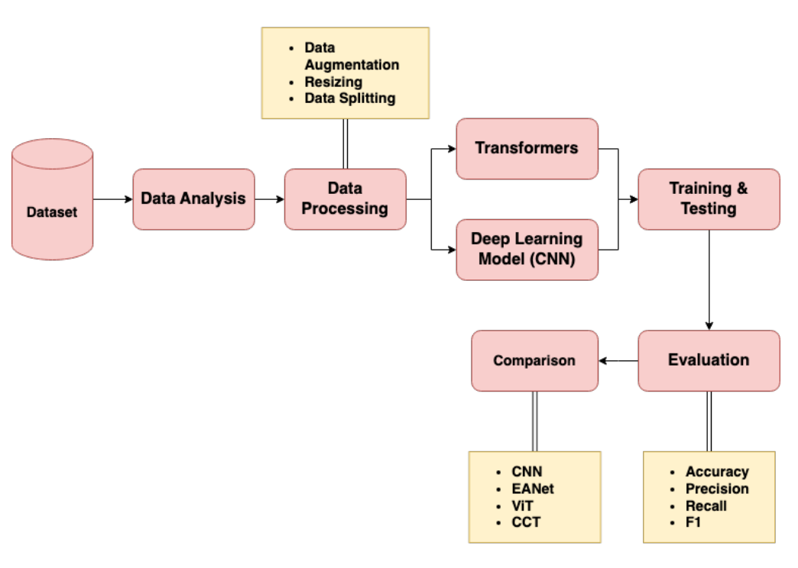
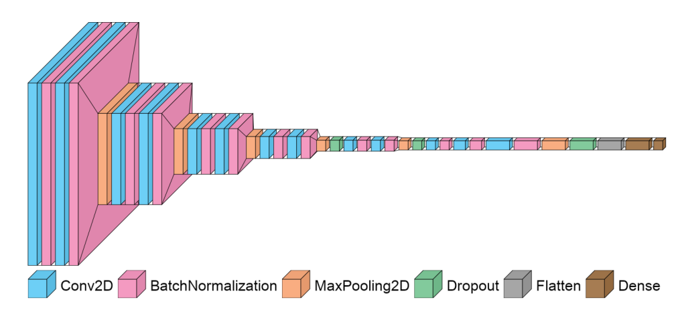
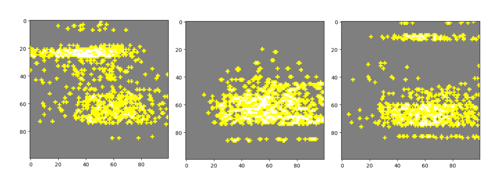
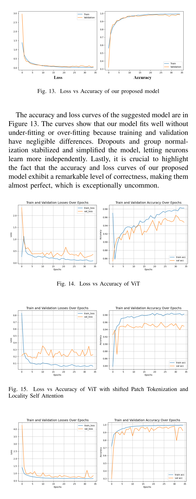
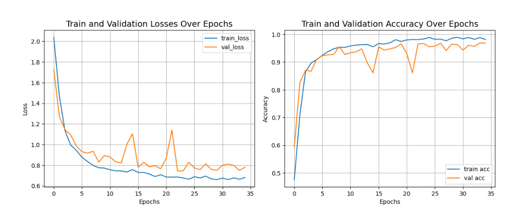
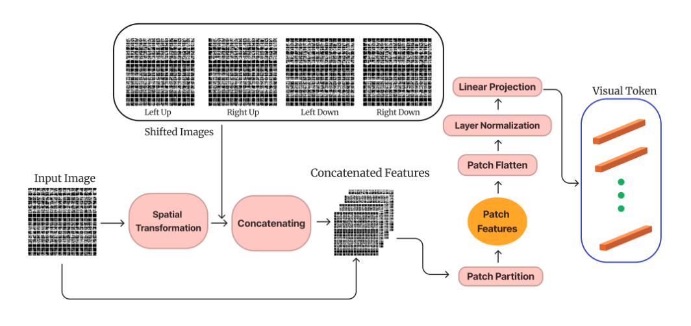

# Review Paper

## CNN vs Transformer Variants: Malware Classification Using Binary Malware Images

### Penulis & Tahun

Mohammad Muhibur Rahman, Anushua Ahmed, Mutasim Husain Khan, Mohammad Rakibul Hasan Mahin, Fahmid Bin Kibria, Dewan Ziaul Karim, dan Mohammad Kaykobad (**2023**).

### Judul Penelitian

*CNN vs Transformer Variants: Malware Classification Using Binary Malware Images*

### Nama Jurnal / Conference

Paper konferensi pada **2023 IEEE International Conference on Communication, Networks and Satellite (COMNETSAT)**, halaman 308-315. Paper ini bukan artikel jurnal.

DOI: `10.1109/COMNETSAT59769.2023.10420585`

### Dataset

Penelitian menggunakan **Malimg Dataset**, yaitu dataset citra malware grayscale yang dibentuk dari representasi kode biner malware.

- 9.339 citra awal;
- 25 kategori atau keluarga malware;
- citra diubah menjadi ukuran 100 x 100 piksel untuk model CNN;
- setelah augmentasi, data menjadi 12.560 citra;
- pembagian data: 72% training, 14% validation, dan 14% testing;
- augmentasi yang digunakan antara lain horizontal flip.

*Gambar 1. Contoh citra dari beberapa kelas Malimg Dataset.*

### Metode / Model

Penelitian membandingkan model CNN dengan beberapa varian Transformer.

**Model CNN:**

- CNN yang diusulkan;
- InceptionV3;
- ResNet50;
- DenseNet-201;
- VGG16.

**Model Transformer:**

- Vision Transformer (ViT);
- ViT dengan Shifted Patch Tokenization dan Locality Self-Attention;
- Compact Convolutional Transformer (CCT);
- External Attention Network (EANet).

Model CNN yang diusulkan dilatih selama 35 epoch menggunakan batch size 32, optimizer Adam, dan learning rate 0,0001. Untuk menjelaskan keputusan model, penulis menggunakan metode Explainable AI **LIME**.

*Gambar 2. Ilustrasi arsitektur CNN yang diusulkan.*

Alur utama penelitian adalah mengubah malware biner menjadi citra grayscale, melakukan preprocessing dan augmentasi, melatih model CNN dan Transformer, kemudian membandingkan hasil klasifikasi menggunakan accuracy, recall, precision, loss, dan F1-score.

### Hasil Utama

Model CNN yang diusulkan memperoleh performa terbaik pada dataset Malimg.

| Model                        |         Accuracy |           Recall |        Precision |             Loss |         F1-score |           Parameter |
| ---------------------------- | ---------------: | ---------------: | ---------------: | ---------------: | ---------------: | ------------------: |
| InceptionV3                  |           76,02% |           74,62% |           77,59% |           0,8684 |           76,08% |          21.854.009 |
| ResNet50                     |           92,83% |           92,36% |           92,56% |           0,2834 |           92,46% |          24.406.937 |
| DenseNet-201                 |           86,94% |           87,29% |           87,29% |           0,7894 |           87,29% |          18.754.009 |
| VGG16                        |           94,11% |           94,27% |           94,27% |           0,2291 |           94,27% |          14.829.913 |
| **CNN yang diusulkan** | **99,44%** | **99,44%** | **99,44%** | **0,0228** | **99,44%** | **2.143.553** |

Perbandingan dengan model Transformer:

| Model                                                      |         Accuracy |           Parameter |
| ---------------------------------------------------------- | ---------------: | ------------------: |
| ViT                                                        |           95,93% |          21.682.144 |
| ViT + Shifted Patch Tokenization + Locality Self-Attention |           95,18% |          18.033.696 |
| CCT                                                        |           97,43% |             410.842 |
| EANet                                                      |           96,79% |             500.128 |
| **CNN yang diusulkan**                               | **99,44%** | **2.143.553** |

Hasil tersebut menunjukkan bahwa CNN yang diusulkan mengungguli seluruh model pembanding. Selain memiliki accuracy paling tinggi, model tersebut juga mempunyai jumlah parameter yang jauh lebih rendah dibandingkan sebagian besar model CNN dan ViT.

LIME digunakan untuk menunjukkan area citra yang paling berpengaruh terhadap keputusan klasifikasi. Pada contoh yang dianalisis, area berwarna biru menunjukkan bagian yang paling mendukung keputusan model, sedangkan area abu-abu menunjukkan bagian yang dianggap kurang relevan.

*Gambar 3. Contoh hasil prediksi dan visualisasi LIME pada paper asli.*

*Gambar 4. Grafik loss dan accuracy training-validation.*

*Gambar 5. Tabel hasil pengujian model CNN.*

*Gambar 6. Tabel perbandingan accuracy dan jumlah parameter CNN-Transformer.*

### Keterbatasan

1. Penelitian hanya menggunakan Malimg Dataset sehingga kemampuan generalisasi ke dataset lain belum dapat dipastikan.
2. Dataset yang digunakan berupa citra grayscale dan belum menguji citra malware RGB seperti MaleVis.
3. Penelitian belum membandingkan CNN dengan arsitektur visual modern seperti Vision Mamba.
4. Evaluasi efisiensi masih berfokus pada jumlah parameter; training time, inference time, penggunaan GPU, dan konsumsi energi belum dibahas secara mendalam.
5. Augmentasi dapat membuat data training dan testing memiliki kemiripan pola sehingga validasi lintas-dataset tetap diperlukan.
6. Perbedaan konfigurasi input dan hyperparameter antararsitektur dapat memengaruhi fairness perbandingan.
7. Dataset malware dapat berubah seiring munculnya varian baru sehingga hasil pada dataset lama belum tentu langsung berlaku untuk malware terbaru.

## Kesimpulan Review

Paper ini menunjukkan bahwa CNN masih menjadi pendekatan yang sangat kuat untuk klasifikasi citra malware. CNN yang diusulkan memperoleh accuracy 99,44% dengan hanya 2.143.553 parameter, lebih baik daripada ViT, CCT, EANet, dan beberapa CNN populer pada pengujian Malimg.

Kontribusi penting paper ini adalah perbandingan langsung CNN dan Transformer pada citra malware serta penggunaan LIME untuk membantu interpretasi model. Namun, hasil penelitian masih perlu diuji pada dataset lain, terutama dataset RGB, dan dibandingkan dengan arsitektur baru seperti Vision Mamba.

## Gambar dari Paper Asli

Folder `IMAGE` dikosongkan terlebih dahulu. Gambar, grafik, atau tabel dari paper akan ditambahkan kemudian hanya apabila diperlukan untuk memperjelas pembahasan review.

## Sumber

1. Rahman, M. M., Ahmed, A., Khan, M. H., Mahin, M. R. H., Kibria, F. B., Karim, D. Z., & Kaykobad, M. (2023). *CNN vs Transformer Variants: Malware Classification Using Binary Malware Images*. 2023 IEEE International Conference on Communication, Networks and Satellite (COMNETSAT), 308-315. https://doi.org/10.1109/COMNETSAT59769.2023.10420585
2. ResearchGate: [CNN vs Transformer Variants: Malware Classification Using Binary Malware Images](https://www.researchgate.net/publication/378044907_CNN_vs_Transformer_Variants_Malware_Classification_Using_Binary_Malware_Images)
