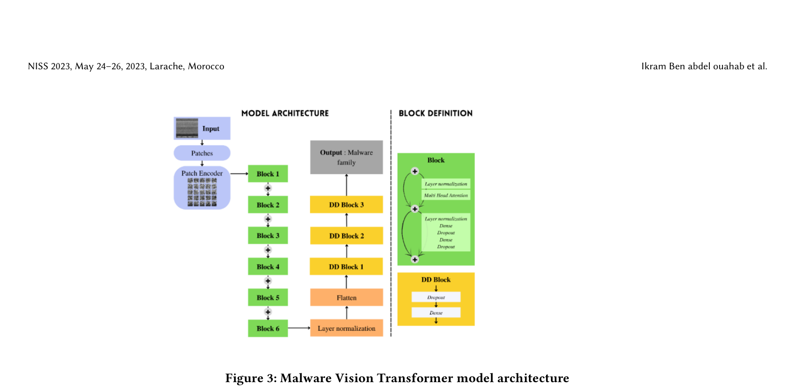
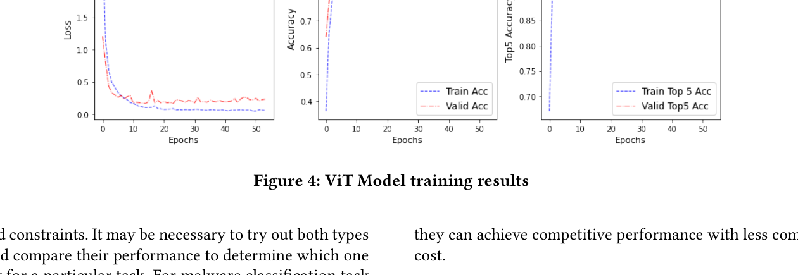

# Review Paper

## Enhancing Malware Classification with Vision Transformers: A Comparative Study with Traditional CNN Models

### Identitas paper

- **Penulis:** Ikram Ben Abdel Ouahab, Lotfi Elaachak, dan Mohammed Bouhorma.
- **Tahun:** 2023.
- **Publikasi:** *Proceedings of the 6th International Conference on Networking, Intelligent Systems & Security (NISS 2023)*, Article 57, halaman 1–5. Diterbitkan ACM pada 13 November 2023.
- **DOI:** [10.1145/3607720.3607781](https://doi.org/10.1145/3607720.3607781).

### Tujuan penelitian

Penelitian memperkenalkan MalwareViT untuk klasifikasi keluarga malware melalui visualisasi malware sebagai citra, lalu membandingkan hasilnya dengan CNN dan metode KNN+GIST yang dirujuk penulis. Paper juga menyatakan mengeksplorasi representasi input, konfigurasi model, dan strategi pelatihan.

### Dataset dan evaluasi

Eksperimen menggunakan **Malimg**, dengan **25 kelas** dan citra malware berukuran input **64 × 64 × 3**. Paper mengutip basis data Malimg yang berisi 9.369 citra. Metrik yang disajikan dalam tabel hasil adalah accuracy dan loss. Artikel tidak menjelaskan secara memadai pembagian data train/validation/test, jumlah sampel per split, metode perhitungan loss, ataupun prosedur replikasi CNN, sehingga angka performa tidak dapat dianggap sebagai perbandingan yang sepenuhnya terkontrol.

### Metode atau arsitektur model

Model usulan dinamai **MalwareViT**. Citra malware dipotong menjadi patch berukuran 11 × 11; untuk input 64 × 64, tabel konfigurasi menyebut 25 patch dan projection dimension 36. Arsitektur memiliki 8 transformer layers dengan 4 attention heads, transformer units [72, 36], serta MLP head [2048, 1024]. Konfigurasi eksperimen lain mencakup learning rate 0,001, weight decay 0,0001, batch size 256, maksimum 100 epoch, dan patience 30. Uraian arsitektur menyebut enam blok ViT dan tiga blok Dense/Dropout pada head, yang tidak konsisten sepenuhnya dengan angka delapan transformer layers pada tabel konfigurasi.

Sebagai pembanding, penulis membuat classifier CNN sendiri. Paper juga mencantumkan hasil KNN+GIST dari referensi terkait.

*Gambar 1. Arsitektur MalwareViT, Fig. 3 pada Ben Abdel Ouahab et al. (2023). Gambar diekstrak dari PDF paper.*

*Gambar 2. Hasil training/validation yang ditampilkan penulis, Fig. 4 pada Ben Abdel Ouahab et al. (2023). Gambar diekstrak dari PDF paper.*

### Domain penelitian

**Cybersecurity dan computer vision**, khususnya klasifikasi keluarga malware dari representasi citra biner menggunakan Vision Transformer.

### Hasil utama

Tabel 2 paper melaporkan hasil berikut:

| Model | Accuracy | Loss |
|---|---:|---:|
| MalwareViT (ViT) | 98,38% | 0,0517 |
| CNN | 97,90% | 0,1229 |
| KNN+GIST | 97,37% | −0,1627* |

\* Paper memberi catatan bahwa angka KNN+GIST adalah negative log loss. Karena nilainya tercantum negatif dan definisi/penghitungannya tidak dijelaskan lebih lanjut, angka loss tersebut perlu dikutip apa adanya dan tidak ditafsirkan sebagai skala yang langsung sebanding dengan dua baris lainnya.

Penulis menyatakan ViT memperoleh accuracy lebih tinggi pada eksperimen ini. Abstrak juga mengklaim robustness dan interpretability lebih baik, tetapi tabel hasil yang ditampilkan tidak menyediakan metrik robustness atau evaluasi interpretability yang mendukung klaim tersebut.

### Analisis kontribusi model

Kontribusi paper adalah penerapan ViT pada citra malware Malimg dan perbandingan eksperimen dengan CNN. Hasil 98,38% versus 97,90% menunjukkan selisih accuracy 0,48 poin persentase pada konfigurasi yang dilaporkan. Karena rincian split dan kontrol eksperimen terbatas, hasil ini lebih tepat diperlakukan sebagai hasil yang dilaporkan paper, bukan bukti bahwa ViT secara umum selalu mengungguli CNN.

### Kelebihan

1. Menguji secara langsung ViT dan CNN untuk klasifikasi citra malware.
2. Menggunakan Malimg dengan klasifikasi multiclass 25 kelas.
3. Memberikan konfigurasi penting ViT, termasuk ukuran input, patch, projection dimension, attention heads, dan jumlah epoch.
4. Menyertakan grafik proses training/validation dan diagram arsitektur model.
5. Relevan sebagai penelitian terdahulu untuk penggunaan ViT pada klasifikasi malware berbasis citra.

### Keterbatasan

1. Evaluasi hanya dilaporkan pada Malimg; paper tidak mengevaluasi MaleVis RGB.
2. Walaupun input ditulis sebagai tiga kanal, paper tidak cukup menjelaskan apakah citra asli Malimg yang grayscale direplikasi ke RGB atau diproses dengan cara lain.
3. Prosedur pembagian dataset, validasi, dan pengujian tidak dilaporkan secara rinci, sehingga potensi kebocoran data atau variasi split tidak dapat dinilai dari artikel.
4. Rincian konfigurasi CNN dan kesetaraan proses tuning dengan ViT terbatas.
5. Terdapat ketidakselarasan antara uraian enam blok ViT dan tabel yang menyebut delapan transformer layers.
6. Klaim robustness dan interpretability tidak didukung metrik atau eksperimen khusus pada hasil yang ditampilkan.
7. Artikel singkat (5 halaman) dan tidak membandingkan ViT dengan Vision Mamba.
8. Angka loss KNN+GIST dilaporkan negatif tanpa penjelasan rumus yang cukup, sehingga tidak mudah dibandingkan dengan loss model lainnya.

### Kesimpulan review

Paper ini relevan sebagai referensi penerapan Vision Transformer untuk klasifikasi citra malware dan memberikan hasil accuracy yang lebih tinggi daripada CNN pada eksperimen Malimg yang dilaporkan. Namun, rincian protokol evaluasi dan beberapa bagian arsitektur kurang konsisten, sedangkan robustness dan interpretability tidak diuji secara eksplisit melalui metrik khusus. Paper ini bukan perbandingan ViT dengan Vision Mamba dan bukan evaluasi MaleVis RGB, sehingga hasilnya tidak dapat dibandingkan langsung dengan eksperimen tesis tanpa menyamakan dataset, preprocessing, pembagian data, dan prosedur training.

### Sumber

1. Ben Abdel Ouahab, I., Elaachak, L., & Bouhorma, M. (2023). *Enhancing Malware Classification with Vision Transformers: A Comparative Study with Traditional CNN Models*. **Proceedings of the 6th International Conference on Networking, Intelligent Systems & Security (NISS 2023)**, Article 57, 1–5. [Halaman artikel ACM](https://dl.acm.org/doi/10.1145/3607720.3607781) · [DOI](https://doi.org/10.1145/3607720.3607781).
2. [PDF artikel ACM](https://dl.acm.org/doi/epdf/10.1145/3607720.3607781).
