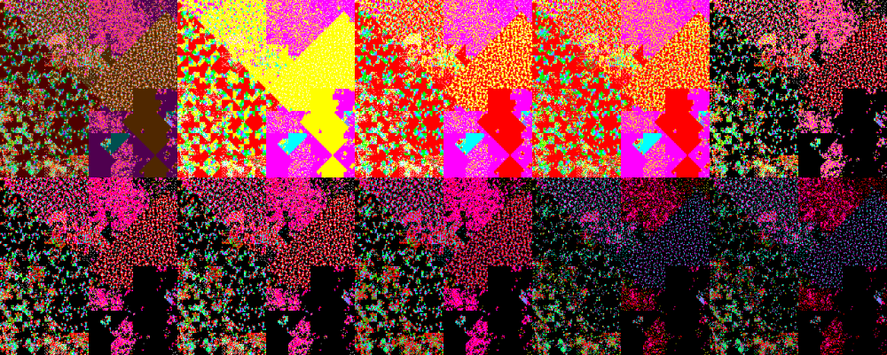
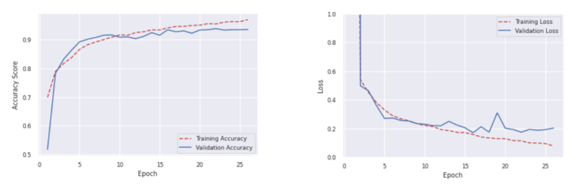

# Review Paper

## Image-Based Malware Detection Using α-Cuts and Binary Visualisation

### Identitas paper

- **Penulis:** Betty Saridou, Isidoros Moulas, Stavros Shiaeles, dan Basil Papadopoulos.
- **Tahun:** 2023.
- **Publikasi:** *Applied Sciences*, 13(7), artikel 4624.
- **DOI:** [10.3390/app13074624](https://doi.org/10.3390/app13074624).
- **Sumber:** [Halaman artikel MDPI](https://www.mdpi.com/2076-3417/13/7/4624) · [PDF artikel](https://www.mdpi.com/2076-3417/13/7/4624/pdf).

### Tujuan penelitian

Penelitian menguji apakah segmentasi warna dengan α-cut dapat memperbaiki representasi citra hasil visualisasi biner malware sekaligus menjadikannya lebih sparse. Penulis mengevaluasi apakah citra sparse tersebut masih menyimpan informasi yang cukup untuk membedakan berkas berbahaya dan benign menggunakan CNN.

### Dataset dan evaluasi

Penulis membangun citra dari berkas kode malware dan benign; dataset eksperimen berisi 1.250, 2.500, 5.000, atau 10.000 citra dengan kelas seimbang 50:50. Citra berukuran 256 × 256 dibuat dengan pemetaan H-curve dan skema pewarnaan ASCII. Paper tidak menyebut dataset standar seperti MaleVis atau Malimg sebagai sumber eksperimen.

Setiap eksperimen membagi data menjadi 80% latih, 10% validasi, dan 10% uji. Evaluasi menggunakan accuracy, precision, recall, F-score, dan kurva belajar. Perbandingan mencakup citra tanpa α-cut serta hasil α = 0,3 dan α = 0,6, beberapa skema pewarnaan, dan empat ukuran dataset.

*Gambar 1. Citra malware dan hasil pemrosesan α-cut pada nilai 0,1–0,9; Fig. 6 dari Saridou et al. (2023), diekstrak dari PDF paper.*

### Metode atau arsitektur model

Tahap visualisasi memetakan byte berkas ke citra RGB 256 × 256 menggunakan H-curve, lalu mengelompokkan nilai ASCII dan menyesuaikan nada warna melalui fuzzy inference system. Nilai tiap kanal R, G, dan B diperlakukan sebagai fuzzy set. α-cut mengubah setiap nilai kanal menjadi 1 jika memenuhi ambang α dan menjadi 0 jika di bawahnya, sehingga setiap piksel menjadi salah satu dari delapan kombinasi biner RGB.

Klasifikasi biner dilakukan dengan ResNet50 yang dilatih dari awal tanpa transfer learning. Model dihiperparametrisasi pada batch size, optimizer, dan learning rate; paper melaporkan konfigurasi terbaik menggunakan batch 32, stochastic gradient descent, dan learning rate 0,1.

### Domain penelitian

Keamanan siber dan pemrosesan citra, khususnya deteksi biner berkas malware melalui visualisasi biner dan CNN. Paper juga membahas potensi penggunaan representasi tersebut dalam sistem deteksi intrusi.

### Hasil utama

- Pada skema pewarnaan yang diusulkan dengan 10.000 citra dan tanpa α-cut, hasilnya 93,89% accuracy, 96,40% precision, 91,20% recall, dan 93,73% F-score.
- Dengan α = 0,3 pada 10.000 citra, hasilnya 92,90% accuracy, 93,86% precision, 91,80% recall, dan 92,82% F-score.
- Dengan α = 0,6 pada 10.000 citra, hasilnya 93,60% accuracy, 94,48% precision, 92,60% recall, dan 93,53% F-score.
- Model α = 0,6 pada dataset 10.000 citra menunjukkan kurva belajar yang dinilai penulis lebih stabil. Namun, skor accuracy-nya sedikit di bawah model tanpa pemrosesan α-cut.

*Gambar 2. Kurva accuracy dan loss pelatihan/validasi untuk ResNet50 pada dataset 10.000 citra dengan α = 0,6; Fig. 8 dari Saridou et al. (2023), diekstrak dari PDF paper.*

### Analisis kontribusi model

Kontribusi penelitian terletak pada penggunaan α-cut sebagai tahap pemrosesan untuk visualisasi citra malware: kanal warna RGB dibinerkan sehingga terbentuk matriks sparse, lalu diuji dalam klasifikasi ResNet50. Hasilnya memperlihatkan bahwa konfigurasi tertentu yang diproses α-cut tetap menghasilkan performa yang kompetitif dan kurva belajar yang lebih stabil menurut pengamatan paper. Penelitian ini tidak menguji Vision Transformer atau Vision Mamba.

### Kelebihan

1. Membandingkan beberapa ukuran dataset, skema pewarnaan, dan dua nilai α-cut.
2. Melaporkan precision, recall, F-score, serta kurva belajar di samping accuracy.
3. Menjelaskan proses visualisasi, pemetaan H-curve, dan transformasi kanal RGB.
4. Menguji deteksi malware versus benign, bukan hanya klasifikasi keluarga malware.

### Keterbatasan

1. Eksperimen terbatas pada α = 0,3 dan α = 0,6 serta fuzzy set linear; penulis menyebut biaya dan waktu komputasi membatasi cakupan pengujian.
2. Dataset berupa citra sintetis yang dibuat dari berkas, bukan dataset citra malware standar seperti MaleVis; hasilnya tidak langsung mewakili klasifikasi MaleVis RGB.
3. Paper menyatakan satu berkas dapat menjadi beberapa citra, dan perubahan kecil pada urutan byte dapat mengubah pola visual.
4. Representasi sparse dibahas sebagai potensi efisiensi, tetapi eksperimen tidak menggunakan algoritma atau struktur data khusus untuk mempercepat operasi sparse.
5. Model yang diuji hanya ResNet50, sehingga hasilnya tidak memberi perbandingan dengan ViT maupun Vision Mamba.

### Kesimpulan review

Paper ini memberi contoh penelitian yang menggabungkan visualisasi biner malware, pemrosesan kanal RGB dengan α-cut, dan klasifikasi CNN. Hasil menunjukkan α-cut 0,6 pada dataset terbesar dapat mempertahankan performa yang mendekati citra tanpa pemrosesan dan menghasilkan kurva belajar yang dinilai lebih stabil. Karena datasetnya disusun sendiri dari berkas malware/benign dan modelnya ResNet50, hasilnya merupakan konteks metodologis, bukan hasil pembanding langsung untuk eksperimen MaleVis RGB atau perbandingan ViT dan Vision Mamba.

### Sumber

Saridou, B., Moulas, I., Shiaeles, S., & Papadopoulos, B. (2023). *Image-Based Malware Detection Using α-Cuts and Binary Visualisation*. **Applied Sciences, 13**(7), 4624. [Artikel](https://www.mdpi.com/2076-3417/13/7/4624) · [PDF](https://www.mdpi.com/2076-3417/13/7/4624/pdf) · [DOI](https://doi.org/10.3390/app13074624).
