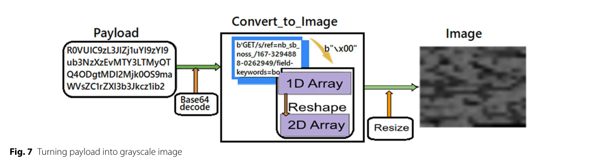
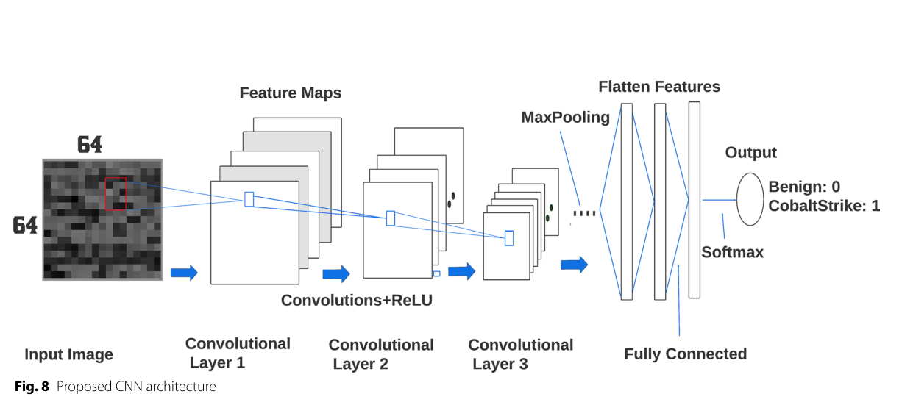
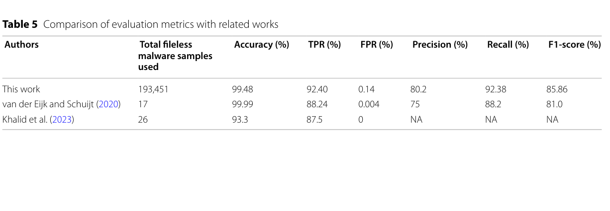

# Review Paper

## Machine Learning Based Fileless Malware Traffic Classification Using Image Visualization

### Identitas paper

- **Penulis:** Fikirte Ayalke Demmese, Ajaya Neupane, Sajad Khorsandroo, May Wang, Kaushik Roy, dan Yu Fu.
- **Tahun:** 2023.
- **Publikasi:** *Cybersecurity*, volume 6, artikel 32.
- **DOI:** [10.1186/s42400-023-00170-z](https://doi.org/10.1186/s42400-023-00170-z).
- **Sumber:** [Artikel Springer](https://link.springer.com/article/10.1186/s42400-023-00170-z) | [PDF Springer](https://link.springer.com/content/pdf/10.1186/s42400-023-00170-z.pdf).

### Tujuan penelitian

Penelitian ini menguji penggunaan visualisasi citra dan CNN untuk mendeteksi lalu lintas jaringan fileless malware. Fokus eksperimennya adalah beacon Cobalt Strike yang berkomunikasi melalui HTTP; sesi benign dibandingkan dengan sesi yang memuat lalu lintas berbahaya.

### Dataset dan evaluasi

Data berasal dari infrastruktur riset Palo Alto Networks. Data benign awalnya mencakup lebih dari 3,6 juta sesi jaringan enterprise selama satu minggu. Setelah deduplikasi berdasarkan hostname dan URI path, 567.620 sesi digunakan untuk pelatihan. Data berbahaya terdiri atas 6.271 sesi Cobalt Strike hasil simulasi; penulis mengacak urutan field header HTTP untuk augmentasi hingga menjadi 188.130 sampel pelatihan. Rasio kelas pelatihan yang dilaporkan adalah 75:25.

Pengujian menggunakan 859.885 sesi benign dan 5.321 sampel berbahaya dari Wildfire, APT di lapangan, pelanggan Palo Alto Networks, dan profil Cobalt Strike publik. Evaluasi melaporkan accuracy, precision, recall/TPR, FPR, dan F1. Karena kelas benign sangat dominan pada test set, accuracy perlu dibaca bersama metrik untuk kelas malware.

*Gambar 1. Alur konversi payload menjadi citra grayscale; Fig. 7 pada paper.*

*Gambar 2. Arsitektur CNN untuk klasifikasi sesi benign dan Cobalt Strike; Fig. 8 pada paper.*

*Gambar 3. Perbandingan metrik evaluasi dengan penelitian terdahulu; Table 5 pada paper.*

### Metode atau arsitektur model

Payload HTTP beacon yang dikodekan Base64 didekode menjadi byte. Nilai byte dipetakan ke array satu dimensi, diubah menjadi array dua dimensi, lalu di-zero-pad dan diubah ukurannya menjadi citra grayscale 64 × 64 menggunakan interpolasi. Citra menjadi masukan CNN dengan tiga lapisan konvolusi, ReLU, batch normalization, dan max pooling. Fitur hasil konvolusi diratakan, diteruskan ke lapisan fully connected dengan dropout 0,4, lalu diklasifikasikan menggunakan softmax. Pelatihan menggunakan Adam dan batch size 32. Model memiliki sekitar 51,99 juta parameter.

### Domain penelitian

Keamanan jaringan dan deteksi lalu lintas fileless malware melalui visualisasi payload. Input yang divisualisasikan adalah payload komunikasi jaringan Cobalt Strike, bukan citra dari berkas executable malware.

### Hasil utama

- Pada evaluasi yang dilaporkan, model mencapai accuracy 99,48%, precision 80,2%, recall 92,38%, dan F1 85,86%.
- Dari 5.321 sampel berbahaya pada test set, 4.916 terdeteksi; rata-rata TPR yang dilaporkan adalah 92,38%.
- Untuk 859.885 sampel benign, 1.214 ditandai sebagai berbahaya; FPR yang dilaporkan 0,14%.
- Nilai accuracy tinggi perlu ditafsirkan bersama precision, recall, F1, dan ketimpangan jumlah kelas pada test set.

### Analisis kontribusi model

Kontribusi utamanya adalah penerapan pipeline payload-ke-citra grayscale dan CNN pada deteksi lalu lintas fileless malware. Eksperimen menggunakan lalu lintas Cobalt Strike serta sampel pengujian dari beberapa sumber, sehingga memberi contoh penggunaan visualisasi untuk analisis trafik jaringan. Tugasnya berbeda dari klasifikasi keluarga malware berdasarkan citra biner berkas; hasil metriknya karena itu tidak setara langsung dengan hasil pada tugas dan dataset tersebut.

### Kelebihan

1. Menguraikan pipeline dari payload HTTP hingga citra grayscale dan prediksi CNN.
2. Menggunakan sampel uji berbahaya dari beberapa sumber serta melaporkan metrik per sumber.
3. Menyajikan precision, recall, F1, dan FPR selain accuracy.
4. Menguji augmentasi dengan pengacakan susunan field header HTTP dan membahas pengaruh ketidakseimbangan kelas.

### Keterbatasan

1. Sampel berbahaya berlabel sulit diperoleh; jumlah dan variasi data membatasi cakupan evaluasi.
2. Data malicious pelatihan diperluas melalui permutasi urutan header, sehingga variasi tersebut belum tentu mewakili seluruh perubahan trafik atau keluarga fileless malware.
3. Evaluasi berfokus pada beacon Cobalt Strike melalui HTTP; kinerja pada protokol, pola serangan, atau malware fileless lain belum dibuktikan.
4. CNN memerlukan masukan berukuran tetap. Penyesuaian payload jaringan yang panjangnya bervariasi dapat menyebabkan kehilangan atau distorsi informasi.
5. Penulis tidak melakukan cross-validation berulang karena biaya komputasi; data dan infrastruktur produksi yang dipakai juga membatasi reproduksibilitas independen.
6. Ketimpangan test set yang besar membuat accuracy kurang informatif jika disajikan tanpa precision, recall, F1, dan FPR.

### Kesimpulan review

Paper ini menunjukkan pipeline visualisasi payload jaringan sebagai citra grayscale yang diproses CNN untuk mendeteksi beacon Cobalt Strike. Hasilnya melaporkan recall 92,38% dan F1 85,86%, di samping accuracy 99,48%. Angka-angka tersebut perlu dibaca dalam konteks ketimpangan test set dan ruang lingkup evaluasi yang berpusat pada Cobalt Strike HTTP; generalisasi ke protokol dan jenis fileless malware lain masih belum ditunjukkan.

### Sumber

Demmese, F. A., Neupane, A., Khorsandroo, S., Wang, M., Roy, K., & Fu, Y. (2023). *Machine learning based fileless malware traffic classification using image visualization*. **Cybersecurity, 6**, 32. [Artikel](https://link.springer.com/article/10.1186/s42400-023-00170-z) | [PDF](https://link.springer.com/content/pdf/10.1186/s42400-023-00170-z.pdf) | [DOI](https://doi.org/10.1186/s42400-023-00170-z).
