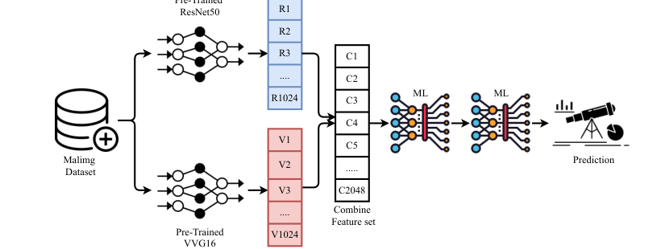
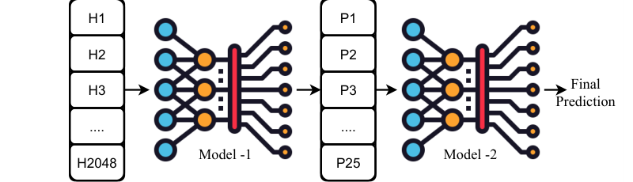
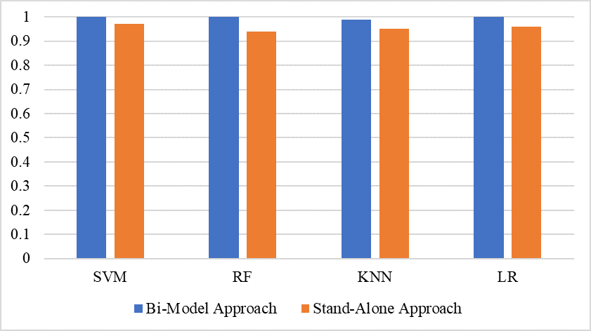

# Review Paper

## Malware Detection Using Image Representation of Malware Data and Transfer Learning

### Identitas paper

- **Penulis:** Furqan Rustam, Imran Ashraf, Anca Delia Jurcut, Ali Kashif Bashir, dan Yousaf Bin Zikria.
- **Tahun:** 2023.
- **Publikasi:** *Journal of Parallel and Distributed Computing*, volume 172, hlm. 32–50.
- **DOI:** [10.1016/j.jpdc.2022.10.001](https://doi.org/10.1016/j.jpdc.2022.10.001).
- **Sumber:** [ScienceDirect](https://www.sciencedirect.com/science/article/abs/pii/S0743731522002118) · [Naskah di repositori MMU](https://repository.mmu.ac.uk/articles/journal_contribution/Malware_detection_using_image_representation_of_malware_data_and_transfer_learning/32469534?file=65039667) · [PDF](https://repository.mmu.ac.uk/ndownloader/files/65039667).

### Tujuan penelitian

Penelitian mengembangkan pendekatan klasifikasi keluarga malware menggunakan transfer learning untuk mengekstrak fitur citra, lalu mengklasifikasikannya dengan machine learning. Penulis mengusulkan **Bi-model**, yaitu skema bertingkat yang melatih model kedua menggunakan probabilitas keluaran model pertama.

### Dataset dan evaluasi

Penelitian menggunakan **Malimg**, yang berisi citra grayscale dari 25 keluarga/varian malware dengan jumlah sampel tidak seimbang. Sampel malware biner direpresentasikan sebagai citra; studi ini tidak menggunakan MaleVis.

Eksperimen menggunakan pembagian train/test **80:20**. Penulis juga melakukan **10-fold cross-validation** untuk mengevaluasi Bi-model. Metrik yang dilaporkan meliputi accuracy, precision, recall, F1-score, simpangan baku pada cross-validation, waktu pelatihan, dan uji t untuk perbandingan.

*Gambar 1. Alur pendekatan dari citra Malimg melalui ResNet50 dan VGG16, penggabungan fitur, lalu Bi-model, Fig. 1 Rustam et al. (2023). Diekstrak dari PDF paper.*

### Metode atau arsitektur model

VGG16 (ditulis **VVG-16** dalam naskah) dan ResNet-50 pralatih digunakan secara terpisah untuk mengekstrak fitur dari citra grayscale. Masing-masing menghasilkan 1.024 fitur; keduanya digabungkan menjadi hybrid feature set berukuran 2.048.

Fitur gabungan diproses oleh empat classifier: Support Vector Classifier (SVC), Random Forest (RF), K-Nearest Neighbors (KNN), dan Logistic Regression (LR). Dalam Bi-model, model pertama memetakan fitur gabungan ke probabilitas 25 kelas; model kedua dari keluarga classifier yang sama menggunakan probabilitas itu untuk menghasilkan prediksi akhir.

*Gambar 2. Model pertama menghasilkan fitur probabilitas untuk classifier kedua, Fig. 5 Rustam et al. (2023). Diekstrak dari PDF paper.*

### Domain penelitian

**Keamanan siber dan klasifikasi citra**, khususnya klasifikasi keluarga malware dari citra grayscale berbasis byte dengan transfer learning dan classifier machine learning.

### Hasil utama

- Pada eksperimen 25 kelas Malimg, **Bi-SVC, Bi-RF, dan Bi-LR mencapai akurasi 100%**; **Bi-KNN mencapai 99%**.
- Pada 10-fold cross-validation, Bi-SVC, Bi-RF, dan Bi-LR dilaporkan memiliki mean accuracy 1,00 dengan simpangan baku 0,00; Bi-KNN memiliki mean 0,99 dengan SD 0,01.
- Bi-model meningkatkan hasil dibandingkan classifier tunggal pada pengaturan yang diuji, tetapi waktu pelatihannya lebih tinggi karena dua tahap klasifikasi dijalankan berurutan.

*Gambar 3. Perbandingan Bi-model dengan pendekatan single-model untuk SVM, RF, KNN, dan LR, Fig. 6 Rustam et al. (2023). Diekstrak dari PDF paper.*

### Analisis kontribusi model

Kontribusi utama paper adalah menggabungkan fitur visual dari dua backbone CNN pralatih, lalu mengompres representasi gabungan menjadi vektor probabilitas kelas melalui tahap pertama sebelum klasifikasi tahap kedua. Model yang diusulkan bukan Vision Transformer atau Vision Mamba; kedua backbone utamanya adalah CNN dan classifier akhirnya adalah SVC/RF/KNN/LR.

### Kelebihan

1. Menguji pendekatan pada klasifikasi multi-kelas 25 varian Malimg.
2. Membandingkan fitur VGG16, ResNet-50, dan fitur gabungannya.
3. Melaporkan hasil dengan pembagian data serta 10-fold cross-validation.
4. Mengukur selain accuracy, termasuk precision, recall, F1-score, simpangan baku, waktu, dan uji t.
5. Memaparkan peningkatan performa beserta biaya waktu tambahan dari skema bertingkat.

### Keterbatasan

1. Evaluasi utama hanya menggunakan Malimg; paper tidak menguji MaleVis atau dataset eksternal lain.
2. Input berupa citra grayscale, bukan citra RGB MaleVis.
3. Tidak mengevaluasi ViT atau Vision Mamba dan tidak menyediakan perbandingan langsung antara keduanya.
4. Hasil 100% berlaku pada dataset dan protokol Malimg yang digunakan; belum membuktikan generalisasi ke malware baru atau dataset lain.
5. Penulis menyebut biaya komputasi Bi-model lebih tinggi daripada model tunggal dan mengusulkan optimasi waktu serta penambahan sampel malware yang lebih baru sebagai pekerjaan lanjutan.

### Kesimpulan review

Paper ini relevan sebagai penelitian transfer learning dan klasifikasi multi-kelas malware berbasis citra, serta sebagai pembanding pendekatan CNN dengan classifier klasik. Namun, hasilnya menggunakan Malimg grayscale dan tidak mencakup Vision Transformer, Vision Mamba, atau MaleVis RGB. Karena itu, akurasi paper menjadi konteks literatur, bukan pembanding langsung untuk eksperimen tesis yang menggunakan MaleVis RGB dan mengadu ViT dengan Vision Mamba.

### Sumber

1. Rustam, F., Ashraf, I., Jurcut, A. D., Bashir, A. K., & Zikria, Y. B. (2023). *Malware detection using image representation of malware data and transfer learning*. **Journal of Parallel and Distributed Computing, 172**, 32–50. [DOI](https://doi.org/10.1016/j.jpdc.2022.10.001) · [ScienceDirect](https://www.sciencedirect.com/science/article/abs/pii/S0743731522002118) · [PDF repositori MMU](https://repository.mmu.ac.uk/ndownloader/files/65039667).
