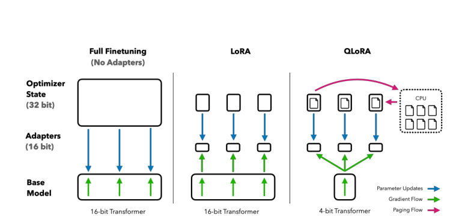
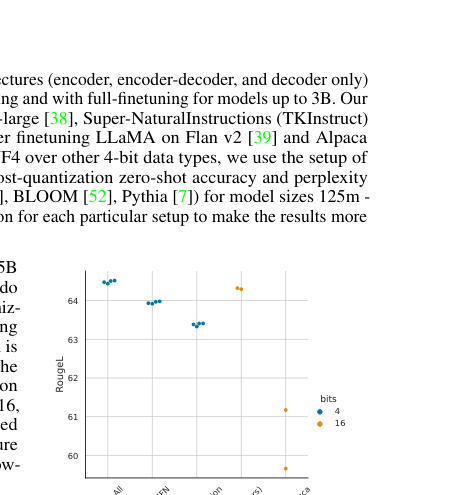
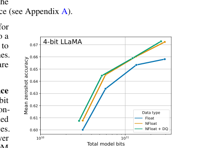
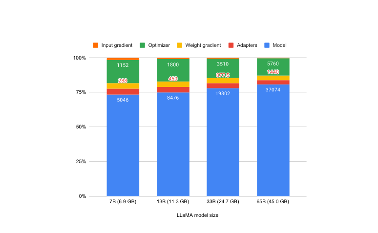

# Review Paper

### Identitas paper

#### Penulis & Tahun

Tim Dettmers, Artidoro Pagnoni, Ari Holtzman, dan Luke Zettlemoyer (**2023**).

#### Judul Penelitian

*QLoRA: Efficient Finetuning of Quantized LLMs*

#### Nama Conference

Paper ini dipublikasikan pada **Advances in Neural Information Processing Systems (NeurIPS 2023)**. Versi awal tersedia sebagai preprint arXiv pada tahun 2023.

DOI: `10.52202/075280-0441`.

### Tujuan penelitian

QLoRA dikembangkan untuk mengurangi kebutuhan memori saat melakukan fine-tuning Large Language Model berukuran besar, dengan tetap mempertahankan performa yang mendekati fine-tuning 16-bit penuh.

### Dataset dan evaluasi

Penelitian mengevaluasi QLoRA pada lebih dari 1.000 model menggunakan delapan instruction datasets, beberapa tipe model seperti LLaMA dan T5, serta ukuran model yang berbeda.

Evaluasi mencakup:

- instruction following;
- chatbot performance;
- language modeling;
- zero-shot accuracy;
- human evaluation;
- GPT-4 evaluation.

Model hasil fine-tuning, yang disebut **Guanaco**, dievaluasi menggunakan Vicuna benchmark dan beberapa tugas zero-shot.

### Metode atau arsitektur model

QLoRA menggabungkan tiga komponen utama:

1. **4-bit NormalFloat (NF4)** untuk merepresentasikan bobot model secara efisien.
2. **Double Quantization** untuk mengurangi memori yang digunakan oleh konstanta quantization.
3. **Paged Optimizers** untuk mengelola memory spike selama training.

QLoRA mempertahankan pretrained language model dalam kondisi frozen dan terkuantisasi 4-bit. Gradien kemudian mengalir menuju **Low-Rank Adapters (LoRA)** yang menjadi satu-satunya parameter yang dilatih.

Alur kerja QLoRA adalah:

1. Pretrained LLM dikuantisasi ke format 4-bit NF4.
2. Bobot dasar model dibekukan.
3. LoRA adapters ditambahkan pada layer Transformer.
4. Training hanya memperbarui parameter adapter.
5. Paged optimizer mengatur penggunaan memori ketika terjadi lonjakan kebutuhan GPU.

### Domain penelitian

Domain penelitian ini adalah **Natural Language Processing (NLP)**. QLoRA digunakan untuk fine-tuning model bahasa pada tugas:

- instruction following;
- dialogue generation;
- chatbot;
- language modeling;
- text generation.

### Hasil utama

QLoRA memungkinkan fine-tuning model 65B parameter pada satu GPU 48GB dengan performa yang mendekati fine-tuning 16-bit penuh.

Model Guanaco mencapai sekitar **99,3% performa ChatGPT** pada Vicuna benchmark berdasarkan evaluasi yang dilaporkan paper.

Eksperimen juga menunjukkan bahwa NF4 memberikan performa lebih baik dibandingkan beberapa format 4-bit lain, sementara Double Quantization membantu mengurangi memory footprint tanpa penurunan performa yang berarti.

### Analisis kontribusi model

Kontribusi utama QLoRA adalah:

- memungkinkan fine-tuning LLM besar dengan memori terbatas;
- menggabungkan quantization 4-bit dengan LoRA;
- memperkenalkan NF4 yang sesuai untuk distribusi bobot normal;
- menggunakan Double Quantization untuk mengurangi overhead memori;
- menggunakan Paged Optimizer untuk mengelola memory spike.

### Kelebihan

- Mengurangi kebutuhan GPU secara signifikan.
- Mempertahankan performa mendekati full fine-tuning.
- Dapat digunakan pada model LLM berukuran besar.
- Membuka peluang fine-tuning LLM pada perangkat atau lingkungan dengan sumber daya terbatas.
- Menyediakan implementasi dan model yang dapat digunakan kembali.

### Keterbatasan

- Training tetap memerlukan GPU dengan kapasitas besar untuk model berukuran sangat besar.
- Quantization dapat memengaruhi stabilitas dan kualitas pada tugas tertentu.
- LoRA adapter tidak selalu mampu merepresentasikan seluruh perubahan yang diperlukan oleh setiap domain.
- Evaluasi chatbot dapat dipengaruhi oleh keterbatasan benchmark dan bias penilaian otomatis.

### Kesimpulan review

QLoRA menunjukkan bahwa fine-tuning LLM berukuran besar dapat dilakukan secara lebih hemat memori dengan menggabungkan quantization 4-bit, NF4, Double Quantization, Paged Optimizer, dan Low-Rank Adapter. Pendekatan ini menjaga pretrained model tetap frozen dan hanya melatih parameter adapter, sehingga jumlah parameter serta kebutuhan memori dapat ditekan.

Hasil eksperimen memperlihatkan bahwa QLoRA mampu mempertahankan performa yang mendekati fine-tuning 16-bit penuh, termasuk pada model berukuran 65B parameter. Secara metodologis, QLoRA menjadi dasar penting bagi penerapan Parameter-Efficient Fine-Tuning pada LLM, meskipun pemilihan quantization, adapter, dataset, dan konfigurasi training tetap memengaruhi kualitas akhir model.

### Sumber

1. Dettmers, T., Pagnoni, A., Holtzman, A., & Zettlemoyer, L. (2023). *QLoRA: Efficient Finetuning of Quantized LLMs*. **NeurIPS 2023**. https://doi.org/10.52202/075280-0441
2. [Halaman paper NeurIPS](https://proceedings.neurips.cc/paper_files/paper/2023/hash/1feb87871436031bdc0f2beaa62a049b-Abstract-Conference.html)
3. [PDF paper](https://arxiv.org/pdf/2305.14314)
