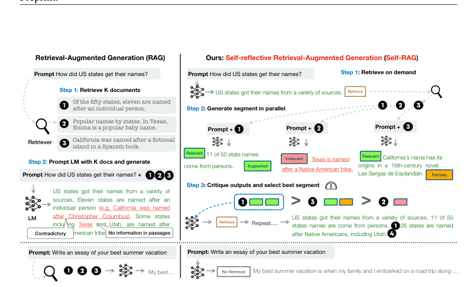
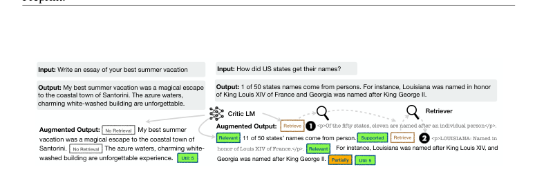
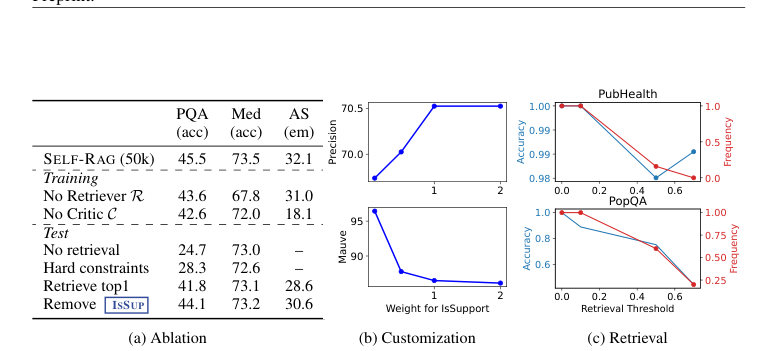
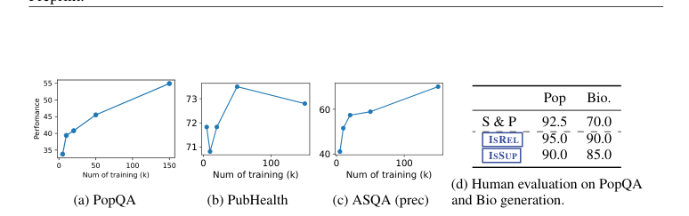

# Review Paper

## Self-RAG: Learning to Retrieve, Generate, and Critique through Self-Reflection

### Penulis & Tahun

Akari Asai, Zeqiu Wu, Yizhong Wang, Avirup Sil, dan Hannaneh Hajishirzi (**2023**; diterbitkan pada ICLR 2024).

### Judul Penelitian

*Self-RAG: Learning to Retrieve, Generate, and Critique through Self-Reflection*

### Nama Conference

Paper ini dipublikasikan sebagai paper conference pada **International Conference on Learning Representations (ICLR 2024)**. Versi awal tersedia sebagai preprint arXiv pada tahun 2023.

DOI/ID: `arXiv:2310.11511`.

### Tujuan Penelitian

Penelitian ini mengatasi dua masalah pada RAG konvensional: sistem selalu melakukan retrieval meskipun informasi tambahan tidak diperlukan, dan LLM tidak selalu mampu menilai apakah dokumen hasil retrieval mendukung jawabannya.

### Dataset dan Evaluasi

SELF-RAG dievaluasi pada beberapa tugas knowledge-intensive NLP, termasuk:

- open-domain Question Answering;
- reasoning;
- fact verification;
- long-form generation;
- citation accuracy dan factuality.

Eksperimen dilakukan menggunakan model SELF-RAG berukuran 7B dan 13B serta dibandingkan dengan LLM dan sistem RAG lainnya.

### Metode / Model

SELF-RAG melatih satu language model agar dapat melakukan retrieval, generation, dan self-critique secara adaptif.

Model menggunakan **reflection tokens** yang memandu proses inference. Token tersebut mencakup:

- **Retrieve**: menentukan apakah model perlu mengambil dokumen eksternal;
- **IsRelevant**: menilai relevansi dokumen yang diambil;
- **IsSupported**: menilai apakah keluaran didukung oleh dokumen;
- **IsUseful**: menilai kegunaan jawaban secara keseluruhan;
- **Critique**: memberikan sinyal evaluasi terhadap keluaran model.

Alur inference SELF-RAG adalah:

1. Model menerima pertanyaan dan konteks generasi sebelumnya.
2. Model menentukan apakah retrieval diperlukan.
3. Retriever mengambil beberapa passage jika diperlukan.
4. Model menilai relevansi passage dan menghasilkan kandidat jawaban.
5. Reflection tokens digunakan untuk mengkritik dukungan fakta dan kegunaan jawaban.
6. Kandidat terbaik dipilih berdasarkan sinyal refleksi dan kebutuhan tugas.

### Proses Training

Data training SELF-RAG diperkaya dengan reflection tokens. Model dilatih untuk memprediksi keluaran tugas sekaligus token retrieval dan critique.

Pada proses training, passage hasil retrieval tidak dihitung sebagai target prediksi utama. Model diarahkan untuk mempelajari kapan harus melakukan retrieval, bagaimana menilai evidence, dan bagaimana menghasilkan jawaban yang didukung sumber.

### Tugas NLP

Paper ini berfokus pada:

- Retrieval-Augmented Generation;
- open-domain Question Answering;
- factuality assessment;
- fact verification;
- long-form text generation;
- citation-aware generation.

### Hasil Utama

SELF-RAG 7B dan 13B dilaporkan mengungguli berbagai baseline pada open-domain QA, reasoning, dan fact verification. Model juga meningkatkan factuality serta citation accuracy pada long-form generation dibandingkan LLM dan sistem RAG pembanding.

Keunggulan utama SELF-RAG berasal dari kemampuan retrieval on-demand dan reflection tokens yang memungkinkan model menyesuaikan perilaku generation dengan kebutuhan tugas.

### Analisis Kontribusi Model

Kontribusi utama SELF-RAG adalah:

- retrieval yang dilakukan hanya ketika dibutuhkan;
- penilaian relevansi passage secara internal;
- self-critique terhadap factuality dan dukungan evidence;
- kontrol inference melalui reflection tokens;
- kemampuan menyesuaikan trade-off antara frekuensi retrieval dan kualitas jawaban.

### Kelebihan

- Mengurangi retrieval yang tidak diperlukan.
- Meningkatkan factuality dan citation accuracy.
- Mengintegrasikan retrieval dan self-reflection dalam satu model.
- Dapat dikustomisasi berdasarkan kebutuhan kualitas atau efisiensi.
- Diuji pada berbagai tugas knowledge-intensive NLP.

### Keterbatasan

- Training memerlukan data reflection dan proses anotasi atau supervision tambahan.
- Penggunaan retriever tetap memengaruhi kualitas evidence yang tersedia.
- Reflection tokens dapat menambah kompleksitas decoding dan inference.
- Biaya training dan penyimpanan model tetap besar untuk model berukuran 7B atau 13B.

### Kesimpulan Review

SELF-RAG mengembangkan RAG adaptif dengan melatih language model untuk menentukan kapan retrieval diperlukan, menilai relevansi evidence, dan mengkritik keluaran yang dihasilkan. Reflection tokens berfungsi sebagai mekanisme kontrol yang menghubungkan retrieval, factuality assessment, dan generation dalam satu proses inference.

Hasil eksperimen menunjukkan peningkatan pada open-domain Question Answering, reasoning, fact verification, factuality, dan citation accuracy. Kontribusi metodologis paper ini terletak pada pengurangan retrieval yang tidak perlu serta kemampuan model menyesuaikan proses generasi berdasarkan kualitas evidence. Tantangan utamanya adalah kebutuhan training khusus, biaya komputasi, dan ketergantungan terhadap kualitas retriever.

### Sumber

1. Asai, A., Wu, Z., Wang, Y., Sil, A., & Hajishirzi, H. (2023/2024). *Self-RAG: Learning to Retrieve, Generate, and Critique through Self-Reflection*. **ICLR 2024**. https://arxiv.org/abs/2310.11511
2. [Paper dan PDF](https://openreview.net/pdf?id=hSyW5go0v8)
3. [Kode dan model SELF-RAG](https://selfrag.github.io/)
