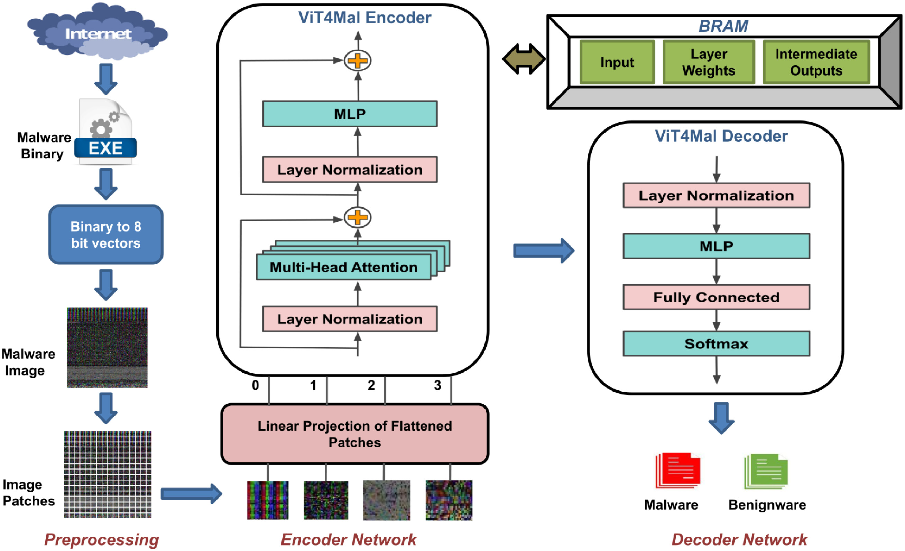
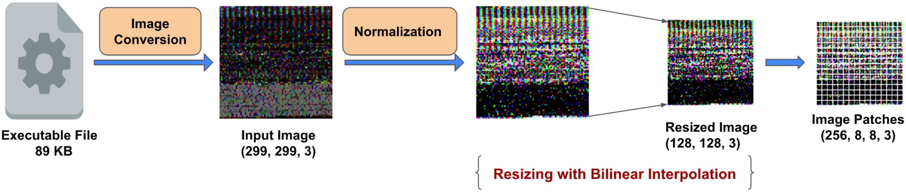

# Review Paper

## ViT4Mal: Lightweight Vision Transformer for Malware Detection on Edge Devices

### Identitas paper

- **Penulis:** Akshara Ravi, Vivek Chaturvedi, dan Muhammad Shafique.
- **Tahun:** 2023.
- **Publikasi:** *ACM Transactions on Embedded Computing Systems*, Volume 22, Issue 5s, Article 117, 26 halaman.
- **DOI:** [10.1145/3609112](https://doi.org/10.1145/3609112).

### Tujuan penelitian

Penelitian ini mengembangkan ViT4Mal, sistem deteksi malware berbasis citra yang dapat dijalankan pada perangkat edge dengan sumber daya terbatas. Penulis mengevaluasi kinerja ViT dibanding CNN dan mengoptimalkan model agar encoder ViT dapat diimplementasikan pada FPGA.

### Dataset dan evaluasi

Paper menggunakan tiga kumpulan data untuk eksperimen yang berbeda:

- **Dataset motivasional:** 1.773 ELF berbahaya dari VirusShare dan 1.423 executable benign Linux. Digunakan untuk membandingkan metode ekstraksi fitur statis, bukan eksperimen utama ViT.
- **IMG_DS (IoT Android malware dataset):** 14.733 sampel benign dan 2.486 sampel malicious pada awalnya. Sampel benign diaugmentasi menjadi 14.733, sehingga dataset eksperimen berjumlah 29.466 citra RGB berukuran 299 × 299 piksel. Dataset ini dipakai untuk klasifikasi biner dan evaluasi utama ViT4Mal.
- **IoTPOT:** 124.799 executable yang dikumpulkan pada 2020–2022, mencakup beberapa arsitektur seperti ARM, MIPS, PowerPC, x86, dan SPARC. Dipakai untuk eksperimen lintas arsitektur; paper juga menambahkan sampel benign dari repositori GitHub dan dataset sebelumnya, lalu mengaugmentasi sampel benign karena jumlah awalnya terbatas.

Evaluasi meliputi accuracy, precision, recall, F1-score, false-positive rate, false-negative rate, waktu prediksi, latensi, konsumsi energi, serta penggunaan sumber daya FPGA. Untuk perbandingan CPU dengan CNN, penulis melatih model pada IMG_DS selama 50 epoch; eksperimen ViT lain memakai 100 epoch. Laporan tidak merinci jumlah train/test yang sama untuk semua pengujian, sehingga angka dari eksperimen berbeda tidak selalu dapat dibandingkan langsung.

### Metode atau arsitektur model

Bytecode executable diubah menjadi citra RGB: byte disusun menjadi citra persegi dengan zero-padding, nilai grayscale yang sama disalin ke tiga kanal RGB, citra dinormalisasi, diubah ukurannya, lalu dipotong menjadi patch sebagai token ViT. Implementasi awal menggunakan input 128 × 128 × 3 dan patch 8 × 8 × 3. Encoder memakai patch embedding, positional embedding yang dapat dipelajari, transformer blocks dengan multi-head self-attention, MLP, layer normalization, dan residual connection. Keluaran encoder diratakan dan diproses oleh MLP dengan softmax untuk klasifikasi benign/malicious.

Model dibandingkan dengan CNN ResNet-50, InceptionV3, dan IMCFN. Untuk deployment, encoder dijalankan pada FPGA Xilinx PYNQ Z1; preprocessing dan decoder dijalankan di luar FPGA. Optimasi meliputi kuantisasi, pengurangan jumlah encoder/head, loop pipelining, dan array partitioning.

*Gambar 1. Arsitektur ViT4Mal yang diusulkan, Fig. 5 pada Ravi et al. (2023). Gambar asli dari PDF paper.*

*Gambar 2. Alur preprocessing, Fig. 6 pada Ravi et al. (2023). Gambar asli dari PDF paper.*

### Domain penelitian

**Cybersecurity, computer vision, dan embedded/edge computing**, khususnya klasifikasi malware dari visualisasi bytecode menggunakan Vision Transformer ringan.

### Hasil utama

- Pada IMG_DS, ViT4Mal dengan 8 encoder dan 4 attention head mencapai **97,66% accuracy**; IMCFN mencapai 97,35%. Untuk perbandingan ini, ViT4Mal melaporkan **98% precision, 98% recall, F1-score 98%, 35.951.305 parameter, dan waktu prediksi 0,76 detik**, sedangkan IMCFN memiliki 134.362.969 parameter dan waktu prediksi 0,81 detik.
- Pada uji lintas arsitektur IoTPOT, akurasi yang dilaporkan adalah **97,18%** ketika training dan testing mencakup semua arsitektur; **97,6%** ketika training/testing dibatasi pada ARM, MIPS, dan x86; serta **97,86%** saat training pada MIPS dan testing pada x86. Nilai FPR/FNR masing-masing konfigurasi juga dilaporkan dalam tabel paper.
- Pada FPGA, model terpilih dengan **2 encoder dan 4 head** mencapai **93,89% accuracy**, **1,48 detik** inferensi, dan **2,77 joule** pada test set IMG_DS berisi 5.894 citra. Penulis melaporkan speedup **41× dibanding ViT original** yang membutuhkan 60 detik pada setup pembanding.
- Konfigurasi dengan 1 encoder dan 2 head lebih cepat (0,81 detik), tetapi akurasinya 92,41%; penulis memilih dua encoder dan empat head sebagai kompromi akurasi dan latensi.

### Analisis kontribusi model

Kontribusi utama paper adalah evaluasi penggunaan ViT untuk klasifikasi citra malware IoT serta implementasi encoder pada FPGA dengan sumber daya terbatas. Paper menguji pengurangan kedalaman encoder dan optimasi hardware, bukan hanya melaporkan akurasi model di CPU. Citra RGB di sini dibentuk dengan menyalin nilai grayscale bytecode yang sama ke ketiga kanal; representasi tersebut berbeda dari citra RGB semantik atau tiga kanal fitur assembly yang digunakan penelitian lain.

### Kelebihan

1. Menguji model pada CPU dan perangkat FPGA dengan keterbatasan memori dan komputasi.
2. Menyertakan perbandingan dengan beberapa CNN serta IMCFN pada dataset yang sama.
3. Melaporkan trade-off jumlah encoder, akurasi, latensi, energi, dan penggunaan resource FPGA.
4. Mengevaluasi generalisasi lintas arsitektur executable IoT melalui eksperimen IoTPOT.
5. Menjelaskan pipeline konversi bytecode ke citra dan implementasi hardware.

### Keterbatasan

1. Dataset utama IMG_DS adalah dataset IoT Android dengan klasifikasi biner, bukan MaleVis dan bukan klasifikasi keluarga malware multiclass seperti dalam tesis.
2. Walaupun citra disimpan sebagai RGB, ketiga kanal dibuat dengan menyalin nilai grayscale byte yang sama; hasilnya tidak merepresentasikan tiga sumber fitur warna yang berbeda.
3. Dataset benign pada IMG_DS diaugmentasi untuk menyeimbangkan jumlah kelas. IoTPOT juga memerlukan penambahan dan augmentasi sampel benign karena ketersediaannya terbatas; hal ini membatasi penilaian generalisasi pada distribusi kelas asli.
4. Eksperimen FPGA memakai board PYNQ Z1 untuk mensimulasikan perangkat edge, bukan deployment pada beragam perangkat IoT produksi.
5. Paper membandingkan ViT dengan CNN dan tidak menguji Vision Mamba. Pengaturan dataset, preprocessing, pembagian data, dan perangkatnya juga tidak sebanding langsung dengan eksperimen tesis yang memakai MaleVis RGB.
6. Waktu CPU, FPGA, dan speedup berasal dari konfigurasi/implementasi berbeda; angka tersebut perlu dikutip bersama konteks perangkat dan konfigurasi masing-masing.

### Kesimpulan review

ViT4Mal relevan sebagai penelitian terdahulu tentang Vision Transformer untuk deteksi malware berbasis citra serta optimasi inferensi pada edge/FPGA. Paper menunjukkan kinerja kompetitif pada dataset IoT Android dan menguji klasifikasi lintas arsitektur executable. Namun, ia bukan bukti perbandingan langsung antara ViT dan Vision Mamba pada MaleVis RGB: tugas utamanya biner, sumber citranya adalah bytecode executable yang direplikasi menjadi kanal RGB, dan evaluasi tidak menggunakan MaleVis.

### Sumber

1. Ravi, A., Chaturvedi, V., & Shafique, M. (2023). *ViT4Mal: Lightweight Vision Transformer for Malware Detection on Edge Devices*. **ACM Transactions on Embedded Computing Systems, 22**(5s), Article 117. [Halaman artikel ACM](https://dl.acm.org/doi/10.1145/3609112) · [DOI](https://doi.org/10.1145/3609112).
2. [PDF artikel ACM](https://dl.acm.org/doi/epdf/10.1145/3609112).
