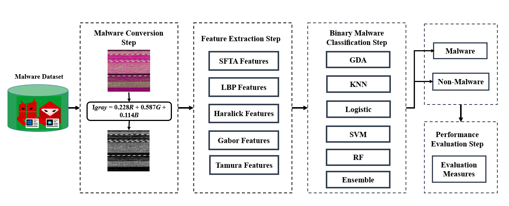
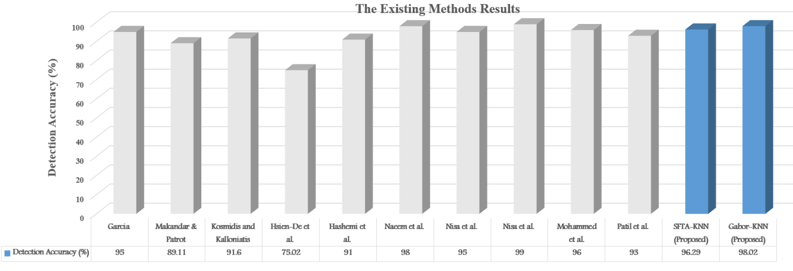

# Review Paper

## A Comparative Performance Analysis of Malware Detection Algorithms Based on Various Texture Features and Classifiers

### Identitas paper

- **Penulis:** Ismail Taha Ahmed, Baraa Tareq Hammad, dan Norziana Jamil.
- **Tahun:** 2024.
- **Publikasi:** *IEEE Access*, volume 12, hlm. 11500–11519.
- **DOI:** [10.1109/ACCESS.2024.3354959](https://doi.org/10.1109/ACCESS.2024.3354959).
- **Sumber:** [Halaman publikasi UAEU](https://research.uaeu.ac.ae/en/publications/a-comparative-performance-analysis-of-malware-detection-algorithm/) · [ResearchGate](https://www.researchgate.net/publication/377448099_A_Comparative_Performance_Analysis_of_Malware_Detection_Algorithms_Based_on_Various_Texture_Features_and_Classifiers).

### Tujuan penelitian

Penelitian membandingkan lima descriptor tekstur dan enam classifier untuk mencari kombinasi yang efektif dalam deteksi malware berbasis visualisasi citra. Fokusnya mencakup pengaruh fitur, classifier, dan keseimbangan dataset terhadap performa serta ukuran vektor fitur.

### Dataset dan evaluasi

Studi menggunakan dua dataset:

- **Malimg:** 9.339 citra grayscale dari 25 keluarga malware; dataset tidak seimbang. Paper juga menjelaskan penambahan 350 berkas benign dari MaleVis untuk eksperimen deteksi biner.
- **MaleVis:** 14.226 citra dari 25 keluarga malware dan satu kelas cleanware. Penulis menyebut 9.100 sampel seimbang dengan 350 citra per kelas; resolusi citra berkisar dari 224 × 224 hingga 300 × 300. Paper menyebut citra MaleVis sebagai RGB byte images, tetapi metode yang diusulkan mengonversi citra RGB ke grayscale sebelum ekstraksi fitur.

Lima descriptor yang diuji adalah SFTA, Local Binary Pattern (LBP), Haralick, Gabor, dan Tamura. Enam classifier ialah Gaussian Discriminant Analysis (GDA), K-Nearest Neighbors (KNN), Logistic, Support Vector Machine (SVM), Random Forest (RF), dan Extreme Learning Machine/ensemble (ELM). Metrik yang dilaporkan meliputi accuracy, error, precision, recall, dan F1. Metode evaluasi menyebut 10-fold cross-validation; bagian deskripsi dataset MaleVis juga menyebut pembagian 9.100 training dan 5.126 testing. Hubungan antara pembagian tersebut dan prosedur 10-fold tidak dijelaskan secara rinci dalam naskah.

*Gambar 1. Alur metode perbandingan dan deteksi yang diusulkan, Fig. 5 Ahmed et al. (2024). Diekstrak dari PDF paper.*

### Metode atau arsitektur model

Metode mengonversi representasi malware menjadi grayscale, menghitung descriptor tekstur, lalu memberikan vektor fitur kepada classifier. SFTA menghasilkan vektor berukuran 1 × 21, sedangkan kombinasi fitur yang diusulkan dalam pembahasan menghasilkan vektor ringkas 1 × 12. Paper tidak menggunakan CNN, Vision Transformer, atau Vision Mamba sebagai classifier utama.

*Gambar 2. Perbandingan akurasi beberapa metode handcrafted dan metode usulan, Fig. 14 Ahmed et al. (2024). Diekstrak dari PDF paper.*

### Domain penelitian

**Keamanan siber dan analisis citra**, khususnya deteksi malware biner menggunakan fitur tekstur handcrafted dan machine learning klasik. Walaupun MaleVis termasuk dataset yang digunakan, penelitian ini bukan studi klasifikasi citra RGB berbasis ViT atau Mamba.

### Hasil utama

- Pada **Malimg**, KNN menjadi classifier terbaik menurut penulis pada ukuran accuracy, error, F1, dan precision; SVM berada di urutan berikutnya. SFTA menunjukkan hasil terbaik di antara descriptor Malimg. Kombinasi SFTA-KNN mencapai akurasi **96,29%**.
- Pada **MaleVis**, KNN juga unggul menurut penulis pada ukuran yang dilaporkan; Gabor memberi hasil fitur terbaik. Kombinasi Gabor-KNN mencapai akurasi **98,02%**.
- Nilai tersebut berasal dari tugas deteksi **biner** malware versus cleanware/benign, sebagaimana dijelaskan untuk MaleVis, bukan evaluasi multi-kelas keluarga malware dengan ViT/Mamba.

### Analisis kontribusi model

Kontribusi paper adalah perbandingan sistematis fitur tekstur klasik dan classifier, bukan arsitektur deep learning baru. Penggunaan Malimg dan MaleVis membuatnya berguna untuk memahami pengaruh dataset seimbang dan representasi visual. Hasilnya memberi konteks pada penggunaan MaleVis, tetapi tidak menjadi baseline langsung bagi eksperimen ViT versus Vision Mamba karena fitur, classifier, preprocessing, dan tugas klasifikasinya berbeda.

### Kelebihan

1. Membandingkan lima fitur tekstur dan enam classifier pada dua dataset dengan karakteristik keseimbangan berbeda.
2. Mengevaluasi beberapa metrik selain accuracy, termasuk precision, recall, F1, dan error.
3. Melaporkan kombinasi metode dengan dimensi fitur yang relatif ringkas.
4. Menyertakan hasil pada MaleVis dan Malimg, sehingga perbedaan dataset dapat dibahas.

### Keterbatasan

1. Pipeline mengubah citra RGB menjadi grayscale, sehingga informasi warna RGB tidak dipertahankan.
2. MaleVis dievaluasi sebagai deteksi biner, bukan klasifikasi multi-kelas malware seperti pembagian keluarga.
3. Penelitian menggunakan fitur handcrafted dan classifier klasik; tidak membandingkan CNN, ViT, atau Mamba.
4. Pelaporan protokol MaleVis menyebut baik train/test 9.100/5.126 maupun 10-fold cross-validation, tetapi hubungan keduanya tidak diperinci.
5. Perbedaan dataset, representasi grayscale, tugas biner, dan protokol membuat angka akurasi tidak bisa dibandingkan langsung dengan eksperimen klasifikasi RGB multi-kelas.

### Kesimpulan review

Paper ini relevan sebagai penelitian terdahulu yang menggunakan MaleVis dan Malimg serta membandingkan metode klasifikasi malware berbasis fitur tekstur. Nilai utamanya bagi tesis adalah konteks dataset dan baseline machine learning klasik. Paper ini tidak menjawab perbandingan Vision Mamba dengan Vision Transformer, dan hasil MaleVis-nya merupakan deteksi biner berbasis grayscale, bukan klasifikasi keluarga malware berbasis citra RGB.

### Sumber

1. Ahmed, I. T., Hammad, B. T., & Jamil, N. (2024). *A Comparative Performance Analysis of Malware Detection Algorithms Based on Various Texture Features and Classifiers*. **IEEE Access, 12**, 11500–11519. [DOI](https://doi.org/10.1109/ACCESS.2024.3354959) · [UAEU publication record](https://research.uaeu.ac.ae/en/publications/a-comparative-performance-analysis-of-malware-detection-algorithm/) · [ResearchGate](https://www.researchgate.net/publication/377448099_A_Comparative_Performance_Analysis_of_Malware_Detection_Algorithms_Based_on_Various_Texture_Features_and_Classifiers).

