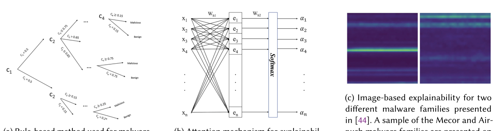
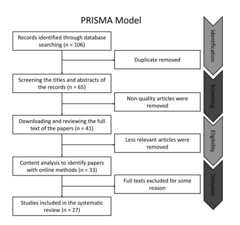

# Review Paper

## A Comprehensive Analysis of Explainable AI for Malware Hunting

### Identitas paper

- **Penulis:** Mohd Saqib, Samaneh Mahdavifar, Benjamin C. M. Fung, dan Philippe Charland.
- **Tahun:** 2024.
- **Publikasi:** *ACM Computing Surveys*, 56(12), Article 314, 40 halaman.
- **DOI:** [10.1145/3677374](https://doi.org/10.1145/3677374).
- **Sumber:** [Halaman ACM](https://dl.acm.org/doi/10.1145/3677374) · [PDF ACM](https://dl.acm.org/doi/epdf/10.1145/3677374).

### Tujuan penelitian

Paper ini meninjau penggunaan Explainable AI (XAI) untuk analisis dan deteksi malware. Penulis memetakan metode XAI yang dipakai, jenis data dan fitur yang dijelaskan, cara mengukur mutu penjelasan, serta risiko dan tantangan seperti serangan adversarial. Paper juga mengusulkan kerangka tingkat explainability untuk mengelompokkan kedalaman informasi yang diberikan kepada analis.

### Dataset dan evaluasi

Paper merupakan survei, bukan eksperimen klasifikasi baru. Penulis menyatakan menyeleksi 27 artikel untuk evaluasi XAI dan merangkum sejumlah penelitian lain tentang deteksi malware. Dataset dalam studi primer beragam, antara lain Drebin, Malimg, EMBER, serta dataset malware dan trafik jaringan lainnya.

Tabel paper menggabungkan metrik klasifikasi seperti accuracy, precision, recall, dan F1 dengan penilaian explainability seperti fidelity, robustness, expressiveness, sparsity, completeness, consistency, dan evaluasi manual. Nilai klasifikasi berasal dari studi primer yang berbeda; penulis secara eksplisit menyarankan kehati-hatian karena hasil bergantung pada dataset dan setup eksperimen. Banyak studi yang ditinjau tidak mengevaluasi penjelasannya dengan metrik XAI yang terstandar.

*Gambar 1. Ragam metode XAI yang dibahas untuk explainable malware detection; Fig. 6 pada paper.*

*Gambar 2. Diagram proses pencarian dan penyaringan literatur; Fig. 8 pada paper.*

### Metode atau arsitektur model

Survei mencakup model deteksi seperti CNN untuk citra grayscale atau berwarna, MLP/DNN, RNN, transformer, model berbasis graf, dan model gabungan. Metode penjelasan yang dibahas mencakup attention, SHAP, LIME, Grad-CAM, LEMNA, EIGER, aturan, serta penjelas berbasis subgraf seperti GAGE dan CFGExplainer. Tingkat explainability yang diusulkan mengelompokkan keluaran dari heatmap atau byte/pixel, fitur statis, perilaku dinamis, hingga penjelasan graf dan instruksi yang lebih rinci.

### Domain penelitian

Keamanan siber, analisis malware, dan explainable artificial intelligence. Cakupan data termasuk PE/Windows dan APK/Android, fitur statis maupun dinamis, citra malware, urutan API/opcode, trafik jaringan, dan graf alur kontrol.

### Hasil utama

- Metode XAI untuk malware menggunakan beragam bentuk penjelasan: fitur penting, heatmap/pixel, aturan, urutan kejadian, dan subgraf.
- Penulis menyimpulkan tidak ada korelasi konsisten antara skor klasifikasi tinggi dan tingkat explainability.
- Evaluasi explainability belum seragam; banyak studi memakai penilaian manual atau tidak mengukur mutu penjelasan secara eksplisit.
- XAI dapat memperluas permukaan serangan: perubahan adversarial berpotensi memengaruhi prediksi sekaligus menyesatkan penjelasan.
- Penulis membahas kebutuhan data multimodal, privasi/federated learning, integrasi NLP, serta evaluasi yang lebih kuat sebagai arah lanjutan.

### Analisis kontribusi model

Kontribusi utamanya adalah taksonomi dan kerangka analisis XAI untuk malware, bukan arsitektur klasifikasi baru. Bagian citra membahas CNN serta penjelasan berbasis attention, gradien, pixel, dan heatmap. Paper juga mengutip Malimg dan studi visual malware, sehingga relevan sebagai sumber tentang interpretabilitas pada klasifikasi malware berbasis citra. Namun, paper tidak menguji MaleVis RGB secara khusus dan tidak membandingkan Vision Transformer dengan Vision Mamba.

### Kelebihan

1. Menghubungkan explainability dengan kebutuhan operasional analis malware, bukan hanya skor klasifikasi.
2. Mencakup penjelasan berbasis fitur, citra, urutan, dan graf.
3. Membahas metrik explainability dan kerentanan adversarial pada penjelas.
4. Menawarkan tingkat explainability yang membantu membedakan penjelasan permukaan dari penjelasan perilaku atau kode yang lebih mendalam.

### Keterbatasan

1. Bukti kuantitatif dirangkum dari dataset, model, dan protokol yang berbeda, sehingga angka performa tidak dapat dibandingkan langsung.
2. Penulis mencatat evaluasi XAI belum terstandar dan banyak studi yang tidak mengukur mutu penjelasan dengan metrik formal.
3. Proses seleksi menyebut 27 artikel, tetapi pencarian dilakukan melalui beberapa sumber dan tahap revisi; alur awal tidak mencakup fase revisi kedua.
4. Fokus paper adalah explainability lintas metode analisis malware, bukan evaluasi citra RGB MaleVis atau perbandingan arsitektur ViT dan Vision Mamba.

### Kesimpulan review

Paper ini merupakan rujukan yang baik untuk memahami cara menjelaskan keputusan model deteksi malware dan keterbatasan evaluasi XAI. Untuk klasifikasi citra malware, pembahasan CNN dan heatmap memberi konteks terkait interpretabilitas. Paper ini tidak menyediakan hasil langsung untuk MaleVis RGB maupun perbandingan ViT–Vision Mamba; klaim performa perlu ditelusuri ke studi primer yang dirangkum.

### Sumber

Saqib, M., Mahdavifar, S., Fung, B. C. M., & Charland, P. (2024). *A Comprehensive Analysis of Explainable AI for Malware Hunting*. **ACM Computing Surveys, 56**(12), Article 314. [ACM](https://dl.acm.org/doi/10.1145/3677374) · [PDF](https://dl.acm.org/doi/epdf/10.1145/3677374) · [DOI](https://doi.org/10.1145/3677374).
