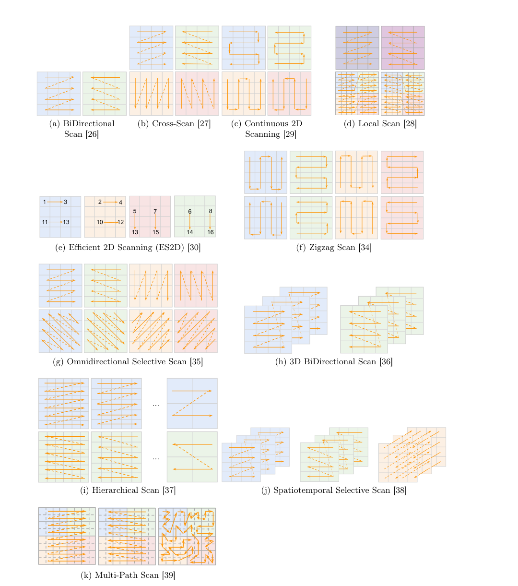
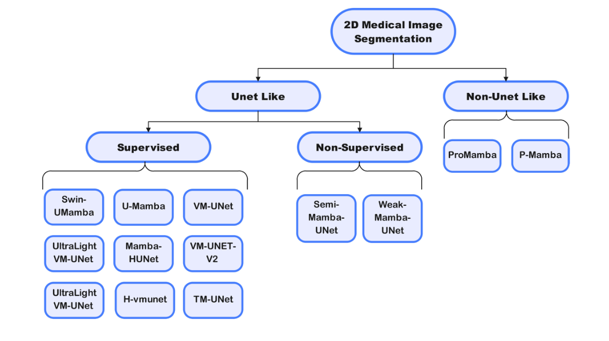

# Review Paper

## A Survey on Visual Mamba

### Identitas paper

- **Penulis:** Hanwei Zhang, Ying Zhu, Dan Wang, Lijun Zhang, Tianxiang Chen, dan Zi Ye.
- **Tahun:** 2024.
- **Jenis publikasi:** Survei literatur; naskah arXiv:2404.15956. Versi pertama dipublikasikan pada 24 April 2024 dan versi kedua pada 26 April 2024.
- **Sumber:** [arXiv](https://arxiv.org/abs/2404.15956) · [PDF](https://arxiv.org/pdf/2404.15956).

### Tujuan penelitian

Paper ini menyurvei adaptasi Mamba dan state space model (SSM) ke computer vision. Tujuannya merangkum konsep dasar SSM, perkembangan model visual berbasis Mamba, desain pemindaian token 2D, serta pemakaian model tersebut di berbagai tugas visual.

### Dataset dan evaluasi

Paper ini **tidak menjalankan eksperimen primer dengan satu dataset dan satu protokol evaluasi**. Sebagai survei, paper merangkum metode dan hasil dari penelitian terdahulu pada beragam benchmark, termasuk klasifikasi citra, segmentasi medis 2D, dan tugas visual lain. Angka hasil dari studi-studi tersebut tidak digabungkan menjadi satu evaluasi komparatif yang seragam.

### Metode atau arsitektur model

Survei menjelaskan SSM selektif Mamba dan adaptasinya untuk citra yang semula berbentuk grid dua dimensi. Pembahasan mencakup Vision Mamba (ViM), VMamba, blok visual state space, serta urutan pemindaian seperti raster, pemindaian dua arah, dan pemindaian lintas arah. Berbagai strategi dirangkum untuk mempertahankan informasi spasial dan hubungan lokal saat fitur citra diubah menjadi urutan token.

*Gambar 1. Perbandingan urutan pemindaian 2D dan selective scan pada beberapa model Mamba visual, Fig. 4 Zhang et al. (2024). Diekstrak dari PDF paper.*

Survei juga menguraikan penggunaan Mamba untuk segmentasi citra medis 2D dan menampilkan taksonomi pendekatan yang dibahas.

*Gambar 2. Ikhtisar model Mamba untuk segmentasi citra medis 2D, Fig. 5 Zhang et al. (2024). Diekstrak dari PDF paper.*

### Domain penelitian

**Computer vision**, khususnya model visual berbasis Mamba/SSM. Cakupan survei meliputi pengenalan citra, segmentasi, pemrosesan citra medis, dan aplikasi visual lainnya. Paper bukan penelitian malware dan tidak menguji MaleVis.

### Hasil utama

- Paper menyusun perkembangan Mamba visual dan mengelompokkan pendekatan menurut arsitektur, strategi pemindaian, serta tugas aplikasinya.
- Pemindaian token merupakan keputusan desain penting karena citra memiliki struktur spasial 2D, sedangkan SSM memproses urutan.
- Survei menunjukkan penggunaan Mamba meluas dari klasifikasi citra ke tugas padat seperti segmentasi, termasuk citra medis.
- Sebagai tinjauan literatur, paper tidak menghasilkan metrik eksperimen baru yang bisa diperlakukan sebagai hasil satu model.

### Analisis kontribusi model

Kontribusi utama paper adalah sintesis dan taksonomi untuk memahami lanskap Mamba visual yang berkembang cepat. Ia membantu pembaca membandingkan pilihan desain, terutama cara mengurutkan dan memindai fitur spasial, serta melihat area aplikasi yang telah dijajaki. Karena merupakan survei, kontribusinya berupa pemetaan pengetahuan dan pembahasan, bukan arsitektur klasifikasi baru.

### Kelebihan

1. Merangkum latar SSM/Mamba dan adaptasinya untuk data visual dalam satu sumber.
2. Mengorganisasi metode berdasarkan strategi arsitektur, pemindaian, dan tugas aplikasi.
3. Membahas lebih dari klasifikasi, termasuk segmentasi medis.
4. Berguna sebagai peta literatur untuk menemukan paper primer dan istilah desain yang relevan.

### Keterbatasan

1. Tidak melakukan eksperimen primer atau evaluasi terkontrol antararsitektur.
2. Hasil yang dirangkum berasal dari paper dengan dataset, protokol, perangkat keras, dan metrik berbeda sehingga tidak selalu dapat dibandingkan langsung.
3. Karena naskah disusun pada 2024, survei tidak mencakup perkembangan setelah cakupan literaturnya.
4. Tidak membahas klasifikasi malware RGB atau mengevaluasi model pada MaleVis.

### Kesimpulan review

Paper ini merupakan referensi survei yang berguna untuk memahami konsep serta ragam desain Vision Mamba dan model visual SSM, khususnya pemindaian spasial dan aplikasi segmentasi. Isinya dapat menjadi landasan teori tentang keluarga model Mamba visual, tetapi tidak memberikan bukti performa langsung untuk klasifikasi malware RGB. Klaim tentang efektivitas pada MaleVis perlu bersumber dari eksperimen yang menguji dataset tersebut secara langsung.

### Sumber

1. Zhang, H., Zhu, Y., Wang, D., Zhang, L., Chen, T., & Ye, Z. (2024). *A Survey on Visual Mamba*. arXiv:2404.15956. [Abstrak dan riwayat versi](https://arxiv.org/abs/2404.15956) · [PDF](https://arxiv.org/pdf/2404.15956).
