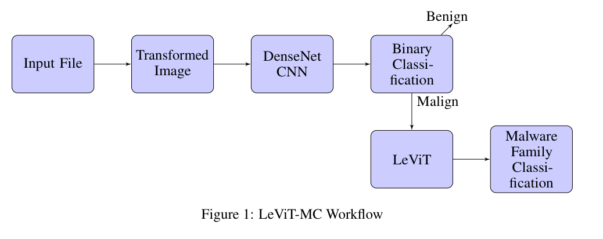
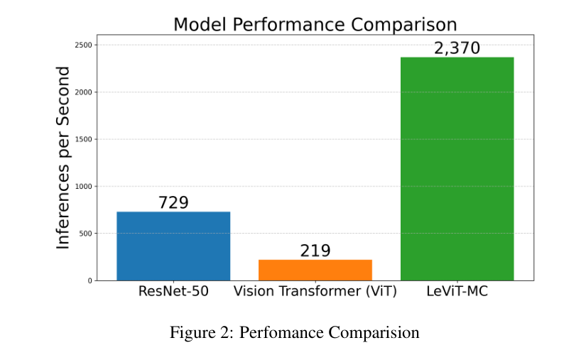

# Review Paper

## Accelerating Malware Classification: A Vision Transformer Solution

### Identitas paper

- **Penulis:** Shrey Bavishi dan Shrey Modi.
- **Tahun:** 2024.
- **Publikasi:** Preprint arXiv, arXiv:2409.19461v1, kategori cs.CR; pada versi yang diperiksa tertulis *under review*.
- **Sumber:** [arXiv](https://arxiv.org/abs/2409.19461) | [PDF](https://arxiv.org/pdf/2409.19461).

### Tujuan penelitian

Penelitian memperkenalkan LeViT-MC untuk klasifikasi malware dari citra hasil visualisasi berkas PE. Model dirancang untuk memisahkan klasifikasi benign/malicious dari klasifikasi keluarga malware, dengan sasaran akurasi dan inferensi yang baik.

### Dataset dan evaluasi

Eksperimen menggunakan MaleVis berisi 14.226 citra RGB berukuran 224×224 dalam 26 kelas (satu kelas benign dan 25 keluarga malware). Paper menyebut pembagian 70% training dan 30% validation. Metrik yang dilaporkan mencakup accuracy dan perbandingan waktu inferensi. Eksperimen dijalankan pada GPU NVIDIA A100-SXM4 80 GB.

*Gambar 1. Diagram alur LeViT-MC pada paper: DenseNet menangani klasifikasi biner, lalu LeViT mengklasifikasikan keluarga malware.*

*Gambar 2. Grafik performa inferensi dari paper. Klaim ini perlu dibaca sebagai angka yang dilaporkan penulis karena pembanding diambil dari studi berbeda.*

### Metode atau arsitektur model

LeViT-MC memakai dua tahap: DenseNet yang diinisialisasi dari ImageNet untuk klasifikasi benign/malicious, lalu LeViT pralatih untuk mengelompokkan keluarga malware pada sampel yang dinilai malicious. Berkas PE direpresentasikan sebagai citra RGB dengan mengelompokkan tiga byte berurutan menjadi nilai kanal warna.

### Domain penelitian

Computer vision untuk klasifikasi keluarga malware Windows PE berbasis citra RGB, dengan MaleVis sebagai dataset.

### Hasil utama

Penulis melaporkan accuracy 96,6% pada MaleVis. Paper juga menyatakan inference lebih cepat dibanding beberapa CNN dan ViT yang dirujuknya; angka perbandingan kecepatan tidak diukur ulang dengan protokol yang sama dalam eksperimen yang dijelaskan.

### Analisis kontribusi model

Paper memberi contoh penerapan Vision Transformer ringan pada MaleVis RGB. Kontribusinya adalah rancangan pipeline dua tahap CNN–ViT, sehingga hasilnya bukan evaluasi ViT murni dan tidak dapat diperlakukan sebagai angka performa backbone ViT standar.

### Kelebihan

1. Menggunakan MaleVis RGB dan melaporkan klasifikasi multikelas.
2. Menguraikan representasi citra dari byte PE serta peran DenseNet dan LeViT.
3. Membahas kecepatan inferensi sebagai pertimbangan selain akurasi.

### Keterbatasan

1. Evaluasi hanya dilakukan pada MaleVis; generalisasi lintas dataset belum diuji.
2. Sistem menggabungkan DenseNet dan LeViT, sehingga hasilnya tidak mengisolasi pengaruh ViT.
3. Perbandingan throughput mengacu pada hasil dari studi lain dan kondisi perangkat/pengujian yang tidak sepenuhnya sebanding.
4. Dokumen yang tersedia adalah preprint dan mencantumkan status *under review*; status publikasinya perlu diperiksa sebelum dikutip sebagai artikel jurnal.

### Kesimpulan review

LeViT-MC merupakan contoh klasifikasi malware RGB pada MaleVis yang menggabungkan CNN dan Vision Transformer ringan serta melaporkan accuracy 96,6%. Angka tersebut sebaiknya dikutip sebagai hasil yang dilaporkan oleh preprint, dengan menyebut pipeline dua tahap dan keterbatasan evaluasinya.

### Sumber

Bavishi, S., & Modi, S. (2024). *Accelerating Malware Classification: A Vision Transformer Solution*. arXiv:2409.19461. [Artikel](https://arxiv.org/abs/2409.19461) | [PDF](https://arxiv.org/pdf/2409.19461).
