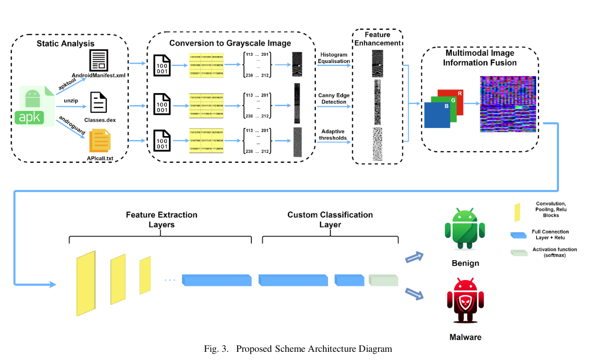
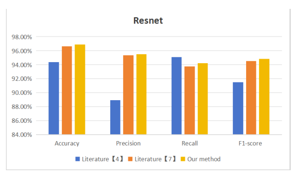

# Review Paper

## Android Malware Detection Based on RGB Images and Multi-feature Fusion

### Identitas paper

- **Penulis:** Zhiqiang Wang, Qiulong Yu, dan Sicheng Yuan.
- **Tahun:** 2024.
- **Publikasi:** Preprint arXiv, arXiv:2408.16555, kategori cs.CR.
- **Sumber:** [arXiv](https://arxiv.org/abs/2408.16555) | [PDF](https://arxiv.org/pdf/2408.16555).

### Tujuan penelitian

Penelitian menguji apakah penggabungan beberapa sumber fitur Android ke dalam citra RGB dapat meningkatkan deteksi malware dibandingkan representasi yang hanya memakai berkas DEX.

### Dataset dan evaluasi

Eksperimen memakai CICMalDroid 2020, dengan 4.039 aplikasi benign dan 12.623 sampel malware yang terbagi dalam beberapa kategori Android. Model yang diuji mencakup AlexNet, GoogLeNet, MobileNetV2, ResNet, dan ResMLP. Evaluasi menggunakan accuracy, precision, recall, F1-score, serta ablation atas kanal fitur. MaleVis tidak digunakan.

*Gambar 1. Diagram metode dari paper: ekstraksi DEX, AndroidManifest.xml, dan API call; konversi dan peningkatan citra; fusi tiga kanal; lalu klasifikasi.*

*Gambar 2. Perbandingan hasil model ResNet untuk metode paper dan metode pembanding; sumber: Figure 4(c) pada paper.*

### Metode atau arsitektur model

Penulis mengekstrak DEX, AndroidManifest.xml, dan API call dari APK. Setiap sumber diubah menjadi citra grayscale dan ditingkatkan dengan teknik pemrosesan citra; ketiganya kemudian digabung sebagai kanal R, G, dan B. Citra gabungan diberikan ke beberapa model klasifikasi.

### Domain penelitian

Deteksi malware Android berbasis citra RGB hasil fusi fitur aplikasi. Ini berbeda dari citra byte RGB Windows PE pada MaleVis.

### Hasil utama

Paper melaporkan accuracy tertinggi 97,25% dengan ResNet. Ablation menunjukkan penggunaan tiga sumber fitur memberikan hasil lebih baik daripada hanya menggunakan DEX pada pengujian yang dilaporkan.

### Analisis kontribusi model

Kontribusi utamanya adalah cara membangun representasi RGB dari tiga sumber informasi APK, bukan pengembangan Vision Transformer atau backbone Mamba. Paper dapat menjadi rujukan pendukung untuk gagasan representasi citra RGB multi-kanal pada malware, dengan perbedaan sumber data dan tugas yang jelas.

### Kelebihan

1. Menjelaskan secara eksplisit pemetaan DEX, manifest, dan API call ke kanal RGB.
2. Membandingkan beberapa arsitektur klasifikasi serta melakukan ablation kanal.
3. Melaporkan beberapa metrik, bukan accuracy saja.

### Keterbatasan

1. Fokus pada Android dan CICMalDroid 2020; hasil tidak langsung mewakili Windows PE atau MaleVis.
2. Uji utamanya adalah deteksi malware Android, bukan perbandingan Vision Mamba dan Vision Transformer.
3. Dokumen arXiv merupakan preprint; periksa status publikasi sebelum mengutipnya sebagai artikel jurnal.

### Kesimpulan review

Paper ini memberi contoh konkret pembentukan citra RGB dari fitur malware dan melaporkan hasil pada CICMalDroid 2020. Relevansinya terutama pada representasi RGB; perbedaan platform, dataset, dan model klasifikasi membatasi perbandingan langsung dengan studi MaleVis.

### Sumber

Wang, Z., Yu, Q., & Yuan, S. (2024). *Android Malware Detection Based on RGB Images and Multi-feature Fusion*. arXiv:2408.16555. [Artikel](https://arxiv.org/abs/2408.16555) | [PDF](https://arxiv.org/pdf/2408.16555).
