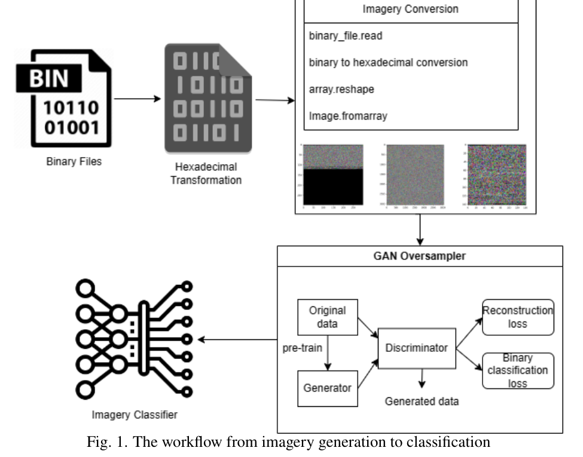
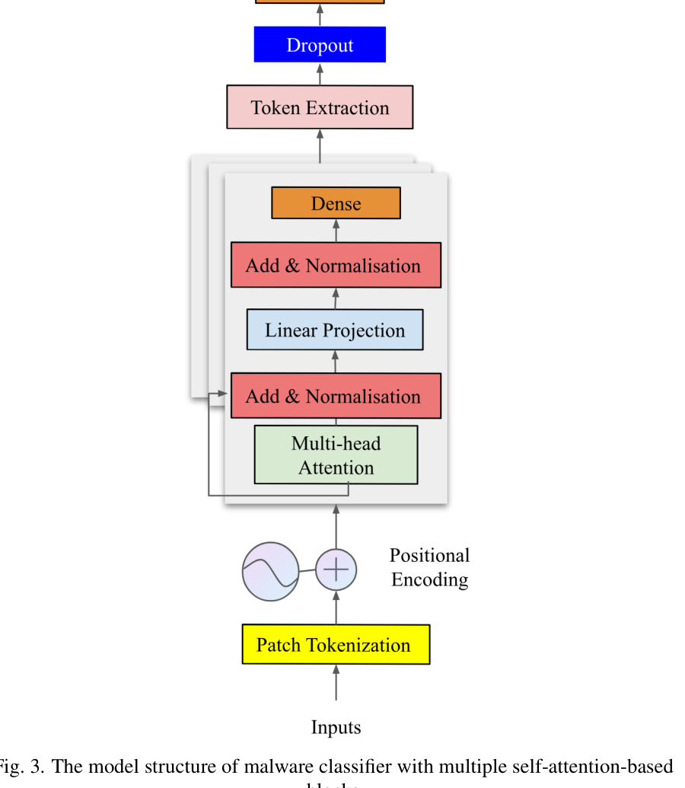
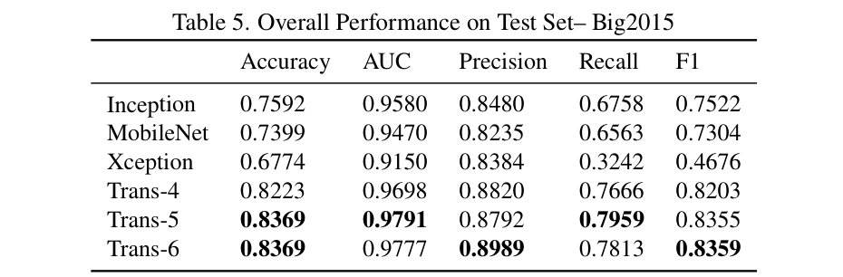
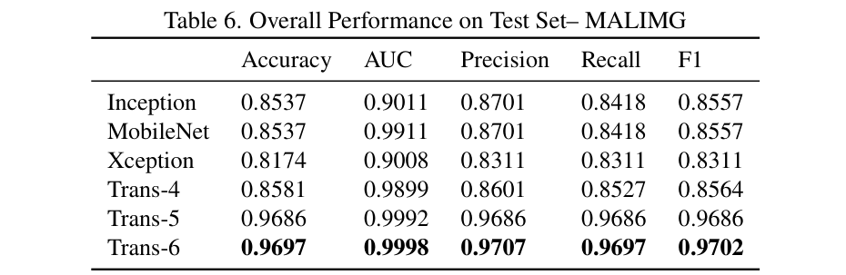

# Review Paper

## Convolutional-free Malware Image Classification using Self-attention Mechanisms

### Identitas paper

- **Penulis:** Huiyao Dong.
- **Tahun:** 2024.
- **Publikasi:** *Informatics and Automation*, volume 23, nomor 6, halaman 1869-1898.
- **DOI:** [10.15622/ia.23.6.11](https://doi.org/10.15622/ia.23.6.11).
- **Sumber:** [Halaman artikel jurnal](https://ia.spcras.ru/index.php/sp/article/view/16434) | [DOI](https://doi.org/10.15622/ia.23.6.11).

### Tujuan penelitian

Paper mengusulkan classifier citra malware berbasis self-attention tanpa lapisan konvolusi pada bagian classifier, dan GAN oversampler untuk mengurangi ketimpangan kelas. Model diuji terhadap tiga baseline CNN pada dataset Big2015 dan MALIMG.

### Dataset dan evaluasi

Big2015 dilaporkan berisi 10.470 berkas malware dari sembilan keluarga. MALIMG dilaporkan berisi 9.458 sampel dari 25 keluarga. Data dibagi menggunakan subset yang telah ditentukan oleh sumber dataset. Representasi Big2015 memakai citra berukuran 128 × 128 × 3; citra MALIMG yang ukuran awalnya bervariasi diubah menjadi 224 × 224 × 3. GAN oversampling dan class weighting digunakan untuk menangani ketimpangan kelas.

Evaluasi membandingkan model Trans-4, Trans-5, dan Trans-6 (masing-masing 4, 5, dan 6 blok Transformer) dengan Inception, MobileNet, dan Xception. Metrik yang dilaporkan adalah accuracy, AUC, precision, recall, dan F1. Pada Big2015, Trans-5 mencapai accuracy 0,8369 dan AUC 0,9791; pada MALIMG, Trans-6 mencapai accuracy 0,9697 dan F1 0,9702. Angka-angka ini adalah hasil pada dua dataset yang berbeda dan bukan hasil pada MaleVis.

*Gambar 1. Alur representasi citra malware, oversampling GAN, dan klasifikasi; Fig. 1 pada paper.*

*Gambar 2. Struktur patch tokenization dan blok self-attention classifier; Fig. 3 pada paper.*

*Gambar 3. Hasil pengujian Big2015 untuk CNN dan variasi jumlah blok Transformer; Table 5 pada paper.*

*Gambar 4. Hasil pengujian MALIMG untuk CNN dan variasi jumlah blok Transformer; Table 6 pada paper.*

### Metode atau arsitektur model

Berkas malware dipetakan dari opcode/representasi heksadesimal menjadi citra tiga kanal. GAN oversampler menggunakan convolutional autoencoder sebagai generator dan discriminator untuk menghasilkan sampel sintetis bagi kelas minoritas. Classifier membagi citra menjadi patch, menambahkan positional encoding, lalu memproses token menggunakan blok multi-head self-attention. Arsitektur classifier yang diuji memiliki 4, 5, atau 6 blok; setiap blok memakai delapan attention head, normalisasi, koneksi residual, dan feed-forward layer dengan aktivasi GELU. Model memakai bobot awal ImageNet dan dilatih dua tahap: 20 epoch dengan backbone dibekukan, diikuti 20 epoch fine-tuning. Pengoptimalan memakai AdamW dan dropout.

### Domain penelitian

Klasifikasi malware berbasis citra untuk keamanan siber. Paper membentuk representasi RGB dari data malware dan mengevaluasi self-attention/ViT pada Big2015 dan MALIMG. Paper tidak menguji dataset MaleVis.

### Hasil utama

- Pada Big2015, Trans-5 memperoleh accuracy 0,8369, AUC 0,9791, precision 0,8792, recall 0,7959, dan F1 0,8355.
- Pada MALIMG, Trans-6 memperoleh accuracy 0,9697, AUC 0,9998, precision 0,9707, recall 0,9697, dan F1 0,9702.
- Hasil Transformer umumnya lebih tinggi daripada tiga baseline CNN yang diuji, khususnya pada MALIMG.
- Paper menyatakan kurva validasi berfluktuasi selama fine-tuning; hasil per model juga berbeda antara dataset dan jumlah blok.

### Analisis kontribusi model

Paper menggabungkan oversampling berbasis GAN dengan classifier self-attention untuk klasifikasi citra malware. Perbandingan Trans-4/5/6 memberi gambaran pengaruh jumlah blok Transformer, sedangkan baseline Inception, MobileNet, dan Xception menjadi pembanding CNN dalam eksperimen yang sama. Kontribusi eksperimen dibatasi pada dataset dan konfigurasi yang dilaporkan; hasilnya tidak menunjukkan performa pada MaleVis.

### Kelebihan

1. Menguji classifier self-attention pada dua dataset malware dan membandingkannya dengan tiga baseline CNN.
2. Melaporkan beberapa metrik selain accuracy, termasuk precision, recall, F1, dan AUC.
3. Menguji tiga kedalaman classifier Transformer, bukan hanya satu konfigurasi.
4. Menjelaskan tahapan oversampling GAN dan fine-tuning model pralatih.

### Keterbatasan

1. Evaluasi hanya menggunakan Big2015 dan MALIMG; hasil pada dataset citra malware lain belum ditunjukkan.
2. Ketahanan terhadap teknik obfuscation dan sampel malware baru belum diuji secara sistematis; penulis juga menyebut hal ini sebagai arah penelitian lanjutan.
3. GAN oversampler memakai convolutional autoencoder. Jadi, meskipun classifier-nya konvolusi-bebas, keseluruhan pipeline tidak sepenuhnya bebas konvolusi.
4. Angka performa tidak selalu disajikan konsisten: abstrak dan tabel mendukung hasil utama yang berbeda menurut dataset/model, sementara bagian lain merangkum hasil sebagai 0,80 pada Big2015 dan 0,966 pada MALIMG. Karena itu, hasil sebaiknya dikutip dengan menyebut dataset, varian Trans, dan tabel yang menjadi acuan.
5. Pembagian data mengikuti subset yang telah ditentukan sumber dataset; rincian protokol pembagian ulang dan pengujian lintas-sumber terbatas.
6. Perbandingan dilakukan dengan Inception, MobileNet, dan Xception; model pembanding lain dan pengukuran biaya komputasi yang lengkap tidak disajikan.

### Kesimpulan review

Paper ini menguji classifier malware citra berbasis self-attention dengan oversampling GAN dan melaporkan hasil yang kompetitif pada Big2015 serta MALIMG. Variasi jumlah blok menghasilkan performa terbaik yang berbeda pada tiap dataset. Hasilnya perlu ditafsirkan sesuai dataset dan varian model, dengan mempertimbangkan ketidakselarasan beberapa angka pelaporan, penggunaan convolutional autoencoder pada oversampler, dan belum adanya evaluasi pada dataset lain seperti MaleVis.

### Sumber

Dong, H. (2024). *Convolutional-free Malware Image Classification using Self-attention Mechanisms*. **Informatics and Automation, 23**(6), 1869-1898. [Artikel jurnal](https://ia.spcras.ru/index.php/sp/article/view/16434) | [DOI](https://doi.org/10.15622/ia.23.6.11).
