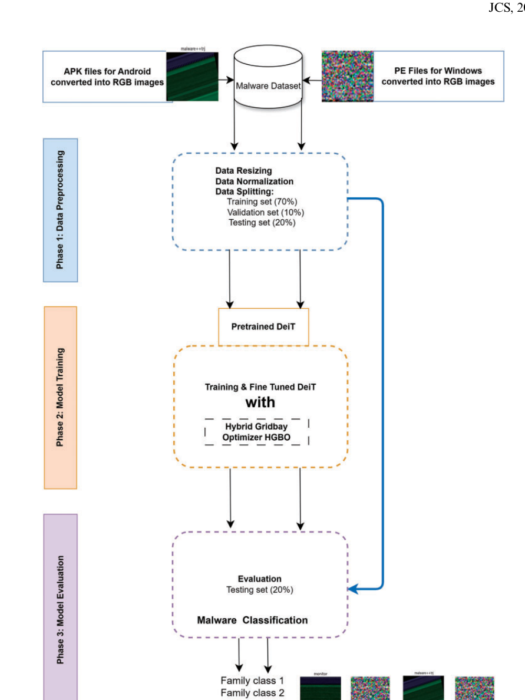
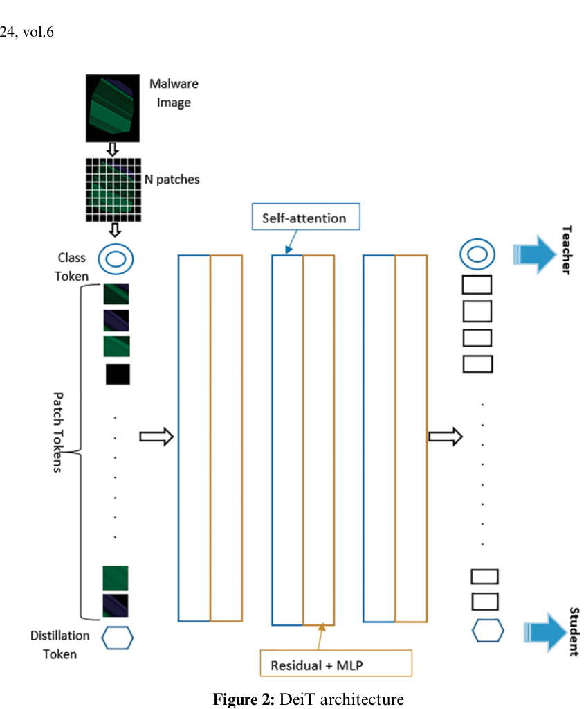
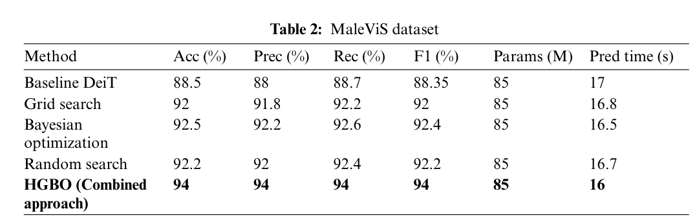
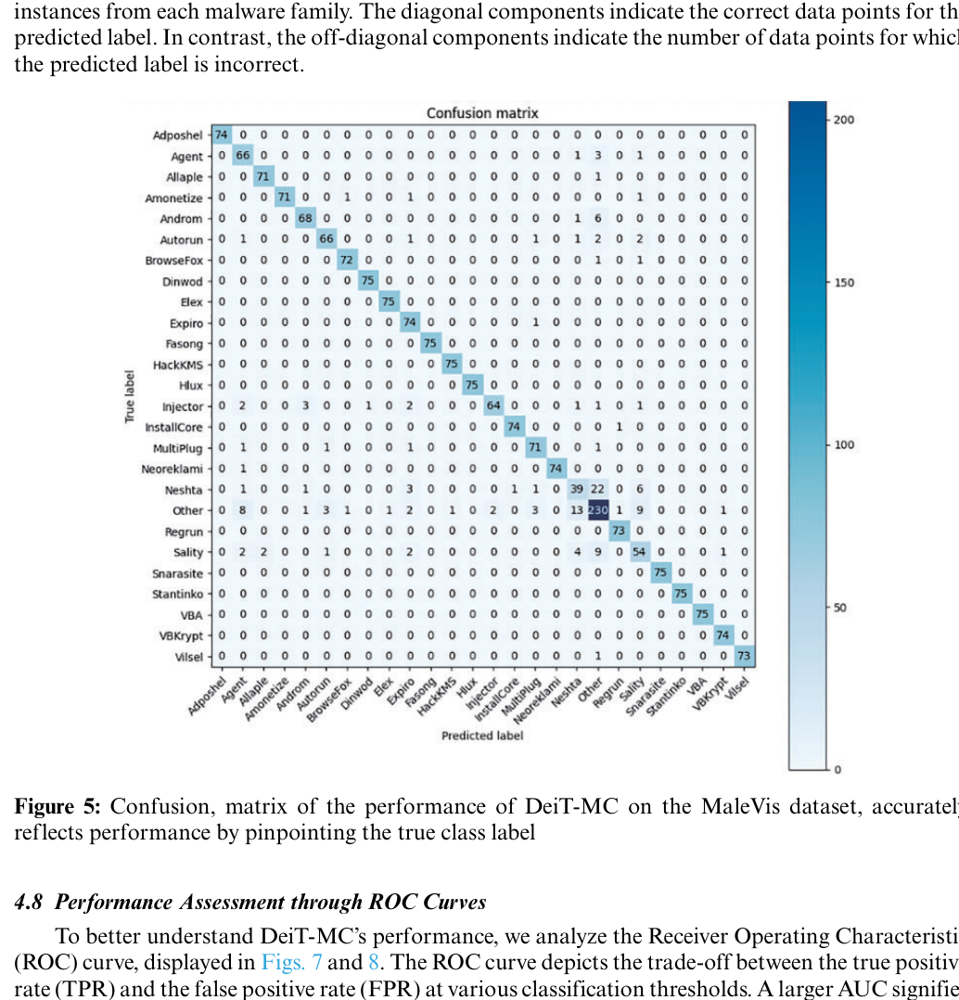

# Review Paper

## Data-Efficient Image Transformers for Robust Malware Family Classification

### Identitas paper

- **Penulis:** Boadu Nkrumah, Michal Asante, Gaddafi Adbdul-Salam, dan Wofa K. Adu-Gyamfi.
- **Tahun:** 2024.
- **Publikasi:** *Journal of Cyber Security*, volume 6, nomor 1, halaman 131-153.
- **DOI:** [10.32604/jcs.2024.053954](https://doi.org/10.32604/jcs.2024.053954).
- **Sumber:** [Artikel Tech Science Press](https://www.techscience.com/JCS/v6n1/58967) | [PDF](https://www.techscience.com/JCS/v6n1/58967/pdf).

### Tujuan penelitian

Penelitian mengembangkan DeiT-MC, model klasifikasi malware berbasis Data-Efficient Image Transformer (DeiT), dan menguji pengaruh optimasi hyperparameter Hybrid GridBay Optimizer (HGBO). Evaluasi dilakukan pada MaleVis dan MalNet-Image Tiny.

### Dataset dan evaluasi

MaleVis berisi 14.226 citra RGB dalam 26 kelas dan paper menggunakan resolusi 224 × 224 piksel. Paper menyebut pembagian stratified 70% training, 10% validation, dan 20% testing. Dataset kedua, MalNet-Image Tiny, memiliki 61.201 citra training, 8.742 validation, dan 17.486 test dalam 43 tipe; penelitian memilih 15 tipe karena keterbatasan sumber daya.

Metrik yang digunakan mencakup accuracy, precision, recall, F1, confusion matrix, dan ROC-AUC. Pada MaleVis, tabel hasil optimasi melaporkan accuracy/precision/recall/F1 sebesar 94% untuk HGBO dan 88,5% accuracy untuk baseline DeiT. Jumlah support di classification report MaleVis adalah 2.135, yang tidak cocok dengan 20% dari total 14.226 (sekitar 2.845). Karena itu angka evaluasi perlu dikutip bersama rincian split yang dilaporkan dan ketidakselarasan jumlah sampel tersebut.

*Gambar 1. Tahapan data preparation, fine-tuning DeiT dengan HGBO, dan evaluasi; Figure 1 pada paper.*

*Gambar 2. Diagram arsitektur DeiT dengan patch, self-attention, class token, dan distillation token; Figure 2 pada paper.*

*Gambar 3. Perbandingan baseline DeiT, grid search, Bayesian optimization, random search, dan HGBO pada MaleVis; Table 2 pada paper.*

*Gambar 4. Confusion matrix DeiT-MC pada kelas-kelas MaleVis; Figure 5 pada paper.*

### Metode atau arsitektur model

Model menggunakan DeiT-base pralatih ImageNet dengan sekitar 85 juta parameter, 12 encoder Transformer, dan 12 attention head per encoder. Citra dibagi menjadi patch 16 × 16, lalu diproses dengan self-attention dan token distillation. HGBO menggabungkan pencarian grid (30% dari strategi optimasi) dengan Bayesian optimization (70%) untuk mencari hyperparameter. Paper melaporkan fine-tuning selama 50 epoch, Adam, batch size 32, weight decay 0,03, dropout terpilih 0,5, class weighting, augmentasi citra, dan early stopping.

### Domain penelitian

Computer vision untuk klasifikasi keluarga malware dari citra RGB berkas. Paper menguji DeiT pada MaleVis dan MalNet-Image Tiny, termasuk klasifikasi multikelas. MaleVis dalam paper dijelaskan sebagai citra RGB malware/benign dari berkas Windows PE.

### Hasil utama

- Pada MaleVis, baseline DeiT mencapai accuracy 88,5%; HGBO mencapai 94% pada accuracy, precision, recall, dan F1 dalam tabel perbandingan optimasi.
- Grid search, Bayesian optimization, dan random search masing-masing melaporkan accuracy 92%, 92,5%, dan 92,2% pada MaleVis.
- Pada MalNet-Image Tiny, HGBO melaporkan 92% untuk accuracy, precision, recall, dan F1; dataset eksperimen dibatasi pada 15 tipe.
- DeiT-MC memiliki sekitar 85 juta parameter. Paper melaporkan waktu prediksi 16 detik pada MaleVis, tetapi rincian kondisi pengukuran yang diperlukan untuk perbandingan throughput tidak dijabarkan secara memadai.

### Analisis kontribusi model

Paper memberi contoh langsung penerapan DeiT pada citra MaleVis RGB, serta membandingkan hasil baseline DeiT dengan beberapa strategi pencarian hyperparameter. Kontribusi metode utamanya adalah HGBO, bukan backbone visual baru. Hasilnya dapat menjadi rujukan untuk performa DeiT pada dataset citra malware, dengan memperhatikan ukuran model, rincian eksperimen, dan konsistensi pelaporan data.

### Kelebihan

1. Menggunakan MaleVis dalam format RGB dan melaporkan hasil multikelas.
2. Membandingkan baseline DeiT dengan grid search, Bayesian optimization, random search, dan HGBO pada pipeline yang sama.
3. Menyediakan metrik beragam, confusion matrix, ROC-AUC, dan classification report per kelas.
4. Menjelaskan konfigurasi DeiT, proses fine-tuning, augmentasi, class weighting, dan strategi HGBO.

### Keterbatasan

1. DeiT-base memiliki sekitar 85 juta parameter; paper sendiri menyebut kebutuhan komputasi dan memori menjadi kendala untuk perangkat edge.
2. Paper tidak menguji kinerja real-time, walaupun menyajikan waktu prediksi agregat.
3. Rincian ukuran split MaleVis tidak konsisten: total 14.226 dengan pembagian 70/10/20 mengimplikasikan sekitar 2.845 sampel test, sedangkan classification report mencatat support 2.135.
4. Bagian preprocessing menyebut ukuran citra 224 × 224 dan penggunaan seluruh konten file, tetapi uraian lain juga membahas representasi berbasis 50 KB awal; dampak pilihan cakupan byte tidak dievaluasi dengan jelas.
5. Dataset hanya tersedia atas permintaan menurut pernyataan ketersediaan data, sehingga replikasi independen dapat terkendala.
6. Model dan optimizer dikaji pada dua dataset, tetapi uji terhadap malware baru di lingkungan operasional atau perubahan distribusi jangka panjang belum dilaporkan.

### Kesimpulan review

DeiT-MC menerapkan DeiT pada citra malware RGB dan melaporkan accuracy 94% pada MaleVis setelah optimasi HGBO, dibandingkan 88,5% pada baseline DeiT. Paper ini relevan sebagai contoh Vision Transformer untuk klasifikasi malware berbasis citra RGB. Interpretasi hasil perlu mempertimbangkan model yang besar, evaluasi real-time yang belum dilakukan, akses data, dan ketidakselarasan jumlah sampel pada pelaporan split MaleVis.

### Sumber

Nkrumah, B., Asante, M., Adbdul-Salam, G., & Adu-Gyamfi, W. K. (2024). *Data-Efficient Image Transformers for Robust Malware Family Classification*. **Journal of Cyber Security, 6**(1), 131-153. [Artikel](https://www.techscience.com/JCS/v6n1/58967) | [PDF](https://www.techscience.com/JCS/v6n1/58967/pdf) | [DOI](https://doi.org/10.32604/jcs.2024.053954).
