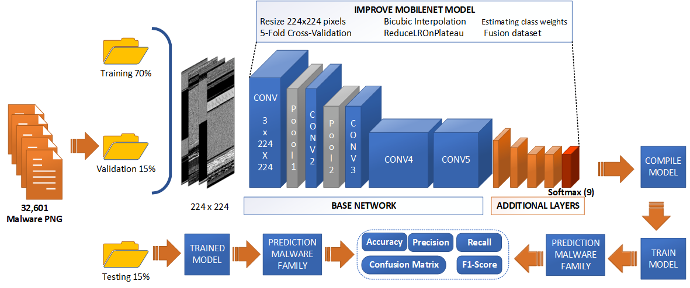
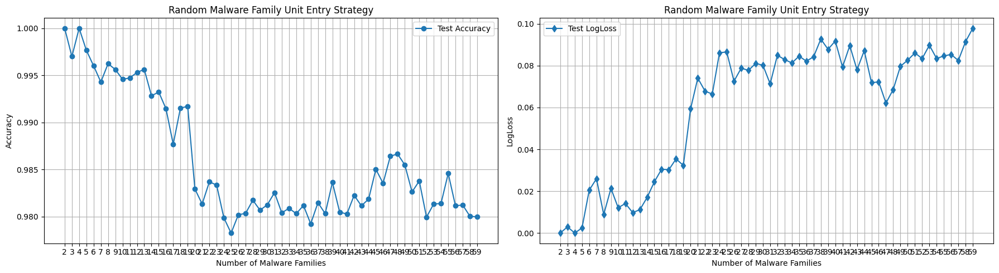
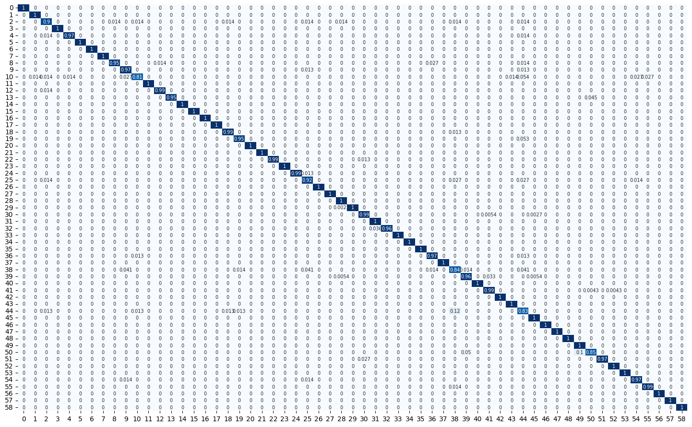

# Review Paper

## Deep Learning Applied to Imbalanced Malware Datasets Classification

### Identitas paper

- **Penulis:** Marcelo Palma Salas dan Paulo Lício de Geus.
- **Tahun:** 2024; diterbitkan pada 16 September 2024.
- **Publikasi:** *Journal of Internet Services and Applications*, volume 15, hlm. 342–359.
- **DOI:** [10.5753/jisa.2024.3907](https://doi.org/10.5753/jisa.2024.3907).
- **Sumber:** [Halaman artikel/DOI](https://doi.org/10.5753/jisa.2024.3907) · [PDF artikel](https://www.ic.unicamp.br/~paulo/papers/2024-JISA-marcelo.palma-deep.learning.malware.pdf) · [Semantic Scholar](https://www.semanticscholar.org/paper/Deep-Learning-Applied-to-Imbalanced-Malware-Salas-Geus/eb85d4fbef77fe94893bdc6dfc12c75c1e34706f).

### Tujuan penelitian

Penelitian mengembangkan dan mengevaluasi **MobileNet Fine Tuning (MobileNet FT)** untuk klasifikasi keluarga malware pada dataset yang memiliki tingkat ketidakseimbangan berbeda. Penulis juga membentuk dataset gabungan Fusion dan mengamati perubahan performa ketika jumlah keluarga malware bertambah.

### Dataset dan evaluasi

Eksperimen mencakup empat dataset:

- **Microsoft BIG 2015**, dataset malware dengan sembilan keluarga dan distribusi sampel tidak seimbang.
- **Malimg**, 9.339 citra dari 25 keluarga malware.
- **MaleVis**, 12.394 citra dari 25 keluarga malware serta satu kelas legitimate.
- **Fusion**, gabungan Microsoft BIG 2015, Malimg, dan MaleVis, berisi 32.601 citra dan 59 keluarga malware.

Paper menyebut format input pada tabel hasil sebagai byteplot grayscale. Citra disiapkan sebagai PNG berukuran 224 × 224 menggunakan interpolasi bicubic; penulis juga membandingkan beberapa pilihan konversi dan interpolasi. Pelatihan menggunakan split 70% training, 15% validation, dan 15% test dengan 5-fold cross-validation. Parameter yang dilaporkan mencakup 50 epoch, Adam, learning rate 0,0001, class weighting, dan ReduceLROnPlateau. Evaluasi mencakup accuracy, precision, recall, F1-score, log loss, confusion matrix, dan waktu.

*Gambar 1. Rancangan MobileNet FT, pembagian data, dan metrik evaluasi, Fig. 9 Salas & de Geus (2024). Gambar asli diekstrak dari PDF.*

### Metode atau arsitektur model

MobileNet pralatih digunakan sebagai backbone CNN. Paper menjelaskan penghapusan lapisan klasifikasi terakhir, penambahan lapisan untuk klasifikasi malware, dan penggunaan softmax dengan jumlah keluaran sesuai jumlah kelas. Bobot backbone dibekukan pada konfigurasi yang dijelaskan. Fine-tuning dilengkapi class weights untuk mengatasi imbalance, ReduceLROnPlateau untuk penyesuaian learning rate, dan preprocessing bicubic ke resolusi 224 × 224.

Paper bukan model Transformer atau Mamba; MobileNet FT adalah CNN dengan transfer learning.

### Domain penelitian

**Keamanan siber dan computer vision**, khususnya klasifikasi keluarga malware dari representasi citra byte dan penanganan ketidakseimbangan kelas.

### Hasil utama

- Akurasi MobileNet FT yang dilaporkan pada abstrak adalah **98,71%** untuk BIG 2015, **99,08%** untuk Malimg, **96,04%** untuk MaleVis, dan **98,04%** untuk Fusion.
- Tabel/body hasil melaporkan **99,07%** untuk Malimg, sementara abstraknya menyebut 99,08%; perbedaan kecil ini dipertahankan sebagai ketidaksesuaian pelaporan dalam paper.
- Untuk MaleVis, paper melaporkan accuracy 96,02%, precision 96,09%, recall 96,02%, dan F1-score 96,04% pada tabel perbandingan.
- Untuk Fusion, hasil test set mencatat accuracy 98,037% dan log loss 0,09280.
- Analisis penambahan keluarga menunjukkan kecenderungan accuracy menurun dan log loss meningkat saat jumlah kelas bertambah, meskipun metrik tetap relatif tinggi pada beberapa titik.

*Gambar 2. Accuracy dan log loss test terhadap jumlah keluarga malware pada Fusion, Fig. 16 Salas & de Geus (2024). Gambar asli diekstrak dari PDF.*

*Gambar 3. Confusion matrix Fusion 59 kelas, Fig. 15 Salas & de Geus (2024). Gambar asli diekstrak dari PDF.*

### Analisis kontribusi model

Kontribusi penelitian mencakup penerapan transfer learning MobileNet dengan class weighting dan preprocessing citra yang ditujukan untuk menangani dataset malware tidak seimbang, serta pembentukan dataset Fusion lintas sumber. Analisis performa berdasarkan jumlah kelas menyoroti bahwa keberhasilan pada dataset dengan kelas lebih sedikit tidak otomatis bertahan ketika keluarga malware bertambah.

### Kelebihan

1. Mengevaluasi satu pendekatan pada empat dataset dan melaporkan hasil pada MaleVis.
2. Secara eksplisit menelaah imbalance kelas dan perubahan hasil ketika jumlah keluarga bertambah.
3. Menggabungkan class weighting, penjadwalan learning rate, dan validasi silang dalam pipeline.
4. Menyediakan evaluasi dengan beberapa metrik, confusion matrix, serta log loss.
5. Menyusun Fusion sebagai kumpulan 59 keluarga dari tiga dataset.

### Keterbatasan

1. Model yang diteliti adalah MobileNet/CNN; paper tidak mengevaluasi ViT ataupun Vision Mamba.
2. Hasil dataset MaleVis yang dibandingkan menggunakan input byte grayscale, sehingga tidak mengukur performa model pada citra RGB penuh.
3. Fusion menggabungkan beberapa sumber dataset; hasilnya tidak dapat dianggap sebagai evaluasi MaleVis saja.
4. Penulis menyatakan performa turun saat jumlah keluarga meningkat dan menyebut keterbatasan generalisasi terhadap ancaman baru yang belum dilihat.
5. Nilai akurasi Malimg sedikit berbeda antara abstrak (99,08%) dan bagian hasil/tabel (99,07%).

### Kesimpulan review

Paper ini relevan untuk konteks klasifikasi malware berbasis citra, terutama sebagai studi MobileNet pada MaleVis, Malimg, dan Fusion serta analisis class imbalance. Paper dapat menjadi pembanding CNN dan sumber pembahasan pengaruh jumlah keluarga malware. Namun, ia tidak membandingkan Vision Transformer dengan Vision Mamba; hasil MaleVis-nya juga dilaporkan untuk byteplot grayscale, sehingga tidak dapat dianggap sebagai hasil eksperimen MaleVis RGB yang sebanding langsung dengan tesis.

### Sumber

1. Palma Salas, M., & de Geus, P. L. (2024). *Deep Learning Applied to Imbalanced Malware Datasets Classification*. **Journal of Internet Services and Applications, 15**, 342–359. [DOI](https://doi.org/10.5753/jisa.2024.3907) · [PDF artikel](https://www.ic.unicamp.br/~paulo/papers/2024-JISA-marcelo.palma-deep.learning.malware.pdf).
