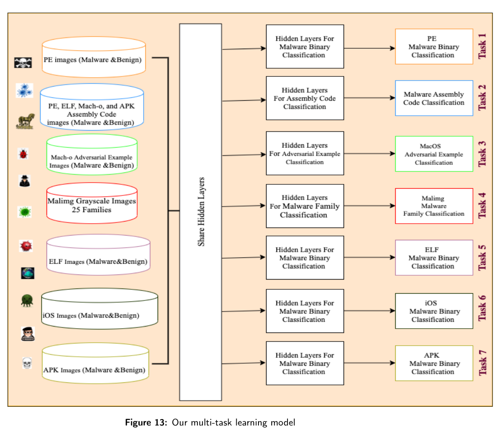
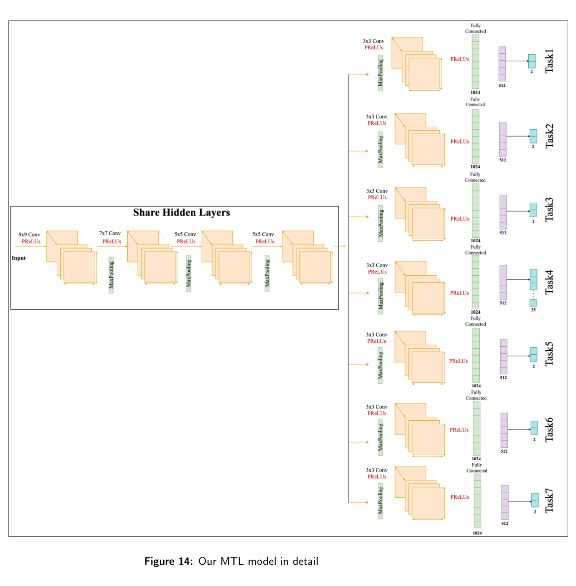

# Review Paper

## Deep Multi-Task Learning for Malware Image Classification

### Identitas paper

- **Penulis:** Ahmed Bensaoud dan Jugal Kalita.
- **Tahun:** 2024.
- **Publikasi:** Preprint arXiv, arXiv:2405.05906, kategori cs.CR.
- **Sumber:** [arXiv](https://arxiv.org/abs/2405.05906) | [PDF](https://arxiv.org/pdf/2405.05906).

### Tujuan penelitian

Penelitian mengusulkan kerangka deep multi-task learning untuk klasifikasi malware melalui citra, sekaligus membangun dataset citra berwarna dari sampel lintas format berkas.

### Dataset dan evaluasi

Penulis menyatakan mengumpulkan sekitar 100.000 sampel benign dan malware dari PE, APK, Mach-O, dan ELF. Fitur berkas diubah menjadi citra BMP/PNG berwarna. Eksperimen mencakup tujuh tugas klasifikasi dan membandingkan empat fungsi aktivasi: ReLU, LeakyReLU, PReLU, dan ELU. Paper menyatakan PReLU menghasilkan accuracy di atas 99,87% pada tugas-tugas yang diuji; abstrak dan uraian kontribusi juga menyebut angka agregat yang berbeda, sehingga angka sebaiknya dikutip dengan rincian tabel eksperimen.

*Gambar 1. Diagram model multi-task dengan lapisan tersembunyi yang dipakai bersama dan tujuh cabang tugas; sumber: Figure 13 pada paper.*

*Gambar 2. Rincian arsitektur model multi-task; sumber: Figure 14 pada paper.*

### Metode atau arsitektur model

Model menggunakan pembelajaran multi-task untuk klasifikasi biner dan multikelas, dengan beberapa submodel yang dilatih untuk tugas berbeda. Paper menjelaskan pembuatan citra dari fitur sampel, termasuk augmentasi CycleGAN untuk memperbanyak sampel Mac OS yang jumlah awalnya terbatas.

### Domain penelitian

Klasifikasi malware berbasis citra dari beberapa tipe berkas dan platform. Dataset yang disusun paper bukan MaleVis; fokusnya juga mencakup deteksi lintas format, bukan khusus RGB Windows PE.

### Hasil utama

Penulis melaporkan accuracy lebih dari 99,87% dengan PReLU pada tujuh tugas. Angka tersebut merupakan hasil yang dilaporkan paper dan tidak dapat dibandingkan langsung dengan hasil MaleVis karena dataset, tugas, dan pembagian datanya berbeda.

### Analisis kontribusi model

Kontribusi paper adalah pembelajaran multi-task dan penyusunan dataset citra berwarna lintas platform. Ini dapat memberi konteks tentang variasi tugas dan representasi citra malware, tetapi tidak membandingkan Vision Transformer dengan Vision Mamba.

### Kelebihan

1. Mencakup berbagai format berkas, termasuk PE, APK, Mach-O, dan ELF.
2. Menguji beberapa tugas dan fungsi aktivasi.
3. Menyediakan kode/dataset yang dirujuk oleh penulis melalui repositori proyek.

### Keterbatasan

1. Tidak menggunakan MaleVis dan konfigurasi tugasnya berbeda dari klasifikasi 26 kelas MaleVis.
2. Paper berfokus pada multi-task learning, bukan studi komparatif backbone ViT dan Mamba.
3. Angka agregat yang disebut pada bagian abstrak dan kontribusi tidak sepenuhnya seragam; rincian hasil perlu dirujuk langsung ke tabel.
4. Dokumen arXiv yang tersedia adalah preprint.

### Kesimpulan review

Paper ini membahas klasifikasi malware berbasis citra lintas format dengan pendekatan multi-task dan melaporkan hasil tinggi pada eksperimen internalnya. Perbedaan dataset, formulasi tugas, dan status preprint perlu diperhatikan ketika menggunakannya sebagai rujukan.

### Sumber

Bensaoud, A., & Kalita, J. (2024). *Deep Multi-Task Learning for Malware Image Classification*. arXiv:2405.05906. [Artikel](https://arxiv.org/abs/2405.05906) | [PDF](https://arxiv.org/pdf/2405.05906) | [Repositori dataset/kode yang disebut paper](https://github.com/abensaou-uccs/Colorado-MalColorImg).
