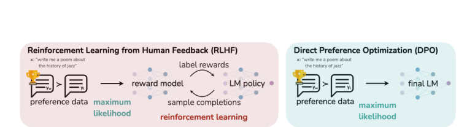
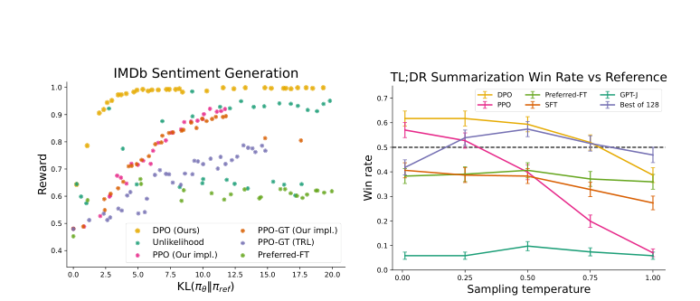
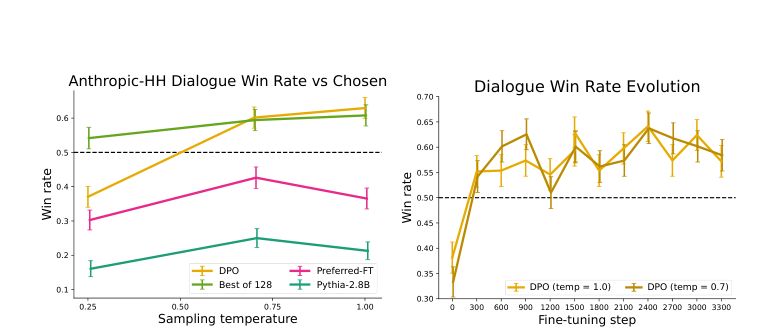

# Review Paper

### Identitas paper

#### Penulis & Tahun

Rafael Rafailov, Archit Sharma, Eric Mitchell, Stefano Ermon, Christopher D. Manning, dan Chelsea Finn (**2023**; versi arXiv diperbarui pada 2024).

#### Judul Penelitian

*Direct Preference Optimization: Your Language Model is Secretly a Reward Model*

#### Nama Conference

Paper ini dipublikasikan pada **Advances in Neural Information Processing Systems (NeurIPS 2023)**.

DOI: `10.52202/075280-2338`.

### Tujuan penelitian

Penelitian ini mengembangkan metode alignment language model yang lebih sederhana daripada Reinforcement Learning from Human Feedback (RLHF). DPO bertujuan mengoptimalkan model berdasarkan preferensi manusia tanpa perlu melatih reward model secara terpisah dan menjalankan reinforcement learning berbasis policy optimization.

### Dataset dan evaluasi

DPO dievaluasi pada beberapa tugas alignment dan text generation, termasuk:

- sentiment control;
- TL;DR summarization;
- single-turn dialogue;
- human preference evaluation;
- GPT-4-based evaluation.

Eksperimen membandingkan DPO dengan PPO-based RLHF, Preferred-Finetuning, dan beberapa baseline sampling.

### Metode atau arsitektur model

DPO memanfaatkan hubungan matematis antara reward function dan optimal policy. Dengan parameterisasi tersebut, objective RLHF dapat diubah menjadi objective klasifikasi langsung pada pasangan respons yang dipilih dan ditolak oleh manusia.

Alur DPO adalah:

1. Dataset berisi prompt, respons yang dipilih, dan respons yang ditolak disiapkan.
2. Model membandingkan probabilitas respons chosen dan rejected.
3. Perbedaan probabilitas dibandingkan dengan reference policy.
4. Loss klasifikasi digunakan untuk meningkatkan probabilitas respons yang disukai.
5. Model hasil fine-tuning digunakan tanpa reward model terpisah saat inference.

Secara konseptual, DPO tetap mempertahankan kontrol terhadap perubahan policy melalui regularisasi KL terhadap reference policy, tetapi menghindari loop reinforcement learning yang kompleks.

### Domain penelitian

Domain penelitian ini adalah **Natural Language Processing (NLP)**. Paper ini berfokus pada:

- language model alignment;
- preference optimization;
- text summarization;
- dialogue generation;
- sentiment-controlled generation.

### Hasil utama

DPO menghasilkan frontier reward-KL yang lebih efisien dibandingkan metode pembanding pada eksperimen sentiment control.

Pada tugas summarization, DPO memperoleh win rate sekitar **61%**, lebih tinggi dibandingkan performa terbaik PPO yang dilaporkan sekitar **57%**. Pada single-turn dialogue, DPO menjadi metode yang mampu meningkatkan performa dibandingkan respons pilihan pada dataset Anthropic-HH dalam eksperimen yang dilakukan.

### Analisis kontribusi model

Kontribusi utama DPO adalah:

- menghilangkan kebutuhan reward model terpisah;
- menghindari sampling selama policy optimization;
- mengganti RL objective dengan classification loss;
- menyederhanakan implementasi alignment berbasis preferensi;
- mempertahankan kontrol terhadap penyimpangan dari reference policy.

### Kelebihan

- Lebih sederhana dan stabil dibandingkan PPO-based RLHF.
- Tidak memerlukan tahap pelatihan reward model terpisah.
- Tidak membutuhkan reinforcement learning loop yang kompleks.
- Efektif untuk sentiment control, summarization, dan dialogue.
- Dapat menggunakan dataset preferensi yang sama dengan pendekatan RLHF.

### Keterbatasan

- Kualitas DPO bergantung pada kualitas dan konsistensi preference dataset.
- Pemilihan beta dan reference policy dapat memengaruhi hasil alignment.
- Dataset preferensi yang bias dapat menghasilkan perilaku model yang bias.
- DPO tidak secara otomatis menyelesaikan masalah factuality atau reasoning.
- Evaluasi berbasis GPT-4 dan human preference tetap memiliki potensi bias.

### Kesimpulan review

DPO merumuskan alignment language model sebagai optimasi langsung terhadap pasangan respons berdasarkan preferensi manusia. Dengan memanfaatkan hubungan antara reward function dan optimal policy, metode ini mengubah objective RLHF menjadi classification loss sehingga reward model dan policy optimization berbasis reinforcement learning tidak lagi diperlukan.

Hasil eksperimen menunjukkan bahwa DPO mampu mencapai performa yang kompetitif atau lebih baik daripada PPO-based RLHF pada sentiment control, summarization, dan dialogue generation. Kontribusi utama metode ini adalah penyederhanaan pipeline alignment, meskipun efektivitasnya tetap bergantung pada kualitas preference data, reference policy, dan konfigurasi optimasi.

### Sumber

1. Rafailov, R., Sharma, A., Mitchell, E., Ermon, S., Manning, C. D., & Finn, C. (2023). *Direct Preference Optimization: Your Language Model is Secretly a Reward Model*. **NeurIPS 2023**. https://doi.org/10.52202/075280-2338
2. [Halaman paper NeurIPS](https://proceedings.neurips.cc/paper_files/paper/2023/hash/a85b405ed65c6477a4fe8302b5e06ce7-Abstract.html)
3. [PDF paper](https://arxiv.org/pdf/2305.18290)
