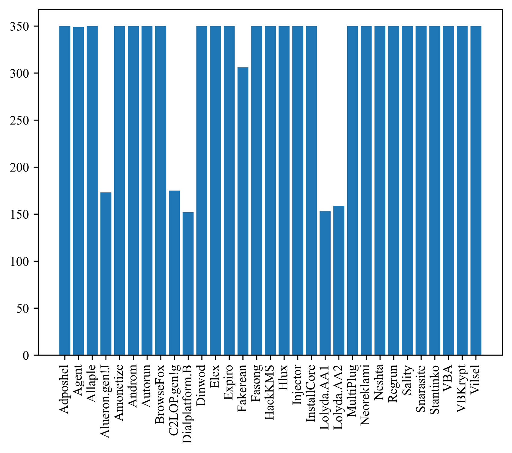
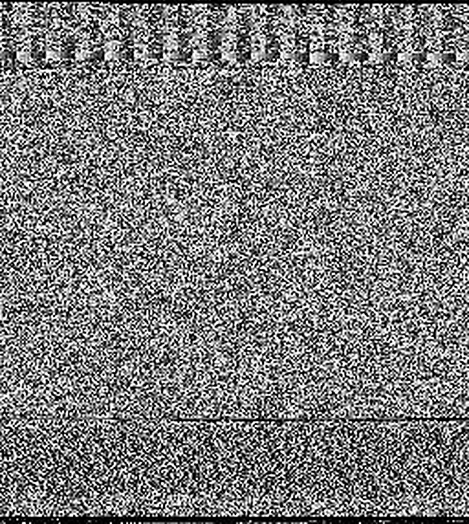
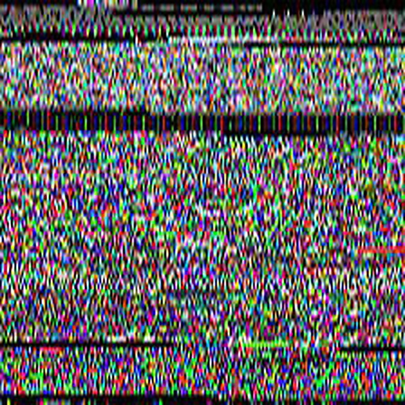
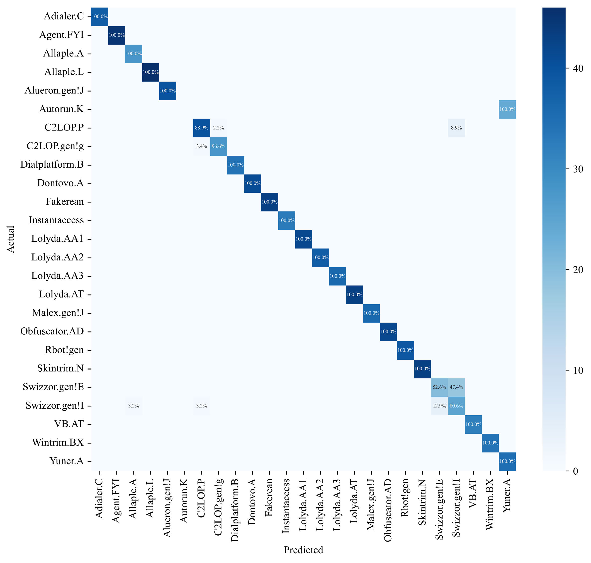
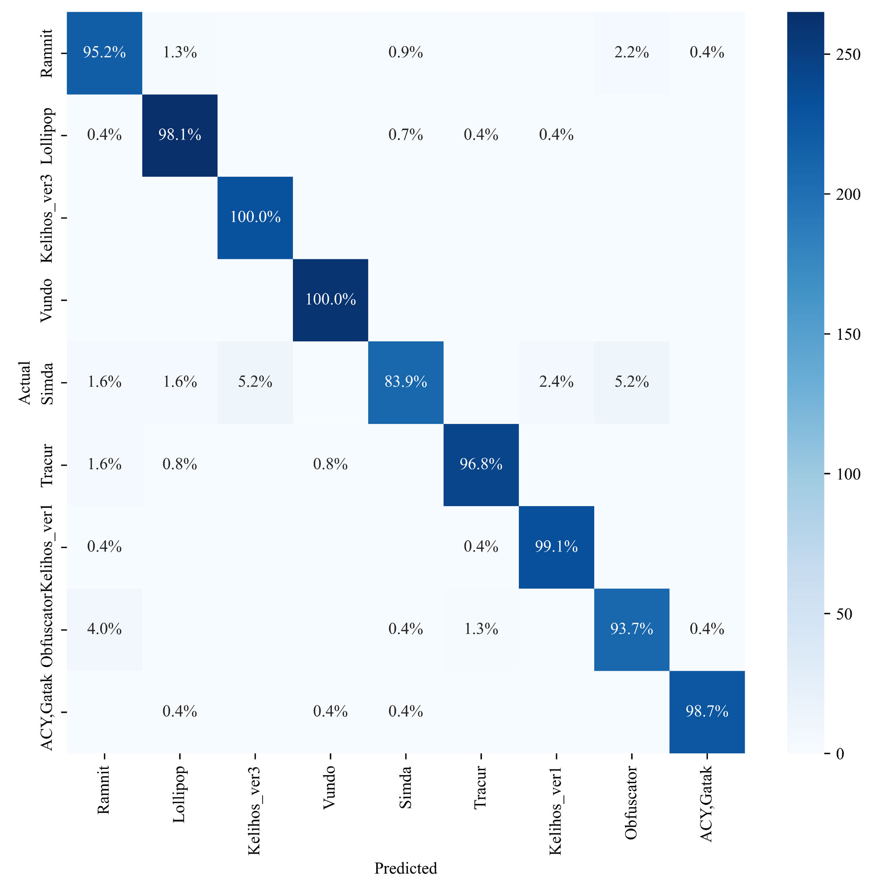
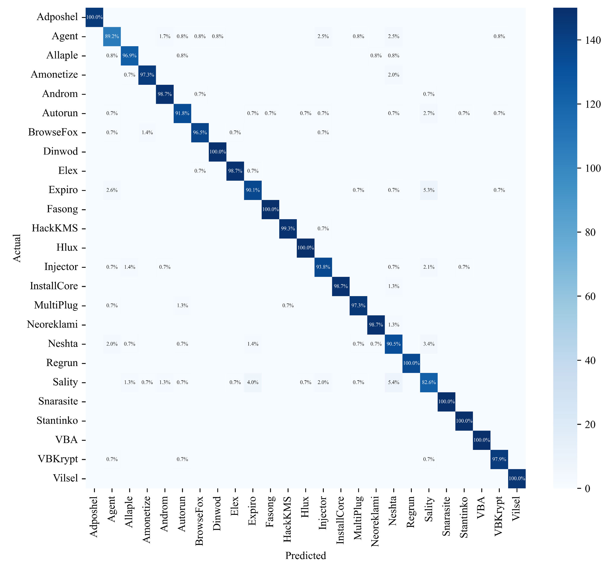
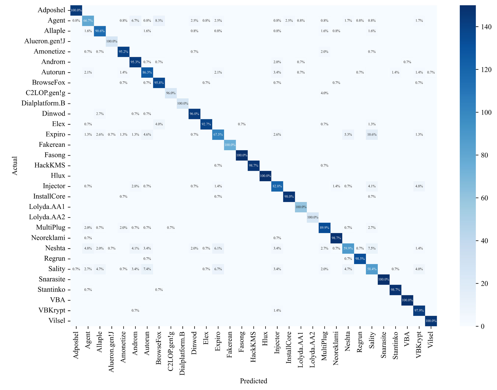

# Review Paper

### Identitas paper

#### Penulis & Tahun

Yajun Liu, Hong Fan, Jianguang Zhao, Jianfang Zhang, dan Xinxin Yin (**2024**).

#### Judul Penelitian

*Efficient and Generalized Image-Based CNN Algorithm for Multi-Class Malware Detection*

#### Nama Jurnal / Conference

Artikel jurnal pada **IEEE Access**, Volume 12, 2024, halaman 104323-104330.

DOI: `10.1109/ACCESS.2024.3435362`

### Tujuan penelitian

Penelitian ini mengusulkan dan mengevaluasi framework CNN berbasis citra untuk klasifikasi malware multi-kelas dengan memperhatikan ketidakseimbangan data dan efisiensi.

### Dataset dan evaluasi

Penelitian mengevaluasi framework pada empat dataset terbuka:

1. **Malimg Dataset** - citra grayscale dari keluarga malware.
2. **Microsoft BIG 2015 Dataset** - dataset malware dengan representasi citra dari file biner.
3. **MaleVis Dataset** - citra malware RGB.
4. **Blended Dataset** - gabungan seluruh data MaleVis dan lima kategori dari Malimg, dengan total 31 kategori.

Penulis menyoroti masalah ketidakseimbangan kelas. Pada MaleVis, kategori `Other` memiliki distribusi yang tidak seimbang antara data training dan testing, sehingga eksperimen dilakukan dengan dan tanpa kategori tersebut.

*Gambar 1. Statistik sampel dataset yang digunakan dalam penelitian.*

### Metode atau arsitektur model

Penelitian mengusulkan framework **VBDN (malicious code detection framework)** yang menggabungkan empat komponen utama:

- visualisasi kode malware menjadi feature map;
- balanced sampling menggunakan ImbalancedDatasetSampler;
- data augmentation untuk meningkatkan generalisasi dan mengurangi overfitting;
- CNN untuk ekstraksi fitur dan klasifikasi multi-kelas.

#### 1. Malware Visualization

Kode malware dikonversi menjadi feature map grayscale dan RGB. Beberapa sumber informasi yang digunakan meliputi PE view, assembly view, byte view, character information, byte stream, dan struktur PE.

*Gambar 2. Contoh konversi malware menjadi feature map grayscale.*

*Gambar 3. Contoh konversi malware menjadi feature map RGB.*

#### 2. Balanced Sampling

Untuk mengatasi kelas yang tidak seimbang, paper membahas up-sampling dan down-sampling. Penulis kemudian mengoptimalkan BalancedDatasetSampler agar bobot sampling dapat ditentukan secara otomatis tanpa harus membuat dataset baru.

*Gambar 4. Proses balanced sampling.*

#### 3. Data Augmentation

Data augmentation dilakukan menggunakan metode `Compose` pada Python. Tujuannya adalah memperkaya variasi data dan mengurangi risiko overfitting akibat pengulangan sampel kelas minoritas.

*Gambar 5. Tahapan data augmentation pada feature map malware.*

#### 4. CNN dan VBDN

CNN digunakan untuk melakukan ekstraksi fitur dan klasifikasi. Model menggunakan convolutional layer, batch normalization, pooling, dropout, reshape, dan dua fully connected layer. Aktivasi yang digunakan adalah ReLU.

Framework VBDN menggabungkan proses visualisasi malware, pemeriksaan keseimbangan dataset, balanced sampling, augmentation, ekstraksi fitur CNN, dan klasifikasi.

*Gambar 6. Framework deteksi malware VBDN.*

Konfigurasi eksperimen utama:

- batch size training: 64;
- batch size testing: 32;
- jumlah epoch: 200;
- learning rate: 0,01;
- momentum SGD: 0,5;
- random seed: 50;
- hardware: Intel Core i5-10600KF, RAM 32 GB, dan GPU RTX 3060;
- software: Python 3.10, PyTorch, cuDNN, dan Jupyter Notebook.

### Domain penelitian

Domain penelitian ini adalah **Computer Vision untuk cybersecurity**, khususnya klasifikasi malware multi-kelas dari representasi citra kode.

### Hasil utama

Hasil akurasi VBDN pada empat dataset adalah:

| Dataset | Accuracy | Catatan |
|---|---:|---|
| Malimg | **94,22%** | Meningkat 1,85% dibanding XGBoost terbaik pada dataset tersebut |
| BIG 2015 | **96,19%** | Meningkat 1,09% dibanding Random Forest terbaik |
| MaleVis dengan kategori Other | **83,22%** | Kategori Other memiliki masalah distribusi dan heat map hanya 58,1% |
| MaleVis tanpa kategori Other | **96,76%** | Meningkat 7,64% dibanding Random Forest terbaik |
| Blended | **91,39%** | Meningkat 1,69% dibanding Random Forest terbaik |

*Gambar 7. Hasil eksperimen pada Malimg Dataset.*

*Gambar 8. Hasil eksperimen pada BIG 2015 Dataset.*

*Gambar 9. Hasil eksperimen pada MaleVis setelah kategori Other dihapus.*

*Gambar 10. Hasil eksperimen pada Blended Dataset.*

Secara umum, CNN yang digunakan memperoleh akurasi di atas 90% pada seluruh dataset. Penulis juga membandingkan model dengan VGG16, AlexNet, DenseNet-121, MobileNetV2, ResNeXt-50, dan ShuffleNet V2 menggunakan tiga aspek: accuracy, waktu pemrosesan, dan peningkatan waktu.

Keunggulan utama VBDN bukan hanya akurasi, tetapi juga waktu pemrosesan. Pada beberapa dataset, model yang diusulkan memiliki waktu pengujian lebih rendah dibanding model deep learning yang lebih besar. Pada Malimg, waktu VBDN dilaporkan 89,15% lebih singkat dibanding VGG16.

### Analisis kontribusi model

Kontribusi utama paper ini adalah framework VBDN yang menyatukan visualisasi kode malware, balanced sampling, augmentasi data, dan CNN. Evaluasi pada empat dataset serta pengukuran waktu pemrosesan memberi gambaran tentang pengaruh distribusi kelas dan biaya komputasi.

### Kelebihan

- Menguji framework pada empat dataset, termasuk MaleVis dan dataset gabungan.
- Membahas ketidakseimbangan kelas dan strategi balanced sampling.
- Melaporkan akurasi serta waktu pemrosesan dan membandingkan model dengan beberapa baseline.

### Keterbatasan

1. Performa sangat dipengaruhi oleh distribusi kelas, terutama kategori `Other` pada MaleVis.
2. Menghapus kategori `Other` meningkatkan accuracy MaleVis secara signifikan, tetapi dapat mengurangi representasi kondisi dunia nyata.
3. Dataset yang digunakan berasal dari representasi visual malware sehingga penelitian tidak membahas analisis dinamis, API call, network traffic, atau reverse engineering secara langsung.
4. Perbandingan waktu pemrosesan dipengaruhi hardware, batch size, implementasi, dan konfigurasi software.
5. Generalisasi terhadap malware baru dan varian yang mengalami obfuscation masih perlu diuji pada dataset eksternal.
6. Paper berfokus pada CNN dan belum membandingkan framework VBDN dengan Vision Transformer atau Vision Mamba.
7. Beberapa kategori masih sulit dikenali, seperti Simda pada MaleVis serta Agent, Expiro, Neshta, dan Sality pada Blended Dataset.

### Kesimpulan review

Paper ini mengusulkan VBDN, yaitu framework klasifikasi malware berbasis citra yang menggabungkan visualisasi malware, balanced sampling, data augmentation, dan CNN. Framework tersebut mencapai accuracy di atas 90% pada empat dataset dan menunjukkan efisiensi waktu dibanding beberapa model deep learning pembanding.

Kontribusi penting penelitian ini adalah perhatian terhadap ketidakseimbangan kelas dan evaluasi per kategori menggunakan confusion matrix. Hasilnya menunjukkan bahwa kualitas distribusi data sangat menentukan performa model. Penelitian ini relevan sebagai referensi untuk kategori CNN - klasifikasi, khususnya pada malware image classification dan perbandingan performa antara akurasi dengan efisiensi komputasi.

### Sumber

1. Liu, Y., Fan, H., Zhao, J., Zhang, J., & Yin, X. (2024). *Efficient and Generalized Image-Based CNN Algorithm for Multi-Class Malware Detection*. **IEEE Access, 12**, 104323-104330. https://doi.org/10.1109/ACCESS.2024.3435362
2. ResearchGate: [Efficient and Generalized Image-Based CNN Algorithm for Multi-Class Malware Detection](https://www.researchgate.net/publication/382682191_Efficient_and_Generalized_Image-Based_CNN_Algorithm_for_Multi-Class_Malware_Detection)
