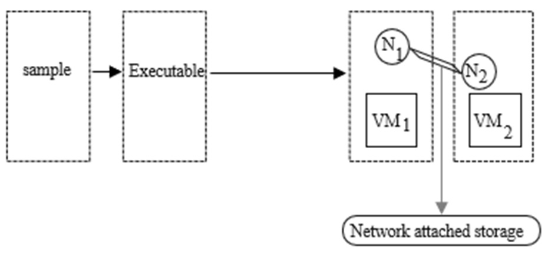
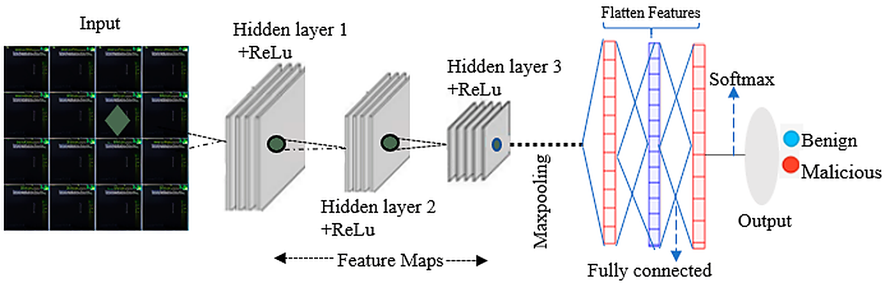
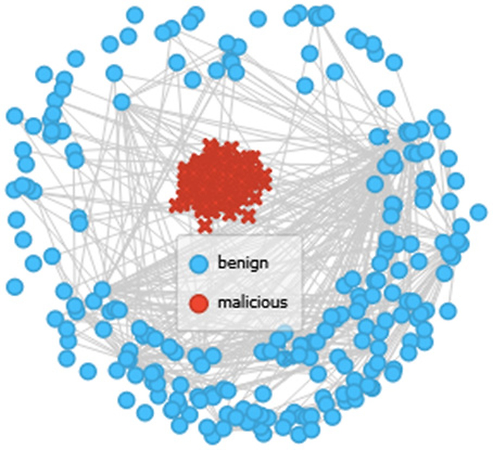

# Review Paper

## Enhanced Image-Based Malware Classification Using Transformer-Based Convolutional Neural Networks (CNNs)

### Penulis & Tahun

Moses Ashawa, Nsikak Owoh, Salaheddin Hosseinzadeh, dan Jude Osamor (**2024**).

### Judul Penelitian

*Enhanced Image-Based Malware Classification Using Transformer-Based Convolutional Neural Networks (CNNs)*

### Nama Jurnal / Conference

Artikel jurnal pada **Electronics**, Volume 13, Article 4081, tahun 2024. DOI: `10.3390/electronics13204081`.

### Dataset

Penelitian menggunakan sekitar **16.000 sampel malware dan benign** yang dikumpulkan dan diproses melalui lingkungan virtual machine. File executable diubah menjadi representasi citra berdasarkan byte stream dan intensitas piksel.

Paper memanfaatkan beberapa bentuk representasi, yaitu byte stream, grayscale image, feature map, dan visualisasi berbasis keluarga malware. Data diklasifikasikan menjadi kelas **benign** dan **malicious** pada tahap visualisasi serta evaluasi model.

*Gambar 1. Alur penyimpanan executable pada virtual machine.*

### Metode / Model

Penelitian mengusulkan pendekatan klasifikasi malware berbasis citra yang menggabungkan **CNN dengan komponen Transformer-based feature processing**. Arsitektur utama yang dipilih adalah **ResNet-152**.

Alasan pemilihan ResNet-152 adalah:

- residual learning membantu mengurangi masalah degradasi jaringan;
- arsitektur yang dalam dapat menangkap pola malware yang kompleks;
- residual connection membantu mengurangi risiko vanishing gradient;
- model dapat digunakan untuk mempelajari fitur lokal dan struktur visual malware.

Tahapan utama penelitian:

1. Executable malware disimpan dan diproses pada virtual machine.
2. Byte stream diubah menjadi nilai desimal dan unsigned integer.
3. Nilai tersebut dipetakan menjadi intensitas piksel untuk membentuk citra malware.
4. Feature normalization dilakukan menggunakan min-max normalization.
5. Dimensi fitur direduksi menggunakan Principal Component Analysis (PCA).
6. CNN mengekstraksi feature map melalui beberapa hidden layer, ReLU, max pooling, dan fully connected layer.
7. Model melakukan klasifikasi benign atau malicious.
8. Feature space dianalisis menggunakan multi-dimensional scaling, SOM, PCA, heatmap, dan visualisasi keluarga malware.

*Gambar 2. Proses ekstraksi feature map hingga klasifikasi benign dan malicious.*

### Feature Normalization dan Representasi Citra

Penulis menggabungkan fitur terstruktur dan fitur berbasis konten. Nilai fitur dinormalisasi ke rentang 0 sampai 1 agar skala setiap variabel lebih seragam. Byte stream kemudian dikonkatenasi menjadi satu aliran biner yang dipetakan ke citra.

PCA digunakan untuk memahami komponen yang paling dominan dalam data. Hasil yang dilaporkan menunjukkan bahwa komponen pertama menangkap sekitar 74,2% variasi data, sedangkan komponen berikutnya menangkap sebagian besar variasi yang tersisa.

*Gambar 3. Visualisasi ruang fitur benign dan malicious menggunakan pendekatan SOM.*

### Hasil Utama

Hasil utama penelitian menunjukkan bahwa model yang diusulkan memperoleh accuracy sekitar **99,62%**. Nilai tersebut sedikit melampaui beberapa metode pembanding yang berada pada kisaran 99,60%.

Hasil penelitian juga menunjukkan bahwa:

- model dapat membedakan pola benign dan malicious secara efektif;
- feature visualization membantu memahami proses pemisahan kelas;
- heatmap dapat menunjukkan area citra yang dianggap penting oleh model;
- visualisasi keluarga malware membantu melihat kemiripan pola antarjenis malware;
- ResNet-152 memberikan keseimbangan antara akurasi, kedalaman model, dan kemampuan menangkap pola kompleks.

### Interpretasi Hasil

Penelitian tidak hanya melaporkan nilai accuracy, tetapi juga menggunakan beberapa visualisasi untuk memahami perilaku model. Multi-dimensional scaling digunakan untuk melihat pengelompokan fitur pada beberapa tahap iterasi. SOM memperlihatkan hubungan dan pemisahan antara kelas benign dan malicious. PCA digunakan untuk melihat kontribusi komponen utama terhadap variasi data.

Heatmap digunakan untuk menunjukkan region of interest yang dianggap penting oleh model. Visualisasi ini membantu menjelaskan bagian citra yang berkontribusi terhadap keputusan klasifikasi.

### Kelebihan

1. Menggunakan representasi malware berbasis citra yang dapat diproses oleh model computer vision.
2. Menggabungkan analisis feature map dan visualisasi ruang fitur.
3. Menggunakan ResNet-152 yang kuat untuk menangkap pola malware yang kompleks.
4. Melaporkan accuracy tinggi, yaitu sekitar 99,62%.
5. Menyediakan visualisasi untuk membantu interpretasi proses klasifikasi.
6. Mempertimbangkan efisiensi komputasi dan kemampuan generalisasi model.
7. Relevan untuk kategori CNN - klasifikasi dalam malware image classification.

### Keterbatasan

1. Dataset relatif terbatas, yaitu sekitar 16.000 sampel, sehingga generalisasi terhadap dataset yang lebih besar masih perlu diuji.
2. Performa model dapat dipengaruhi oleh hyperparameter dan konfigurasi eksperimen tertentu.
3. Perbandingan antara ResNet-152 dan Vision Transformer belum sepenuhnya mewakili semua variasi arsitektur Transformer.
4. Representasi citra dapat kehilangan sebagian informasi struktural dan behavioral dari file executable asli.
5. Eksperimen lebih berfokus pada klasifikasi benign-malicious sehingga klasifikasi banyak keluarga malware belum menjadi fokus utama.
6. Pengujian pada lingkungan IoT atau platform lain mungkin memerlukan penyesuaian arsitektur dan hyperparameter.
7. Akurasi tinggi belum otomatis menunjukkan ketahanan terhadap malware baru, obfuscation, adversarial examples, atau domain shift.

## Kesimpulan Review

Paper ini mengembangkan pendekatan klasifikasi malware berbasis citra dengan memanfaatkan CNN dan pemrosesan fitur berbasis Transformer. ResNet-152 dipilih karena mampu menangkap pola kompleks melalui residual learning. Dengan representasi byte stream sebagai citra, model mencapai accuracy sekitar 99,62%.

Kontribusi penting penelitian ini adalah penggunaan visualisasi feature space, PCA, SOM, dan heatmap untuk mendukung interpretasi model. Walaupun hasilnya sangat baik, validasi pada dataset yang lebih besar, multiclass malware family classification, dan pengujian lintas-platform masih diperlukan untuk memastikan generalisasi.

## Sumber

1. Ashawa, M., Owoh, N., Hosseinzadeh, S., & Osamor, J. (2024). *Enhanced Image-Based Malware Classification Using Transformer-Based Convolutional Neural Networks (CNNs)*. **Electronics, 13**, 4081. https://doi.org/10.3390/electronics13204081
2. ResearchGate: [Enhanced Image-Based Malware Classification Using Transformer-Based Convolutional Neural Networks (CNNs)](https://www.researchgate.net/publication/385019678_Enhanced_Image-Based_Malware_Classification_Using_Transformer-Based_Convolutional_Neural_Networks_CNNs)
