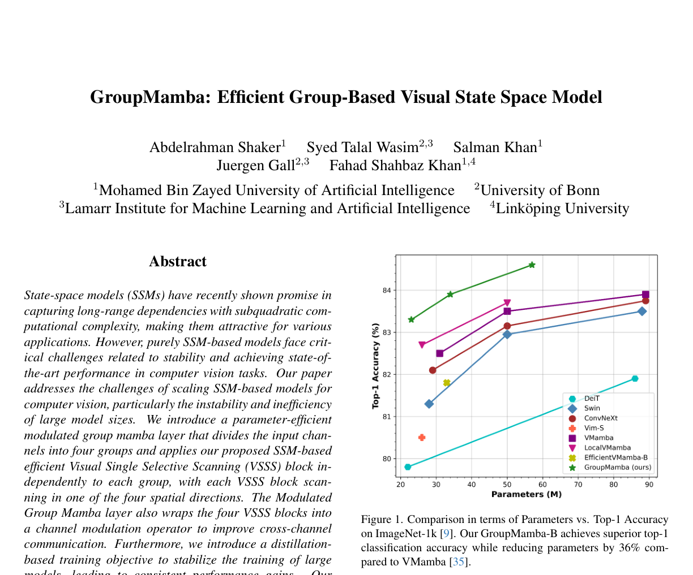
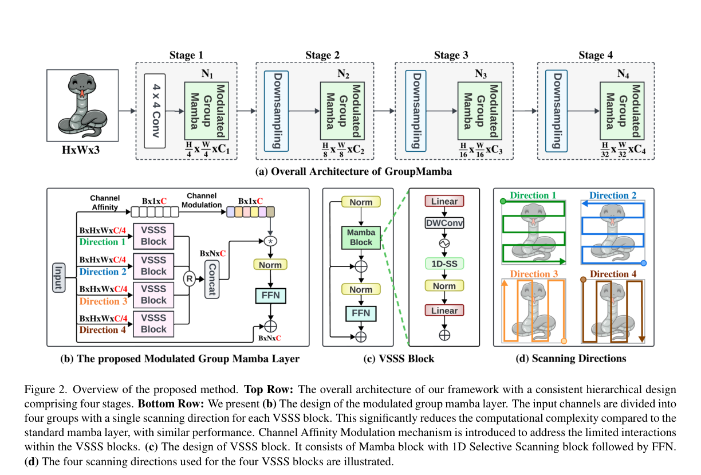

# Review Paper

## GroupMamba: Efficient Group-Based Visual State Space Model

### Identitas paper

- **Penulis:** Abdelrahman Shaker, Syed Talal Wasim, Salman Khan, Juergen Gall, dan Fahad Shahbaz Khan.
- **Tahun:** Preprint arXiv pertama kali diajukan pada 2024; versi PDF yang ditinjau adalah arXiv v2 tanggal 28 Maret 2025.
- **Publikasi:** Diterima di *IEEE/CVF Conference on Computer Vision and Pattern Recognition (CVPR 2025)* menurut metadata arXiv.
- **Sumber:** [arXiv:2407.13772](https://arxiv.org/abs/2407.13772) · [PDF arXiv](https://arxiv.org/pdf/2407.13772) · [CVPR Open Access](https://openaccess.thecvf.com/content/CVPR2025/html/Shaker_GroupMamba_Efficient_Group-Based_Visual_State_Space_Model_CVPR_2025_paper.html).

### Tujuan penelitian

Paper ini mengusulkan GroupMamba untuk mengatasi kebutuhan parameter/komputasi dan kestabilan model visual berbasis SSM. Metode membagi kanal fitur menjadi empat grup dengan arah selective scan spasial yang berbeda, menambahkan channel modulation untuk meningkatkan komunikasi antarkanal, serta memakai objective distillation untuk membantu kestabilan training model besar.

### Dataset dan evaluasi

Eksperimen menggunakan benchmark computer vision umum:

- **ImageNet-1K:** sekitar 1,28 juta citra training dan 50 ribu validasi dari 1.000 kelas; metrik Top-1 accuracy, parameter, dan FLOPs. Training 300 epoch dengan warm-up 20 epoch, batch size 1.024, AdamW, serta delapan GPU A100.
- **MS-COCO 2017:** object detection dan instance segmentation dengan Mask R-CNN jadwal 1×; metrik box AP dan mask AP.
- **ADE20K:** semantic segmentation menggunakan UperNet; metrik mIoU single-scale dan multi-scale.

Paper juga menyertakan ablation komponen scan, channel affinity modulation, dan distillation loss. Tidak ada eksperimen pada malware atau MaleVis.

### Metode atau arsitektur model

GroupMamba memakai hierarki empat stage. Patch embedding awal membuat fitur beresolusi lebih rendah, lalu Modulated Group Mamba layers memproses fitur. Kanal masukan dibagi menjadi empat grup, masing-masing menjalankan Visual Single Selective Scan (VSSS) pada salah satu arah spasial. Channel Affinity Modulation (CAM) digunakan untuk memperbaiki interaksi informasi antargrup yang berkurang akibat pengelompokan. Blok menggunakan LayerNorm, residual connection, dan FFN. Distillation objective menggabungkan cross-entropy label ground truth dan label teacher (RegNetY-16G pada setup yang dijelaskan).

*Gambar 1. Perbandingan parameter dengan Top-1 accuracy pada ImageNet-1K, Fig. 1 pada Shaker et al. (2025). Gambar asli diekstrak dari PDF.*

*Gambar 2. Empat-stage GroupMamba, Modulated Group Mamba layer, VSSS block, dan arah scan, Fig. 2 pada Shaker et al. (2025). Gambar asli diekstrak dari PDF.*

### Domain penelitian

**Computer vision dan machine learning**, khususnya backbone SSM untuk klasifikasi citra, object detection, instance segmentation, dan semantic segmentation. Paper bukan penelitian cybersecurity atau klasifikasi malware.

### Hasil utama

- Pada ImageNet-1K, **GroupMamba-T** mencapai 83,3% Top-1 accuracy dengan 23 juta parameter dan 4,5G FLOPs; **GroupMamba-S** 83,9% dengan 34 juta parameter dan 7,0G FLOPs; **GroupMamba-B** 84,5% dengan 57 juta parameter dan 14G FLOPs.
- GroupMamba-T melaporkan accuracy 0,8 poin persentase lebih tinggi daripada VMamba-T (82,5%), dengan 26% lebih sedikit parameter.
- Pada MS-COCO dengan Mask R-CNN 1×, GroupMamba-T memperoleh **47,6 box AP** dan **42,9 mask AP**.
- Pada ADE20K dengan UperNet, GroupMamba-T memperoleh **48,6 mIoU single-scale** dan **49,2 multi-scale**.
- Ablation distillation menunjukkan peningkatan untuk konfigurasi lebih besar: GroupMamba-S berubah dari 83,1% menjadi 83,9%, dan GroupMamba-B dari 83,2% menjadi 84,5% menurut tabel ablation paper.

### Analisis kontribusi model

Kontribusi utama adalah pemrosesan fitur SSM berbasis grup dan scan empat arah, disertai CAM untuk komunikasi antarkanal serta distillation untuk kestabilan training. Evaluasi menunjukkan model bersaing pada benchmark visi umum dengan jumlah parameter yang dilaporkan lebih rendah daripada beberapa model SSM pembanding. Paper ini membantu memahami desain alternatif Vision Mamba/SSM, tetapi tidak memberi bukti langsung tentang performa pada malware.

### Kelebihan

1. Menggabungkan efisiensi grouped operations dengan scan di beberapa arah spasial.
2. Menyertakan CAM untuk menanggapi keterbatasan komunikasi kanal akibat grouping.
3. Menguji image classification dan dua tipe dense prediction pada dataset standar.
4. Menyajikan ablation untuk arah scan, distillation, dan komponen model.
5. Melaporkan accuracy, parameter, FLOPs, AP, dan mIoU.

### Keterbatasan

1. Tidak menguji malware, MaleVis, atau klasifikasi citra RGB malware.
2. Hasil ImageNet/COCO/ADE20K tidak dapat disamakan langsung dengan klasifikasi malware karena domain, label, preprocessing, dan metrik berbeda.
3. Performa klasifikasi dilatih pada delapan GPU A100; hasil efisiensi model tidak otomatis mencerminkan latensi atau kebutuhan memori pada perangkat keras lain.
4. Perbandingan utama berfokus pada accuracy/parameter/FLOPs dan task benchmark; paper tidak menguji robustness khusus untuk obfuscation malware.
5. GroupMamba memasukkan beberapa komponen (group scanning, CAM, distillation), sehingga kontribusi masing-masing perlu dibaca dari ablation dan tidak disimpulkan dari skor model akhir saja.

### Kesimpulan review

GroupMamba adalah backbone visual SSM yang menggabungkan group-based multi-direction scanning, channel modulation, dan distillation. Paper melaporkan hasil kompetitif pada ImageNet-1K, COCO, dan ADE20K. Untuk tesis klasifikasi malware RGB MaleVis, paper ini relevan sebagai referensi rancangan SSM/visi, bukan sebagai pembanding empiris pada dataset malware. Kinerjanya terhadap ViT dan Vision Mamba perlu diuji pada kondisi eksperimen yang sama.

### Sumber

1. Shaker, A., Wasim, S. T., Khan, S., Gall, J., & Shahbaz Khan, F. (2025). *GroupMamba: Efficient Group-Based Visual State Space Model*. **Proceedings of the IEEE/CVF Conference on Computer Vision and Pattern Recognition (CVPR 2025)**. [CVPR Open Access](https://openaccess.thecvf.com/content/CVPR2025/html/Shaker_GroupMamba_Efficient_Group-Based_Visual_State_Space_Model_CVPR_2025_paper.html).
2. [arXiv abstract and version history](https://arxiv.org/abs/2407.13772) · [PDF](https://arxiv.org/pdf/2407.13772) · [Code and model weights](https://github.com/Amshaker/GroupMamba).
