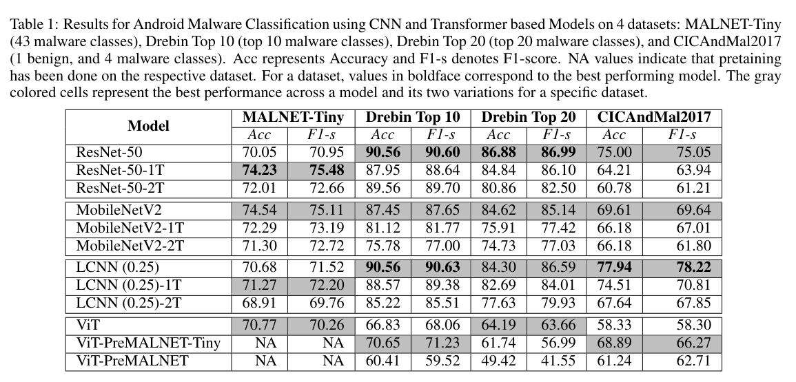
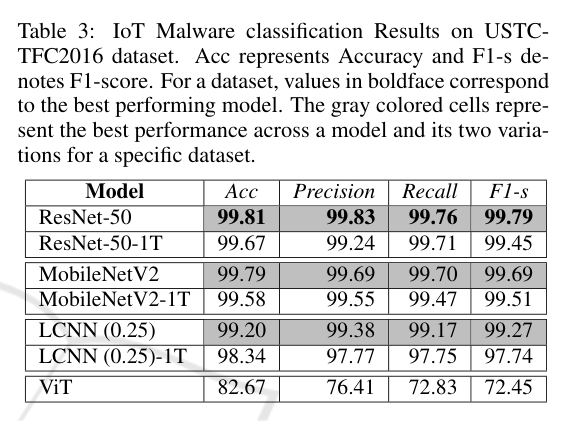

# Review Paper

## Malware Analysis Using Transformer Based Models: An Empirical Study

### Identitas paper

- **Penulis:** Abhishek Joshi, Divyateja Pasupuleti, Nischith P., Sarvesh Sutaone, Soumil Ray, Soumyadeep Dey, dan Barsha Mitra.
- **Tahun:** 2024.
- **Publikasi:** *Proceedings of the 21st International Conference on Security and Cryptography (SECRYPT 2024)*, halaman 858–865. DOI: [10.5220/0012855100003767](https://doi.org/10.5220/0012855100003767).
- **Sumber:** [SciTePress](https://www.scitepress.org/PublishedPapers/2024/128551/) | [PDF](https://www.scitepress.org/Papers/2024/128551/128551.pdf).

### Tujuan penelitian

Penelitian membandingkan model CNN, CNN yang ditambah lapisan Transformer, dan model Transformer murni untuk analisis malware berbasis citra. Penulis juga mengevaluasi Transformer untuk klasifikasi urutan API call Android.

### Dataset dan evaluasi

Eksperimen mencakup MALNET-Tiny, Drebin Top 10, Drebin Top 20, dan CICAndMal2017. Masukan citra berasal dari aplikasi Android dan lalu lintas IoT yang divisualisasikan; eksperimen sekuens memakai API call Android. Metrik tabel meliputi accuracy dan F1-score. Dataset MaleVis tidak digunakan.

*Gambar 1. Tabel hasil klasifikasi citra Android pada MALNET-Tiny, Drebin, dan CICAndMal2017; sumber: Table 1 pada paper.*

*Gambar 2. Hasil pada dataset lalu lintas IoT USTC-TFC2016; sumber: Table 3 pada paper.*

### Metode atau arsitektur model

Perbandingan citra mencakup ResNet-50, MobileNetV2, LCNN, variasi dengan satu atau dua lapisan Transformer, serta Vision Transformer (ViT) murni. Untuk API call sequence, penulis melatih BERT dan membandingkan strategi inisialisasi embedding dan pretraining.

### Domain penelitian

Klasifikasi malware Android dan IoT berbasis citra serta urutan API call; bukan malware Windows PE pada MaleVis.

### Hasil utama

Secara umum, penulis melaporkan CNN mengungguli model berbasis Transformer pada dataset yang diuji. Kinerja berubah menurut dataset dan jumlah kelas; penambahan lapisan Transformer tidak memberi peningkatan konsisten. Hasil ini mendukung perlunya evaluasi empiris per dataset, bukan asumsi bahwa Transformer selalu lebih baik.

### Analisis kontribusi model

Paper memberikan studi komparatif langsung atas CNN, CNN+Transformer, dan ViT murni pada representasi malware, sehingga berguna sebagai konteks metodologis perbandingan arsitektur. Domain, platform, dan datasetnya berbeda dari MaleVis RGB.

### Kelebihan

1. Membandingkan beberapa keluarga model dalam studi yang sama.
2. Mencakup citra dan sekuens API, serta beberapa dataset Android/IoT.
3. Melaporkan accuracy dan F1-score untuk mengamati trade-off antar model.

### Keterbatasan

1. Tidak menggunakan MaleVis atau citra RGB malware Windows PE.
2. Eksperimen melibatkan dataset Android dan IoT yang karakteristiknya berbeda dari klasifikasi keluarga malware PE.
3. Jumlah dataset dan variasi eksperimen membatasi generalisasi kesimpulan ke dataset lain.

### Kesimpulan review

Studi ini menunjukkan bahwa hasil Transformer pada klasifikasi malware bergantung pada representasi dan dataset, serta CNN dapat menjadi pembanding kuat. Temuannya berguna sebagai konteks evaluasi arsitektur, tetapi tidak dapat langsung dianggap sebagai hasil untuk MaleVis RGB.

### Sumber

Joshi, A., Pasupuleti, D., Nischith, P., Sutaone, S., Ray, S., Dey, S., & Mitra, B. (2024). *Malware Analysis Using Transformer Based Models: An Empirical Study*. In *Proceedings of SECRYPT 2024* (pp. 858–865). [Artikel](https://www.scitepress.org/PublishedPapers/2024/128551/) | [PDF](https://www.scitepress.org/Papers/2024/128551/128551.pdf) | [DOI](https://doi.org/10.5220/0012855100003767).
