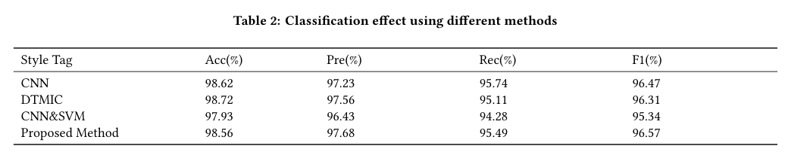
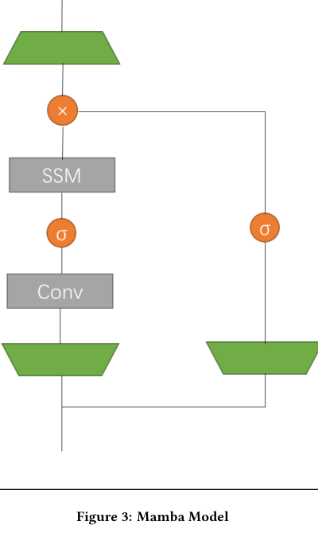
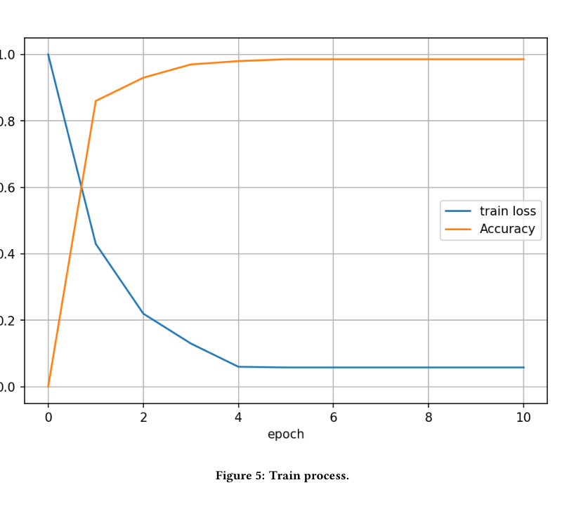

# Review Paper

## Malware Image Classification Based on Mamba

### Identitas paper

- **Penulis:** Haoxuan Wang
- **Tahun:** 2024
- **Judul:** *Malware Image Classification Based on Mamba*
- **Publikasi:** Proceedings of AISNS 2024, Xiangtan, China, 20–22 Desember 2024, hlm. 249–254.
- **Penerbit dan DOI:** ACM, [10.1145/3714334.3714377](https://doi.org/10.1145/3714334.3714377).

### Tujuan penelitian

Penelitian ini mengusulkan model berbasis Mamba untuk mengklasifikasikan keluarga malware dari representasi visual berkas. Penulis mengubah byte kode menjadi citra grayscale, lalu menggunakan model sekuensial Mamba untuk memprediksi kelas malware pada dataset MalImg.

### Dataset dan evaluasi

Paper menggunakan **MalImg**, yang dilaporkan berisi 9.339 sampel dari 25 kelas keluarga malware. Byte berkas dibaca sebagai nilai `uint8` dan disusun menjadi citra grayscale dengan lebar tetap serta tinggi yang menyesuaikan ukuran berkas. Data dibagi menjadi 90% untuk pelatihan dan 10% untuk pengujian. Pelatihan berlangsung selama 10 epoch dengan batch size 1.

Evaluasi mencakup accuracy, precision, recall, F1-score, dan kurva ROC. Lingkungan yang dilaporkan adalah Windows 64-bit, Intel Core i7-9750, GPU yang disebut “RX 2060” pada paper, RAM 16 GB, Python, dan PyTorch. Paper tidak menjelaskan validasi silang atau pengulangan eksperimen dengan beberapa pembagian data.

*Tabel 2 paper membandingkan accuracy, precision, recall, dan F1-score model usulan dengan CNN, DTMIC, dan CNN&SVM. Sumber: Wang (2024), Tabel 2.*

### Metode atau arsitektur model

Model menggabungkan **state space model (SSM)** dengan lapisan pemetaan linear. Masukan berupa urutan nilai dari byte kode yang telah divisualisasikan; bagian SSM memproses dependensi sekuensial dan lapisan pemetaan menghasilkan probabilitas untuk 25 kelas. Penulis melaporkan penggunaan Adam dengan learning rate 0,001 dan categorical cross-entropy.

*Skema Mamba dalam paper menunjukkan jalur konvolusi dan SSM dengan cabang pemetaan serta operasi gerbang. Sumber: Wang (2024), Gambar 3.*

### Domain penelitian

**Cybersecurity dan computer vision**, khususnya klasifikasi keluarga malware melalui visualisasi byte berkas dan pemodelan sekuensial.

### Hasil utama

| Metode | Accuracy (%) | Precision (%) | Recall (%) | F1-score (%) |
|---|---:|---:|---:|---:|
| CNN | 98,62 | 97,23 | 95,74 | 96,47 |
| DTMIC | 98,72 | 97,56 | 95,11 | 96,31 |
| CNN&SVM | 97,93 | 96,43 | 94,28 | 95,34 |
| Metode usulan Mamba | 98,56 | 97,68 | 95,49 | 96,57 |

Menurut Tabel 2, metode usulan memiliki precision dan F1-score tertinggi di antara metode yang dicantumkan, tetapi accuracy-nya sedikit di bawah CNN dan DTMIC. Uraian teks pada halaman yang sama menyebut accuracy 98,68%, sedangkan tabel melaporkan 98,56%; paper tidak menjelaskan perbedaan ini. Nilai pada tabel digunakan di atas karena disajikan bersama metrik pembanding.

*Grafik menunjukkan train loss turun dan accuracy meningkat sepanjang 10 epoch. Sumber: Wang (2024), Gambar 5.*

### Analisis kontribusi model

Paper menerapkan Mamba secara langsung untuk klasifikasi keluarga malware dari representasi grayscale byte, dengan alasan SSM dapat memproses dependensi sekuensial yang panjang. Hasil Tabel 2 menunjukkan bahwa model bersaing dengan pembanding klasik pada satu dataset: F1-score dan precision-nya tertinggi pada tabel, sedangkan accuracy tertinggi diperoleh DTMIC. Karena pengujian hanya menggunakan MalImg dan satu skema pembagian data yang dilaporkan, hasil ini belum menunjukkan konsistensi keunggulan lintas dataset atau protokol.

### Kelebihan

1. Menguji Mamba pada tugas malware yang direpresentasikan sebagai citra grayscale.
2. Menyediakan perbandingan metrik dengan tiga metode pembanding.
3. Melaporkan konfigurasi pelatihan, perangkat keras, dan kurva pelatihan.
4. Membahas pemrosesan byte sebagai urutan, sehingga memberi konteks untuk penggunaan SSM pada data malware tervisualisasi.

### Keterbatasan

1. Evaluasi hanya menggunakan MalImg; tidak ada eksperimen pada MaleVis atau dataset lain.
2. Representasi yang digunakan grayscale, bukan RGB.
3. Pembagian train/test 90:10 dilaporkan tanpa validasi silang, pengulangan beberapa seed, atau interval ketidakpastian.
4. Terdapat ketidaksesuaian angka accuracy metode usulan: 98,56% pada tabel dan 98,68% dalam uraian teks.
5. Rincian preprocessing citra dan bentuk masukan sekuensial belum cukup untuk mereplikasi seluruh pipeline; paper menyebut lebar tetap, tetapi tidak menetapkan nilainya dalam uraian tersebut.
6. Tidak ada pembanding Vision Transformer, sehingga paper tidak memberikan perbandingan langsung Mamba versus ViT.
7. Klaim ketahanan di abstrak tidak disertai protokol uji robustness yang terperinci pada eksperimen yang dilaporkan.

### Kesimpulan review

Paper ini menunjukkan bahwa arsitektur Mamba dapat diterapkan pada klasifikasi keluarga malware dari byte berkas yang divisualisasikan sebagai citra grayscale. Pada tabel hasil, model memperoleh precision dan F1-score tertinggi di antara metode pembanding, sementara accuracy-nya sedikit di bawah CNN dan DTMIC. Kesimpulan performa perlu dibaca dengan hati-hati karena paper melaporkan dua angka accuracy yang berbeda dan hanya menguji satu dataset dengan satu pembagian data.

### Sumber

1. Wang, H. (2024). *Malware Image Classification Based on Mamba*. Proceedings of AISNS 2024, 249–254. [ACM Digital Library](https://dl.acm.org/doi/10.1145/3714334.3714377) · [DOI](https://doi.org/10.1145/3714334.3714377).
2. [PDF paper di ACM Digital Library](https://dl.acm.org/doi/pdf/10.1145/3714334.3714377).
