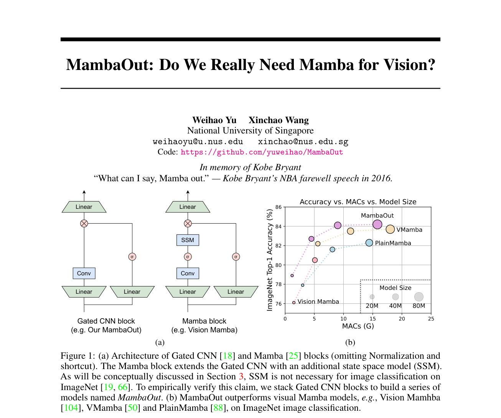
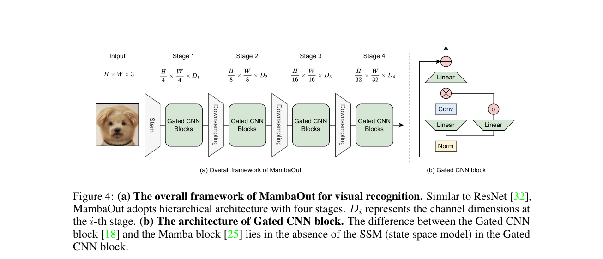

# Review Paper

## MambaOut: Do We Really Need Mamba for Vision?

### Identitas paper

- **Penulis:** Weihao Yu dan Xinchao Wang.
- **Tahun:** 2024.
- **Jenis publikasi:** Preprint arXiv:2405.07992v3; naskah ditandai *under review* pada versi PDF. Halaman arXiv yang diperiksa tidak mencantumkan venue publikasi.
- **Sumber:** [arXiv:2405.07992](https://arxiv.org/abs/2405.07992) · [PDF arXiv](https://arxiv.org/pdf/2405.07992).

### Tujuan penelitian

Paper menguji apakah State Space Model (SSM) atau Mamba diperlukan untuk tugas computer vision. Penulis berhipotesis bahwa SSM tidak perlu untuk klasifikasi citra ImageNet, sedangkan SSM masih berpotensi berguna untuk deteksi dan segmentasi yang melibatkan urutan visual lebih panjang. Untuk menguji gagasan ini, mereka membangun MambaOut dengan menghilangkan SSM dari blok Mamba dan menumpuk blok Gated CNN.

### Dataset dan evaluasi

Eksperimen memakai benchmark visi umum berikut:

- **ImageNet** untuk klasifikasi citra 1.000 kelas; sekitar 1,3 juta citra training dan 50 ribu citra validasi. Metrik utama Top-1 accuracy; tabel juga melaporkan parameter dan MACs.
- **COCO 2017** untuk object detection dan instance segmentation dengan Mask R-CNN; metrik box AP dan mask AP. Setup yang dijelaskan memakai jadwal 1× sebanyak 12 epoch.
- **ADE20K** untuk semantic segmentation dengan UperNet; metrik mIoU untuk single-scale dan multi-scale.

Untuk klasifikasi ImageNet, model memakai input 224 × 224, training 300 epoch, batch size 4.096, AdamW, dan TPU v3. Evaluasi COCO memakai gambar dengan sisi pendek 800 px, batch size 16, serta 4 GPU NVIDIA 4090. Setup ADE20K memakai batch size 16 dan 160.000 iterasi. Paper tidak mengevaluasi dataset malware.

### Metode atau arsitektur model

MambaOut dibangun dengan menumpuk **Gated CNN blocks**, dengan token mixer SSM dari blok Mamba dihilangkan. Penulis membandingkan MambaOut dengan visual Mamba, CNN, model attention/ViT, serta model hybrid. Paper juga membahas perbedaan causal mixing pada SSM dengan fully-visible mixing yang umum untuk tugas pemahaman citra.

*Gambar 1. Perbedaan blok Mamba dan Gated CNN, serta perbandingan ImageNet, Fig. 1 pada Yu & Wang (2024). Gambar asli diekstrak dari PDF.*

*Gambar 2. Kerangka MambaOut dengan empat stage dan Gated CNN blocks, Fig. 4 pada Yu & Wang (2024). Gambar asli diekstrak dari PDF.*

### Domain penelitian

**Computer vision dan machine learning**, khususnya analisis kebutuhan SSM/Mamba pada image classification, object detection, instance segmentation, dan semantic segmentation. Paper tidak membahas cybersecurity atau klasifikasi malware.

### Hasil utama

- Pada ImageNet 224 × 224, MambaOut-Tiny memperoleh **82,7% Top-1 accuracy** dengan 27 juta parameter dan 4,5G MACs; MambaOut-Small memperoleh **84,1%** dengan 48 juta parameter dan 9,0G MACs; MambaOut-Base memperoleh **84,2%** dengan 85 juta parameter dan 15,8G MACs.
- Paper melaporkan MambaOut-Small melampaui LocalVMamba-S (83,7%) sebesar 0,4 poin Top-1 dan memakai 79% MACs-nya.
- Pada COCO Mask R-CNN 1×, MambaOut-Tiny memperoleh **45,1 box AP** dan **41,0 mask AP**. Hasilnya masih di bawah VMamba-T (46,5 box AP; 42,1 mask AP) dan LocalVMamba-T (46,7; 42,2).
- Pada ADE20K, MambaOut-Tiny memperoleh **46,4 mIoU single-scale** dan **46,8 multi-scale**; VMamba-T memperoleh 47,3 dan 48,3, sedangkan LocalVMamba-T 47,9 dan 49,1.
- Hasil paper mendukung pembedaan menurut tugas: MambaOut unggul atas model visual Mamba yang dibandingkan pada klasifikasi ImageNet, tetapi tidak menyamai visual Mamba terbaik yang dibandingkan pada deteksi/segmentasi.

### Analisis kontribusi model

Kontribusi utama paper adalah eksperimen ablation konseptual tentang peran SSM dalam visi menggunakan MambaOut sebagai baseline Gated CNN tanpa SSM. Ini mengingatkan bahwa keuntungan Mamba bergantung pada sifat tugas, bukan otomatis berlaku pada semua masalah visi. Untuk riset malware, paper memberi perspektif dalam merancang pembanding dan interpretasi hasil: kesimpulan dari ImageNet atau tugas dense prediction tidak otomatis berlaku untuk klasifikasi citra malware.

### Kelebihan

1. Menguji hipotesis tentang kapan SSM diperlukan melalui klasifikasi dan tugas dense prediction.
2. Membandingkan model pada ImageNet, COCO, dan ADE20K, termasuk beberapa ukuran model.
3. Mencantumkan parameter, MACs, accuracy, AP, dan mIoU sesuai tugas.
4. Menjelaskan perbedaan causal SSM dengan kebutuhan fully-visible pada pengenalan visual.
5. MambaOut menyediakan baseline yang lebih sederhana untuk menguji kontribusi SSM pada model visi.

### Keterbatasan

1. Tidak menguji malware, MaleVis, atau klasifikasi citra RGB malware.
2. Kesimpulan paper dibatasi pada tugas dan benchmark yang dipilih; tidak membuktikan bahwa SSM tidak berguna bagi semua bentuk klasifikasi citra.
3. Perbandingan lintas model merangkum hasil dari arsitektur dan studi berbeda; paper juga mengingatkan sebagian konfigurasi/meta-architecture berbeda.
4. Evaluasi throughput bukan metrik utama pada tabel ImageNet, sehingga paper tidak memberi bukti bahwa MambaOut selalu lebih cepat daripada model Mamba pada seluruh perangkat.
5. Halaman arXiv yang diperiksa mencatat preprint, dan PDF yang digunakan menandai naskah *under review*; status publikasi perlu diperiksa ulang sebelum sitasi final.

### Kesimpulan review

MambaOut menguji argumen bahwa SSM/Mamba tidak selalu dibutuhkan untuk visi. Pada benchmark yang dibandingkan, model tanpa SSM mencapai hasil ImageNet lebih tinggi daripada sejumlah model visual Mamba, sementara hasil COCO dan ADE20K menunjukkan model tersebut masih tertinggal dari VMamba/LocalVMamba tertentu. Paper berguna sebagai landasan untuk membahas peran dan trade-off Mamba, tetapi tidak memberikan evaluasi malware atau MaleVis. Efektivitas Mamba untuk klasifikasi malware RGB harus diuji langsung pada dataset dan protokol yang sama dengan baseline ViT.

### Sumber

1. Yu, W., & Wang, X. (2024). *MambaOut: Do We Really Need Mamba for Vision?* arXiv:2405.07992v3. [Halaman arXiv dan riwayat versi](https://arxiv.org/abs/2405.07992).
2. [PDF arXiv](https://arxiv.org/pdf/2405.07992) · [Kode penulis](https://github.com/yuweihao/MambaOut).
