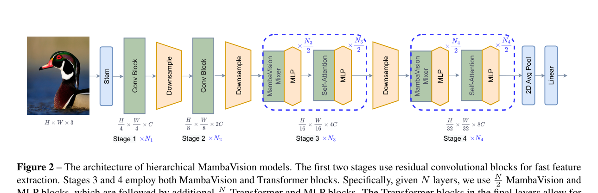
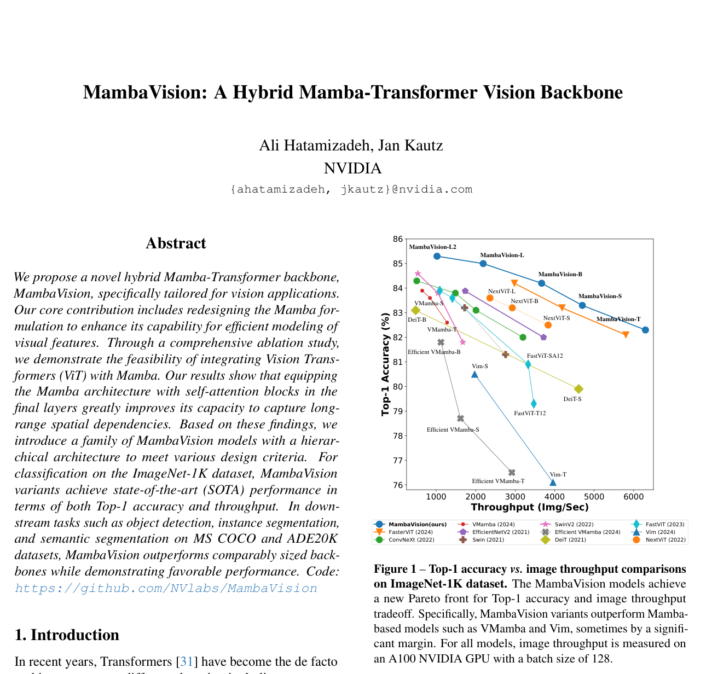

# Review Paper

## MambaVision: A Hybrid Mamba-Transformer Vision Backbone

### Identitas paper

- **Penulis:** Ali Hatamizadeh dan Jan Kautz.
- **Tahun publikasi:** 2025 (diterima di CVPR 2025). Versi awal arXiv diajukan pada 10 Juli 2024; PDF lokal adalah versi arXiv v2 tanggal 25 Maret 2025.
- **Publikasi:** *Proceedings of the IEEE/CVF Conference on Computer Vision and Pattern Recognition (CVPR 2025)*.
- **Sumber:** [arXiv:2407.08083](https://arxiv.org/abs/2407.08083) · [PDF arXiv](https://arxiv.org/pdf/2407.08083) · [CVPR Open Access](https://openaccess.thecvf.com/content/CVPR2025/html/Hatamizadeh_MambaVision_A_Hybrid_Mamba-Transformer_Vision_Backbone_CVPR_2025_paper.html).

### Tujuan penelitian

Paper ini mengusulkan MambaVision, backbone visi hierarkis yang menggabungkan CNN, Mamba, dan self-attention. Penelitian merancang ulang mixer Mamba untuk data visual serta menguji di mana blok Transformer perlu ditempatkan agar dapat menggabungkan efisiensi pemrosesan sekuens dengan pemodelan konteks global.

### Dataset dan evaluasi

Evaluasi utama dilakukan pada benchmark visi umum, bukan malware:

- **ImageNet-1K** untuk klasifikasi citra. Dilaporkan Top-1 accuracy, parameter, FLOPs, dan throughput citra.
- **MS COCO** untuk object detection dan instance segmentation dengan Cascade Mask R-CNN; metrik mencakup box AP dan mask AP.
- **ADE20K** untuk semantic segmentation dengan UPerNet; metrik yang dilaporkan adalah mIoU.
- Eksperimen tambahan menggunakan **ImageNet-21K** untuk pretraining/fine-tuning model berskala besar.

Untuk ImageNet-1K, model dilatih 300 epoch menggunakan 32 GPU A100; detail training lengkap dirujuk ke repositori kode. Throughput pada tabel benchmark diukur pada A100 dengan batch size 128. Eksperimen downstream menggunakan backbone pretrained; detailnya berbeda sesuai task dan dijelaskan dalam paper/suplemen.

### Metode atau arsitektur model

MambaVision mempunyai empat stage. Stem dan dua stage awal memakai residual CNN untuk ekstraksi fitur resolusi tinggi. Stage 3 dan 4 memakai MambaVision mixer bersama blok Transformer. Pada stage ini, Mamba mixer dan MLP dipakai pada separuh blok, dilanjutkan self-attention dan MLP pada separuh blok berikutnya. Penambahan attention di stage akhir ditujukan untuk menangkap kembali konteks spasial global dan dependensi jarak jauh.

MambaVision mixer memodifikasi Mamba: causal convolution diganti dengan convolution reguler, lalu ditambahkan cabang simetris dengan convolution dan SiLU tanpa SSM. Keluaran kedua jalur digabung dan diproyeksikan. Varian model mencakup ukuran T, T2, S, B, L, dan L2. Paper juga melakukan ablation terhadap desain mixer dan integrasi self-attention.

*Gambar 1. Arsitektur model hierarkis MambaVision, Fig. 2 pada Hatamizadeh & Kautz (2025). Gambar asli diekstrak dari PDF.*

*Gambar 2. Perbandingan Top-1 accuracy dan throughput model pada ImageNet-1K, Fig. 1 pada Hatamizadeh & Kautz (2025). Gambar asli diekstrak dari PDF.*

### Domain penelitian

**Computer vision dan machine learning**, khususnya desain backbone visual hibrida CNN–Mamba–Transformer untuk klasifikasi, deteksi objek, segmentasi instance, dan segmentasi semantik. Paper tidak menguji cybersecurity atau klasifikasi malware.

### Hasil utama

- Pada ImageNet-1K, **MambaVision-T** mencapai 82,3% Top-1 accuracy dengan throughput 6.298 img/s; **MambaVision-S** 83,3% dan 4.700 img/s; **MambaVision-B** 84,2% dan 3.670 img/s.
- MambaVision-B melaporkan 84,2% Top-1, 97,7 juta parameter, dan 15,0 GFLOPs; sebagai pembanding pada tabel, VMamba-B memperoleh 83,9% Top-1 dan 645 img/s, sedangkan ConvNeXt-B 83,8% dan 1.485 img/s. Angka throughput diukur dengan setup paper yang sama, A100 dan batch size 128.
- Pada MS COCO, MambaVision-T memperoleh 51,1 box AP dan 44,3 mask AP; MambaVision-S 52,3 dan 45,2; MambaVision-B 52,8 dan 45,7.
- Pada ADE20K, varian T/S/B memperoleh 46,0/48,2/49,1 mIoU.
- Pretraining ImageNet-21K meningkatkan Top-1 MambaVision-B dari 84,2% ke 84,9%, dan MambaVision-L dari 85,0% ke 86,1% pada resolusi 224.

### Analisis kontribusi model

Kontribusi paper adalah menunjukkan rancangan backbone hibrida yang menggunakan convolution untuk stage beresolusi tinggi, Mamba mixer untuk pemodelan sekuens, dan attention pada stage akhir. Hasil benchmark menyajikan trade-off accuracy dan throughput serta performa downstream pada deteksi dan segmentasi. Karena MambaVision memang menggabungkan Mamba dan Transformer, ia dapat menjadi referensi konsep arsitektur hibrida; tetapi paper ini bukan perbandingan terkontrol antara Vision Mamba murni dengan ViT murni pada tugas klasifikasi malware.

### Kelebihan

1. Menguji beberapa skala backbone dan melaporkan accuracy, throughput, parameter, serta FLOPs.
2. Mengevaluasi lebih dari satu tugas computer vision, termasuk deteksi dan dua jenis segmentasi.
3. Menyertakan ablation terhadap rancangan mixer dan integrasi blok self-attention.
4. Menggunakan model dan benchmark pembanding yang mencakup keluarga CNN, Transformer, hybrid, dan Mamba-based.
5. Menyediakan kode melalui repositori NVlabs yang ditautkan dari paper.

### Keterbatasan

1. Tidak menggunakan dataset malware atau MaleVis, sehingga paper tidak memberikan hasil klasifikasi malware.
2. MambaVision adalah arsitektur hibrida CNN–Mamba–Transformer; hasilnya tidak dapat dianggap sebagai hasil Vision Mamba murni atau ViT murni.
3. Perbandingan throughput bergantung pada GPU A100, batch size 128, implementasi, resolusi, dan konfigurasi benchmark yang dilaporkan.
4. Hasil ImageNet, COCO, dan ADE20K tidak dapat dibandingkan langsung dengan klasifikasi keluarga malware karena perbedaan domain, label, preprocessing, dan metrik.
5. Paper tidak mengevaluasi ketahanan terhadap obfuscation atau gangguan khusus malware.

### Kesimpulan review

MambaVision adalah backbone visi hibrida yang menggabungkan CNN, Mamba mixer, dan self-attention untuk menyeimbangkan akurasi serta throughput. Evaluasi pada ImageNet-1K, COCO, dan ADE20K mendukung performanya dalam benchmark computer vision umum. Untuk tesis klasifikasi malware RGB menggunakan MaleVis, paper ini relevan sebagai referensi desain hibrida dan pembanding konseptual, tetapi tidak menyediakan bukti empiris pada dataset atau tugas malware. Pengujian tesis tetap perlu membandingkan model pada dataset, preprocessing, split, dan lingkungan komputasi yang sama.

### Sumber

1. Hatamizadeh, A., & Kautz, J. (2025). *MambaVision: A Hybrid Mamba-Transformer Vision Backbone*. **Proceedings of the IEEE/CVF Conference on Computer Vision and Pattern Recognition (CVPR 2025)**. [CVPR Open Access](https://openaccess.thecvf.com/content/CVPR2025/html/Hatamizadeh_MambaVision_A_Hybrid_Mamba-Transformer_Vision_Backbone_CVPR_2025_paper.html).
2. [arXiv abstract and version history](https://arxiv.org/abs/2407.08083) · [PDF](https://arxiv.org/pdf/2407.08083).
