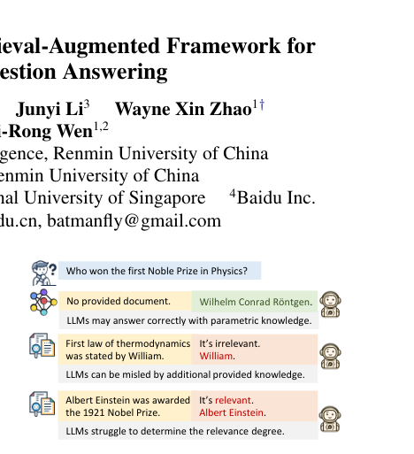
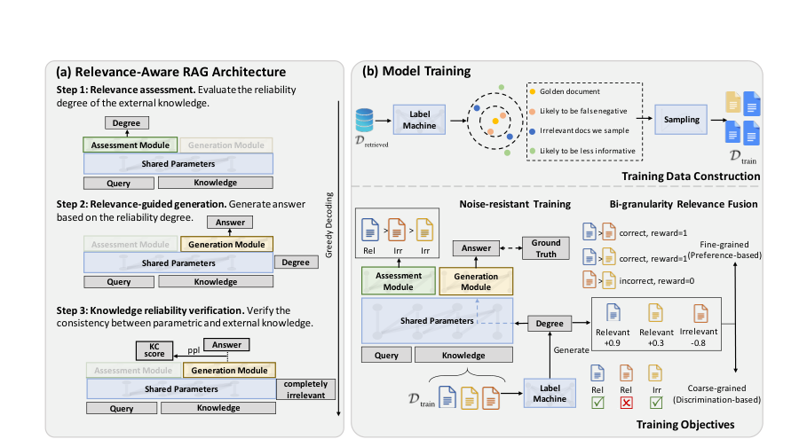
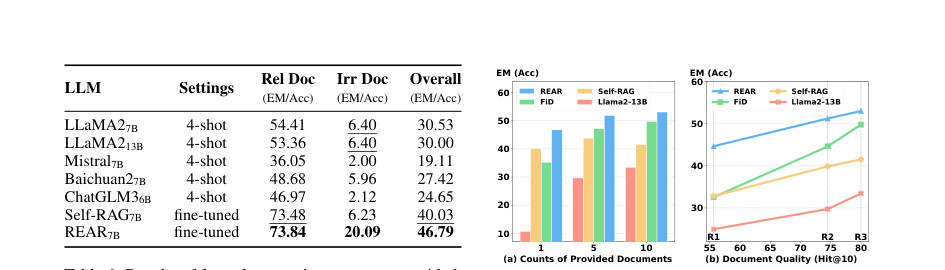
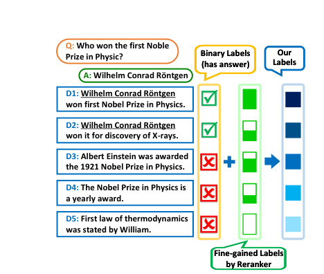

# Review Paper

## REAR: A Relevance-Aware Retrieval-Augmented Framework for Open-Domain Question Answering

### Penulis & Tahun

Yuhao Wang, Ruiyang Ren, Junyi Li, Wayne Xin Zhao, Jing Liu, dan Ji-Rong Wen (**2024**).

### Judul Penelitian

*REAR: A Relevance-Aware Retrieval-Augmented Framework for Open-Domain Question Answering*

### Nama Conference

Artikel penelitian pada **Proceedings of the 2024 Conference on Empirical Methods in Natural Language Processing (EMNLP 2024)**, halaman 5613-5626.

DOI: `10.18653/v1/2024.emnlp-main.321`.

### Tujuan Penelitian

Penelitian ini mengatasi masalah RAG ketika LLM menerima dokumen hasil retrieval yang tidak relevan. Dokumen yang tidak relevan dapat mengganggu pengetahuan internal LLM dan menghasilkan jawaban yang salah.

### Dataset dan Evaluasi

REAR dievaluasi pada **empat tugas open-domain Question Answering** dan dibandingkan dengan beberapa pendekatan RAG serta baseline language model.

Eksperimen juga menguji:

- jumlah dokumen yang diberikan kepada LLM;
- kualitas retriever;
- kemampuan model dalam kondisi dokumen relevan dan noisy;
- kualitas penilaian relevansi dokumen.

### Metode / Model

REAR (**RElevance-Aware Retrieval-Augmented approach**) menambahkan relevance-assessing module ke dalam arsitektur RAG.

Framework REAR memiliki tiga tahap utama:

1. **Relevance assessment**: menilai seberapa relevan dokumen hasil retrieval terhadap pertanyaan.
2. **Relevance-guided generation**: menggunakan dokumen yang relevan untuk membantu proses pembuatan jawaban.
3. **Knowledge reliability verification**: memeriksa keandalan pengetahuan eksternal sebelum jawaban akhir diberikan.

Selain perubahan arsitektur, paper ini memperkenalkan metode training berdasarkan:

- **bi-granularity relevance fusion**, yang menggabungkan penilaian relevansi pada tingkat dokumen dan informasi jawaban;
- **noise-resistant training**, yang membuat model lebih tahan terhadap dokumen retrieval yang tidak relevan.

### Tugas NLP

Paper ini berfokus pada:

- open-domain Question Answering;
- Retrieval-Augmented Generation;
- information retrieval;
- relevance assessment;
- knowledge-intensive NLP.

### Hasil Utama

REAR secara signifikan mengungguli berbagai metode RAG sebelumnya pada empat tugas open-domain QA.

Hasil analisis menunjukkan bahwa REAR tetap stabil ketika jumlah dokumen berubah dan ketika menggunakan retriever dengan kemampuan berbeda. Model juga lebih mampu memanfaatkan dokumen teratas dan mengurangi dampak dokumen yang tidak relevan.

### Analisis Kontribusi Model

Kontribusi utama REAR adalah:

- membuat LLM lebih sadar terhadap relevansi pengetahuan eksternal;
- menggabungkan relevance assessment dengan proses generation;
- memanfaatkan penilaian relevansi dengan dua tingkat granularitas;
- meningkatkan ketahanan RAG terhadap noise pada retrieved documents;
- mengurangi ketergantungan pada kualitas retriever semata.

### Kelebihan

- Mengusulkan integrasi penilaian relevansi ke dalam pipeline RAG.
- Diterbitkan pada EMNLP 2024.
- Menggabungkan information retrieval, LLM, dan Question Answering.
- Memiliki modul penilaian relevansi yang jelas.
- Diuji pada beberapa tugas dan kualitas retriever.

### Keterbatasan

- Penambahan relevance-assessing module dapat meningkatkan biaya komputasi.
- Kinerja masih bergantung pada kualitas dokumen yang berhasil diambil retriever.
- Eksperimen berfokus pada open-domain QA sehingga penerapan pada domain khusus perlu validasi tambahan.
- Penilaian relevansi yang lebih detail memerlukan data training dan anotasi yang sesuai.

### Kesimpulan Review

REAR mengusulkan pengembangan arsitektur RAG dengan menambahkan modul penilaian relevansi dokumen, sehingga LLM dapat membedakan informasi eksternal yang mendukung pertanyaan dari informasi yang berpotensi menimbulkan noise. Arsitektur ini terdiri atas relevance assessment, relevance-guided generation, dan knowledge reliability verification.

Penggabungan bi-granularity relevance fusion dan noise-resistant training meningkatkan kemampuan model dalam memanfaatkan dokumen hasil retrieval secara selektif. Hasil eksperimen pada empat tugas open-domain Question Answering menunjukkan bahwa REAR lebih robust terhadap perubahan jumlah dokumen dan kualitas retriever dibandingkan beberapa baseline RAG. Temuan ini menunjukkan bahwa kualitas sistem RAG tidak hanya ditentukan oleh kemampuan generator, tetapi juga oleh kemampuan model dalam mengevaluasi relevansi dan keandalan konteks yang diterima.

Secara metodologis, REAR memberikan kontribusi pada integrasi information retrieval dan language modeling dengan menempatkan penilaian relevansi sebagai bagian aktif dari proses generasi jawaban. Namun, penggunaan modul tambahan dan kebutuhan data pelatihan relevansi dapat meningkatkan kompleksitas komputasi serta biaya pengembangan sistem.

### Sumber

1. Wang, Y., Ren, R., Li, J., Zhao, W. X., Liu, J., & Wen, J.-R. (2024). *REAR: A Relevance-Aware Retrieval-Augmented Framework for Open-Domain Question Answering*. **EMNLP 2024**, 5613-5626. https://doi.org/10.18653/v1/2024.emnlp-main.321
2. [Artikel dan PDF gratis](https://aclanthology.org/2024.emnlp-main.321/)
3. [Kode REAR](https://github.com/RUCAIBox/REAR)
