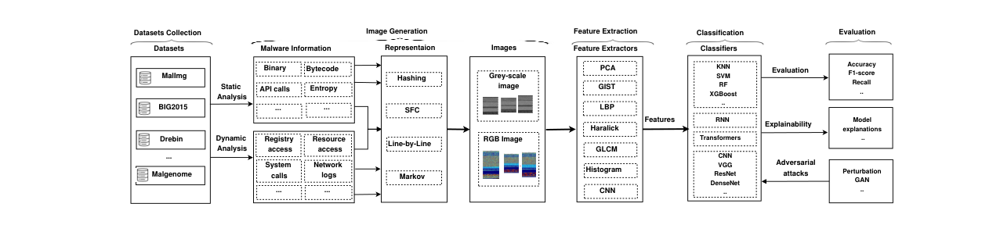
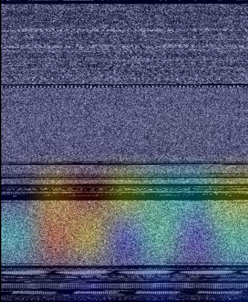
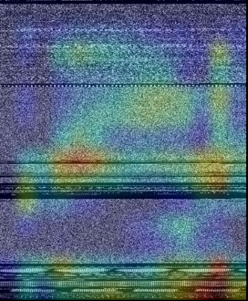
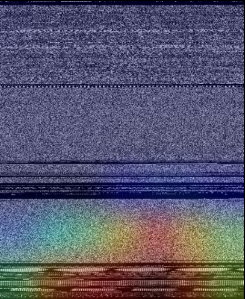

# Review Paper

## SoK: Visualization-Based Malware Detection Techniques

### Identitas paper

- **Penulis:** Matteo Brosolo, Vinod Puthuvath, Asmitha K. A., Rafidha Rehiman K. A., dan Mauro Conti.
- **Tahun:** 2024.
- **Publikasi:** *Proceedings of the 19th International Conference on Availability, Reliability and Security (ARES 2024)*, artikel 45, 13 halaman.
- **DOI:** [10.1145/3664476.3664514](https://doi.org/10.1145/3664476.3664514).
- **Sumber:** [Halaman ACM](https://dl.acm.org/doi/10.1145/3664476.3664514) · [PDF ACM](https://dl.acm.org/doi/epdf/10.1145/3664476.3664514) · [Repositori Universitas Padua](https://research.unipd.it/handle/11577/3520192).

### Tujuan penelitian

Paper ini menyusun SoK (Systematization of Knowledge) tentang teknik visualisasi malware untuk deteksi dan klasifikasi. Penulis mengelompokkan penelitian menurut pengumpulan dataset, cara menghasilkan citra, ekstraksi fitur, classifier, dan evaluasi, serta meninjau explainability, serangan adversarial, obfuscation, dan keberlanjutan model.

### Dataset dan evaluasi

Paper merupakan **survei**, bukan eksperimen klasifikasi baru. Penulis menelaah **91 paper** dan merangkum karakteristik metode serta evaluasi yang digunakan. Dataset yang sering muncul di literatur yang ditinjau meliputi:

- **MalImg:** 9.339 sampel dari 25 keluarga malware dengan distribusi tidak seimbang; citra benchmark-nya grayscale.
- **Microsoft BIG 2015:** sembilan keluarga malware dengan sekitar 20.000 sampel; paper mencatat bahwa tantangan awal menyediakan 10.860 sampel untuk peserta dan sisanya sebagai test set tersembunyi.
- Dataset Android seperti MalGenome, Drebin, AndroZoo, dan Contagio Mobile, serta dataset lain atau dataset buatan peneliti.

Evaluasi yang dibahas adalah metrik dan protokol dari studi-studi terdahulu, seperti accuracy, F1-score, dan recall. Angka hasil dari studi yang berbeda tidak membentuk eksperimen komparatif terkontrol dalam SoK ini.

*Gambar 1. Alur dari dataset dan analisis malware hingga visualisasi, fitur, classifier, dan evaluasi, Fig. 1 Brosolo et al. (2024). Diekstrak dari PDF paper.*

### Metode atau arsitektur model

SoK mengklasifikasikan pendekatan visualisasi menurut sumber informasi **statis**, **dinamis**, atau **hibrida**. Teknik pembentukan citra yang dirangkum mencakup konversi byte ke grayscale/RGB, hashing, space-filling curves, pemrosesan baris demi baris, dan representasi Markov. Fitur yang dibahas meliputi fitur tekstur dan histogram, GIST, LBP, Haralick/GLCM, serta fitur yang dipelajari CNN.

Classifier dalam literatur yang disurvei mencakup KNN, SVM, Random Forest, XGBoost, CNN, RNN, dan Transformer/ViT. Bagian Transformer menyebut penerapan CNN dan Vision Transformer pada citra yang dibentuk dari data PCAP; penyebutan tersebut merupakan rangkuman penelitian lain, bukan evaluasi ViT oleh penulis SoK.

*Gambar 2–4. Heatmap Grad-CAM pada sampel keluarga C2LOP.P dari Fig. 4: ResNet50, VGG16, dan DenseNet121. Gambar asli diekstrak dari PDF.*

### Domain penelitian

**Keamanan siber**, khususnya visualisasi malware untuk machine learning dan deep learning pada deteksi atau klasifikasi malware Windows dan Android. Cakupannya meliputi visualisasi citra biner, aktivitas runtime, traffic, interpretabilitas, dan robustness.

### Hasil utama

- Survei menunjukkan mayoritas penelitian menggunakan fitur statis dan benchmark lama; penulis mendorong dataset yang lebih mutakhir, beragam, dan mencakup malware packed atau obfuscated.
- Visualisasi dinamis berpotensi menangkap perilaku dan perubahan waktu, tetapi jumlah studi lebih sedikit dan biaya komputasinya lebih tinggi dibanding pendekatan statis.
- Deep learning, terutama CNN dan ensemble, sering menghasilkan performa tinggi pada benchmark, tetapi memerlukan dataset memadai dan tuning untuk menghindari overfitting.
- Tantangan yang disorot meliputi imbalance data, adversarial examples yang tetap harus mempertahankan fungsi malware, deteksi obfuscation, explainability, concept drift, dan keterbatasan sumber daya.
- Paper tidak mengusulkan satu model baru dan tidak melaporkan satu set angka performa hasil eksperimen penulis sendiri.

### Analisis kontribusi model

Kontribusinya berupa taksonomi dan pemetaan pipeline visualisasi malware berdasarkan 91 studi, bukan arsitektur atau model klasifikasi baru. Pembahasan Transformer/ViT memberi konteks bahwa keluarga model tersebut telah diterapkan pada sebagian studi visualisasi malware, tetapi survei tidak menyajikan perbandingan langsung antar-ViT, apalagi dengan Vision Mamba.

### Kelebihan

1. Mengorganisasi literatur di sepanjang tahapan pipeline, dari dataset hingga evaluasi.
2. Mencakup sumber fitur statis, dinamis, dan hibrida serta berbagai teknik visualisasi.
3. Tidak hanya membahas akurasi, tetapi juga adversarial robustness, obfuscation, interpretabilitas, dan concept drift.
4. Merangkum karakteristik dataset dan aspek evaluasi dari 91 studi dalam tabel sistematis.
5. Berguna untuk menemukan celah penelitian dan referensi primer yang lebih spesifik.

### Keterbatasan

1. Sebagai SoK, hasilnya bergantung pada cakupan dan kualitas studi terdahulu; tidak menyediakan eksperimen baru.
2. Studi-studi yang dirangkum menggunakan dataset, preprocessing, split, dan metrik berbeda sehingga hasil kinerjanya tidak dapat dibandingkan langsung sebagai satu benchmark.
3. Penulis mencatat banyak studi bergantung pada dataset benchmark yang lama, sehingga hasil survei tidak otomatis menggambarkan malware terbaru.
4. Pembahasannya luas dan bukan evaluasi terfokus pada MaleVis RGB, ViT versus Vision Mamba, atau satu tugas klasifikasi keluarga tertentu.

### Kesimpulan review

Paper ini relevan sebagai landasan umum tentang visualisasi malware, dataset, representasi citra, pipeline klasifikasi, serta tantangan evaluasi. Bagian Transformer/ViT dapat membantu konteks literatur, tetapi paper ini tidak membandingkan ViT dan Vision Mamba atau menguji MaleVis RGB. Untuk membahas performa model pada tugas tesis, hasil eksperimen primer yang menggunakan dataset dan protokol sebanding tetap diperlukan.

### Sumber

1. Matteo Brosolo, Vinod Puthuvath, Asmitha K. A., Rafidha Rehiman K. A., and Mauro Conti. (2024). *SoK: Visualization-based Malware Detection Techniques*. In **Proceedings of the 19th International Conference on Availability, Reliability and Security (ARES 2024)**, Article 45, 13 pages. [ACM DOI](https://doi.org/10.1145/3664476.3664514) · [ACM PDF](https://dl.acm.org/doi/epdf/10.1145/3664476.3664514).
