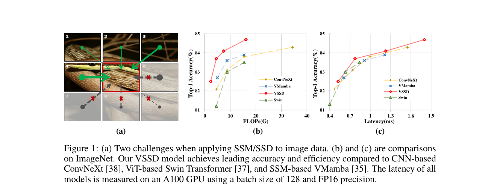
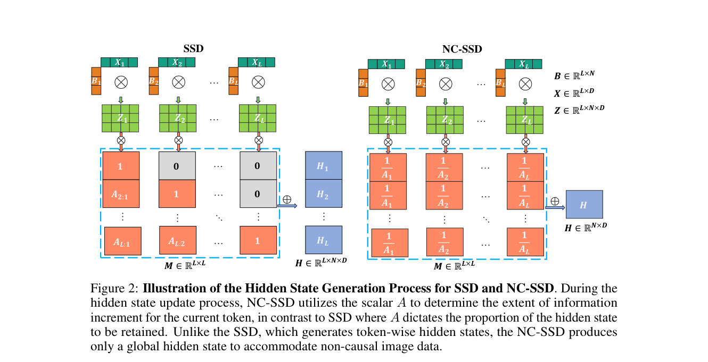

# Review Paper

## VSSD: Vision Mamba with Non-Causal State Space Duality

### Identitas paper

- **Penulis:** Yuheng Shi, Minjing Dong, Mingjia Li, dan Chang Xu.
- **Tahun:** 2024 (preprint arXiv; versi PDF yang ditinjau adalah v2, 4 Agustus 2024).
- **Status publikasi:** Halaman arXiv menyajikan naskah sebagai preprint dan tidak menyebut venue penerbitan.
- **Sumber:** [arXiv:2407.18559](https://arxiv.org/abs/2407.18559) · [PDF arXiv](https://arxiv.org/pdf/2407.18559).

### Tujuan penelitian

Paper ini memperkenalkan **Visual State Space Duality (VSSD)** untuk mengadaptasi State Space Duality (SSD) dari Mamba-2 pada data visual yang tidak bersifat kausal. Penulis merancang Non-Causal SSD (NC-SSD) agar kontribusi token tidak dibatasi urutan sebelumnya, serta menguji VSSD pada klasifikasi citra, deteksi objek, instance segmentation, dan semantic segmentation.

### Dataset dan evaluasi

Paper mengevaluasi model pada benchmark computer vision umum:

- **ImageNet-1K** untuk klasifikasi; metrik utama Top-1 accuracy. Pengaturan umum meliputi 300 epoch, warm-up 20 epoch, AdamW, EMA, label smoothing 0,1, dan center crop 224 × 224 saat pengujian.
- **MS COCO** untuk object detection dan instance segmentation menggunakan Mask R-CNN; dilaporkan box AP dan mask AP. Eksperimen mencakup jadwal training 1× serta 3× + multi-scale.
- **ADE20K** untuk semantic segmentation menggunakan UperNet; dilaporkan mIoU untuk single-scale dan multi-scale testing.

Ablation juga mengukur throughput inference dan training pada A100-PCIE-40G dengan batch 128 dan FP16. Paper tidak menggunakan dataset malware atau MaleVis.

### Metode atau arsitektur model

VSSD mengubah formulasi SSD dengan menyederhanakan state transition menjadi kontribusi token yang bersifat self-referential, sehingga causal mask dapat dihilangkan. NC-SSD lalu memproses token tanpa bergantung pada scan multi-arah untuk menciptakan sifat non-kausal. Backbone VSSD menggunakan empat stage hierarkis, downsampling, dan beberapa skala model (Micro, Tiny, Small, Base). Paper juga menguji varian hibrida yang menambahkan self-attention standar pada stage akhir serta overlapped convolutional downsampling.

*Gambar 1. Ilustrasi tantangan kausalitas/pemetaan token dan perbandingan accuracy-efficiency pada ImageNet, Fig. 1 pada Shi et al. (2024). Gambar diekstrak dari PDF paper.*

*Gambar 2. Ilustrasi proses pembentukan hidden state pada SSD dan NC-SSD, Fig. 2 pada Shi et al. (2024). Gambar diekstrak dari PDF paper.*

### Domain penelitian

**Computer vision dan machine learning**, khususnya arsitektur state space untuk klasifikasi, deteksi objek, dan segmentasi. Paper tidak meneliti cybersecurity atau deteksi malware.

### Hasil utama

- Pada ImageNet-1K, **VSSD-Micro** mencapai 82,5% Top-1 accuracy (14 juta parameter; 2,3G FLOPs), **VSSD-Tiny** 83,7% (24 juta; 4,5G FLOPs), **VSSD-Small** 84,1% (40 juta; 7,4G FLOPs), dan **VSSD-Base** 84,7% (89 juta; 16,1G FLOPs).
- Paper melaporkan VSSD-Tiny mencapai 83,7%, dibanding VMambaV9-T 82,5% pada tabel ImageNet-1K.
- Pada Mask R-CNN 1× di COCO, VSSD-Tiny memperoleh 46,9 box AP dan 42,6 mask AP; VSSD-Small 48,4 box AP dan 43,5 mask AP.
- Pada ADE20K dengan UperNet, VSSD-Tiny memperoleh 47,9 mIoU single-scale dan 48,7 multi-scale.
- Dalam ablation VSSD-Micro, NC-SSD mencapai Top-1 81,6% dan throughput training 606 img/s, dibanding Bi-SSD 81,4% dan 399 img/s. Varian hybrid dengan convolutional downsampling mencapai 82,5% dan 597 img/s.

### Analisis kontribusi model

Kontribusi utama adalah formulasi NC-SSD yang menghilangkan kausalitas intrinsik SSD untuk visual input, serta integrasi desain tersebut ke backbone hierarkis VSSD. Paper membandingkan VSSD dengan beberapa model CNN, Transformer, dan SSM pada benchmark umum dan menyajikan ablation untuk memisahkan kontribusi NC-SSD, attention, dan downsampling. Hasilnya menjadi referensi metodologis tentang alternatif SSM dalam visi, tetapi bukan bukti performa VSSD pada klasifikasi malware.

### Kelebihan

1. Menjelaskan secara eksplisit masalah kausalitas SSM ketika diterapkan pada token citra.
2. Memvalidasi rancangan melalui ablation SSD, Bi-SSD, NC-SSD, hybrid attention, dan downsampling.
3. Mengevaluasi klasifikasi, object detection, instance segmentation, dan semantic segmentation.
4. Melaporkan akurasi, FLOPs, parameter, serta throughput dalam setup yang dinyatakan.
5. Menyediakan kode dan bobot model pada repositori yang ditautkan paper.

### Keterbatasan

1. Tidak mengevaluasi malware, MaleVis, atau klasifikasi citra biner/RGB malware.
2. Evaluasi ImageNet/COCO/ADE20K tidak dapat dibandingkan langsung dengan klasifikasi malware karena perbedaan domain, label, preprocessing, dan metrik.
3. Ablation efisiensi bergantung pada GPU A100, batch size 128, serta presisi FP16; hasil throughput tidak otomatis berlaku pada perangkat keras lain.
4. Keunggulan pada benchmark computer vision umum tidak membuktikan robustness terhadap obfuscation malware atau perubahan citra malware.
5. Status pada arXiv adalah preprint; metadata arXiv yang diperiksa tidak mencantumkan venue publikasi.

### Kesimpulan review

VSSD memperkenalkan NC-SSD sebagai cara menghilangkan causal mask pada pemodelan state space untuk visi dan menunjukkan hasil kompetitif pada ImageNet-1K, COCO, serta ADE20K. Paper ini relevan sebagai landasan metodologis untuk memahami varian Mamba/SSM visual, tetapi tidak menyediakan evaluasi klasifikasi malware atau MaleVis. Kinerja VSSD dalam tesis perlu diuji langsung dengan preprocessing, pembagian data, dan kondisi komputasi yang sama dengan Vision Transformer.

### Sumber

1. Shi, Y., Dong, M., Li, M., & Xu, C. (2024). *VSSD: Vision Mamba with Non-Causal State Space Duality*. arXiv:2407.18559v2. [Halaman arXiv dan versi](https://arxiv.org/abs/2407.18559).
2. [PDF arXiv](https://arxiv.org/pdf/2407.18559) · [Kode dan bobot model](https://github.com/YuHengsss/VSSD).
