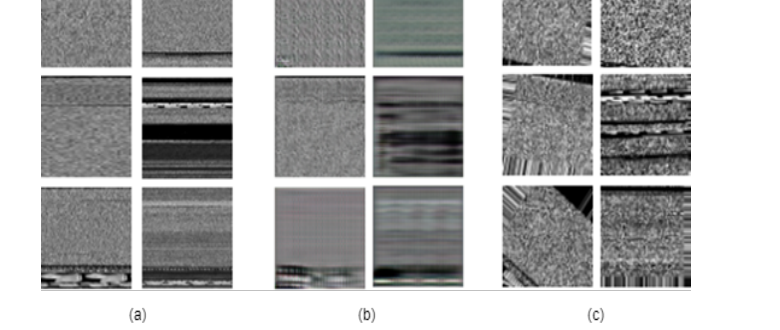
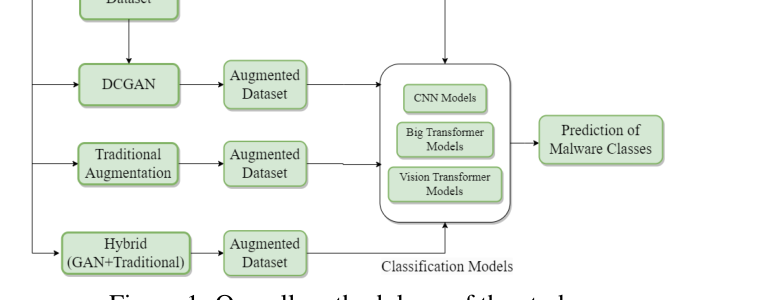
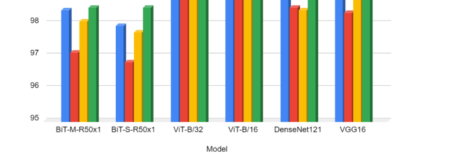
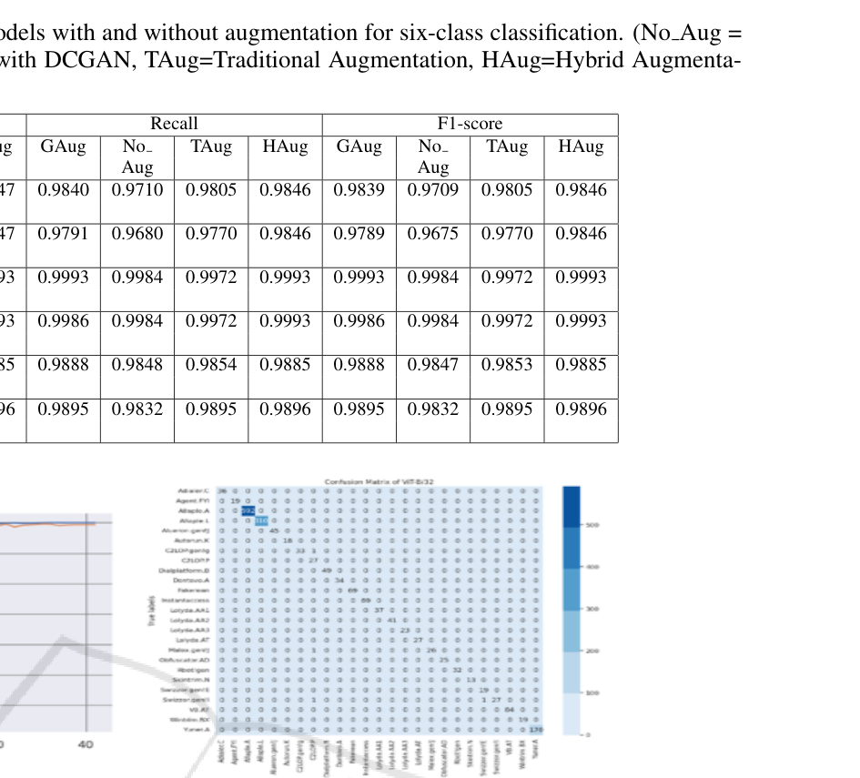

# Review Paper

## Vision Based Malware Classification Using Deep Neural Network with Hybrid Data Augmentation

### Identitas paper

- **Penulis:** Md. Mahbubur Rahman, Md. Delwar Hossain, Hideya Ochiai, Youki Kadobayashi, Tanjim Sakib, dan Syed Taha Yeasin Ramadan.
- **Tahun:** 2024.
- **Publikasi:** *Proceedings of the 10th International Conference on Information Systems Security and Privacy (ICISSP 2024)*, hlm. 823–830.
- **DOI:** [10.5220/0012434400003648](https://doi.org/10.5220/0012434400003648).
- **Sumber:** [Halaman SciTePress](https://www.scitepress.org/PublishedPapers/2024/124344/) · [PDF SciTePress](https://www.scitepress.org/Papers/2024/124344/124344.pdf).

### Tujuan penelitian

Penelitian ini menguji klasifikasi malware yang direpresentasikan sebagai citra dan menilai apakah augmentasi hibrida dapat meningkatkan performa klasifikasi. Augmentasi yang diusulkan menggabungkan sampel buatan Deep Convolutional GAN (DCGAN) dengan transformasi citra konvensional.

### Dataset dan evaluasi

Penelitian menggunakan dataset **Malimg**, yang berisi 9.339 sampel dari 25 keluarga malware. Penulis menguji dua cakupan:

- Subset enam kelas dengan 6.560 citra awal; kelas dipilih karena masing-masing memiliki lebih dari 300 sampel. Dataset tersebut diperluas menjadi 7.200 sampel melalui augmentasi.
- Seluruh dataset Malimg untuk eksperimen klasifikasi 25 kelas.

Malware biner direpresentasikan sebagai citra **grayscale** dengan nilai byte sebagai intensitas piksel. Model menerima citra berukuran 128 × 128 × 3 sesuai pengaturan input yang dilaporkan. Data dibagi 80% untuk pelatihan dan 20% untuk pengujian. Evaluasi menggunakan accuracy, precision, recall, F1-score, dan loss; paper juga menampilkan confusion matrix.

*Gambar 1. Sampel Malimg asli, sampel DCGAN, dan sampel transformasi citra, Fig. 3 Rahman et al. (2024). Gambar asli diekstrak dari PDF.*

### Metode atau arsitektur model

Enam backbone yang dibandingkan adalah BiT-M-R50x1, BiT-S-R50x1, ViT-B/32, ViT-B/16, DenseNet121, dan VGG16. Model-model tersebut menggunakan head klasifikasi yang dilaporkan dengan global average pooling, batch normalization, dense layers, aktivasi SELU, dropout, dan output sesuai jumlah kelas.

Penulis membandingkan data tanpa augmentasi, augmentasi DCGAN (GAug), augmentasi tradisional (TAug), serta augmentasi hibrida (HAug). Pada HAug, sampel asli digabungkan dengan citra hasil DCGAN dan transformasi tradisional.

*Gambar 2. Alur metode klasifikasi dan augmentasi pada penelitian, Fig. 1 Rahman et al. (2024). Gambar asli diekstrak dari PDF.*

### Domain penelitian

**Computer vision untuk keamanan siber**, khususnya klasifikasi keluarga malware dari visualisasi citra biner dan augmentasi data sintetis. Paper menguji ViT, tetapi tidak membandingkan ViT dengan Vision Mamba.

### Hasil utama

- Pada eksperimen enam kelas, ViT-B/32 dengan HAug mencapai akurasi maksimum **99,94%**; ViT-B/16 dengan HAug juga dilaporkan mencapai 99,94%.
- Pada eksperimen 25 kelas Malimg, ViT-B/16 dan ViT-B/32 dengan HAug masing-masing mencapai **99,79%**. Tanpa augmentasi, akurasi yang dilaporkan adalah 98,29% untuk ViT-B/16 dan 98,71% untuk ViT-B/32.
- Hasil tersebut berasal dari protokol dan pembagian data paper. Paper tidak menguji MaleVis maupun citra malware RGB sebagai input eksperimen.

*Gambar 3. Perbandingan akurasi berbagai backbone dan strategi augmentasi pada eksperimen enam kelas, Fig. 5 Rahman et al. (2024). Gambar asli diekstrak dari PDF.*

*Gambar 4. Kurva pelatihan dan confusion matrix ViT-B/32 pada Malimg dengan HAug dan tanpa augmentasi, Fig. 6 Rahman et al. (2024). Gambar asli diekstrak dari PDF.*

### Analisis kontribusi model

Kontribusi penelitian terutama pada evaluasi augmentasi hibrida untuk melatih classifier malware berbasis citra, bukan pada pengembangan backbone baru. Eksperimen memperlihatkan bahwa hasil ViT dapat berubah ketika strategi augmentasi berubah; karena itu, pilihan augmentasi merupakan faktor penting dalam interpretasi performa model. Studi ini memberi pembanding penggunaan ViT untuk Malimg, tetapi tidak mengisolasi perbedaan arsitektur ViT dan Mamba.

### Kelebihan

1. Menguji dua skala klasifikasi, enam kelas dan seluruh 25 kelas Malimg.
2. Membandingkan ViT dengan model transfer learning dan CNN menggunakan beberapa strategi augmentasi.
3. Melaporkan metrik beragam dan menyertakan confusion matrix serta ilustrasi sampel augmentasi.
4. Menguji pengaruh DCGAN dan augmentasi tradisional secara terpisah maupun gabungan.

### Keterbatasan

1. Evaluasi memakai satu dataset, Malimg, sehingga hasil belum menunjukkan generalisasi ke dataset lain seperti MaleVis.
2. Eksperimen menggunakan visualisasi grayscale Malimg; hasilnya bukan evaluasi klasifikasi citra RGB.
3. Tidak ada Vision Mamba atau perbandingan langsung antara Mamba dan ViT.
4. Kelas pada eksperimen enam kelas dipilih dari keluarga dengan lebih dari 300 sampel; cakupan ini tidak mewakili seluruh keragaman Malimg.
5. Akurasi yang sangat tinggi perlu dibaca sesuai protokol split dan augmentasi yang dilaporkan; paper tidak menunjukkan evaluasi lintas dataset.

### Kesimpulan review

Paper ini relevan sebagai studi klasifikasi malware berbasis citra yang menguji Vision Transformer serta pengaruh augmentasi hibrida pada Malimg. Namun, ia tidak menyediakan perbandingan langsung dengan Vision Mamba dan tidak menguji MaleVis RGB. Karena dataset, representasi citra, dan protokol evaluasinya berbeda, angka performa paper sebaiknya digunakan sebagai konteks literatur, bukan dibandingkan langsung dengan hasil eksperimen tesis.

### Sumber

1. Rahman, M., Hossain, M. D., Ochiai, H., Kadobayashi, Y., Sakib, T., & Ramadan, S. T. Y. (2024). *Vision Based Malware Classification Using Deep Neural Network with Hybrid Data Augmentation*. In **Proceedings of the 10th International Conference on Information Systems Security and Privacy (ICISSP 2024)**, 823–830. [Halaman paper](https://www.scitepress.org/PublishedPapers/2024/124344/) · [PDF](https://www.scitepress.org/Papers/2024/124344/124344.pdf) · [DOI](https://doi.org/10.5220/0012434400003648).
