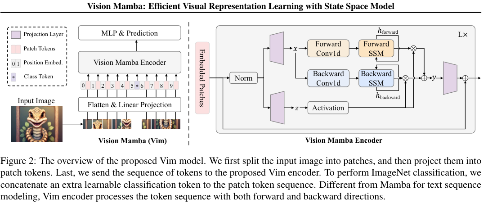
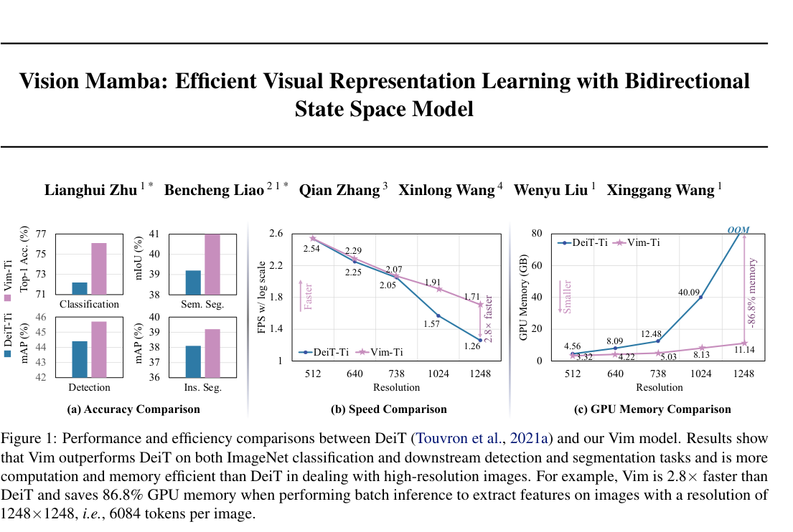

# Review Paper

## Vision Mamba: Efficient Visual Representation Learning with Bidirectional State Space Model

### Identitas paper

- **Penulis:** Lianghui Zhu, Bencheng Liao, Qian Zhang, Xinlong Wang, Wenyu Liu, dan Xinggang Wang.
- **Tahun:** 2024.
- **Publikasi:** *Proceedings of the 41st International Conference on Machine Learning (ICML 2024)*, Proceedings of Machine Learning Research, Volume 235.
- **Versi naskah:** arXiv:2401.09417v3, revisi 14 November 2024. Paper awal dikirim ke arXiv 17 Januari 2024.
- **Sumber:** [arXiv](https://arxiv.org/abs/2401.09417) · [PDF arXiv](https://arxiv.org/pdf/2401.09417) · [PMLR ICML 2024](https://proceedings.mlr.press/v235/zhu24f.html).

### Tujuan penelitian

Penelitian ini memperkenalkan **Vision Mamba (Vim)** sebagai backbone visual berbasis state space model (SSM) bidirectional. Tujuannya adalah memodelkan konteks global pada urutan patch citra dengan efisiensi komputasi dan memori yang lebih baik pada urutan panjang, serta menguji Vim pada klasifikasi citra dan tugas visual lanjutan.

### Dataset dan evaluasi

Eksperimen paper menggunakan benchmark computer vision umum, bukan dataset malware:

- **ImageNet-1K:** sekitar 1,28 juta citra training dan 50 ribu citra validasi dari 1.000 kategori. Metrik klasifikasi utama adalah top-1 accuracy.
- **ADE20K:** 20 ribu citra training, 2 ribu validasi, dan 3 ribu testing dengan 150 kategori semantik; evaluasi semantic segmentation menggunakan mIoU.
- **COCO 2017:** digunakan untuk object detection dan instance segmentation dengan metrik AP, termasuk evaluasi bounding box dan mask.

Untuk klasifikasi ImageNet, training mengikuti setting DeiT: augmentasi random crop, horizontal flip, label smoothing, mixup, dan random erasing; 300 epoch; AdamW; batch total 1.024; initial learning rate 0,001; delapan GPU A800. Uji efisiensi mengukur inference speed/FPS dan memori GPU pada beberapa resolusi hingga 1.248 × 1.248. Perbandingan ini berasal dari setting benchmark paper dan tidak dapat langsung dipindahkan ke tugas klasifikasi malware tanpa eksperimen baru.

### Metode atau arsitektur model

Vim membagi citra menjadi patch non-overlap dengan proyeksi kernel 16 × 16, mengubahnya menjadi urutan token, menambahkan positional embedding dan class token, lalu memproses token menggunakan tumpukan Vim blocks. Setiap block menggabungkan pemrosesan sekuensial arah maju dan mundur melalui SSM selektif, Conv1D, gating, normalisasi, dan residual connection. Model tidak menggunakan self-attention pada backbone Vim.

Konfigurasi default memakai 24 Vim blocks dan dimensi SSM 16. Paper menyediakan skala Tiny, Small, dan Base, serta fine-tuning urutan panjang dengan stride patch 8. Evaluasi membandingkan Vim terutama dengan DeiT dan sejumlah backbone CNN/SSM.

*Gambar 1. Overview model Vim, Fig. 2 pada Zhu et al. (2024). Gambar asli diekstrak dari PDF.*

*Gambar 2. Perbandingan accuracy, speed, dan penggunaan GPU memory pada berbagai resolusi, Fig. 1 pada Zhu et al. (2024). Gambar asli diekstrak dari PDF.*

### Domain penelitian

**Computer vision dan machine learning**, khususnya backbone visual berbasis state space model untuk image classification, object detection, instance segmentation, dan semantic segmentation. Paper tidak melakukan penelitian cybersecurity atau klasifikasi malware.

### Hasil utama

- Pada ImageNet-1K, Vim-Tiny memperoleh **76,1%** top-1 accuracy dengan 7 juta parameter, Vim-Small **80,3%** dengan 26 juta parameter, dan Vim-Base **81,9%** dengan 98 juta parameter. Setelah long-sequence fine-tuning, hasil masing-masing menjadi 78,3%, 81,4%, dan 83,2%.
- Pada ADE20K, UperNet dengan Vim-Tiny mencapai **41,0 mIoU**, sedangkan UperNet dengan DeiT-Tiny 39,2; Vim-Small dan DeiT-Small masing-masing memperoleh 44,9 dan 44,0 mIoU.
- Pada ekstraksi fitur batch di resolusi **1.248 × 1.248**, paper melaporkan Vim **2,8× lebih cepat** daripada DeiT dan menggunakan **86,8% lebih sedikit GPU memory**.
- Paper juga mengevaluasi object detection dan instance segmentation pada COCO 2017 serta menguji kontribusi desain bidirectional melalui ablation study.

### Analisis kontribusi model

Kontribusi Vim adalah mengadaptasi selective SSM Mamba ke urutan patch visual dengan pemrosesan dua arah dan positional embedding. Ini menyediakan alternatif backbone terhadap Transformer ketika urutan visual panjang membuat self-attention mahal dari sisi komputasi dan memori. Hasil benchmark menunjukkan performa kompetitif terhadap DeiT pada tugas yang diuji dan keuntungan efisiensi terutama pada resolusi tinggi.

Untuk tesis, paper ini merupakan sumber primer bagi konsep dan rancangan Vision Mamba. Namun, hasilnya hanya mendukung pemahaman arsitektur serta benchmark umum; ia tidak menyediakan bukti performa Vim pada citra RGB malware atau MaleVis.

### Kelebihan

1. Mengusulkan backbone visual berbasis SSM tanpa self-attention pada Vim blocks.
2. Menguji klasifikasi dan beberapa tugas dense prediction, tidak hanya satu benchmark.
3. Melaporkan ablation bidirectional SSM dan strategi class token.
4. Menyertakan pengukuran accuracy, jumlah parameter, inference speed, dan GPU memory.
5. Menyediakan kode dan model melalui repositori proyek yang ditautkan dari arXiv.

### Keterbatasan

1. Tidak menguji dataset malware, MaleVis, atau representasi citra biner/RGB malware.
2. Hasil ImageNet/ADE20K/COCO tidak dapat dibandingkan langsung dengan hasil klasifikasi malware karena perbedaan domain, dataset, preprocessing, dan protokol evaluasi.
3. Pengukuran efisiensi bergantung pada perangkat keras, implementasi, batch inference, dan resolusi yang ditentukan dalam paper; hasil tersebut bukan jaminan bahwa Vim lebih cepat pada setiap perangkat atau ukuran citra.
4. Klaim efisiensi di sini terutama terkait pemodelan urutan patch panjang; implementasi dan optimasi konkret pada lingkungan tesis tetap harus diuji.
5. Paper tidak membahas robustness khusus terhadap obfuscation atau perubahan representasi malware.

### Kesimpulan review

Vision Mamba adalah referensi metodologis utama untuk menjelaskan arsitektur Vim dan perbedaannya dari backbone ViT berbasis self-attention. Paper menunjukkan hasil yang kompetitif pada benchmark visual umum serta keuntungan waktu dan memori pada resolusi tinggi. Karena tidak mengevaluasi malware atau MaleVis, efektivitasnya untuk klasifikasi malware RGB harus dibuktikan lewat eksperimen tesis dengan dataset, preprocessing, split, dan kondisi komputasi yang sama seperti baseline Vision Transformer.

### Sumber

1. Zhu, L., Liao, B., Zhang, Q., Wang, X., Liu, W., & Wang, X. (2024). *Vision Mamba: Efficient Visual Representation Learning with Bidirectional State Space Model*. **Proceedings of the 41st International Conference on Machine Learning**, PMLR 235. [PMLR](https://proceedings.mlr.press/v235/zhu24f.html).
2. [arXiv abstract and version history](https://arxiv.org/abs/2401.09417) · [PDF](https://arxiv.org/pdf/2401.09417).
