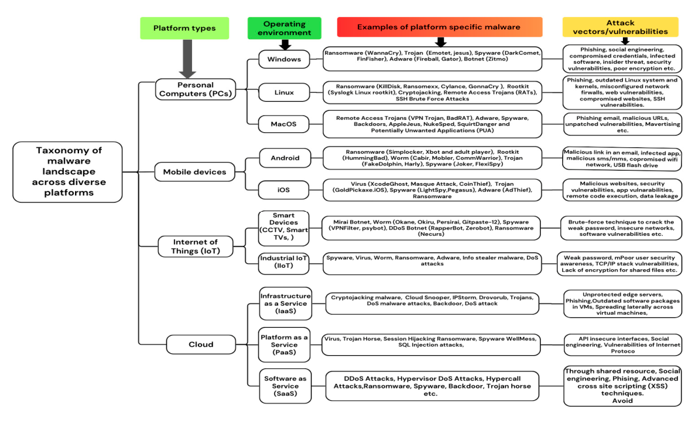
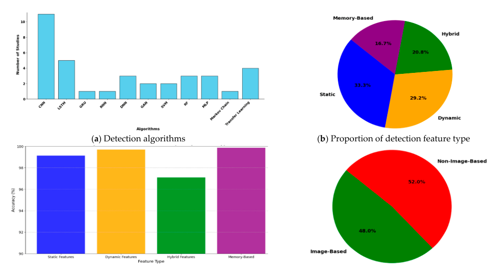

# Review Paper

## A Survey on ML Techniques for Multi-Platform Malware Detection: Securing PC, Mobile Devices, IoT, and Cloud Environments

### Identitas paper

- **Penulis:** Jannatul Ferdous, Rafiqul Islam, Arash Mahboubi, dan Md Zahidul Islam.
- **Tahun:** 2025.
- **Publikasi:** *Sensors*, 25(4), artikel 1153.
- **DOI:** [10.3390/s25041153](https://doi.org/10.3390/s25041153).
- **Sumber:** [Halaman artikel MDPI](https://www.mdpi.com/1424-8220/25/4/1153) · [PDF artikel](https://www.mdpi.com/1424-8220/25/4/1153/pdf).

### Tujuan penelitian

Paper ini meninjau penggunaan machine learning (ML) dan deep learning (DL) untuk deteksi malware di PC, perangkat mobile, IoT, dan cloud. Tujuannya memetakan teknik dan fitur yang digunakan, membahas ancaman serta kendala khusus tiap platform, dan mengidentifikasi kebutuhan solusi yang lebih adaptif lintas platform.

### Dataset dan evaluasi

Paper merupakan survey dan tidak membuat eksperimen klasifikasi baru. Penulis membahas literatur yang terbit sejak 2017, termasuk artikel jurnal, prosiding konferensi, dan sumber daring. Dataset yang dirangkum beragam, misalnya Microsoft BIG 2015, Malimg, MaleVis, Malicia, VirusShare, VirusTotal, dan CIC-MalMem-2022.

Dalam ringkasan studi Windows, paper mencantumkan satu penelitian yang memakai BIG 2015, Malimg, MaleVis, dan Malicia dengan DenseNet; akurasi 98,23% yang dicatat pada tabel/narasi secara khusus dilaporkan untuk Malimg, bukan sebagai hasil terpisah MaleVis. Survey juga menampilkan perbandingan angka dari studi lain, tetapi tidak melakukan evaluasi ulang dengan dataset atau protokol yang sama.

*Gambar 1. Taksonomi lanskap malware lintas platform, Fig. 3 Ferdous et al. (2025); diekstrak dari PDF paper.*

### Metode atau arsitektur model

Survey mengelompokkan metode analisis malware sebagai statis, dinamis, memory-based, dan hybrid. Algoritma yang dibahas mencakup metode tradisional seperti SVM, KNN, logistic regression, Naïve Bayes, decision tree, dan ensemble, serta DL seperti CNN, RNN/LSTM/GRU, GAN, autoencoder, transformer, dan transfer learning.

Untuk studi malware berbasis citra pada segmen PC/Windows, paper merangkum konversi biner atau opcode menjadi citra dan penggunaan CNN/DenseNet/VGG/ResNet. Salah satu grafik survey pada segmen Windows membandingkan metode berbasis citra dan non-citra serta distribusi fitur dan akurasi menurut jenis fitur.

*Gambar 2. Distribusi algoritma, fitur, akurasi menurut jenis fitur, serta metode berbasis citra/non-citra pada studi Windows, Fig. 5; diekstrak dari PDF paper.*

### Domain penelitian

Keamanan siber dan deteksi malware lintas platform: Windows, Linux, macOS, Android, iOS, IoT, dan cloud. Computer vision dibahas sebagai salah satu pendekatan, terutama untuk citra yang dibuat dari biner malware pada studi PC.

### Hasil utama

- Survey menyimpulkan penelitian yang ditinjau masih didominasi solusi khusus platform; transfer model lintas Windows, Linux, IoT, mobile, dan cloud masih menjadi tantangan.
- Tantangan yang disorot meliputi ketiadaan dataset terpadu lintas platform, heterogenitas fitur, keterbatasan sumber daya, adversarial evasion, kebutuhan interpretabilitas, serta sulitnya membandingkan hasil dari eksperimen yang berbeda.
- Pada segmen studi Windows, Fig. 5d melaporkan porsi metode image-based 48% dan non-image-based 52%. Angka ini merujuk pada pengelompokan studi di segmen tersebut, bukan pada seluruh literatur lintas platform.
- Arah riset yang diusulkan mencakup framework lintas platform, transfer/federated learning, model ringan melalui pruning/quantization/distillation, dan XAI.

### Analisis kontribusi model

Kontribusi paper adalah sintesis lintas platform atas algoritma, fitur, dataset, dan tantangan operasional. Untuk tesis berbasis citra, paper memberi konteks karena merangkum sejumlah studi CNN yang mengubah biner menjadi citra, termasuk studi yang mencantumkan MaleVis sebagai salah satu dataset. Namun, paper tidak mengevaluasi MaleVis sendiri dan tidak memisahkan skor MaleVis pada angka 98,23% yang dilaporkan untuk studi DenseNet tersebut. Paper juga tidak membandingkan Vision Transformer dan Vision Mamba; istilah transformer dalam survey tidak berarti evaluasi khusus Vision Transformer pada citra malware.

### Kelebihan

1. Mencakup beberapa platform dan sistem operasi, bukan hanya Windows atau Android.
2. Mengelompokkan pendekatan berdasarkan analisis statis, dinamis, memori, dan hybrid.
3. Menyertakan tabel fitur dan ringkasan studi yang dapat membantu penelusuran literatur primer.
4. Secara eksplisit membahas kebutuhan dataset lintas platform, efisiensi model, generalisasi, dan interpretabilitas.

### Keterbatasan

1. Paper menyebut cakupan literatur sejak 2017, tetapi tidak menyajikan protokol pencarian yang rinci seperti basis data, query, jumlah rekaman, atau alur seleksi; cakupan survey sulit direproduksi.
2. Angka akurasi dirangkum dari studi dengan dataset, pembagian data, fitur, dan kondisi uji berbeda, sehingga bukan perbandingan langsung antaralgoritma.
3. Cakupan dan kualitas dataset berbeda antarplatform; survey sendiri mencatat belum adanya dataset besar dan seragam yang mewakili seluruh platform.
4. Bagian citra malware berfokus terutama pada studi PC/Windows dan CNN. MaleVis disebut sebagai dataset pada sebuah studi, tetapi tidak ada hasil MaleVis tersendiri.
5. Tidak ada eksperimen atau evaluasi khusus ViT, Vision Mamba, atau perbandingan kedua arsitektur tersebut.

### Kesimpulan review

Paper ini berguna untuk konteks luas tentang ML/DL dalam deteksi malware lintas platform dan untuk mengidentifikasi studi primer berbasis citra. Relevansinya terhadap tesis bersifat pendukung: paper mencatat MaleVis dalam salah satu studi yang dirangkum, tetapi tidak melaporkan hasil MaleVis secara terpisah maupun menguji model ViT atau Vision Mamba. Angka dari survey sebaiknya ditelusuri ke studi primer sebelum digunakan sebagai pembanding kuantitatif.

### Sumber

Ferdous, J., Islam, R., Mahboubi, A., & Islam, M. Z. (2025). *A Survey on ML Techniques for Multi-Platform Malware Detection: Securing PC, Mobile Devices, IoT, and Cloud Environments*. **Sensors, 25**(4), 1153. [Artikel MDPI](https://www.mdpi.com/1424-8220/25/4/1153) · [PDF](https://www.mdpi.com/1424-8220/25/4/1153/pdf) · [DOI](https://doi.org/10.3390/s25041153).
