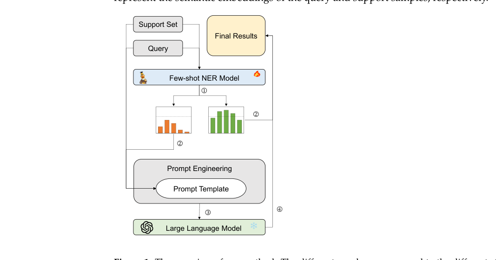
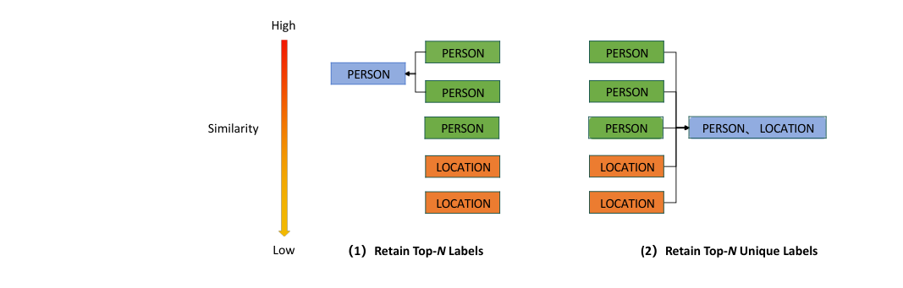
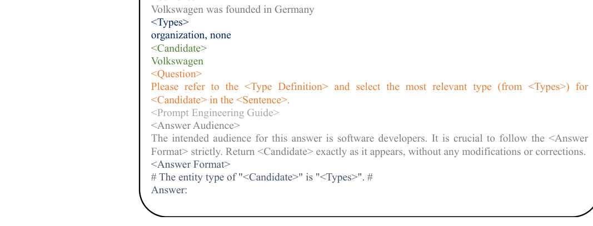

# Review Paper

## Advancing Few-Shot Named Entity Recognition with Large Language Model

### Penulis & Tahun

Yuhui Xiao, Jianjian Zou, dan Qun Yang (**2025**).

### Judul Penelitian

*Advancing Few-Shot Named Entity Recognition with Large Language Model*

### Nama Jurnal

Artikel penelitian pada **Applied Sciences**, Volume 15, Article 3838, tahun 2025. Artikel tersedia secara open access.

DOI: `10.3390/app15073838`.

### Tujuan Penelitian

Penelitian ini meningkatkan performa few-shot Named Entity Recognition (NER) ketika distribusi data pada support set dan query set berbeda. Masalah tersebut dapat menyebabkan model metric learning menghasilkan prediksi dengan tingkat keyakinan rendah.

### Dataset

Eksperimen dilakukan pada dua benchmark few-shot NER:

- **Few-NERD**, dataset NER dengan banyak kategori entitas.
- **CrossNER**, dataset NER lintas domain.

Evaluasi dilakukan dalam skenario few-shot menggunakan metrik **micro-F1**.

### Metode / Model

Framework yang diusulkan menggabungkan **small language model (SLM)** berbasis metric learning dengan **large language model (LLM)** sebagai pemeriksa kedua.

Tahapan utama model adalah:

1. SLM melakukan identifikasi awal berdasarkan kemiripan token antara support set dan query set.
2. Cosine similarity digunakan untuk mengukur tingkat keyakinan prediksi.
3. Query dengan similarity rendah diteruskan kepada LLM untuk pengenalan ulang.
4. LLM menggunakan definisi tipe entitas dan prompt terstruktur.
5. Label-filtering membatasi kandidat label agar proses klasifikasi lebih mudah.

Penelitian juga menguji beberapa strategi prompting, yaitu chain-of-thought, metacognitive prompting, dan self-verification prompting. Template prompt terstruktur digunakan untuk membantu LLM memahami konteks, definisi tipe entitas, contoh few-shot, kandidat, dan format jawaban.

### Tugas NLP

Paper ini berfokus pada **few-shot Named Entity Recognition**, yaitu mengenali dan memberi label pada entitas dalam teks menggunakan jumlah contoh berlabel yang terbatas.

Contoh kategori entitas dapat berupa orang, lokasi, organisasi, produk, atau istilah khusus domain.

### Hasil Utama

Metode kolaboratif yang diusulkan meningkatkan micro-F1 dibandingkan metode state-of-the-art sebelumnya:

| Dataset | Peningkatan micro-F1 |
| --- | ---: |
| Few-NERD | **0,86%** |
| CrossNER | **4,9%** |

Hasil tersebut menunjukkan bahwa LLM dapat membantu memperbaiki prediksi SLM, terutama ketika query memiliki kemiripan rendah dengan contoh pada support set.

### Analisis Kontribusi Model

Kontribusi utama framework adalah:

- SLM menangani prediksi awal dengan biaya lebih rendah.
- LLM digunakan secara selektif hanya pada query yang sulit.
- Label-filtering mengurangi ruang pencarian label.
- Prompt terstruktur membantu LLM memahami definisi tipe entitas.

### Kelebihan

- Menggabungkan kelebihan metric learning dan kemampuan generalisasi LLM.
- Tidak menggunakan LLM untuk seluruh data sehingga penggunaannya lebih selektif.
- Relevan untuk kondisi data berlabel yang sangat terbatas.
- Menguji beberapa strategi prompting dan beberapa LLM open-source.

### Keterbatasan

- Dua tahap inferensi dapat meningkatkan latensi dan biaya komputasi.
- Kinerja masih bergantung pada kualitas LLM dan desain prompt.
- Pemilihan threshold similarity dapat memengaruhi jumlah query yang diteruskan ke LLM.
- Efisiensi untuk pemrosesan NER berskala sangat besar masih perlu diteliti.

### Kesimpulan Review

Paper ini mengusulkan framework hybrid yang menggabungkan metric-learning NER untuk prediksi awal dengan LLM untuk memperbaiki kasus yang memiliki tingkat keyakinan rendah. Strategi label-filtering dan prompt terstruktur membantu mengurangi ruang klasifikasi LLM. Hasil pada Few-NERD dan CrossNER menunjukkan bahwa kolaborasi SLM-LLM efektif untuk NER dengan data berlabel terbatas, meskipun konsekuensinya adalah tambahan latensi dan biaya inferensi.

### Sumber

1. Xiao, Y., Zou, J., & Yang, Q. (2025). *Advancing Few-Shot Named Entity Recognition with Large Language Model*. **Applied Sciences, 15**, 3838. https://doi.org/10.3390/app15073838
