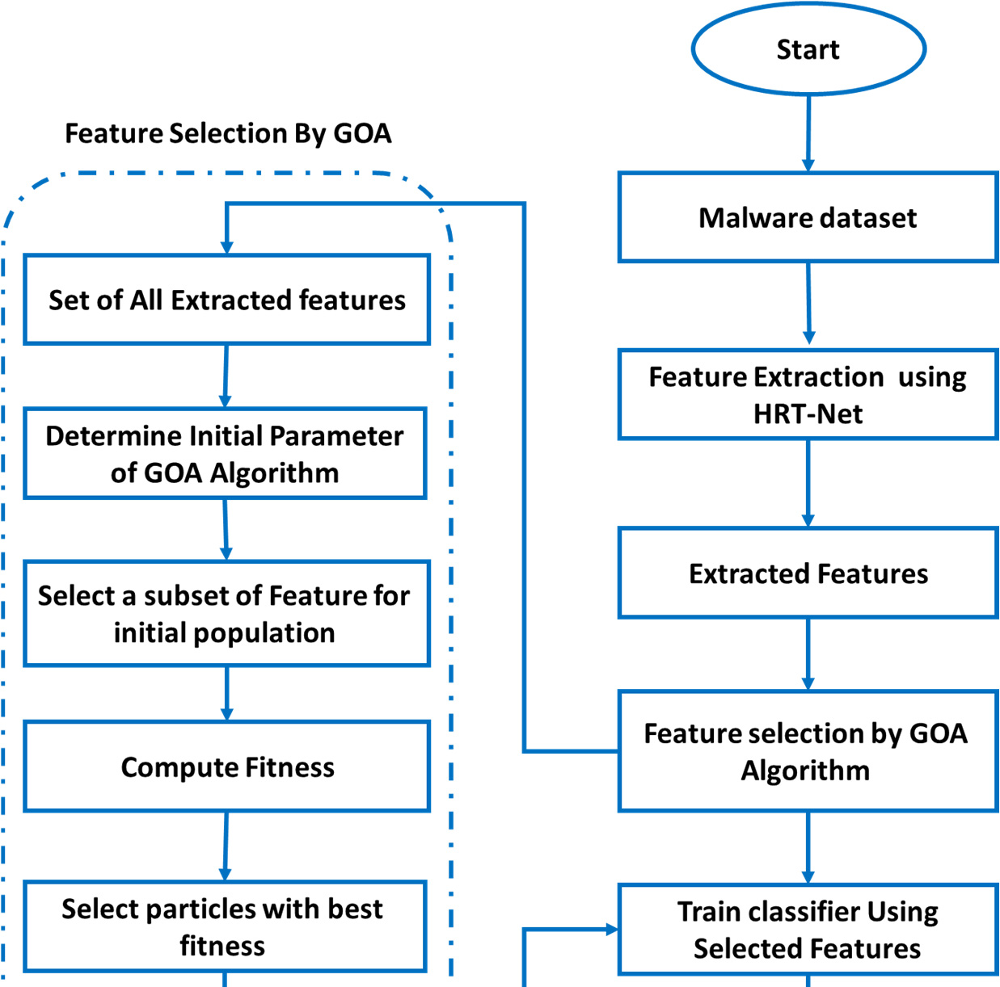
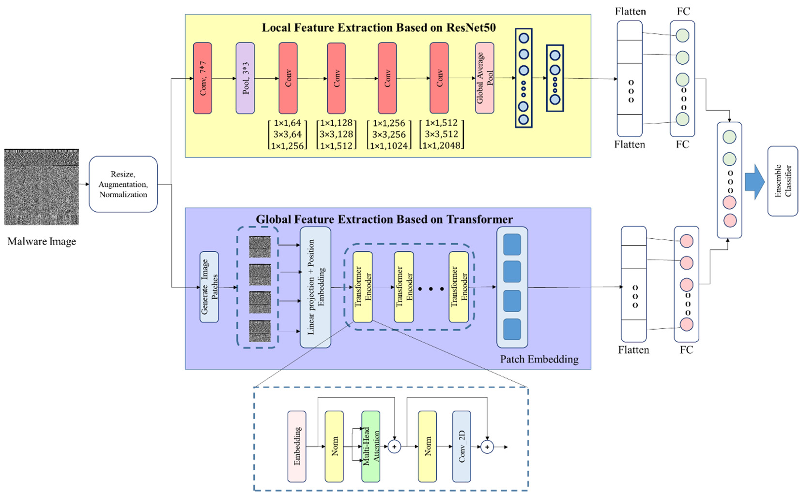
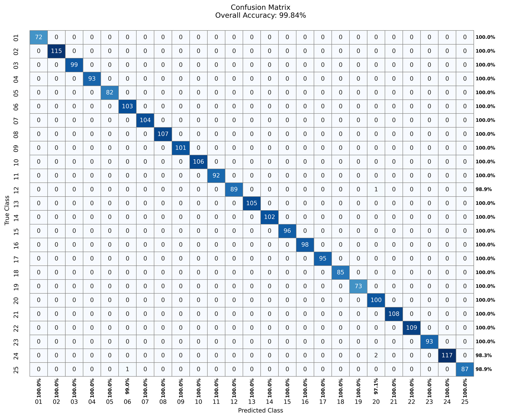
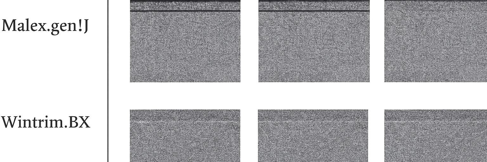

# Review Paper

## An Efficient Malware Detection Method Using a Hybrid ResNet-Transformer Network and IGOA-Based Wrapper Feature Selection

### Penulis & Tahun

Ali Abbas Hafeth dan Abdu Ibrahim Abdullahi (**2025**).

### Judul Penelitian

*An Efficient Malware Detection Method Using a Hybrid ResNet-Transformer Network and IGOA-Based Wrapper Feature Selection*

### Nama Jurnal / Conference

Artikel jurnal pada **Electronics**, Volume 14, Article 2741, tahun 2025. DOI: `10.3390/electronics14132741`.

### Dataset

Penelitian menggunakan **Malimg Dataset** untuk klasifikasi **25 tipe malware** berbasis citra. File malware direpresentasikan sebagai citra sehingga pola lokal dan global dapat dipelajari oleh model computer vision.

Data dibagi menjadi 70% data training dan 30% data testing. Evaluasi juga menggunakan 10-fold cross-validation. Metrik yang digunakan meliputi accuracy, precision, recall, dan F1-score.

### Metode / Model

Penelitian mengusulkan pipeline **HRT-Net-IGOA-Ensemble Learning**, yang terdiri dari tiga komponen utama:

1. **Hybrid ResNet-Transformer Network (HRT-Net)**
   - Cabang ResNet50 mengekstraksi fitur lokal seperti tekstur dan pola visual malware.
   - Cabang Transformer mempelajari dependensi jarak jauh dan hubungan global antarbagian citra.
   - Fitur lokal dan global digabungkan menjadi representasi fitur yang lebih kaya.

2. **Improved Grasshopper Optimization Algorithm (IGOA)**
   - Digunakan sebagai wrapper-based feature selection.
   - Dynamic mutation coefficient membantu pencarian solusi keluar dari local optima.
   - Dynamic inertia motion weights menyeimbangkan eksplorasi dan eksploitasi.
   - Fitur yang tidak penting dihapus untuk mengurangi dimensi dan biaya komputasi.

3. **Ensemble Learning**
   - Menggunakan beberapa classifier berbasis decision tree.
   - Hasil classifier digabungkan untuk meningkatkan stabilitas dan akurasi deteksi.

*Gambar 1. Diagram umum metode yang diusulkan.*

*Gambar 2. Struktur Hybrid ResNet-Transformer Network.*

### Tahapan Penelitian

1. Malware dikonversi menjadi representasi citra.
2. ResNet50 mengekstraksi fitur lokal.
3. Transformer mengekstraksi fitur global menggunakan patch embedding dan multi-head self-attention.
4. Fitur lokal dan global dikonkatenasi.
5. IGOA memilih subset fitur yang optimal.
6. Ensemble Learning melakukan klasifikasi 25 kelas malware.
7. Hasil dievaluasi menggunakan metrik klasifikasi dan analisis computational complexity.

### Hasil Utama

Pada abstrak, penulis melaporkan accuracy sebesar **99,77%** pada Malimg Dataset. Pada tabel perbandingan utama, metode HRT-Net-IGOA-Ensemble Learning memperoleh accuracy rata-rata sebesar **99,85%**.

| Metode | Accuracy |
|---|---:|
| GLCM | 98,58% |
| Random Forest | 98,68% |
| DNN | 99,30% |
| MDC-RepNet | 99,57% |
| ECOC-SVM | 95,01% |
| Auto Encoder | 96,22% |
| LGMal | 88,78% |
| **HRT-Net-IGOA-Ensemble Learning** | **99,85%** |

Pada evaluasi per kelas:

- 22 dari 25 kelas memperoleh accuracy 100%;
- kelas C12 memperoleh 98,9%;
- kelas C24 memperoleh 98,3%;
- kelas C25 memperoleh 98,9%.

*Gambar 3. Confusion matrix hasil klasifikasi.*

Perbandingan computational complexity menunjukkan:

| Metode | Training Time | Testing Time |
|---|---:|---:|
| GLCM | 14,6 menit | 43 ms |
| Random Forest | 13,4 menit | 40 ms |
| DNN | 20,3 menit | 92 ms |
| MDC-RepNet | 22,6 menit | 104 ms |
| ECOC-SVM | 15,7 menit | 49 ms |
| Auto Encoder | 18,1 menit | 78 ms |
| LGMal | 16,9 menit | 56 ms |
| **Metode yang diusulkan** | **12,3 menit** | **36 ms** |

Metode yang diusulkan memiliki waktu training dan testing paling rendah dalam tabel tersebut. Waktu testing sebesar 36 ms menunjukkan potensi untuk aplikasi deteksi yang membutuhkan respons cepat.

*Gambar 4. Contoh visualisasi kelas malware.*

### Kelebihan

1. Menggabungkan kemampuan CNN untuk fitur lokal dan Transformer untuk fitur global.
2. IGOA membantu mengurangi fitur yang tidak relevan dan biaya komputasi.
3. Ensemble Learning meningkatkan stabilitas keputusan klasifikasi.
4. Menghasilkan accuracy sangat tinggi pada 25 kelas malware.
5. Mengevaluasi performa tidak hanya dari accuracy, tetapi juga precision, recall, F1-score, dan waktu komputasi.
6. Menyajikan evaluasi per kelas melalui confusion matrix dan tabel class-specific accuracy.

### Keterbatasan

1. Eksperimen utama menggunakan Malimg Dataset sehingga generalisasi pada dataset lain belum sepenuhnya terbukti.
2. Ensemble Learning disebut cukup memakan waktu pada tahap klasifikasi meskipun hasil pengujian menunjukkan testing time yang rendah.
3. Hasil accuracy memiliki beberapa angka pelaporan, yaitu 99,77% pada abstrak, sekitar 99,7% pada kesimpulan, dan 99,85% pada tabel perbandingan; perbedaan ini perlu dijelaskan berdasarkan skenario evaluasinya.
4. Penelitian masih berfokus pada static analysis berbasis citra dan belum mengintegrasikan API calls, system logs, atau network traffic.
5. Ketahanan terhadap zero-day malware, obfuscation, adversarial attack, dan domain shift masih perlu diuji.
6. Hyperparameter tertentu belum tentu optimal untuk dataset, hardware, atau lingkungan IoT yang berbeda.

### Arah Penelitian Lanjutan

Penulis mengusulkan beberapa arah penelitian lanjutan, yaitu optimasi Ensemble Learning agar lebih ringan, integrasi static dan dynamic analysis, pengujian pada dataset zero-day yang lebih besar, evaluasi adversarial robustness, serta peningkatan explainability model.

## Kesimpulan Review

Paper ini mengusulkan HRT-Net yang menggabungkan ResNet50 dan Transformer untuk menangkap fitur lokal serta global dari citra malware. IGOA digunakan untuk memilih fitur yang optimal, sedangkan Ensemble Learning digunakan untuk menghasilkan keputusan klasifikasi akhir.

Hasil penelitian menunjukkan accuracy rata-rata hingga 99,85%, dengan 22 dari 25 kelas memperoleh accuracy 100%. Metode ini juga mencatat training time 12,3 menit dan testing time 36 ms pada konfigurasi evaluasi yang dilaporkan.

Kontribusi utama paper adalah penggabungan hybrid deep learning dan feature selection berbasis optimasi. Namun, validasi lintas-dataset, dynamic analysis, dan pengujian malware zero-day masih diperlukan untuk membuktikan kemampuan generalisasi dalam kondisi nyata.

## Sumber

1. Hafeth, A. A., & Abdullahi, A. I. (2025). *An Efficient Malware Detection Method Using a Hybrid ResNet-Transformer Network and IGOA-Based Wrapper Feature Selection*. **Electronics, 14**, 2741. https://doi.org/10.3390/electronics14132741
2. Publisher page: [Electronics 2025, 14, 2741](https://www.mdpi.com/2079-9292/14/13/2741)
