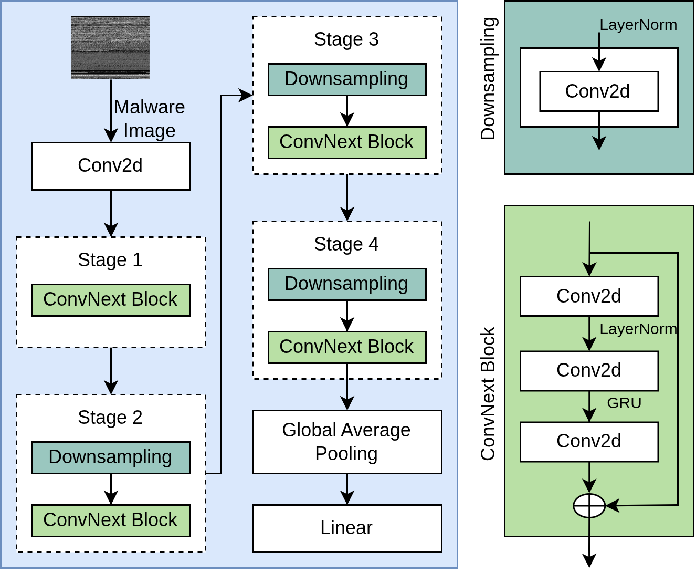
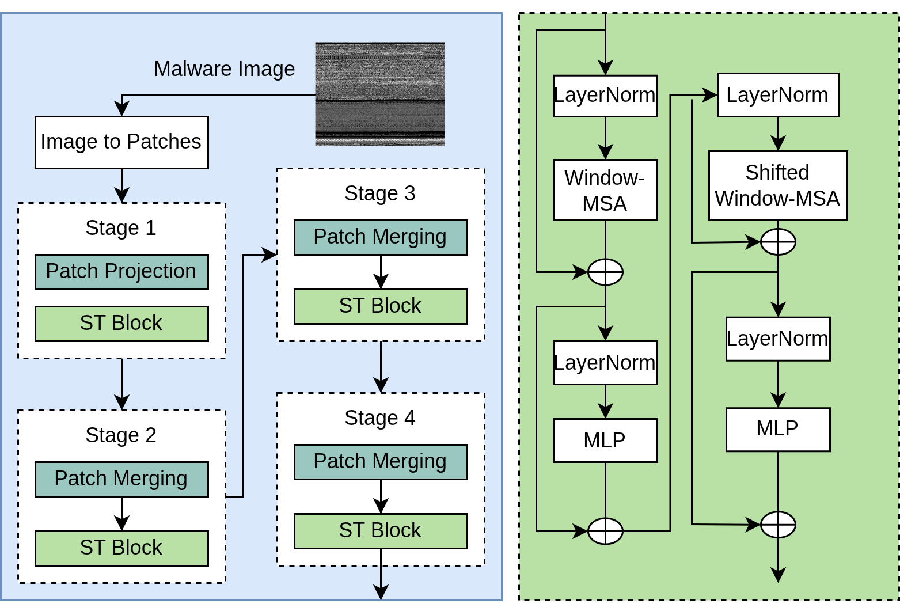
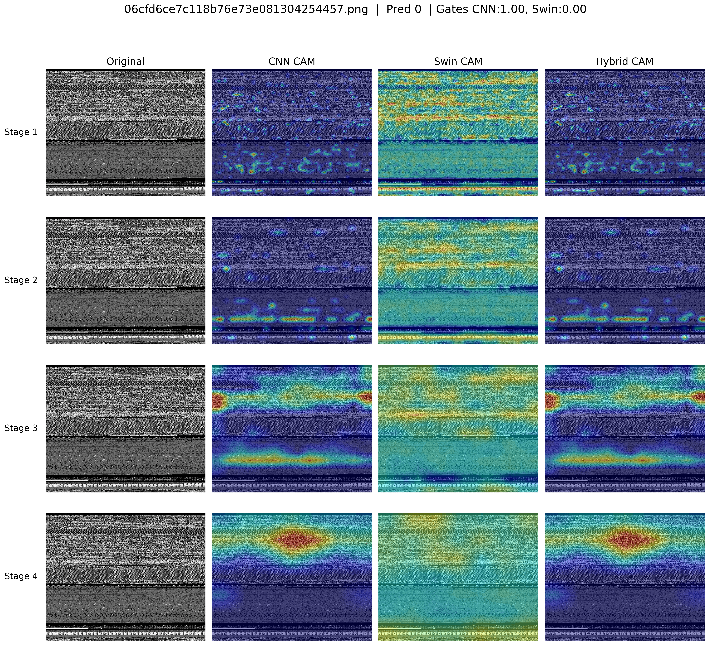
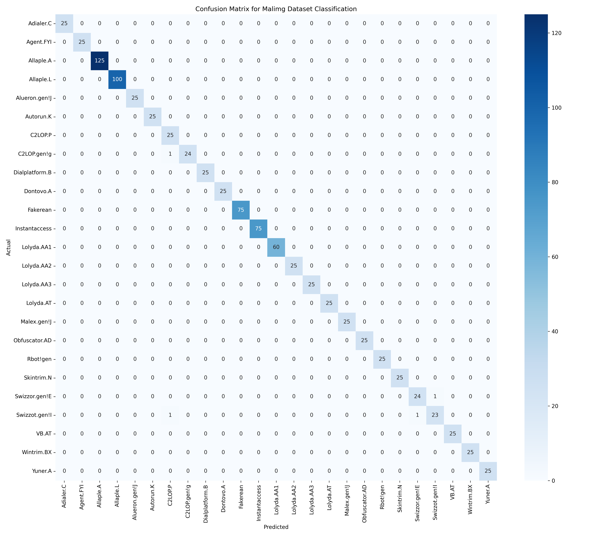

# Review Paper

## An Explainable Hybrid CNN-Transformer Architecture for Visual Malware Classification

### Penulis & Tahun

Mohammed Alshomrani, Aiiad Albeshri, Abdulaziz A. Alsulami, dan Badraddin Alturki (**2025**).

### Judul Penelitian

*An Explainable Hybrid CNN-Transformer Architecture for Visual Malware Classification*

### Nama Jurnal / Conference

Artikel jurnal pada **Sensors**, Volume 25, Article 4581, tahun 2025. DOI: `10.3390/s25154581`.

### Dataset

Penelitian menggunakan tiga dataset benchmark utama:

1. **MalImg**;
2. **MaleVis**;
3. **VirusMNIST**.

Ketiga dataset tersebut mencakup **61 keluarga malware**. Penulis juga melakukan validasi tambahan menggunakan:

- **Maldeb**, terdiri dari 2 kelas;
- **Dumpware-10**, terdiri dari 11 kelas.

Malware biner diubah menjadi citra grayscale, kemudian dilakukan resizing dan normalisasi sebelum diproses oleh model CNN dan Transformer.

### Metode / Model

Penelitian mengusulkan model hybrid yang menggabungkan:

- **ConvNeXt-Tiny** sebagai ekstraktor fitur lokal;
- **Swin Transformer** sebagai ekstraktor dependensi global;
- adaptive feature fusion berbasis gating MLP;
- auxiliary classification heads;
- knowledge distillation menggunakan teacher model;
- fusion MLP dan fully connected layer untuk klasifikasi akhir.

ConvNeXt dan Swin Transformer masing-masing menghasilkan feature vector berukuran 768 dimensi. Kedua vector digabungkan menjadi representasi 1536 dimensi. Gating MLP menghasilkan bobot untuk menentukan kontribusi fitur CNN dan Transformer secara adaptif.

*Gambar 1. Arsitektur hybrid yang menggabungkan ConvNeXt-Tiny dan Swin Transformer.*

### Tahapan Penelitian

1. Citra malware dari MalImg, MaleVis, dan VirusMNIST diproses dengan resizing dan normalisasi.
2. ConvNeXt-Tiny mengekstraksi pola lokal dan tekstur.
3. Swin Transformer membagi citra menjadi patch dan mempelajari relasi global menggunakan shifted-window attention.
4. Dua feature vector berukuran 768 dimensi digabungkan.
5. Gating MLP memberikan bobot adaptif untuk fitur CNN dan Transformer.
6. Fusion MLP mereduksi fitur menjadi 512 dimensi.
7. Fully connected layer menghasilkan prediksi untuk 61 kelas.
8. Knowledge distillation digunakan untuk meningkatkan generalisasi.
9. Grad-CAM digunakan untuk menjelaskan area citra yang memengaruhi keputusan model.

*Gambar 2. Struktur Swin Transformer untuk klasifikasi citra malware.*

### Hasil Utama

Model hybrid menghasilkan accuracy rata-rata tertinggi dibandingkan CNN-only dan Transformer-only.

| Metode | Dataset | Accuracy | Precision | Recall | F1-score | Average Accuracy |
|---|---|---:|---:|---:|---:|---:|
| CNN-Only | MalImg | 96,36% | 92,58% | 95,56% | 93,23% | 92,45% |
| CNN-Only | MaleVis | - | 88,47% | 90,70% | 96,40% | - |
| CNN-Only | VirusMNIST | - | 93,26% | 91,71% | 91,10% | - |
| Transformer-Only | MalImg | 95,94% | 91,98% | 93,92% | 92,60% | 90,44% |
| Transformer-Only | MaleVis | - | 88,35% | 90,31% | 95,79% | - |
| Transformer-Only | VirusMNIST | - | 92,05% | 89,00% | 90,23% | - |
| **Hybrid** | **MalImg** | **99,57%** | **99,38%** | **99,36%** | **99,36%** | **94,04%** |
| Hybrid | MaleVis | - | 88,65% | 90,74% | 96,49% | - |
| Hybrid | VirusMNIST | - | 93,90% | 92,44% | 91,42% | - |

Waktu training yang dilaporkan:

- CNN-only: 2 jam 14 menit;
- Transformer-only: 2 jam 3 menit;
- Hybrid: 2 jam 43 menit.

Model hybrid membutuhkan waktu training lebih lama karena berjalan hingga 29 epoch, sedangkan dua model pembanding berhenti lebih awal pada sekitar 17 epoch. Meskipun demikian, hybrid model memberikan performa rata-rata paling tinggi.

*Gambar 3. Hasil visualisasi evaluasi dan proses klasifikasi pada paper.*

### Explainable AI dengan Grad-CAM

Grad-CAM digunakan untuk memperlihatkan bagian citra yang paling berpengaruh terhadap prediksi. CNN cenderung menyoroti fitur lokal, sedangkan Swin Transformer memberikan perhatian yang lebih luas. Model hybrid menggabungkan kedua pola perhatian tersebut.

Pada tahap akhir, ketiga model cenderung menyoroti area tengah yang dianggap penting untuk klasifikasi. Hal ini menunjukkan bahwa model hybrid tidak hanya menghasilkan accuracy tinggi, tetapi juga memberikan interpretasi visual terhadap keputusan model.

### Validasi Tambahan

Pada dataset tambahan, model hybrid memperoleh hasil berikut:

| Dataset | Accuracy | Precision | Recall | F1-score | Jumlah Kelas |
|---|---:|---:|---:|---:|---:|
| Maldeb | 98% | 98% | 98% | 98% | 2 |
| Dumpware-10 | 97% | 97% | 95% | 96% | 11 |

Hasil tersebut mendukung klaim bahwa model memiliki kemampuan generalisasi pada dataset di luar tiga benchmark utama, meskipun performanya tetap bervariasi antar dataset dan kelas.

*Gambar 4. Confusion matrix pada MalImg Dataset.*

### Kelebihan

1. Menggabungkan fitur lokal CNN dan dependensi global Transformer.
2. Menggunakan lima dataset untuk menguji robustness dan generalisasi.
3. Adaptive fusion memungkinkan model menentukan bobot fitur secara dinamis.
4. Knowledge distillation membantu proses transfer pengetahuan dari teacher model.
5. Grad-CAM memberikan interpretasi visual terhadap keputusan model.
6. Model hybrid memperoleh average accuracy tertinggi, yaitu 94,04%.
7. Validasi tambahan pada Maldeb dan Dumpware-10 memperluas evaluasi di luar benchmark utama.

### Keterbatasan

1. Model hybrid memiliki waktu training lebih lama dibanding CNN-only dan Transformer-only.
2. Kebutuhan komputasi masih cukup tinggi sehingga deployment real-time pada perangkat edge perlu optimasi.
3. Dataset malware berbasis citra dapat kehilangan sebagian informasi behavior dan struktur asli file biner.
4. Beberapa kelas masih mengalami misclassification, seperti Swizzor.gen!E dan Swizzor.gen!I pada MalImg serta Regrun.A pada MaleVis.
5. VirusMNIST menunjukkan variasi precision, recall, dan F1-score yang lebih besar dibanding dataset lainnya.
6. Evaluasi adversarial robustness dan zero-day malware belum menjadi fokus utama.
7. Knowledge distillation dan auxiliary heads menambah kompleksitas pipeline pelatihan.

## Kesimpulan Review

Paper ini mengusulkan arsitektur hybrid yang menggabungkan ConvNeXt-Tiny dan Swin Transformer untuk klasifikasi malware berbasis citra. CNN digunakan untuk menangkap fitur lokal, sedangkan Transformer digunakan untuk memahami hubungan global antarpatch.

Hasil penelitian menunjukkan bahwa model hybrid mengungguli model CNN-only dan Transformer-only dengan average accuracy 94,04% dan accuracy 99,57% pada MalImg. Grad-CAM memperkuat aspek explainability dengan menunjukkan area citra yang memengaruhi prediksi.

Kontribusi utama paper adalah menggabungkan performa, generalisasi, dan interpretabilitas dalam satu framework. Namun, biaya komputasi, waktu training, dan kebutuhan optimasi untuk deployment real-time masih menjadi tantangan.

## Sumber

1. Alshomrani, M., Albeshri, A., Alsulami, A. A., & Alturki, B. (2025). *An Explainable Hybrid CNN-Transformer Architecture for Visual Malware Classification*. **Sensors, 25**, 4581. https://doi.org/10.3390/s25154581
2. MDPI: [An Explainable Hybrid CNN-Transformer Architecture for Visual Malware Classification](https://www.mdpi.com/1424-8220/25/15/4581)
