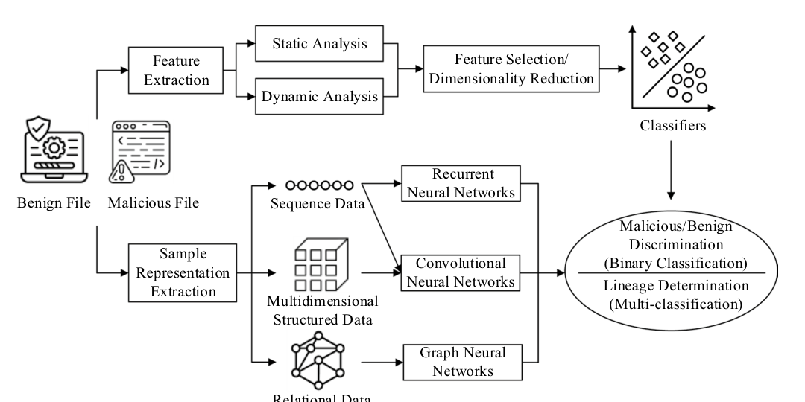
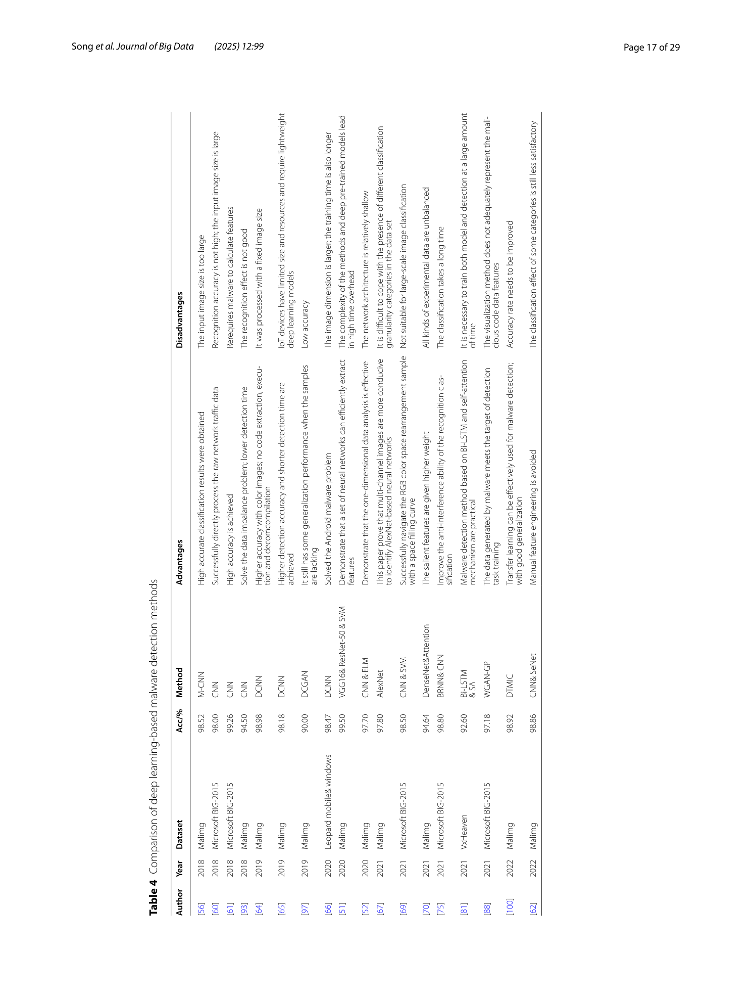
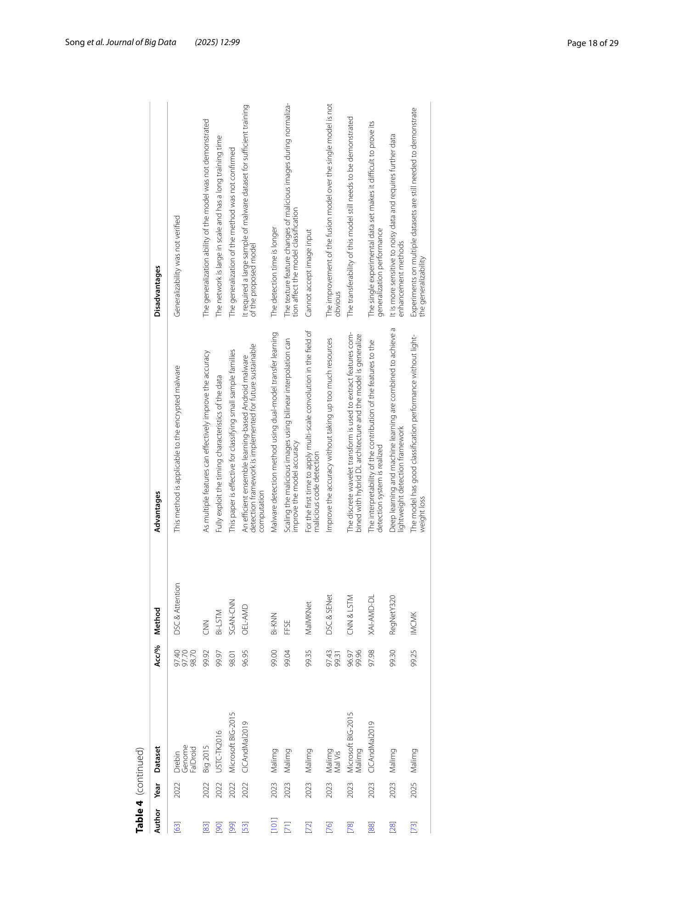

# Review Paper

## Application of Deep Learning in Malware Detection: A Review

### Identitas paper

- **Penulis:** Yafei Song, Dandan Zhang, Jian Wang, Yanan Wang, Yang Wang, dan Peng Ding.
- **Tahun:** 2025.
- **Publikasi:** *Journal of Big Data*, 12, artikel 99.
- **DOI:** [10.1186/s40537-025-01157-y](https://doi.org/10.1186/s40537-025-01157-y).
- **Sumber:** [Halaman Springer](https://link.springer.com/article/10.1186/s40537-025-01157-y) · [PDF artikel](https://link.springer.com/content/pdf/10.1186/s40537-025-01157-y.pdf).

### Tujuan penelitian

Paper ini meninjau metode deteksi malware, dengan perhatian khusus pada penerapan deep learning. Penulis mengelompokkan penelitian menurut representasi dan ekstraksi fitur, termasuk visualisasi citra, fitur sekuens, serta augmentasi data; mereka juga membahas tantangan dan arah riset.

### Dataset dan evaluasi

Review menggunakan pencarian pada Scopus, ACM Digital Library, IEEE Xplore, ScienceDirect, SpringerLink, dan CNKI. Penulis menyebut 363 studi full text diperiksa dan 72 studi dipilih untuk ekstraksi data. Dataset yang muncul dalam ringkasan studi primer mencakup Malimg, Microsoft BIG-2015, Drebin/Genome/FalDroid, dan MalVis (ditulis demikian dalam tabel paper).

Paper tidak menjalankan eksperimen klasifikasi tersendiri. Tabel 4 merangkum hasil studi primer dengan dataset dan metode berbeda. Contohnya, tabel mencatat hasil 97,43% pada Malimg dan 99,31% pada MalVis untuk satu metode DSC & SENet, serta hasil lain pada Malimg dan BIG-2015. Nilai-nilai tersebut adalah laporan studi yang dirujuk, bukan hasil uji ulang atau perbandingan dengan protokol seragam oleh penulis review.

*Gambar 1. Alur representasi dan ekstraksi fitur hingga klasifikasi malware; Fig. 2 pada paper.*

### Metode atau arsitektur model

Paper mengelompokkan metode deep learning menjadi pendekatan visualisasi citra, analisis sekuens, dan augmentasi data. Pada citra malware dibahas konversi biner atau assembly menjadi citra grayscale, RGB, atau multi-kanal; CNN dan turunannya seperti AlexNet, ResNet, DenseNet, serta metode gabungan CNN dengan attention atau LSTM. Bagian lain mencakup RNN/LSTM/GRU, graph neural network, GAN, transfer learning, dan teknik untuk ketidakseimbangan data.

*Gambar 2–3. Table 4 (dua halaman), perbandingan metode deep learning, dataset, akurasi, kelebihan, dan keterbatasan yang dihimpun penulis.*

### Domain penelitian

Keamanan siber dan deteksi atau klasifikasi malware. Cakupannya meliputi malware Windows/PC, Android, IoT, serta representasi malware berbasis citra dan data sekuens.

### Hasil utama

- Studi citra malware yang dirangkum menggunakan citra grayscale, RGB, dan multi-kanal dengan CNN atau model turunannya.
- Tabel komparatif melaporkan berbagai angka akurasi lintas dataset; beberapa hasil mendekati atau melampaui 99%, tetapi angka tersebut tidak berasal dari evaluasi seragam.
- Penulis menyoroti keterbatasan dataset yang kecil atau tidak seimbang, generalisasi yang lemah ke malware baru, kompleksitas komputasi, dan kurangnya interpretabilitas.
- Arah riset yang disarankan mencakup peningkatan mutu dan keragaman data, model yang lebih ringan, interpretabilitas, dan generalisasi yang lebih baik.

### Analisis kontribusi model

Kontribusi paper adalah pemetaan sistematis literatur dan pengelompokan pendekatan, bukan pengajuan satu model baru. Isinya relevan sebagai sumber sekunder untuk konteks klasifikasi malware berbasis citra: paper membahas citra RGB dan mencantumkan studi primer dengan dataset MalVis. Namun, angka MalVis tersebut milik penelitian primer yang dikutip. Paper ini tidak melakukan eksperimen MaleVis RGB sendiri dan tidak secara khusus membandingkan Vision Transformer dengan Vision Mamba.

### Kelebihan

1. Menjelaskan strategi pencarian pada enam basis data dan jumlah studi yang disaring hingga terpilih.
2. Mengelompokkan literatur menurut visualisasi citra, fitur sekuens, dan augmentasi data.
3. Tabel komparatif menyertakan dataset, metode, angka akurasi, serta kelebihan dan keterbatasan yang dilaporkan.
4. Membahas data RGB dan MalVis, sehingga memberi petunjuk ke studi primer yang dapat ditelusuri lebih lanjut.

### Keterbatasan

1. Angka kinerja dihimpun dari studi dengan dataset dan protokol evaluasi yang berbeda; perbandingan langsung antarangka tidak setara.
2. Cakupan temporal tidak konsisten: abstrak menyebut artikel 2011–2025 dan fokus terbaru 2018–2025, sementara metode seleksi menyatakan rentang publikasi 2018–2025.
3. Deskripsi pencarian belum merinci query lengkap per basis data, tanggal pencarian, deduplikasi, dan alasan eksklusi setiap tahap, sehingga reproduksi seleksi terbatas.
4. Tidak ada eksperimen baru, evaluasi MaleVis RGB oleh penulis, ataupun perbandingan ViT dan Vision Mamba.

### Kesimpulan review

Paper ini berguna untuk memetakan pendekatan deep learning pada deteksi malware dan menemukan studi primer yang menggunakan visualisasi RGB maupun MalVis. Karena paper hanya merangkum eksperimen terdahulu, hasil kuantitatifnya perlu diperiksa pada sumber primer sebelum digunakan sebagai tolok ukur. Paper ini memberi konteks pendukung, tetapi tidak menjawab perbandingan ViT dan Vision Mamba pada MaleVis RGB.

### Sumber

Song, Y., Zhang, D., Wang, J., Wang, Y., Wang, Y., & Ding, P. (2025). *Application of deep learning in malware detection: a review*. **Journal of Big Data, 12**, 99. [Artikel Springer](https://link.springer.com/article/10.1186/s40537-025-01157-y) · [PDF](https://link.springer.com/content/pdf/10.1186/s40537-025-01157-y.pdf) · [DOI](https://doi.org/10.1186/s40537-025-01157-y).
