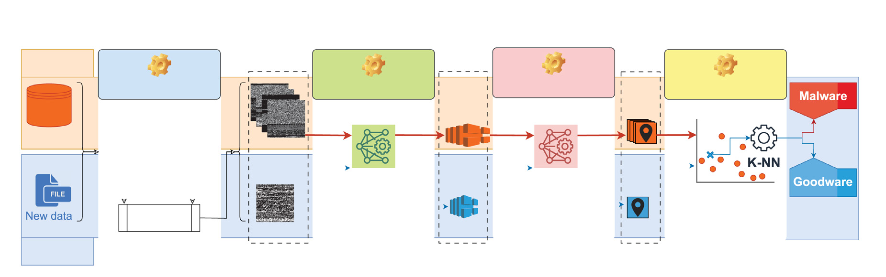
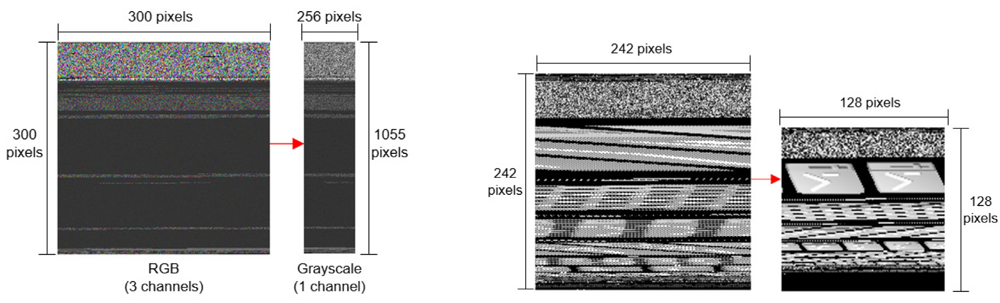
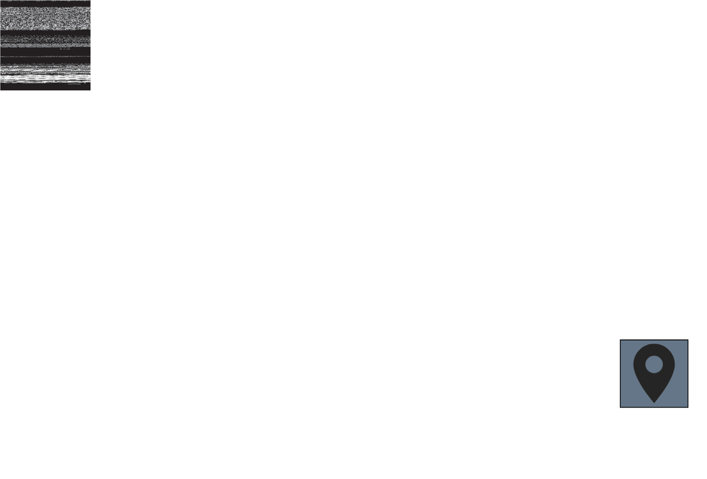
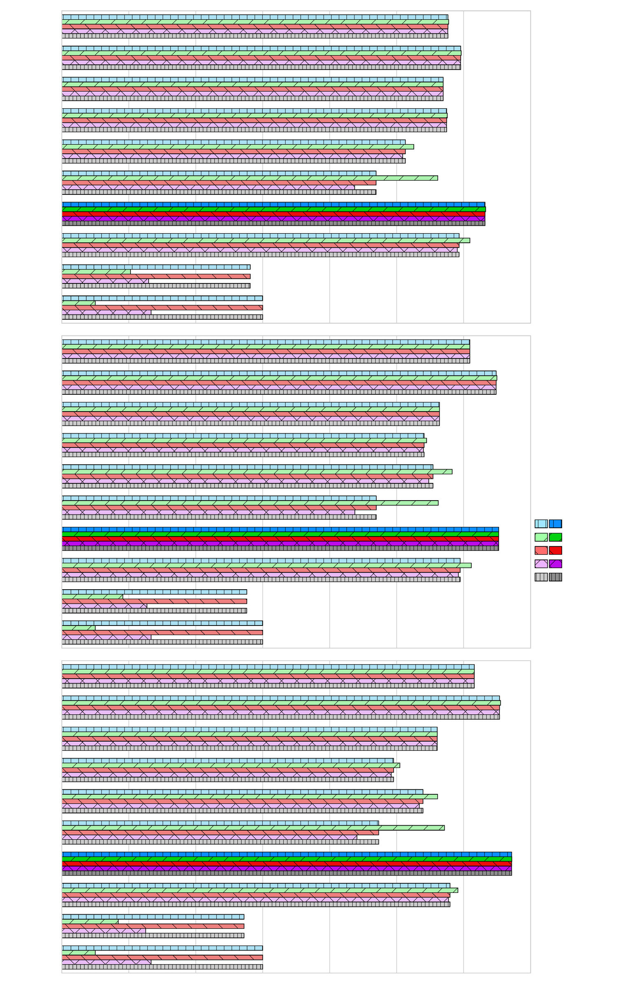

# Review Paper

## CNN-AutoMIC: Combining Convolutional Neural Network and Autoencoder to Learn Non-Linear Features for KNN-Based Malware Image Classification

### Penulis & Tahun

Simone Andriani, Stefano Galantucci, Andrea Iannacone, dan Antonio Maci (**2025**).

### Judul Penelitian

*CNN-AutoMIC: Combining Convolutional Neural Network and Autoencoder to Learn Non-Linear Features for KNN-Based Malware Image Classification*

### Nama Jurnal / Conference

Artikel jurnal pada **Computers & Security**, Volume 156, Article 104507, tahun 2025. Publisher: Elsevier.

### Dataset

Penelitian menggunakan beberapa jenis data untuk menguji performa dan robustness model:

1. **MaleVis** sebagai dataset utama untuk training dan benchmark.
2. **RWD 2020, RWD 2022, dan RWD 2024** sebagai real-world dataset untuk cross-dataset testing.
3. **SMD dataset** untuk menguji kemampuan mendeteksi stealthy malware yang tidak direpresentasikan secara memadai dalam data training.

MaleVis terdiri dari 9.100 citra training dan 5.126 citra validation, dengan 26 kelas: 25 keluarga malware dan satu kelas benign. Citra tersedia dalam ukuran 224 x 224 atau 300 x 300 piksel.

### Metode / Model

CNN-AutoMIC merupakan pipeline yang menggabungkan tiga tahap utama:

1. **CNN sebagai feature extractor**
   - Citra malware diproses melalui convolutional layer, pooling layer, flattening, dense layer, dan dropout.
   - CNN mempelajari fitur non-linear dari tekstur dan pola bytecode image.

2. **Autoencoder sebagai feature compressor**
   - Feature vector dari CNN dikompresi menjadi representasi berdimensi lebih rendah.
   - Autoencoder dilatih untuk mempertahankan informasi penting dan mengurangi redundansi fitur.

3. **K-Nearest Neighbors (KNN) sebagai classifier**
   - Representasi fitur terkompresi digunakan oleh KNN untuk menentukan kelas sampel.
   - KNN dipakai sebagai classifier akhir, bukan fully connected classifier utama.

*Gambar 1. Diagram lengkap pipeline CNN-AutoMIC.*

### Pra-pemrosesan Citra

Bytecode executable dipindai dan setiap byte dipetakan menjadi nilai piksel antara 0 dan 255. Nilai tersebut membentuk citra grayscale dengan lebar tetap dan panjang yang mengikuti ukuran file. Area kosong diisi dengan nilai nol.

Untuk eksperimen tertentu, citra juga diubah dari RGB menjadi grayscale. Ukuran input diuji pada 128 x 128, 192 x 192, dan 256 x 256 piksel untuk mengukur pengaruh resolusi terhadap performa dan informasi yang hilang.

*Gambar 2. Contoh operasi pra-pemrosesan bytecode image.*

### Konfigurasi Model

CNN-AutoMIC diuji dalam beberapa konfigurasi, termasuk:

- konfigurasi CNN-AutoMIC utama;
- CNN-of-CNNAutoMIC sebagai feature extractor tanpa seluruh pipeline compressor-classifier;
- konfigurasi dengan resolusi citra 128 x 128, 192 x 192, dan 256 x 256;
- pembanding AE-MLP, AE-KNN, Multi-AEs, AlexNet, ResNet-50, ResNet-152, VGG-16, VGG-19, dan ViT.

*Gambar 3. Model CNN dan Autoencoder yang digunakan dalam CNN-AutoMIC.*

### Hasil Utama

Pada benchmark MaleVis, hasil CNN-AutoMIC bergantung pada konfigurasi input. Ringkasan hasil pada tabel paper adalah:

| Model / Konfigurasi | Ukuran Input | Accuracy | Macro Precision | Macro Recall | Macro F1 | AUC-ROC |
|---|---:|---:|---:|---:|---:|---:|
| CNN-AutoMIC Conf. 1 | 128 x 128 | 87,06% | 87,08% | 87,06% | 87,06% | 87,06% |
| CNN-AutoMIC Conf. 1 | 192 x 192 | 78,27% | 81,06% | 78,27% | 77,77% | 78,26% |
| CNN-AutoMIC Conf. 1 | 256 x 256 | 76,62% | 80,80% | 76,62% | 75,80% | 76,61% |
| CNN-AutoMIC Conf. 2 | 128 x 128 | 85,89% | 85,89% | 85,89% | 85,89% | 85,88% |
| CNN-of-CNNAutoMIC | 128 x 128 | 84,66% | 84,66% | 84,66% | 84,66% | 84,66% |

Konfigurasi 128 x 128 memberikan hasil terbaik pada tabel tersebut. Peningkatan resolusi tidak otomatis meningkatkan performa; justru dapat menyebabkan informasi tidak relevan, biaya komputasi, dan efek resizing yang lebih besar.

Pada **SMD dataset**, CNN-AutoMIC memperoleh:

- accuracy: 69,07%;
- macro precision: 80,89%;
- macro recall: 69,07%;
- macro F1-score: 65,80%;
- AUC-ROC: 69,07%.

Walaupun performa turun pada stealthy malware, CNN-AutoMIC mengalami penurunan yang lebih kecil dibanding beberapa model pembanding. Hal ini menunjukkan robustness yang relatif lebih baik pada cross-dataset dan data yang tidak sepenuhnya terwakili saat training.

### Cross-Dataset Testing

Salah satu kontribusi penting paper adalah penggunaan real-world dataset dari tahun berbeda, bukan hanya pembagian training-testing dari dataset yang sama. Strategi ini dirancang untuk menghindari estimasi performa yang terlalu optimistis akibat distribusi data training dan testing yang terlalu mirip.

CNN-AutoMIC juga menghasilkan pemisahan kelas yang cukup jelas pada scatter plot, terutama karena kombinasi feature compression dan KNN mampu membentuk batas klasifikasi yang relatif tegas.

*Gambar 4. Visualisasi pengelompokan sampel pada tahap klasifikasi.*

### Kelebihan

1. Menggabungkan kekuatan CNN, Autoencoder, dan KNN dalam satu pipeline.
2. Autoencoder membantu mempelajari fitur non-linear sekaligus mengurangi dimensi fitur.
3. KNN menyediakan classifier sederhana pada representasi fitur yang telah dikompresi.
4. Menggunakan cross-dataset testing dengan real-world dataset dari beberapa tahun.
5. Mengevaluasi robustness terhadap stealthy malware melalui SMD dataset.
6. Menguji beberapa resolusi citra sehingga pengaruh resizing dapat dianalisis.
7. Paper memasukkan unsur explainable AI dan analisis scatter plot untuk memahami pemisahan kelas.

### Keterbatasan

1. Accuracy pada SMD turun cukup besar karena stealthy malware tidak direpresentasikan dengan baik pada data training.
2. Performa CNN-AutoMIC sensitif terhadap ukuran input; resolusi yang lebih besar justru menghasilkan performa lebih rendah pada beberapa konfigurasi.
3. KNN dapat menjadi mahal pada jumlah data atau dimensi fitur yang sangat besar jika proses compression tidak efektif.
4. Representasi bytecode menjadi citra dapat kehilangan informasi semantik dan perilaku asli executable.
5. Hasil benchmark pada dataset yang sama dapat berbeda dari hasil cross-dataset sehingga accuracy tinggi perlu dibaca berdasarkan skenario pengujiannya.
6. Deteksi zero-day dan adversarial malware masih membutuhkan strategi tambahan seperti adversarial learning.
7. Model masih memerlukan pengujian pada platform, keluarga malware, dan distribusi data yang lebih beragam.

## Kesimpulan Review

CNN-AutoMIC menggabungkan CNN sebagai ekstraktor fitur, Autoencoder sebagai compressor, dan KNN sebagai classifier. Berbeda dari pendekatan yang hanya menggunakan CNN sebagai classifier, pipeline ini berfokus pada pembelajaran fitur non-linear yang ringkas dan dapat digunakan untuk klasifikasi berbasis jarak.

Hasil terbaik pada tabel utama diperoleh pada input 128 x 128 dengan accuracy 87,06%. Pengujian cross-dataset dan SMD menunjukkan bahwa evaluasi yang lebih realistis dapat menghasilkan performa lebih rendah, tetapi memberikan gambaran robustness yang lebih berguna daripada pengujian pada satu dataset saja.

Kontribusi utama paper adalah penekanan pada cross-dataset robustness, feature compression, dan pengujian terhadap stealthy malware. Paper ini relevan sebagai referensi CNN - klasifikasi dan sebagai contoh bahwa accuracy tinggi pada satu dataset tidak selalu mencerminkan kemampuan generalisasi di dunia nyata.

## Sumber

1. Andriani, S., Galantucci, S., Iannacone, A., & Maci, A. (2025). *CNN-AutoMIC: Combining convolutional neural network and autoencoder to learn non-linear features for KNN-based malware image classification*. **Computers & Security, 156**, 104507.
2. ScienceDirect: [CNN-AutoMIC](https://www.sciencedirect.com/science/article/pii/S0167404825001968)
