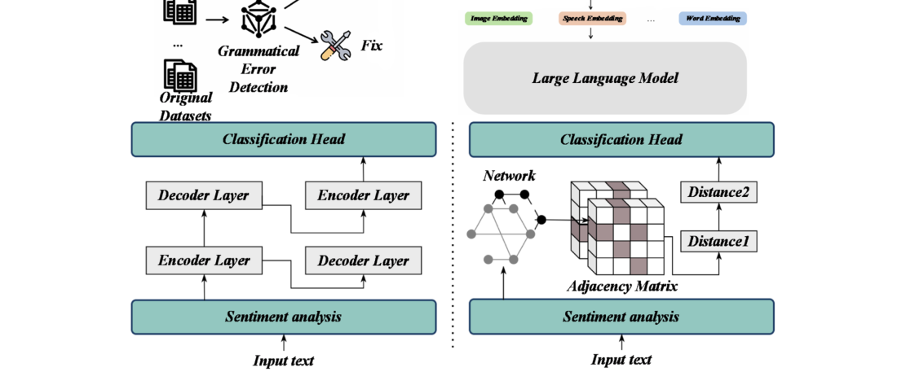
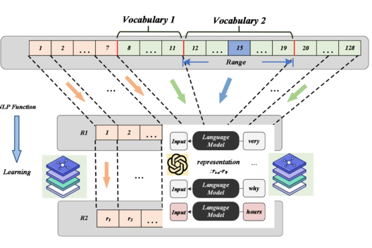
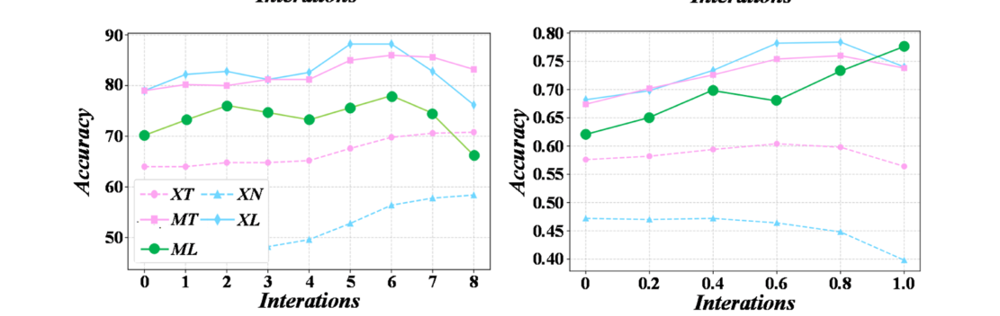
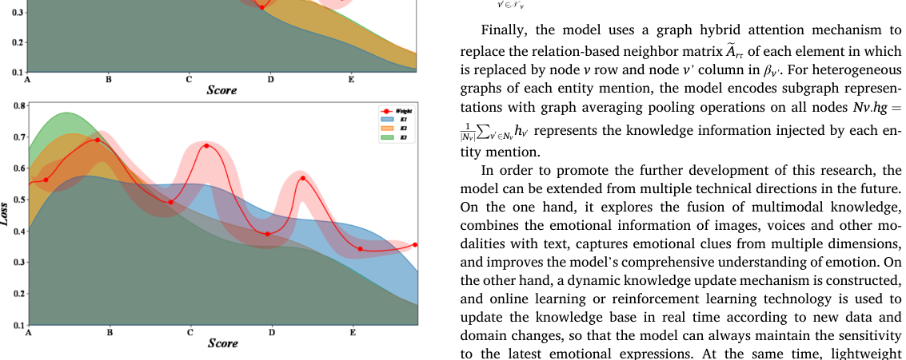

# Review Paper

### Identitas paper

#### Penulis & Tahun

Lan Cui (**2025**).

#### Judul Penelitian

*Construction and Implementation of Knowledge Enhancement Pre-Trained Language Model for Text Sentiment Analysis*

#### Nama Jurnal

Artikel penelitian pada **Systems and Soft Computing**, Volume 7, Article 200293, tahun 2025. Artikel tersedia secara open access.

DOI: `10.1016/j.sasc.2025.200293`.

### Tujuan penelitian

Penelitian ini mengembangkan pretrained language model yang diperkuat dengan pengetahuan eksternal untuk meningkatkan pemahaman emosi pada teks panjang, ekspresi emosional kompleks, dan klasifikasi sentimen yang lebih rinci.

### Dataset dan evaluasi

Penelitian menggunakan dataset teks bahasa Mandarin berskala besar untuk tahap pre-training dan evaluasi klasifikasi sentimen. Pengetahuan tambahan yang digunakan meliputi:

- emotional lexicon;
- label emosi;
- pengetahuan spesifik domain;
- informasi semantik yang berkaitan dengan kata atau ekspresi emosional.

### Metode atau arsitektur model

Model yang diusulkan menggabungkan pretrained language model dengan **knowledge enhancement module** dan sentiment classification head.

Tahapan utama model adalah:

1. Melakukan pre-training pada korpus teks bahasa Mandarin.
2. Mengambil pengetahuan emosional dari emotional lexicon dan knowledge base.
3. Menggabungkan pengetahuan eksternal dengan representasi semantik pretrained language model.
4. Melakukan klasifikasi sentimen umum dan fine-grained sentiment analysis.
5. Menggunakan ablation study untuk mengukur kontribusi knowledge enhancement module.

### Domain penelitian

Domain penelitian ini adalah **Natural Language Processing (NLP)**. Paper ini berfokus pada dua tugas utama:

- **Text sentiment classification**, yaitu menentukan kecenderungan sentimen seperti positif, negatif, atau netral.
- **Fine-grained sentiment analysis**, yaitu menganalisis sentimen secara lebih rinci berdasarkan kategori atau tingkat emosi.

### Hasil utama

Dibandingkan dengan baseline, model memperoleh peningkatan sebagai berikut:

| Tugas | Peningkatan Accuracy | Peningkatan F1-score |
| --- | ---: | ---: |
| Klasifikasi sentimen | **8,3%** | **7,5%** |
| Fine-grained sentiment analysis | **6,2%** | **5,8%** |

Model juga dilaporkan lebih robust ketika memproses teks panjang dan ekspresi emosional yang kompleks.

### Analisis kontribusi model

Knowledge enhancement module membantu model untuk:

- mengenali kosakata emosional;
- memahami kecenderungan sentimen dalam konteks;
- mengurangi kesalahan pada ekspresi emosi yang kompleks;
- memanfaatkan pengetahuan domain selain pola yang dipelajari dari korpus.

Hasil ablation experiment menunjukkan kontribusi modul tambahan terhadap performa model secara keseluruhan.

### Kelebihan

- Menggabungkan pretrained language model dengan pengetahuan eksternal.
- Mendukung klasifikasi sentimen umum dan fine-grained.
- Lebih sesuai untuk teks panjang dan ekspresi emosional kompleks.
- Menyertakan analisis ablation untuk menguji peran modul tambahan.

### Keterbatasan

- Kualitas model bergantung pada emotional lexicon dan knowledge base yang digunakan.
- Eksperimen berfokus pada bahasa Mandarin sehingga generalisasi ke bahasa lain belum terbukti.
- Dataset dan domain yang lebih beragam masih diperlukan untuk menguji generalisasi model.
- Dampak biaya komputasi akibat integrasi pengetahuan eksternal perlu dianalisis lebih lanjut.

### Kesimpulan review

Model yang diusulkan mengintegrasikan pengetahuan emosi dan pengetahuan domain ke dalam pretrained language model untuk sentiment analysis. Knowledge enhancement module membantu model mengenali kosakata emosional dan memahami ekspresi sentimen yang kompleks. Peningkatan accuracy dan F1-score pada klasifikasi sentimen serta fine-grained sentiment analysis menunjukkan manfaat integrasi tersebut, tetapi generalisasi pada bahasa dan domain lain masih memerlukan validasi.

### Sumber

1. Cui, L. (2025). *Construction and Implementation of Knowledge Enhancement Pre-Trained Language Model for Text Sentiment Analysis*. **Systems and Soft Computing, 7**, 200293. https://doi.org/10.1016/j.sasc.2025.200293
