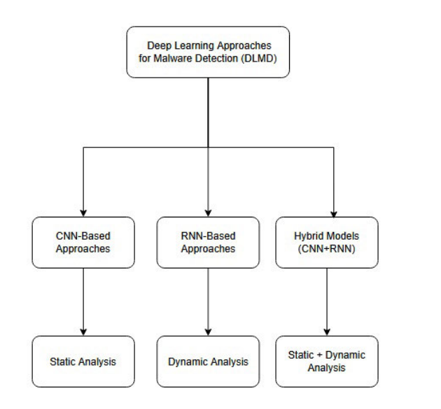
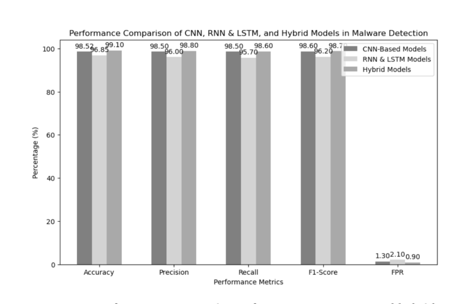

# Review Paper

## Deep Learning Approaches for Malware Detection: A Comprehensive Review of Techniques, Challenges, and Future Directions

### Identitas paper

- **Penulis:** Mohammad Alshoulie dan Abid Mehmood.
- **Tahun:** 2025; terbit daring 24 Juni 2025, versi volume 13 tercatat 14 Juli 2025.
- **Publikasi:** *IEEE Access*, volume 13, hlm. 118652–118677.
- **DOI:** [10.1109/ACCESS.2025.3582875](https://doi.org/10.1109/ACCESS.2025.3582875).
- **Sumber:** [Halaman IEEE Xplore](https://ieeexplore.ieee.org/document/11048875) · [PDF IEEE Xplore](https://ieeexplore.ieee.org/stamp/stamp.jsp?tp=&arnumber=11048875).

### Tujuan penelitian

Paper ini meninjau pendekatan deep learning untuk deteksi malware melalui sintesis literatur yang disebut mencakup 109 publikasi dari 2011 sampai 2024. Penulis menyusun taksonomi pendekatan CNN, RNN, dan gabungan CNN-RNN; membahas tipe analisis statis, dinamis, serta hybrid; dan merangkum dataset, metrik, tantangan, serta arah riset.

### Dataset dan evaluasi

Ini adalah review literatur, bukan eksperimen baru pada satu dataset. Dataset yang dibahas antara lain BIG2015, Malimg, Drebin, Malicia, dan IoT-23. Malimg dijelaskan sebagai citra grayscale dari biner malware dan dipakai dalam studi klasifikasi berbasis citra. MaleVis tidak disebut sebagai dataset yang dievaluasi secara khusus dalam pembahasan dataset paper ini.

Paper merangkum metrik hasil studi terdahulu, termasuk akurasi, precision, recall, F1-score, dan false positive rate (FPR). Penulis melaporkan rentang akurasi CNN 96,5–98,7%, RNN 93,7–96,9%, dan nilai tertinggi 98,7% untuk model hybrid, serta FPR serendah 1,1%. Angka tersebut dikompilasi dari studi yang berbeda; bukan hasil evaluasi ulang dengan dataset dan protokol seragam.

*Gambar 1. Taksonomi CNN, RNN, dan model gabungan menurut pendekatan analisis; Fig. 2 pada paper.*

### Metode atau arsitektur model

Review mengelompokkan model sebagai CNN untuk representasi spasial atau citra malware, RNN/LSTM untuk urutan perilaku seperti API call dan trafik, serta hybrid CNN-RNN/LSTM untuk memadukan fitur spasial dan temporal. Paper juga meninjau DNN, autoencoder, augmentasi data, transfer learning, few-shot learning, dan adversarial training.

*Gambar 2. Grafik perbandingan akurasi, precision, recall, F1-score, dan FPR pada CNN, RNN/LSTM, dan hybrid; Fig. 12 pada paper. Nilainya merupakan ringkasan studi berbeda sebagaimana disajikan penulis.*

### Domain penelitian

Keamanan siber dan deteksi malware. Cakupan termasuk klasifikasi citra malware berbasis CNN serta analisis statis, dinamis, dan gabungan pada data biner, perilaku, urutan API, dan jaringan.

### Hasil utama

- Penulis mengidentifikasi CNN sebagai pendekatan yang banyak digunakan untuk analisis statis dan citra biner, sedangkan RNN/LSTM sesuai untuk data berurutan dan perilaku.
- Review melaporkan performa tinggi pada berbagai studi; model hybrid memperoleh angka maksimum yang dirangkum sebesar 98,7% akurasi dan FPR minimum 1,1%.
- Tantangan yang dibahas meliputi serangan adversarial, kelangkaan dan mutu data, interpretabilitas, biaya komputasi, skalabilitas, serta deteksi zero-day.
- Saran riset mencakup model lebih tangguh, efisien, dapat dijelaskan, dan mampu belajar dari sedikit data atau lintas domain.

### Analisis kontribusi model

Kontribusi utamanya berupa taksonomi konseptual dan ringkasan lintas literatur, bukan arsitektur baru. Bagian klasifikasi berbasis citra membantu memberi konteks penggunaan CNN pada biner malware. Namun, paper tidak menguji ViT atau Vision Mamba secara khusus, tidak membandingkan keduanya, dan tidak menyajikan evaluasi MaleVis RGB yang dapat dipakai sebagai pembanding langsung.

### Kelebihan

1. Merangkum model, tipe analisis, dataset, metrik, dan tantangan dalam satu sumber.
2. Memuat konteks klasifikasi malware berbasis citra selain deteksi berbasis urutan perilaku.
3. Menyediakan taksonomi visual dan pembahasan arah riset seperti robust learning, transfer learning, serta efisiensi.

### Keterbatasan

1. Angka performa berasal dari studi dengan dataset, pembagian data, dan protokol berbeda sehingga tidak menunjukkan perbandingan eksperimental yang setara.
2. Uraian metode pencarian dan seleksi 109 publikasi tidak cukup terperinci dalam bagian review untuk mereproduksi proses seleksinya.
3. Fokus visualnya terutama CNN dan citra grayscale; paper tidak membahas perbandingan ViT dengan Vision Mamba ataupun eksperimen MaleVis RGB.
4. Karena merupakan sintesis sekunder, hasil kuantitatif penting perlu ditelusuri ke studi primer sebelum dibandingkan atau dikutip sebagai benchmark.

### Kesimpulan review

Paper ini berguna sebagai tinjauan umum deep learning untuk deteksi malware dan sebagai sumber konteks bagi pendekatan CNN berbasis citra. Nilai performa yang dirangkum tidak dapat diperlakukan sebagai hasil uji terkontrol lintas arsitektur. Untuk penelitian komparatif ViT dan Vision Mamba pada MaleVis RGB, paper ini merupakan referensi latar belakang; ia tidak menyediakan pembandingan langsung atau skor MaleVis RGB.

### Sumber

Alshoulie, M., & Mehmood, A. (2025). *Deep Learning Approaches for Malware Detection: A Comprehensive Review of Techniques, Challenges, and Future Directions*. **IEEE Access, 13**, 118652–118677. [IEEE Xplore](https://ieeexplore.ieee.org/document/11048875) · [PDF](https://ieeexplore.ieee.org/stamp/stamp.jsp?tp=&arnumber=11048875) · [DOI](https://doi.org/10.1109/ACCESS.2025.3582875).
