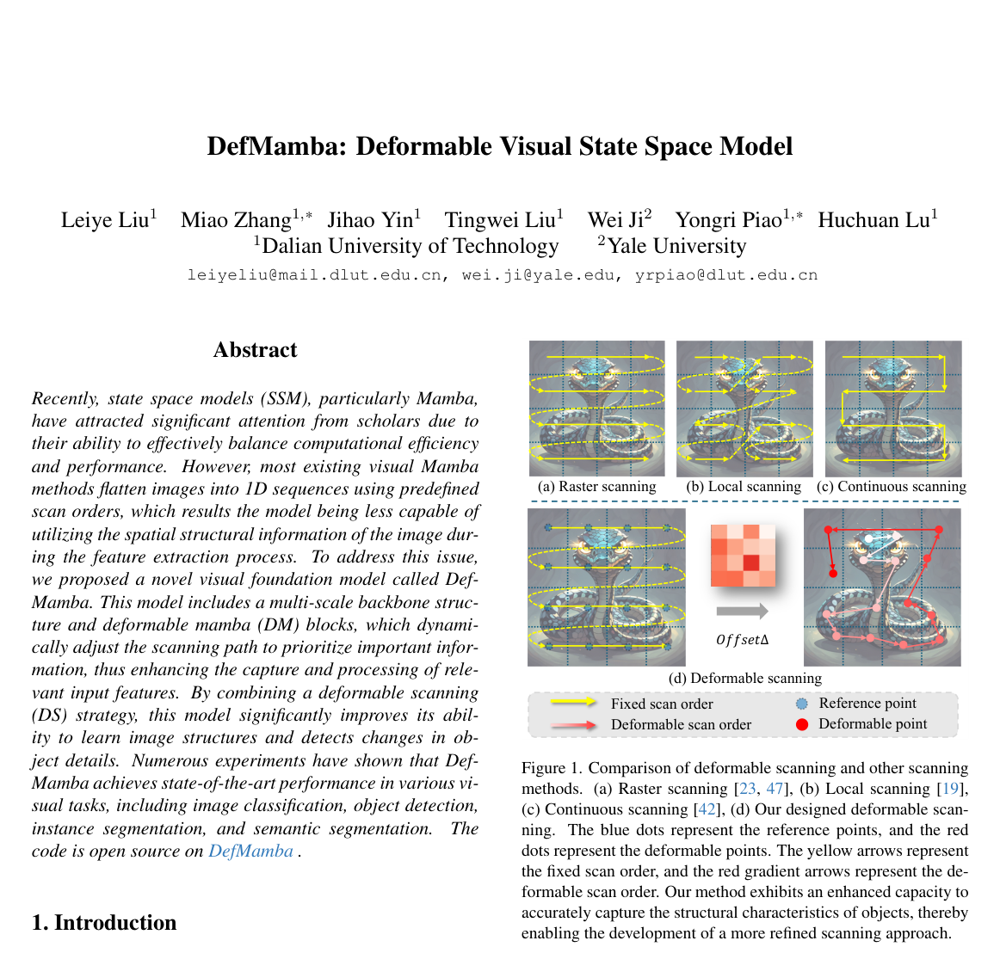
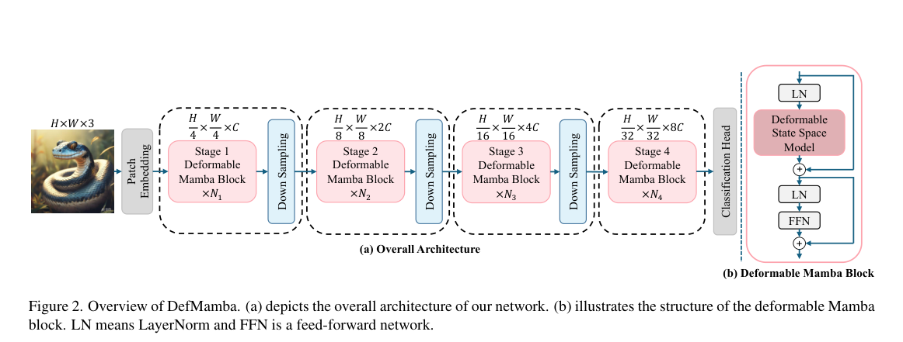

# Review Paper

## DefMamba: Deformable Visual State Space Model

### Identitas paper

- **Penulis:** Leiye Liu, Miao Zhang, Jihao Yin, Tingwei Liu, Wei Ji, Yongri Piao, dan Huchuan Lu.
- **Tahun:** 2025.
- **Publikasi:** *IEEE/CVF Conference on Computer Vision and Pattern Recognition (CVPR 2025)*; metadata arXiv mencantumkan CVPR 2025.
- **Versi PDF yang ditinjau:** arXiv:2504.05794v1, diajukan 8 April 2025.
- **Sumber:** [arXiv:2504.05794](https://arxiv.org/abs/2504.05794) · [PDF arXiv](https://arxiv.org/pdf/2504.05794) · [CVPR Open Access](https://openaccess.thecvf.com/content/CVPR2025/html/Liu_DefMamba_Deformable_Visual_State_Space_Model_CVPR_2025_paper.html).

### Tujuan penelitian

DefMamba ditujukan untuk mengatasi keterbatasan scan order tetap yang umum dipakai visual Mamba saat mengubah feature map 2D menjadi urutan 1D. Paper mengusulkan deformable state space model dengan scanning path yang dapat menyesuaikan diri terhadap konten dan struktur objek, lalu mengevaluasinya pada klasifikasi, deteksi, instance segmentation, dan semantic segmentation.

### Dataset dan evaluasi

Paper menggunakan benchmark computer vision umum:

- **ImageNet-1K:** lebih dari 1,28 juta citra training dan 50 ribu validasi dari 1.000 kelas; melaporkan Top-1 accuracy, parameter, dan FLOPs. Training 300 epoch, warm-up 20 epoch, batch 1.024, delapan GPU A800.
- **MS COCO 2017:** object detection dan instance segmentation dengan Mask R-CNN; melaporkan box AP dan mask AP. Setup mencakup jadwal 1× (12 epoch) dengan multi-scale training.
- **ADE20K:** semantic segmentation menggunakan UperNet, 160.000 iterasi; melaporkan mIoU single-scale dan multi-scale.

Paper tidak mengevaluasi malware, MaleVis, atau klasifikasi keluarga malware.

### Metode atau arsitektur model

DefMamba memakai backbone hierarkis multi-scale empat stage. Deformable Mamba (DM) block terdiri dari Deformable State Space Model, LayerNorm, FFN, dan residual connections. Deformable scanning menghasilkan offset untuk menggeser reference points ke lokasi fitur yang dinilai lebih penting dan mengubah urutan token berdasarkan offset. Bilinear interpolation mengambil fitur pada titik bergeser; token kemudian diurutkan untuk membentuk sekuens adaptif sebelum diproses oleh SSM. Paper juga membahas pembatasan offset dan penggunaan tanh untuk menstabilkan proses.

*Gambar 1. Perbandingan raster, local, continuous, dan deformable scanning, Fig. 1 pada Liu et al. (2025). Gambar asli diekstrak dari PDF.*

*Gambar 2. Backbone DefMamba dan susunan DM block, Fig. 2 pada Liu et al. (2025). Gambar asli diekstrak dari PDF.*

### Domain penelitian

**Computer vision dan machine learning**, khususnya backbone state space model dengan pemindaian deformable untuk klasifikasi citra, deteksi objek, instance segmentation, dan semantic segmentation. Paper tidak meneliti cybersecurity atau malware.

### Hasil utama

- Pada ImageNet-1K, **DefMamba-T** memperoleh 78,6% Top-1 accuracy dengan 8 juta parameter dan 1,2G FLOPs; **DefMamba-S** 83,5% dengan 32 juta parameter dan 4,8G FLOPs; **DefMamba-B** 84,2% dengan 51 juta parameter dan 8,5G FLOPs.
- Pada COCO dengan Mask R-CNN 1×, DefMamba-S mencapai **47,5 box AP** dan **42,8 mask AP**. Paper menyatakan hasilnya sebanding dengan VMamba-T, dengan FLOPs yang dilaporkan 268G dibanding 286G.
- Pada ADE20K, DefMamba-S memperoleh **48,8 mIoU single-scale** dan **49,6 multi-scale**.
- Pada ablation ImageNet ukuran Tiny, penambahan deformable branch pada konfigurasi yang dibandingkan meningkatkan Top-1 dari 76,9% (baseline fixed branches) menjadi 78,6%. Kontribusi ini merupakan hasil ablation khusus konfigurasi tersebut, bukan klaim peningkatan universal pada semua model/dataset.

### Analisis kontribusi model

Kontribusi utama DefMamba adalah menjadikan scan order dan reference points adaptif terhadap fitur input. Ini membedakannya dari visual SSM dengan raster atau multi-scan tetap. Hasil benchmark dan ablation memberikan bukti bahwa deformable scanning dapat membantu pada tugas visi yang diuji. Untuk tesis, paper ini dapat menjadi rujukan desain SSM visual, tetapi tidak menunjukkan apakah deformable scan meningkatkan klasifikasi malware RGB.

### Kelebihan

1. Mengidentifikasi masalah konkret pada pemetaan feature map 2D ke urutan 1D dengan scan order tetap.
2. Merancang offset untuk posisi titik dan urutan token, sehingga scan dapat menyesuaikan struktur input.
3. Menguji klasifikasi serta tugas deteksi dan segmentasi.
4. Menyediakan ablation beberapa cabang scan dan komponen deformable scanning.
5. Melaporkan metrik kinerja dan kompleksitas, termasuk Top-1, AP, mIoU, parameter, dan FLOPs.

### Keterbatasan

1. Tidak menguji malware, MaleVis, atau citra RGB malware.
2. Angka pada ImageNet/COCO/ADE20K tidak dapat dibandingkan langsung dengan klasifikasi malware karena perbedaan domain, label, preprocessing, dan protokol.
3. Training klasifikasi memakai delapan GPU A800; biaya dan kinerja dapat berbeda pada perangkat keras lain.
4. Pemrosesan deformable menggunakan prediksi offset, interpolasi, dan pengurutan token; latensi dan efisiensinya tetap perlu diukur pada setup aplikasi sasaran.
5. Kinerja benchmark visi umum tidak membuktikan robustness pada malware obfuscated atau pergeseran distribusi malware.

### Kesimpulan review

DefMamba mengusulkan SSM visual dengan deformable scanning untuk menyesuaikan titik referensi serta urutan token pada feature map. Paper melaporkan hasil kompetitif pada ImageNet-1K, COCO, dan ADE20K. Relevansinya terhadap tesis terletak pada rancangan backbone Vision Mamba/SSM, bukan hasil empiris malware; manfaatnya untuk klasifikasi RGB MaleVis perlu diuji langsung dengan data dan protokol yang sama dengan baseline ViT.

### Sumber

1. Liu, L., Zhang, M., Yin, J., Liu, T., Ji, W., Piao, Y., & Lu, H. (2025). *DefMamba: Deformable Visual State Space Model*. **Proceedings of the IEEE/CVF Conference on Computer Vision and Pattern Recognition (CVPR 2025)**. [CVPR Open Access](https://openaccess.thecvf.com/content/CVPR2025/html/Liu_DefMamba_Deformable_Visual_State_Space_Model_CVPR_2025_paper.html).
2. [arXiv abstract and version history](https://arxiv.org/abs/2504.05794) · [PDF](https://arxiv.org/pdf/2504.05794).
