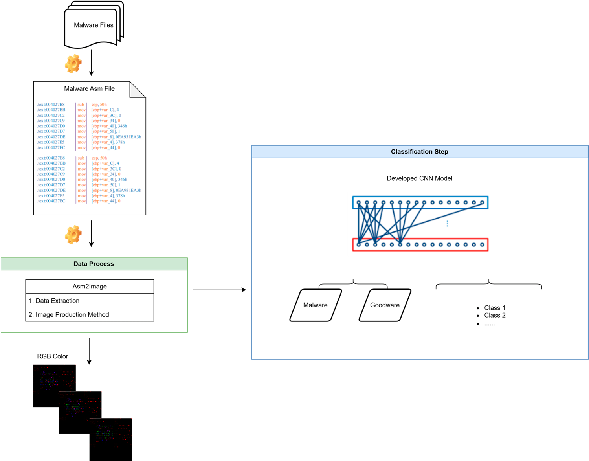
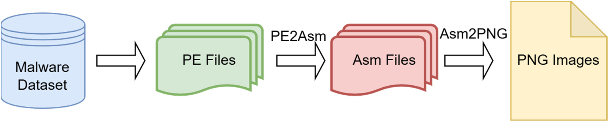
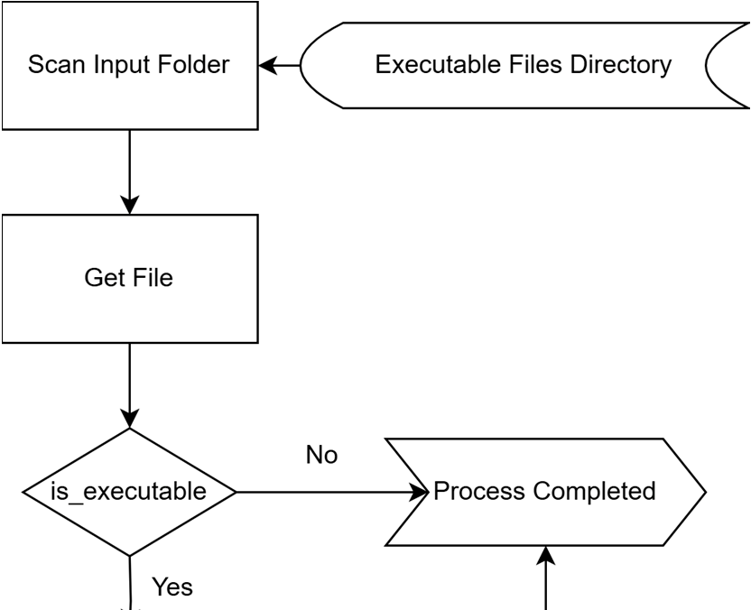
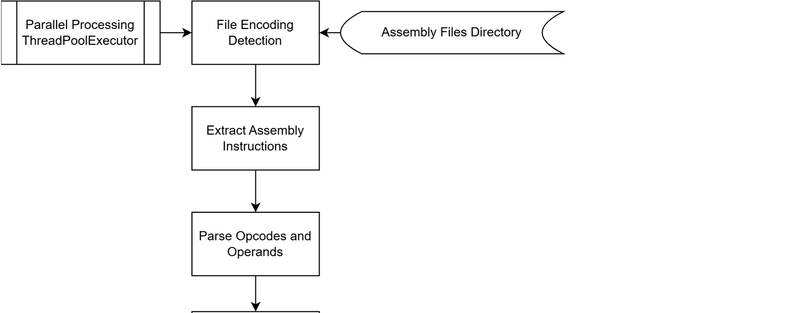
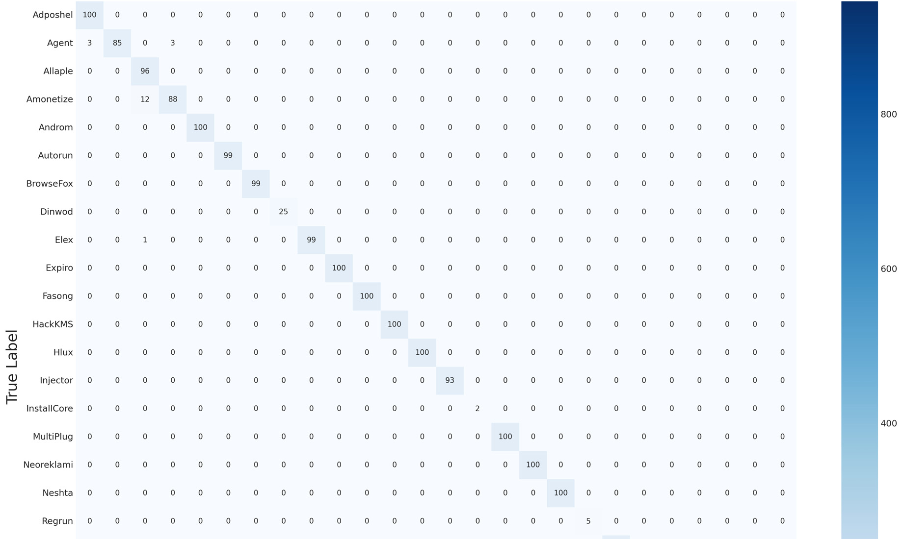
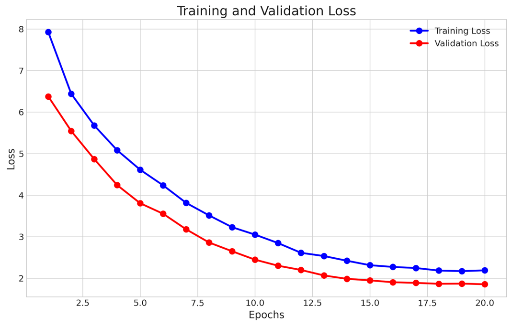
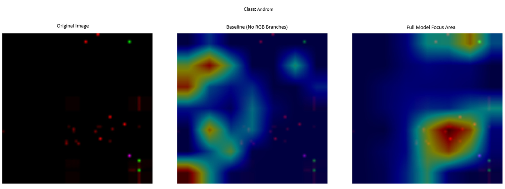
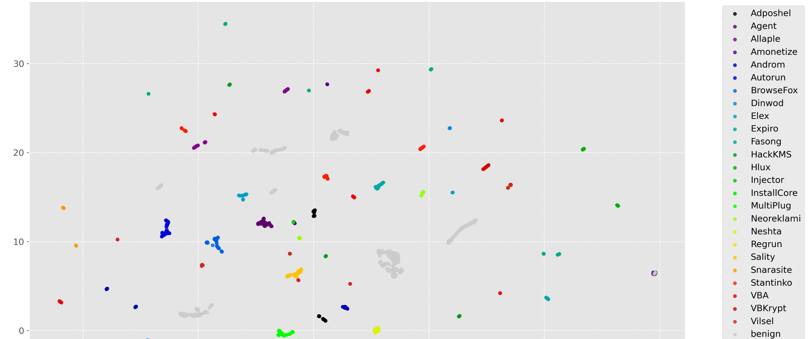

# Review Paper

## Enhancing Malware Detection via RGB Assembly Visualization and Hybrid Deep Learning Models

### Penulis & Tahun

Esra Eroğlu Demirkan dan Murat Aydos (**2025**).

### Judul Penelitian

*Enhancing Malware Detection via RGB Assembly Visualization and Hybrid Deep Learning Models*

### Nama Jurnal / Conference

Artikel jurnal pada **Applied Sciences**, Volume 15, Article 7163, tahun 2025. DOI: `10.3390/app15137163`.

### Dataset

Penelitian membangun dataset **MalevisAsm** dari dataset MaleVis dan menambahkan file benign yang dikumpulkan dari sistem Windows yang digunakan, SourceForge, GitHub, dan situs vendor resmi. Dataset akhir terdiri dari **15.212 citra**, yaitu:

- 12.091 citra training;
- 3.121 citra validation;
- 26 kelas, terdiri dari 25 keluarga malware dan 1 kelas benign;
- seluruh citra berukuran 224 × 224 piksel.

Penelitian juga menggunakan dataset **Dumpware10** sebagai tambahan untuk mengevaluasi generalisasi model di luar MaleVis.

### Metode / Model

Penelitian ini termasuk kategori **computer vision untuk klasifikasi malware berbasis citra** dan menggunakan analisis statis. Alur utamanya adalah:

1. File Portable Executable (PE) dikonversi menjadi kode assembly.
2. Transisi byte, opcode, dan quality dipetakan ke kanal RGB yang berbeda.
3. Citra RGB hasil transformasi diproses oleh model hybrid CNN.
4. Model menggabungkan **EfficientNetB0** dan **DenseNet121** untuk mengekstraksi fitur lokal dan global.
5. Fitur digabungkan melalui fully connected layer, batch normalization, dropout, dan regularisasi L2.
6. Lapisan akhir menggunakan softmax untuk klasifikasi 26 kelas.
7. **UMAP** digunakan untuk memvisualisasikan pemisahan sampel dan membantu analisis malware yang belum pernah dilihat sebelumnya.

### Proses Pembentukan Citra

Penulis memperkenalkan proses **Assembly-to-RGB Visualization**. Berbeda dari citra grayscale berbasis byte, pendekatan ini mempertahankan informasi struktural dengan memetakan karakteristik kode ke tiga kanal warna.

### Hasil Utama

Model hybrid EfficientNetB0 dan DenseNet121 memperoleh hasil utama sebagai berikut:

| Metrik | Hasil |
| --- | ---: |
| Precision | 97,45% |
| Recall | 99,48% |
| F1-score | 98,50% |
| Accuracy | **98,45%** |
| Waktu training | 1.329,74 detik |
| Latensi inference | 47,75 detik |
| Memori | 8 GB GPU |

Model mengungguli beberapa pendekatan sebelumnya pada dataset MaleVis, termasuk Random Forest 93,14%, MobileNet fine-tuning 96,04%, dan CNN terbaik sebelumnya dengan F1-score 95,82%. Namun, hasilnya masih di bawah CycleGAN + CNN yang memperoleh akurasi 99,60% dengan kebutuhan komputasi yang lebih besar.

### Analisis RGB dan Ablasi

Analisis Grad-CAM menunjukkan bahwa kanal merah, hijau, dan biru memberikan informasi yang berbeda untuk proses klasifikasi. Kanal RGB-specific branch terbukti sangat penting.

| Konfigurasi model | Accuracy |
| --- | ---: |
| Full model | 98,45% |
| Tanpa RGB-specific branch | 3,88% |
| Tanpa channel attention | 98,45% |

Hasil tersebut menunjukkan bahwa kontribusi utama model berasal dari representasi RGB dan cabang ekstraksi fitur khusus RGB, bukan dari channel attention.

### Kelebihan

- Mengubah informasi assembly menjadi citra RGB yang lebih kaya dibandingkan representasi grayscale.
- Menggabungkan EfficientNetB0 dan DenseNet121 untuk menangkap fitur lokal serta global.
- Memperoleh recall tinggi, sehingga sesuai untuk mengurangi risiko malware terlewat.
- Tidak bergantung pada augmentasi generatif yang sangat mahal seperti CycleGAN.
- Menyediakan analisis Grad-CAM dan UMAP untuk membantu interpretasi model.

### Keterbatasan

- Evaluasi utama masih sangat bergantung pada dataset MalevisAsm sehingga generalisasi lintas dataset belum sepenuhnya terbukti.
- Performa menurun hingga sekitar 94% pada keluarga malware dengan jumlah sampel kurang dari 50.
- Model membutuhkan sumber daya komputasi lebih besar dibandingkan metode tradisional seperti Random Forest.
- Malware baru, obfuscation, perubahan brightness, skala, dan distribusi data dapat menurunkan kemampuan generalisasi.
- Perbandingan dengan beberapa arsitektur mutakhir masih menjadi pekerjaan lanjutan.

### Kesimpulan Review

Paper ini menawarkan pendekatan yang kuat untuk **klasifikasi malware berbasis computer vision**. Kontribusi utamanya terletak pada transformasi kode assembly menjadi citra RGB dan penggabungan EfficientNetB0 dengan DenseNet121. Akurasi 98,45% dan recall 99,48% menunjukkan performa yang sangat baik pada dataset yang digunakan. Meskipun demikian, validasi lintas dataset dan pengujian terhadap malware baru masih diperlukan sebelum model dapat dianggap benar-benar robust untuk penggunaan operasional.

### Sumber

1. Eroğlu Demirkan, E., & Aydos, M. (2025). *Enhancing Malware Detection via RGB Assembly Visualization and Hybrid Deep Learning Models*. **Applied Sciences, 15**, 7163. https://doi.org/10.3390/app15137163
2. [Halaman sumber artikel di MDPI](https://www.mdpi.com/2076-3417/15/13/7163)
