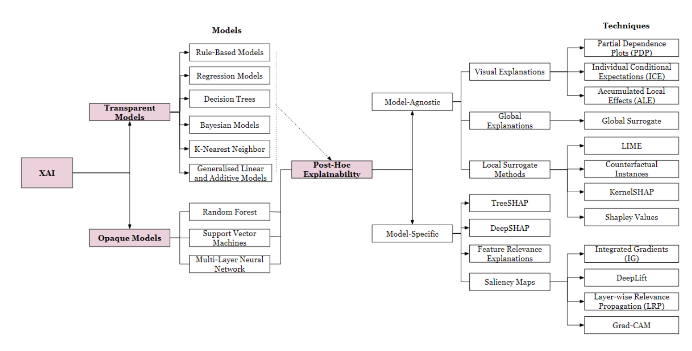
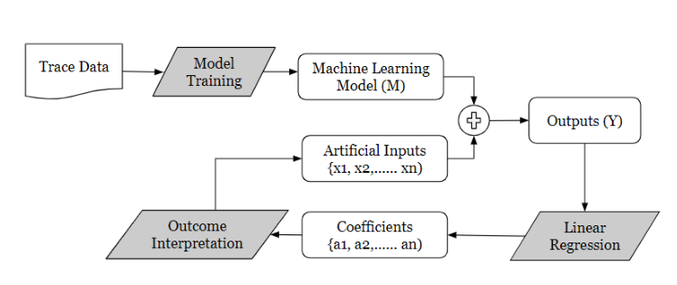

# Review Paper

## Explainable Artificial Intelligence (XAI) for Malware Analysis: A Survey of Techniques, Applications, and Open Challenges

### Identitas paper

- **Penulis:** Harikha Manthena, Shaghayegh Shajarian, Jeffrey C. Kimmell, Mahmoud Abdelsalam, Sajad Khorsandroo, dan Maanak Gupta.
- **Tahun:** 2025.
- **Publikasi:** *IEEE Access*, volume 13, hlm. 61614–61643.
- **DOI:** [10.1109/ACCESS.2025.3555926](https://doi.org/10.1109/ACCESS.2025.3555926).
- **Sumber:** [Halaman IEEE Xplore](https://ieeexplore.ieee.org/document/10944807) · [PDF IEEE Xplore](https://ieeexplore.ieee.org/stamp/stamp.jsp?tp=&arnumber=10944807).

### Tujuan penelitian

Paper ini meninjau pendekatan explainable AI untuk analisis malware, terutama karya 2018–2024. Penulis menyusun taksonomi metode XAI, merangkum penerapannya pada klasifikasi/deteksi malware, dan membahas tantangan serta peluang riset untuk membuat model ML lebih transparan bagi analis keamanan.

### Dataset dan evaluasi

Paper merupakan survei, bukan eksperimen baru. Studi yang dirangkum menggunakan data beragam, termasuk PE/Windows, Android, Malimg, EMBER, trafik jaringan, dan dataset malware lainnya. Tabel-tabelnya mencatat hasil studi primer serta metode penjelasan yang dipakai.

Metrik yang dibahas meliputi accuracy, precision, recall, F1, fidelity, robustness, stability, dan penilaian penjelasan. Karena dataset dan setup berbeda, angka performa yang ditampilkan bukan perbandingan langsung dalam protokol seragam. Fokus survei adalah aplikasi XAI pada analisis malware, bukan evaluasi satu dataset tertentu.

*Gambar 1. Taksonomi model transparan/opaque dan pendekatan explainability; Fig. 3 pada paper.*

*Gambar 2. Contoh workflow explainable malware analysis berbasis hardware trace; Fig. 5 pada paper.*

### Metode atau arsitektur model

Survei membahas model deteksi seperti CNN untuk malware berbasis citra, MLP/DNN, RNN, transformer, model graf, serta model statistik atau tree-based. Teknik penjelasan yang dirangkum mencakup SHAP, LIME, Grad-CAM, saliency maps, LRP, DeepLIFT, attention, metode berbasis aturan, serta penjelas graf. Paper mengorganisasi pendekatan menurut model yang intrinsik transparan atau opaque yang membutuhkan penjelasan post-hoc, juga menurut bentuk data dan konteks malware.

### Domain penelitian

Keamanan siber, analisis malware, dan explainable artificial intelligence. Cakupan meliputi deteksi statis/dinamis, PE Windows, Android, analisis hardware, PDF malware, citra grayscale/berwarna, urutan fitur, dan data berbasis graf.

### Hasil utama

- XAI digunakan untuk menjelaskan fitur statis, perilaku dinamis, byte atau piksel citra, urutan, dan struktur graf.
- Teknik post-hoc seperti SHAP, LIME, Grad-CAM, dan saliency maps sering dipakai pada model yang lebih kompleks.
- Hambatan yang disorot meliputi interpretasi yang belum konsisten, biaya komputasi, perubahan malware, generalisasi, dan risiko adversarial terhadap prediksi maupun penjelasan.
- Arah riset yang dibahas mencakup explainability lintas model, kombinasi data multimodal, validasi penjelasan, serta penggunaan model pra-latih.

### Analisis kontribusi model

Kontribusi paper berupa pemetaan metode dan aplikasi XAI untuk malware, bukan arsitektur klasifikasi baru. Bagian citra malware menghubungkan CNN dengan penjelasan berbasis saliency dan Grad-CAM, yang dapat membantu memahami area citra yang memengaruhi prediksi. Akan tetapi, paper tidak mengevaluasi MaleVis RGB secara khusus dan tidak membandingkan Vision Transformer dengan Vision Mamba.

### Kelebihan

1. Menghubungkan metode XAI dengan alur kerja analisis malware dan kebutuhan analis.
2. Mencakup berbagai jenis data dan pendekatan: fitur tabular, citra, urutan, graf, dan hardware trace.
3. Membahas manfaat dan risiko XAI, termasuk kemungkinan serangan yang mengecoh penjelasan.
4. Merangkum metrik serta tantangan evaluasi interpretabilitas, bukan hanya akurasi model.

### Keterbatasan

1. Hasil performa berasal dari studi dengan dataset dan konfigurasi berbeda sehingga tidak setara sebagai benchmark lintas metode.
2. Survei berfokus pada literatur XAI dan tidak melakukan replikasi atau validasi eksperimental atas metode yang dirangkum.
3. Pembahasan citra malware terutama mengacu pada studi CNN dan metode attribution; tidak mencakup evaluasi modern ViT–Vision Mamba pada MaleVis RGB.
4. Validasi kualitas penjelasan pada studi primer tidak seragam, sehingga klaim bahwa penjelasan dapat dipercaya perlu dinilai menurut metode dan konteksnya.

### Kesimpulan review

Paper ini berguna sebagai referensi untuk memahami teknik explainability yang diterapkan pada sistem analisis malware, termasuk penjelasan visual bagi model CNN. Cakupannya luas, tetapi sifatnya survei sekunder dan bukan pembandingan arsitektur atau dataset tertentu. Untuk tesis klasifikasi MaleVis RGB, paper ini memberi konteks XAI; hasil terkait performa perlu dilacak ke studi primer.

### Sumber

Manthena, H., Shajarian, S., Kimmell, J. C., Abdelsalam, M., Khorsandroo, S., & Gupta, M. (2025). *Explainable Artificial Intelligence (XAI) for Malware Analysis: A Survey of Techniques, Applications, and Open Challenges*. **IEEE Access, 13**, 61614–61643. [IEEE Xplore](https://ieeexplore.ieee.org/document/10944807) · [PDF](https://ieeexplore.ieee.org/stamp/stamp.jsp?tp=&arnumber=10944807) · [DOI](https://doi.org/10.1109/ACCESS.2025.3555926).
