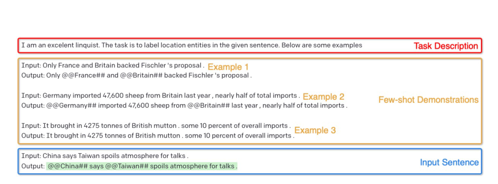
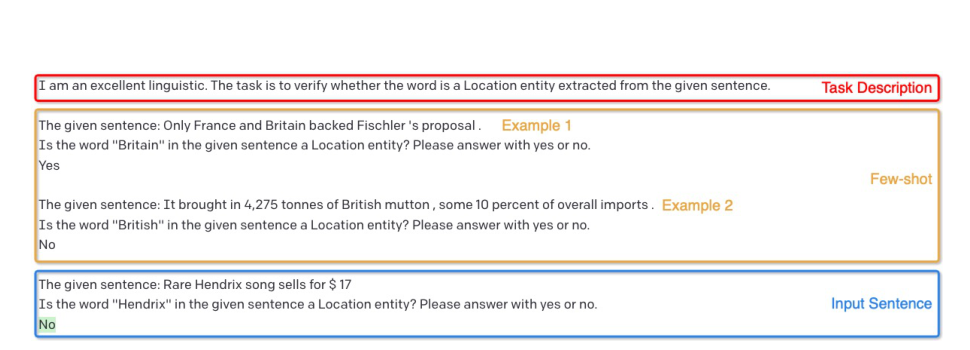
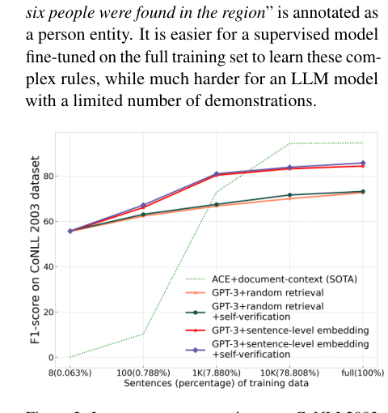
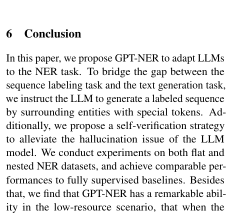

# Review Paper

## GPT-NER: Named Entity Recognition via Large Language Models

### Penulis & Tahun

Shuhe Wang, Xiaofei Sun, Xiaoya Li, Rongbin Ouyang, Fei Wu, Tianwei Zhang, Jiwei Li, dan Guoyin Wang (**2025**).

### Judul Penelitian

*GPT-NER: Named Entity Recognition via Large Language Models*

### Nama Jurnal / Conference

Artikel penelitian pada **Findings of the Association for Computational Linguistics: NAACL 2025**, halaman 4257-4275. Paper tersedia secara open access.

DOI: `10.18653/v1/2025.findings-naacl.239`.

### Tujuan Penelitian

Penelitian ini mengatasi kesenjangan antara Named Entity Recognition yang secara alami merupakan sequence labeling dan Large Language Model yang bekerja sebagai text-generation model.

### Dataset

Eksperimen dilakukan pada beberapa dataset NER:

- **CoNLL2003** dan **OntoNotes5.0** untuk flat NER;
- **ACE2004**, **ACE2005**, dan **GENIA** untuk nested NER.

Penelitian juga menguji skenario low-resource dan few-shot dengan jumlah contoh berlabel yang sangat terbatas.

### Metode / Model

GPT-NER mengubah tugas sequence labeling menjadi tugas text generation. Entitas ditandai menggunakan token khusus `@@` dan `##`.

Contohnya, kalimat `Columbus is a city` diubah menjadi keluaran `@@Columbus## is a city`. Dengan cara ini, LLM hanya perlu menyalin teks dan menambahkan penanda pada bagian yang merupakan entitas.

Tahapan utama metode adalah:

1. Menentukan tipe entitas yang ingin dikenali.
2. Memberikan task description dan few-shot demonstrations kepada LLM.
3. Mengubah keluaran generatif LLM menjadi prediksi entitas berdasarkan token khusus.
4. Menggunakan self-verification untuk memeriksa apakah kandidat benar-benar termasuk tipe entitas yang diminta.
5. Menghapus prediksi yang tidak lolos proses verifikasi.

### Tugas NLP

Paper ini berfokus pada **Named Entity Recognition**, termasuk:

- flat NER, ketika entitas tidak saling bertumpuk;
- nested NER, ketika suatu entitas dapat berada di dalam entitas lain;
- low-resource NER;
- few-shot NER.

### Hasil Utama

GPT-NER memperoleh performa yang sebanding dengan supervised baseline pada kondisi full-data. Pada kondisi low-resource dan few-shot, GPT-NER menunjukkan keunggulan yang lebih kuat dibandingkan model supervised karena mampu memanfaatkan pengetahuan dan kemampuan in-context learning LLM.

Eksperimen tambahan menunjukkan bahwa performa GPT-NER berubah sesuai jumlah demonstrasi few-shot yang diberikan. Penambahan contoh yang relevan dapat membantu model memahami format dan tipe entitas.

### Analisis Kontribusi Model

Kontribusi utama GPT-NER adalah:

- mengubah sequence labeling menjadi text generation;
- menggunakan token khusus untuk menandai span entitas;
- menggunakan self-verification untuk mengurangi over-prediction;
- memanfaatkan kemampuan LLM pada kondisi data berlabel terbatas;
- mendukung flat NER dan nested NER.

### Kelebihan

- Mengusulkan metode khusus untuk mengubah sequence labeling menjadi text generation.
- Tidak memerlukan fine-tuning penuh pada skenario few-shot.
- Memanfaatkan kemampuan in-context learning LLM.
- Memiliki mekanisme self-verification untuk mengurangi hallucination.
- Diuji pada flat NER, nested NER, low-resource, dan few-shot settings.

### Keterbatasan

- Inferensi berbasis LLM dapat membutuhkan biaya dan waktu yang lebih besar.
- Performa bergantung pada kualitas prompt dan jumlah demonstrasi.
- LLM masih dapat mengalami hallucination atau menandai non-entity sebagai entitas.
- Pemrosesan setiap tipe entitas secara terpisah dapat meningkatkan jumlah pemanggilan model.

### Kesimpulan Review

GPT-NER menjembatani sequence labeling dan text generation dengan mengubah NER menjadi tugas penandaan entitas menggunakan token khusus. Self-verification membantu mengurangi over-prediction dan hallucination pada keluaran LLM. Hasil eksperimen menunjukkan keunggulan metode terutama pada kondisi low-resource dan few-shot, sementara biaya inferensi, ketergantungan pada prompt, dan kebutuhan pemrosesan setiap tipe entitas menjadi pertimbangan implementasi.

### Sumber

1. Wang, S., Sun, X., Li, X., Ouyang, R., Wu, F., Zhang, T., Li, J., & Wang, G. (2025). *GPT-NER: Named Entity Recognition via Large Language Models*. **Findings of NAACL 2025**, 4257-4275. https://doi.org/10.18653/v1/2025.findings-naacl.239
2. [Artikel dan PDF gratis](https://aclanthology.org/2025.findings-naacl.239/)
3. [Kode GPT-NER](https://github.com/ShuheWang1998/GPT-NER)
