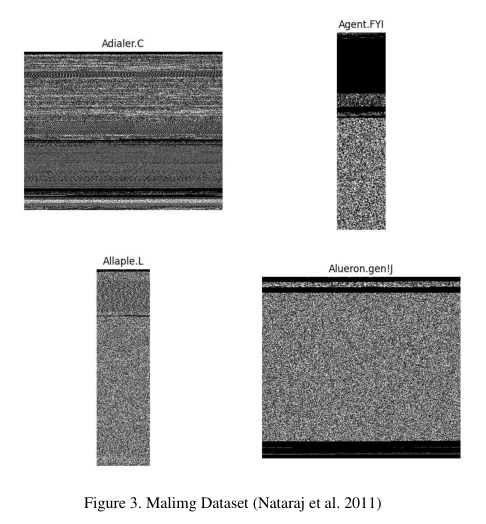
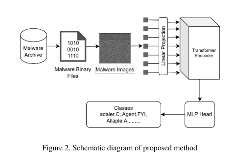
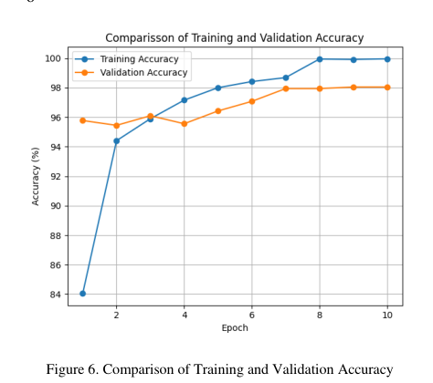

# Review Paper

## Image-Based Malware Multiclass Classification Using Vision Transformer Architecture

### Identitas paper

- **Penulis:** Diash Firdaus, Idi Sumardi, Chalifa Chazar, dan Muhamad Zufar Dafy.
- **Tahun:** 2025.
- **Publikasi:** *Cyber Security dan Forensik Digital*, Vol. 8, No. 1, hlm. 72–79.
- **DOI:** [10.14421/csecurity.2025.8.1.5107](https://doi.org/10.14421/csecurity.2025.8.1.5107).
- **Sumber:** [Halaman artikel jurnal](https://ejournal.uin-suka.ac.id/saintek/cybersecurity/article/view/5107) · [PDF artikel](https://ejournal.uin-suka.ac.id/saintek/cybersecurity/article/view/5107/2921).

### Tujuan penelitian

Penelitian menerapkan Vision Transformer (ViT) untuk klasifikasi multikelas citra malware dan membandingkan akurasi yang dilaporkan dengan beberapa arsitektur CNN dan metode lain dari penelitian terdahulu. Penulis menyoroti kemampuan self-attention ViT dalam menangkap hubungan spasial jarak jauh pada citra.

### Dataset dan evaluasi

Penelitian menggunakan **Malimg**, yang disebut memiliki 9.458 citra grayscale dalam 25 kelas keluarga malware. Ukuran masukan ditetapkan 256 × 256 piksel. Bagian metode menyebut pembagian 80% untuk pelatihan, 10% untuk pengujian, dan 10% untuk validasi. Evaluasi mencakup accuracy, precision, recall, F1-score, classification report, dan confusion matrix.

*Gambar 1. Contoh kelas pada Malimg yang direproduksi dalam paper, Fig. 3; gambar diekstrak dari PDF.*

### Metode atau arsitektur model

Model membagi citra 256 × 256 menjadi patch 32 × 32 sehingga diperoleh 64 patch. Parameter yang dilaporkan adalah embedding dimension 1024, enam lapis Transformer encoder, 16 attention heads, MLP dimension 2048, dropout 0,1, dan embedding dropout 0,1. Model dilatih selama 10 epoch di Google Colab. Paper menyebut penggunaan bobot ViT yang telah dioptimalkan sebagai parameter awal serta early stopping; rincian sumber bobot dan prosedur optimisasinya tidak dijelaskan secara memadai.

*Gambar 2. Skema pendekatan ViT yang diusulkan, Fig. 2; diekstrak dari PDF paper.*

### Domain penelitian

Keamanan siber dan computer vision, khususnya klasifikasi citra grayscale hasil visualisasi biner malware ke dalam 25 kelas keluarga.

### Hasil utama

- Akurasi tertinggi yang dilaporkan adalah 99,96% pada pelatihan, 98,05% pada validasi, dan 97,49% pada pengujian.
- Tabel akurasi per epoch menunjukkan akurasi validasi 98,05% pada epoch 9 dan 10, sedangkan narasi menyebut early stopping berdasarkan validasi 98,04% pada epoch 7. Perbedaan ini tidak dijelaskan.
- Artikel juga menyatakan akurasi 98,05% sebagai hasil perbandingan arsitektur; tabel tersebut membandingkan hasil dengan angka dari studi lain, bukan eksperimen ulang CNN di bawah protokol dan dataset yang sama.

*Gambar 3. Kurva akurasi pelatihan dan validasi yang dilaporkan, Fig. 6; diekstrak dari PDF paper.*

### Analisis kontribusi model

Paper menunjukkan penerapan ViT pada klasifikasi multikelas citra malware Malimg dengan rincian ukuran patch dan konfigurasi encoder. Hasil uji 97,49% menjadi bukti performa pada setup yang dilaporkan. Namun, klaim ViT lebih baik daripada CNN tidak didukung oleh pembandingan ulang yang terkontrol dalam paper ini, sehingga angka dari studi berbeda sebaiknya tidak diperlakukan sebagai eksperimen komparatif langsung.

### Kelebihan

1. Menguji ViT pada 25 kelas keluarga malware dan melaporkan hasil pelatihan, validasi, serta pengujian.
2. Menyediakan detail penting konfigurasi patch dan Transformer encoder.
3. Menggunakan confusion matrix dan metrik klasifikasi selain accuracy.
4. Menyediakan kurva pelatihan/validasi untuk menggambarkan proses belajar.

### Keterbatasan

1. Dataset hanya Malimg grayscale; paper tidak menguji MaleVis atau citra RGB.
2. Tidak ada eksperimen ViT dan CNN yang dilatih ulang pada split, preprocessing, dan kondisi komputasi yang sama; tabel pembanding merangkum angka penelitian terdahulu.
3. Ada ketidaksesuaian antara narasi early stopping pada epoch 7 dan tabel yang mencatat validasi tertinggi pada epoch 9–10.
4. Pelaporan prosedur belum sepenuhnya konsisten: urutan train/test/validation berbeda dari praktik pelaporan yang lebih lazim, dan disebutkan “optimised ViT weights” tanpa menjelaskan sumber checkpoint, pretraining, atau proses optimisasi.
5. Tidak dijelaskan dengan cukup rinci seed, pembentukan split berstrata, penanganan ketidakseimbangan kelas, maupun variasi hasil dari pengulangan eksperimen.
6. Klaim peningkatan atas CNN sulit ditafsirkan sebagai perbandingan setara karena bersandar pada hasil studi lain.

### Kesimpulan review

Paper ini relevan sebagai studi penerapan ViT untuk klasifikasi citra malware multikelas dan melaporkan akurasi uji 97,49% pada Malimg. Penggunaan Malimg grayscale membuat hasilnya tidak langsung sebanding dengan eksperimen MaleVis RGB. Selain itu, klaim keunggulan atas CNN perlu dibaca hati-hati karena tidak didasarkan pada eksperimen terkontrol dalam penelitian yang sama, dan beberapa detail prosedur masih kurang jelas.

### Sumber

Firdaus, D., Sumardi, I., Chazar, C., & Dafy, M. Z. (2025). *Image-Based Malware Multiclass Classification Using Vision Transformer Architecture*. **Cyber Security dan Forensik Digital, 8**(1), 72–79. [Artikel jurnal](https://ejournal.uin-suka.ac.id/saintek/cybersecurity/article/view/5107) · [PDF](https://ejournal.uin-suka.ac.id/saintek/cybersecurity/article/view/5107/2921) · [DOI](https://doi.org/10.14421/csecurity.2025.8.1.5107).
