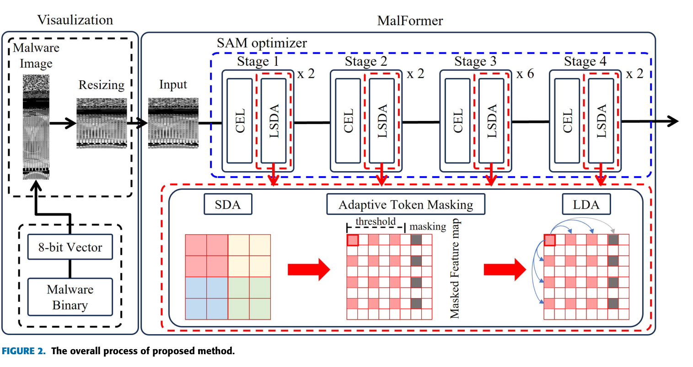
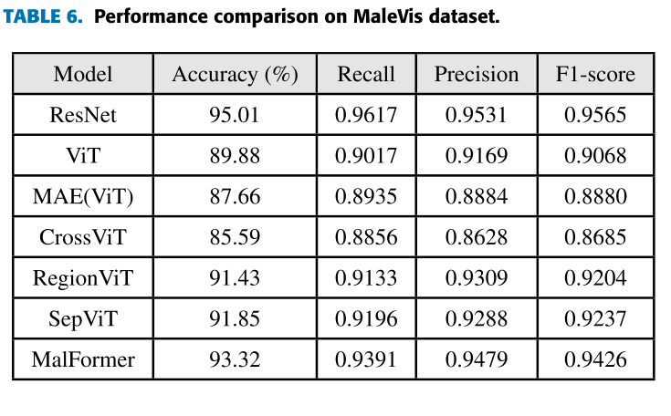
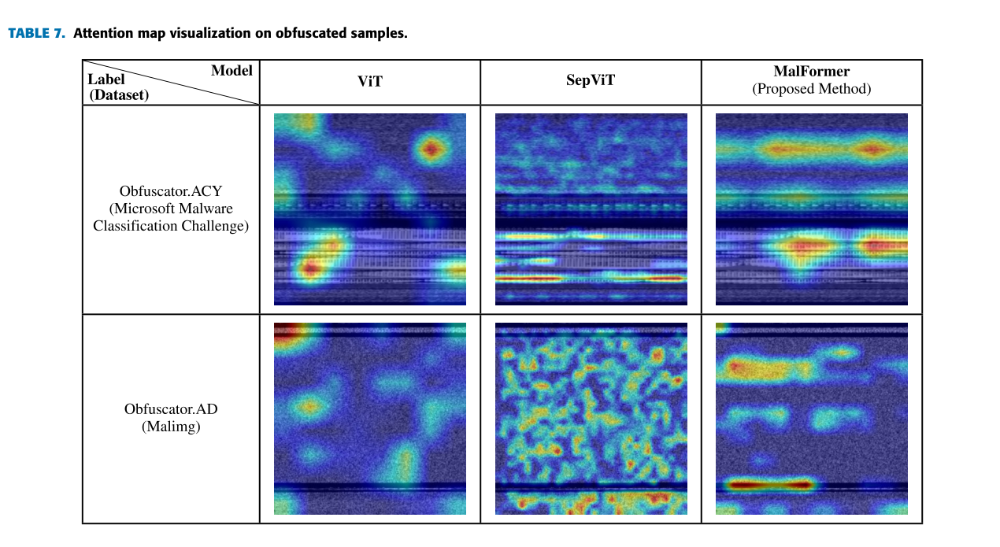

# Review Paper

## MalFormer: A Novel Vision Transformer Model for Robust Malware Analysis

### Identitas paper

#### Penulis & Tahun

In-Woong Jeong, Han-Ju Lee, Gwang-Nam Kim, dan Seok-Hwan Choi (**2025**).

#### Judul Penelitian

*MalFormer: A Novel Vision Transformer Model for Robust Malware Analysis*

#### Nama Jurnal / Conference

Artikel jurnal pada **IEEE Access**, Volume 13, halaman 122671–122683. DOI: [10.1109/ACCESS.2025.3588232](https://doi.org/10.1109/ACCESS.2025.3588232). Diterbitkan 11 Juli 2025.

### Tujuan penelitian

Penelitian ini mengembangkan model Vision Transformer khusus untuk analisis malware berbasis citra. Tujuannya adalah menangkap fitur lokal dan global secara bersamaan serta meningkatkan generalisasi dan ketahanan klasifikasi terhadap sampel malware yang mengalami obfuscation.

### Dataset dan evaluasi

Penulis mengevaluasi model pada empat dataset:

- **Microsoft Malware Classification Challenge**: 10.868 sampel dan 9 kelas.
- **Malimg**: 9.458 citra grayscale dan 25 kelas.
- **MalNet-Tiny**: 87.430 citra malware Android dan 43 tipe.
- **MaleVis**: 14.226 citra, terdiri atas 25 keluarga malware dan satu kelas benign.

Semua data diubah menjadi citra grayscale berukuran **256 × 256** menggunakan interpolasi bilinear. Setiap dataset dibagi dengan rasio train/validation/test **8:1:1**. Evaluasi mencakup accuracy, precision, recall, F1-score, latency, dan throughput. Eksperimen dijalankan menggunakan PyTorch 1.12.1 dan Python 3.9.16 pada AMD Ryzen 9 7900X, GPU GeForce RTX 3080, dan memori 32 GB.

### Metode atau arsitektur model

MalFormer merupakan adaptasi Vision Transformer berbasis CrossFormer++. Model menggabungkan tiga komponen utama:

1. **Cross-Scale Embedding Layer (CEL)** membentuk token dari patch berbagai skala agar fitur lokal dan konteks multi-skala dapat dipertahankan.
2. **Long-Short Distance Attention (LSDA)** menggabungkan perhatian jarak dekat dan jarak jauh untuk memodelkan hubungan lokal antartoken dan dependensi global.
3. **Adaptive Token Masking** mem-mask pola token horizontal yang dianggap berulang atau kurang informatif, dengan tujuan mengurangi pengaruh pola redundan tanpa menghapus token.

Pelatihan menggunakan **Sharpness-Aware Minimization (SAM)** dengan Adam sebagai optimizer dasar untuk meningkatkan generalisasi. Biner malware divisualisasikan sebagai citra grayscale, kemudian di-resize ke 256 × 256. Penulis juga melakukan ablation study terhadap CEL, LSDA dan ukuran grup, wilayah masking, serta SAM; generalisasi diuji dengan stratified 5-fold cross-validation pada Microsoft Malware Classification Challenge dan MalNet-Tiny.

*Gambar 1. Alur dari biner malware menjadi citra grayscale dan pemrosesannya oleh MalFormer, termasuk CEL, LSDA, Adaptive Token Masking, dan SAM. Sumber: Jeong et al. (2025), Gambar 2.*

### Domain penelitian

Domain penelitian ini adalah **Computer Vision untuk cybersecurity**, khususnya analisis, deteksi, atau klasifikasi malware menggunakan representasi citra.

### Hasil utama

| Dataset | Hasil MalFormer yang dilaporkan | Catatan perbandingan |
|---|---|---|
| Microsoft Malware Classification Challenge | Accuracy 97,33%; precision 95,41%; recall 92,27%; F1-score 93,49% | Mengungguli baseline terbaik yang disebutkan, SepViT, pada accuracy, recall, dan F1-score. |
| Malimg | Precision 96,17% | Menjadi precision tertinggi di antara metode ViT yang dibandingkan. |
| MalNet-Tiny | Accuracy 76,75% | Tertinggi dibandingkan ResNet, ViT, MAE, CrossViT, RegionViT, dan SepViT. |
| MaleVis | Accuracy 93,32%; recall 93,91%; precision 94,79%; F1-score 94,26% | Recall tertinggi di antara model ViT yang dibandingkan. ResNet memperoleh accuracy 95,01%, recall 96,17%, precision 95,31%, dan F1-score 95,65%. |

Pada ablation study di Microsoft Malware Classification Challenge, penggunaan SAM meningkatkan accuracy dari **95,26% menjadi 97,33%**, recall dari **88,71% menjadi 92,27%**, dan F1-score dari **90,26% menjadi 93,49%**. Pada perbandingan attention, LSDA melaporkan latency 0,5061 dan throughput 63,23, sedangkan MHSA melaporkan latency 2,3078 dan throughput 13,87 dalam konfigurasi eksperimen tersebut.

*Gambar 2. Tabel hasil MaleVis dari paper. MalFormer mencapai recall tertinggi di antara model ViT, sedangkan ResNet memiliki nilai accuracy, recall, precision, dan F1-score lebih tinggi. Sumber: Jeong et al. (2025), Tabel 6.*

Untuk dua sampel obfuscated yang dianalisis, MalFormer menghasilkan confidence score loss lebih rendah daripada ViT dan SepViT. Analisis aktivasi/Grad-CAM menunjukkan fokus fitur MalFormer lebih terstruktur pada contoh yang dibahas. Temuan ini mendukung klaim robustness paper pada pengujian tersebut, tetapi tidak berarti ketahanan terhadap semua teknik obfuscation telah dibuktikan.

*Gambar 3. Perbandingan peta perhatian ViT, SepViT, dan MalFormer pada sampel Obfuscator.ACY dan Obfuscator.AD. Sumber: Jeong et al. (2025), Tabel 7.*

### Analisis kontribusi model

Kontribusi utama paper ini terletak pada rancangan metode yang dijelaskan pada bagian sebelumnya. Secara khusus, paper mengembangkan atau menerapkan pendekatan berikut: MalFormer merupakan adaptasi Vision Transformer berbasis CrossFormer++. Model menggabungkan tiga komponen utama: 1. Cross-Scale Embedding Layer CEL membentuk token dari patch berbagai skala agar fitur lokal dan konteks multi-skala dapat dipertahankan. 2. Long-Short Distance Attention LSDA menggabungkan perhatian jarak dekat dan jarak jauh untuk mem. Hasil yang dilaporkan menunjukkan: Dataset Hasil MalFormer yang dilaporkan Catatan perbandingan --- --- --- Microsoft Malware Classification Challenge Accuracy 97,33%; precision 95,41%; recall 92,27%; F1-score 93,49% Mengungguli baseline terbaik yang disebutkan, SepViT, pada accuracy, recall, d.

### Kelebihan

1. Menggabungkan representasi multi-skala, perhatian lokal dan global, token masking, serta optimisasi SAM dalam satu model.
2. Menguji empat dataset malware yang beragam, termasuk MaleVis dan MalNet-Tiny.
3. Melaporkan metrik klasifikasi, latency, throughput, ablation study, dan cross-validation pada dua dataset.
4. Menyertakan analisis visual pada contoh malware obfuscated menggunakan activation map dan Grad-CAM.
5. Membandingkan model dengan ResNet, ViT, MAE, CrossViT, RegionViT, dan SepViT dalam lingkungan eksperimen yang sama menurut paper.

### Keterbatasan

1. Eksperimen MaleVis menggunakan grayscale, sehingga tidak menguji secara langsung informasi kanal warna RGB.
2. Pada MaleVis, ResNet mengungguli MalFormer pada keempat metrik yang tercantum di Tabel 6; MalFormer menjadi yang terbaik hanya di antara model ViT yang dibandingkan pada recall, precision, dan F1-score.
3. Analisis robustness terhadap obfuscation yang dipaparkan secara visual berfokus pada contoh tertentu; bukti itu tidak dengan sendirinya mewakili semua jenis obfuscation.
4. Paper tidak menguji Vision Mamba, sehingga tidak menjawab perbandingan langsung Mamba versus ViT.
5. Angka hasil lintas paper atau lintas tesis perlu ditafsirkan hati-hati karena dataset, preprocessing, arsitektur, dan protokol eksperimen dapat berbeda.

### Kesimpulan review

MalFormer mengembangkan ViT untuk klasifikasi malware berbasis citra dengan menyeimbangkan fitur lokal dan global melalui CEL dan LSDA, mengatur token melalui Adaptive Token Masking, serta meningkatkan generalisasi dengan SAM. Paper melaporkan hasil yang kuat pada empat dataset, termasuk MaleVis, serta peningkatan dari SAM dan LSDA pada eksperimen ablation.

Bagi tesis komparatif Vision Mamba dan Vision Transformer, kontribusi terpenting paper ini adalah sebagai rujukan ViT domain malware, contoh evaluasi pada MaleVis, dan sumber pertimbangan metrik performansi serta efisiensi. Karena paper menggunakan grayscale dan arsitektur ViT yang dimodifikasi, hasilnya berfungsi sebagai konteks literatur dan bukan angka pembanding langsung untuk eksperimen RGB tesis.

### Sumber

1. Jeong, I.-W., Lee, H.-J., Kim, G.-N., & Choi, S.-H. (2025). *MalFormer: A Novel Vision Transformer Model for Robust Malware Analysis*. **IEEE Access, 13**, 122671–122683. [https://doi.org/10.1109/ACCESS.2025.3588232](https://doi.org/10.1109/ACCESS.2025.3588232)
2. [IEEE Xplore — Abstract and article record](https://ieeexplore.ieee.org/abstract/document/11078282)
3. [IEEE Xplore — PDF](https://ieeexplore.ieee.org/stamp/stamp.jsp?tp=&arnumber=11078282)
