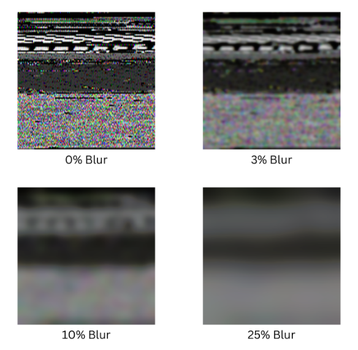
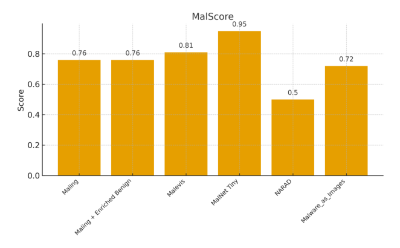

# Review Paper

## MalScore: A Quality Assessment Framework for Visual Malware Datasets Using No-Reference Image Quality Metrics

### Identitas paper

- **Penulis:** Jakub Czaplicki, Mohamed Rahouti, Abdellah Chehri, dan Thaier Hayajneh.
- **Tahun:** 2025.
- **Publikasi:** *Future Internet*, 17(12), artikel 554.
- **DOI:** [10.3390/fi17120554](https://doi.org/10.3390/fi17120554).
- **Sumber:** [Halaman artikel MDPI](https://www.mdpi.com/1999-5903/17/12/554) · [PDF artikel](https://www.mdpi.com/1999-5903/17/12/554/pdf).

### Tujuan penelitian

Penelitian mengusulkan **MalScore**, kerangka untuk menilai dan membandingkan kualitas dataset visual malware. Paper meneliti apakah metrik no-reference image quality assessment (NR-IQA) yang umum dapat digunakan pada citra malware, lalu menggabungkan skor kualitas citra dengan ukuran dataset, kejelasan label, keragaman konten, kebaruan data, dan kebutuhan prapemrosesan.

### Dataset dan evaluasi

Paper menguji lima sumber dataset: Malimg, Malevis, MalNet-Tiny, NARAD (subset citra malicious), dan Malware as Images. Total yang dicantumkan untuk beberapa dataset antara lain 9.339 sampel Malimg, 14.226 Malevis, 87.429 MalNet-Tiny, 11.919 citra NARAD malicious, dan 136 sampel Malware as Images. Penulis membentuk versi dengan Gaussian blur 3%, 10%, dan 25% selain citra tanpa blur, lalu menjalankan enam metrik NR-IQA: BRISQUE, CLIPIQA, CLIPIQA+, CLIPIQA+_rn50_512, CNNIQA, dan DBCNN.

Untuk menguji hubungan skor kualitas dengan performa model, penulis menggunakan ResNet-50 selama 10 epoch pada dataset Malevis dan membandingkan skor BRISQUE dengan akurasi validasi memakai korelasi Pearson dan Spearman. MalScore sendiri merupakan skor gabungan dengan bobot: BRISQUE 35%, kejelasan label 30%, ukuran dataset 25%, keragaman 4%, kebaruan data 3%, serta kebutuhan pemrosesan 3%.

*Gambar 1. Contoh citra Malevis dengan tingkat Gaussian blur berbeda, Fig. 2 Czaplicki et al. (2025); diekstrak dari PDF paper.*

### Metode atau arsitektur model

MalScore bukan model klasifikasi malware. Kerangka ini menghitung skor berbobot untuk menilai kesiapan dan mutu dataset. Skor BRISQUE dibalik dan dinormalisasi relatif terhadap nilai tertinggi; ukuran dataset dinormalisasi secara logaritmik. Komponen lain diberi nilai kategoris/biner berdasarkan kriteria yang ditetapkan penulis, seperti label yang jelas dan jumlah keluarga malware.

Eksperimen ResNet-50 digunakan terpisah sebagai uji proof-of-concept untuk mengamati kemungkinan hubungan antara degradasi citra, skor NR-IQA, dan akurasi CNN. Model memakai bobot awal ImageNet, input 224 × 224, batch size 32, Adam dengan learning rate 0,0001, dan pelatihan 10 epoch.

*Gambar 2. Hasil skor MalScore untuk dataset yang dievaluasi, Fig. 4; diekstrak dari PDF paper.*

### Domain penelitian

Keamanan siber dan tata kelola dataset computer vision, khususnya penilaian mutu dataset citra visual malware untuk mendukung riset klasifikasi berbasis pembelajaran mendalam.

### Hasil utama

- **MalNet-Tiny** memperoleh skor MalScore tertinggi, **95%**; subset citra malicious **NARAD** memperoleh skor terendah, **50%**.
- Skor lain yang dilaporkan: **Malevis 81%**, **Malimg 76%**, **Malimg yang ditambah kelas benign 76%**, dan **Malware as Images 72%**.
- BRISQUE menjadi satu-satunya algoritma NR-IQA yang dilaporkan menunjukkan sensitivitas linear yang kuat terhadap peningkatan blur. BRISQUE tidak menghasilkan skor pada citra Malimg yang diblur karena implementasi menghasilkan nilai NaN.
- Korelasi antara BRISQUE dan akurasi validasi CNN pada eksperimen terbatas tidak signifikan secara statistik: Pearson r = 0,287, p = 0,714; Spearman ρ = 0,6, p = 0,4.

### Analisis kontribusi model

Kontribusi utama adalah kerangka penilaian komposit untuk membandingkan kualitas dataset visual malware, termasuk dimensi yang tidak ditangkap metrik citra saja, seperti kejelasan label dan keragaman. Penelitian juga menunjukkan bahwa metrik NR-IQA yang dirancang untuk citra natural belum tentu cocok untuk tekstur sintetis/berentropi tinggi dari visualisasi malware. Skor MalScore membantu menyusun penilaian dataset, tetapi tidak membuktikan bahwa dataset dengan skor lebih tinggi selalu menghasilkan model deteksi malware yang lebih akurat.

### Kelebihan

1. Menguji lima dataset visual malware yang beragam, termasuk Malevis dan dataset berskala besar MalNet-Tiny.
2. Membandingkan enam algoritma NR-IQA dan beberapa tingkat blur terkontrol.
3. Menggabungkan mutu citra dengan faktor dataset seperti label, ukuran, keragaman, kebaruan, dan kebutuhan pemrosesan.
4. Menyajikan keterbatasan dan mengakui bahwa korelasi BRISQUE dengan akurasi CNN belum signifikan.

### Keterbatasan

1. Bobot MalScore ditentukan berdasarkan pertimbangan desain dan belum dikalibrasi atau dioptimalkan secara empiris.
2. Skor BRISQUE dan ukuran dataset dinormalisasi relatif terhadap kumpulan dataset pembanding; paper menyatakan skor tidak dapat diterapkan secara mandiri pada satu dataset, sehingga nilai dapat berubah jika himpunan pembanding berubah.
3. Skor kategori tertentu menggunakan aturan biner atau ambang yang ditetapkan penulis, sehingga keputusan tersebut dapat memengaruhi peringkat.
4. Gaussian blur merupakan degradasi terkontrol, bukan representasi langsung dari semua kerusakan yang muncul pada pipeline visualisasi malware.
5. Eksperimen CNN hanya proof-of-concept 10 epoch dan menggunakan Malevis; korelasinya dengan skor BRISQUE tidak signifikan. Penulis menyarankan data dan metrik evaluasi yang lebih luas.
6. Paper menilai mutu dataset, bukan membandingkan arsitektur klasifikasi. Tidak ada eksperimen Vision Transformer atau Vision Mamba.

### Kesimpulan review

MalScore memperkenalkan cara terstruktur untuk membandingkan dataset citra visual malware dengan menggabungkan skor BRISQUE dan faktor dataset lainnya. Paper berguna sebagai referensi tentang kualitas serta prapemrosesan dataset, dan mencakup Malevis RGB. Namun, skor kompositnya bergantung pada bobot dan normalisasi relatif yang belum dikalibrasi empiris, sementara hubungan kualitas BRISQUE dengan akurasi ResNet-50 belum terbukti signifikan. Paper ini memberi konteks dataset, bukan pembanding performa model untuk eksperimen klasifikasi.

### Sumber

Czaplicki, J., Rahouti, M., Chehri, A., & Hayajneh, T. (2025). *MalScore: A Quality Assessment Framework for Visual Malware Datasets Using No-Reference Image Quality Metrics*. **Future Internet, 17**(12), 554. [Artikel MDPI](https://www.mdpi.com/1999-5903/17/12/554) · [PDF](https://www.mdpi.com/1999-5903/17/12/554/pdf) · [DOI](https://doi.org/10.3390/fi17120554).
