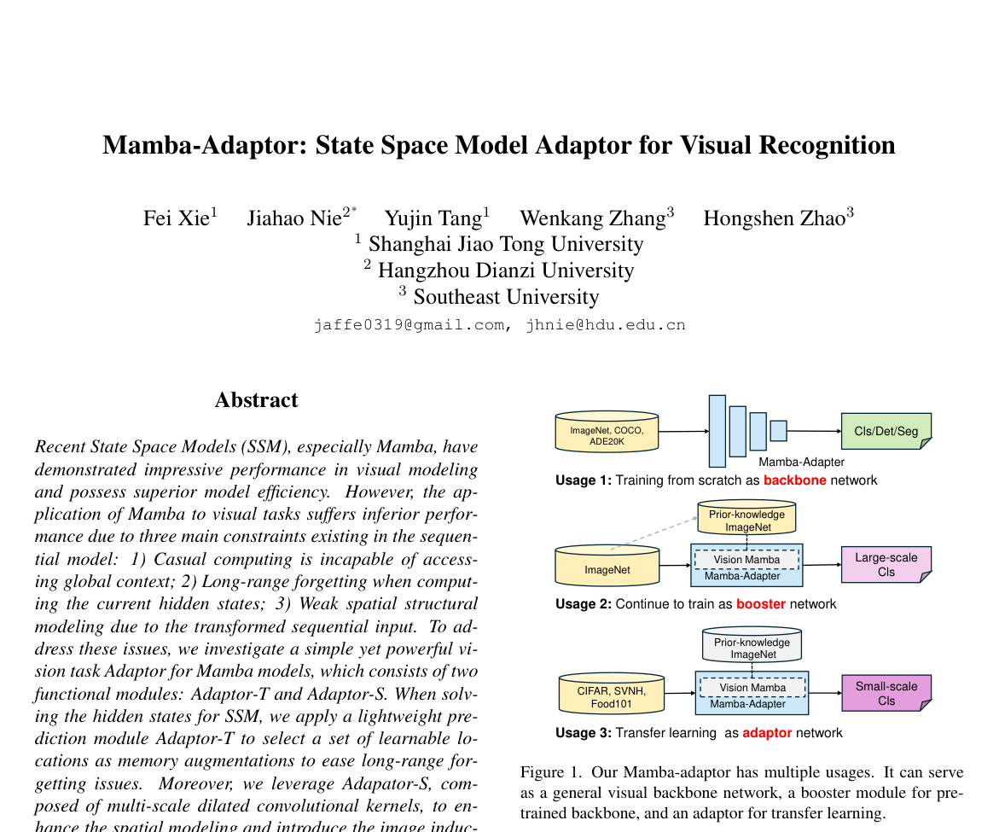
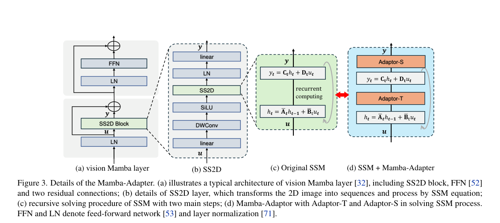

# Review Paper

## Mamba-Adaptor: State Space Model Adaptor for Visual Recognition

### Identitas paper

- **Penulis:** Fei Xie, Jiahao Nie, Yujin Tang, Wenkang Zhang, dan Hongshen Zhao.
- **Tahun:** 2025.
- **Publikasi:** CVPR 2025 (metadata arXiv menyebut “CVPR paper”). PDF yang ditinjau adalah arXiv:2505.12685v1, diajukan 19 Mei 2025.
- **Sumber:** [arXiv:2505.12685](https://arxiv.org/abs/2505.12685) · [PDF arXiv](https://arxiv.org/pdf/2505.12685) · [CVPR Open Access](https://openaccess.thecvf.com/content/CVPR2025/html/Xie_Mamba-Adaptor_State_Space_Model_Adaptor_for_Visual_Recognition_CVPR_2025_paper.html).

### Tujuan penelitian

Penelitian ini memperkenalkan adaptor untuk meningkatkan pemodelan konteks Mamba pada visi. Adaptor-T memilih hidden state sebagai tambahan memori untuk mengatasi pelupaan jarak jauh, sedangkan Adaptor-S memakai dilated convolution multi-skala untuk menambah pemodelan spasial. Paper mengevaluasi adaptor dalam tiga peran: backbone visual yang dilatih dari awal, booster untuk backbone pretrained, dan adaptor efisien untuk transfer learning.

### Dataset dan evaluasi

Paper menggunakan benchmark berikut:

- **ImageNet-1K:** 1,28 juta citra training dan 50 ribu validasi; evaluasi klasifikasi Top-1 accuracy, parameter, dan FLOPs.
- **MS COCO:** 118 ribu citra training dan 5 ribu validasi; deteksi dan instance segmentation dengan Mask R-CNN, box AP dan mask AP, jadwal 1× dan 3× dengan multi-scale.
- **ADE20K:** digunakan untuk semantic segmentation dengan UperNet pada 160 ribu iterasi.
- **CIFAR-100, SVHN, dan Food-101:** transfer learning pada tiga dataset klasifikasi citra skala lebih kecil.

Untuk ImageNet, paper menyatakan menggunakan recipe pelatihan yang sama dengan studi pembanding; rincian semua hyperparameter tidak ada pada bagian utama yang ditinjau. Transfer learning membandingkan Mamba-Adaptor dengan linear probing, full fine-tuning, dan Visual Prompt Tuning (VPT). Tidak ada evaluasi malware atau MaleVis.

### Metode atau arsitektur model

Adaptor-T memprediksi lokasi hidden state yang dipilih sebagai memory augmentation. Adaptor-S mengubah output sekuens menjadi feature map 2D, kemudian memakai depthwise dilated convolutions multi-skala untuk mengagregasikan konteks spasial sebelum mengembalikannya ke bentuk urutan. Paper menerapkan adaptor dalam bentuk sequential untuk backbone yang dilatih dari awal dan parallel untuk transfer learning. Ketiga penggunaan mencakup backbone, booster yang ditambahkan ke model pretrained, dan adaptor yang hanya melatih sebagian kecil parameter.

*Gambar 1. Penggunaan sebagai backbone, booster, dan adaptor transfer learning, Fig. 1 pada Xie et al. (2025). Gambar asli diekstrak dari PDF.*

*Gambar 2. Integrasi Adaptor-T dan Adaptor-S dalam proses penyelesaian SSM, Fig. 3 pada Xie et al. (2025). Gambar asli diekstrak dari PDF.*

### Domain penelitian

**Computer vision dan machine learning**, khususnya adaptor state space untuk klasifikasi citra, deteksi objek, instance segmentation, semantic segmentation, dan transfer learning. Paper bukan penelitian cybersecurity atau klasifikasi malware.

### Hasil utama

- Pada ImageNet-1K, backbone **Mamba-Adaptor-b1** memperoleh 78,4% Top-1 accuracy dengan 7,8 juta parameter dan 1,4G FLOPs. **Mamba-Adaptor-b2** mencatat 83,0% pada tabel hasil, dengan 32 juta parameter dan 5,4G FLOPs.
- Pada COCO dengan Mask R-CNN 1× + multi-scale, Mamba-Adaptor-b1 memperoleh 43,2 box AP dan 39,5 mask AP; Mamba-Adaptor-b2 memperoleh 47,3 box AP dan 43,4 mask AP. Pada jadwal 3× + multi-scale, Mamba-Adaptor-b2 mencatat 49,1 box AP dan 44,8 mask AP.
- Pada peran booster, tabel mencatat VMamba-T berubah dari 82,6% ke 82,7% Top-1, VMamba-S 83,6% ke 83,7%, dan VMamba-B 83,9% ke 84,1%, dengan kenaikan parameter dan FLOPs yang dicantumkan pada tabel.
- Pada transfer learning, Mamba-Adaptor memakai sebagian kecil parameter VMamba pretrained. Contoh VMamba-T memakai 5,56% parameter full fine-tuning dan memperoleh 86,82% pada CIFAR-100, 93,24% pada SVHN, serta 86,45% pada Food-101.

### Analisis kontribusi model

Kontribusi paper adalah adaptor yang menangani dua kelemahan visual SSM: pelupaan konteks sekuensial dan keterbatasan spatial inductive bias. Hasilnya mencakup tiga cara integrasi sehingga lebih luas daripada evaluasi backbone saja. Namun, peningkatan untuk booster relatif kecil pada tabel; manfaat transfer learning perlu dibaca bersama jumlah parameter yang dilatih dan dataset spesifiknya.

### Kelebihan

1. Mengusulkan dua komponen dengan fungsi berbeda: pemilihan hidden-state memory dan agregasi spasial multi-skala.
2. Menguji backbone, booster, dan transfer-learning adaptor.
3. Mengevaluasi klasifikasi, deteksi, instance segmentation, dan transfer learning.
4. Membandingkan transfer learning dengan linear probing, full fine-tuning, dan VPT.
5. Melaporkan ukuran model/parameter trainable beserta metrik task yang relevan.

### Keterbatasan

1. Tidak mengevaluasi malware, MaleVis, atau klasifikasi citra malware.
2. Klaim performa pada ImageNet/COCO tidak langsung menunjukkan manfaat untuk klasifikasi malware karena perbedaan domain dan protokol.
3. Booster meningkatkan Top-1 hanya 0,1–0,2 poin pada angka tabel, sehingga manfaatnya perlu dinilai terhadap tambahan parameter/FLOPs.
4. Ada inkonsistensi angka pada paper: paragraf hasil ImageNet menyebut Mamba-Adaptor-b2 82,9%, sedangkan Tabel 1 mencantumkan 83,0%; review ini menggunakan angka tabel dan mencatat selisih tersebut.
5. Untuk peran booster, narasi menyebut peningkatan VMamba-B sebesar 0,2 poin, sedangkan Tabel 3 menunjukkan 83,9% menjadi 84,1%; angka ini konsisten, tetapi beberapa nilai pada tabel/narasi lain juga perlu dikutip menurut konfigurasi yang tepat.
6. Hasil transfer learning berbeda antar-dataset dan ukuran backbone; performa tidak seragam, sehingga tidak tepat menyimpulkan adaptor selalu menyamai full fine-tuning.

### Kesimpulan review

Mamba-Adaptor menambahkan seleksi memori dan pemodelan spasial ke visual SSM, lalu menguji desainnya sebagai backbone, booster, dan adaptor transfer learning. Hasil yang dilaporkan mencakup ImageNet-1K, COCO, ADE20K, CIFAR-100, SVHN, dan Food-101. Paper relevan sebagai rujukan teknik adaptasi Mamba pada visi, tetapi tidak menyediakan bukti tentang klasifikasi malware RGB atau MaleVis. Manfaatnya untuk tesis perlu diuji secara langsung dan dengan protokol setara terhadap ViT. Ada ketidaksesuaian kecil antara narasi dan tabel untuk angka ImageNet b2, yang perlu dipertahankan saat mengutip.

### Sumber

1. Xie, F., Nie, J., Tang, Y., Zhang, W., & Zhao, H. (2025). *Mamba-Adaptor: State Space Model Adaptor for Visual Recognition*. CVPR 2025. [CVPR Open Access](https://openaccess.thecvf.com/content/CVPR2025/html/Xie_Mamba-Adaptor_State_Space_Model_Adaptor_for_Visual_Recognition_CVPR_2025_paper.html).
2. [arXiv abstract and version history](https://arxiv.org/abs/2505.12685) · [PDF](https://arxiv.org/pdf/2505.12685).
