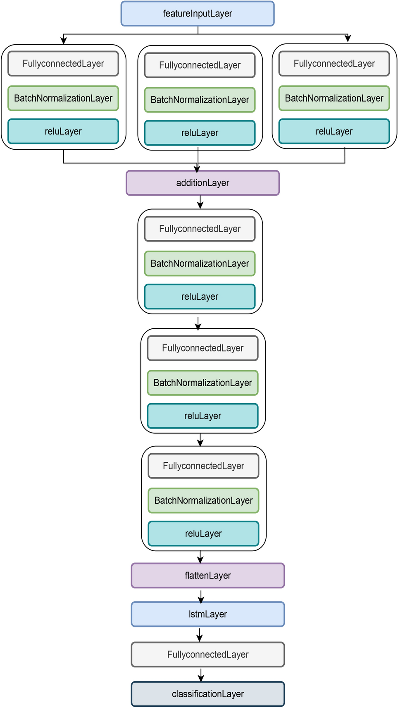
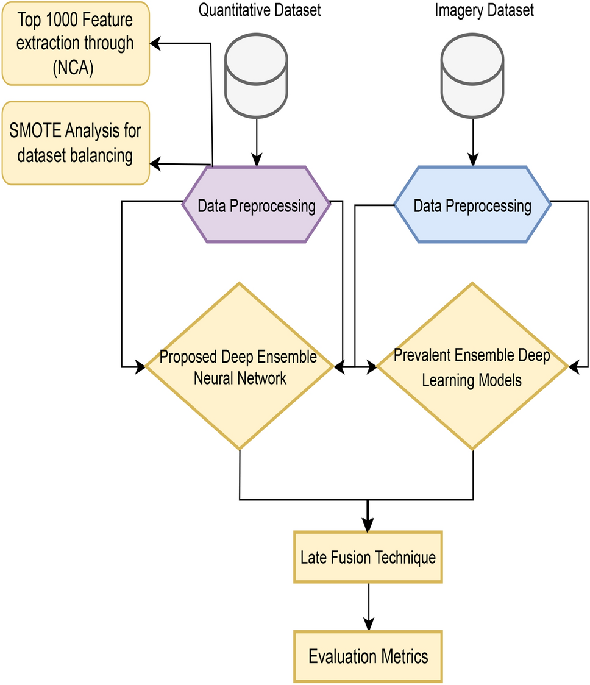

# Review Paper

## Multimodal Malware Classification Using Proposed Ensemble Deep Neural Network Framework

### Identitas paper

- **Penulis:** Sadia Nazim, Muhammad Mansoor Alam, Safdar Rizvi, Jawahir Che Mustapha, Syed Shujaa Hussain, dan Mazliham Mohd Su’ud
- **Tahun:** 2025
- **Publikasi:** *Scientific Reports*, volume 15, artikel 18006; diterbitkan 23 Mei 2025.
- **DOI:** [10.1038/s41598-025-96203-3](https://doi.org/10.1038/s41598-025-96203-3)

### Tujuan penelitian

Penelitian mengembangkan kerangka klasifikasi malware multimodal yang menggabungkan citra malware dengan fitur numerik. Model untuk masing-masing jenis data dilatih terpisah, lalu hasil prediksinya digabungkan menggunakan late fusion. Tujuannya adalah meningkatkan klasifikasi dengan memanfaatkan informasi visual dan numerik secara bersamaan.

### Dataset dan evaluasi

Paper menggunakan tiga sumber data:

- **CCCS-CIC-AndMal-2020:** dataset numerik Android yang dilaporkan berisi 400.000 sampel, 14 kategori, dan 191 keluarga malware. Penulis memilih 20% data (68.433 sampel menurut paper), mempertahankan 1.000 fitur teratas melalui Neighbourhood Component Analysis (NCA), lalu menerapkan SMOTE untuk menyeimbangkan kelas.
- **MaleVis:** citra byteplot RGB dari executable Windows. Paper menyebut 9.100 citra untuk training dan 5.126 untuk validation, dengan 26 kelas.
- **Malimg:** 9.339 citra grayscale dari 25 keluarga malware.

Untuk eksperimen citra, penulis membuat *blended malware image dataset* dengan menggabungkan lima kelas Malimg dan semua kategori MaleVis. Jadi angka citra yang dilaporkan berasal dari dataset campuran tersebut, bukan hasil MaleVis terpisah. Paper melaporkan metrik accuracy, precision, recall, F1-score, serta confusion matrix. Eksperimen menggunakan MATLAB 2022, komputer dengan prosesor Intel Core i5 generasi ke-7 dan RAM 16 GB.

*Gambar 1. Arsitektur ensemble deep learning untuk klasifikasi citra yang diusulkan. Gambar asli dari Nazim et al. (2025), Fig. 7.*

*Gambar 2. Alur pemrosesan dataset numerik dan citra hingga late fusion. Gambar asli dari Nazim et al. (2025), Fig. 8.*

### Metode atau arsitektur model

Model citra yang diusulkan merupakan jaringan deep ensemble berbasis **CNN dan LSTM**, bukan Vision Transformer. Artikel menyebut rancangan 24 lapis; cabang konvolusi memproses citra, menambahkan pooling pada pemrosesan citra, menggabungkan fitur, lalu meneruskannya ke LSTM dan classifier. Untuk cabang numerik digunakan fitur terpilih melalui NCA dan klasifikasi ensemble, dengan RUSBoost sebagai salah satu metode yang dipasangkan pada late fusion.

Alur eksperimen mencakup pemilihan fitur numerik dengan NCA, penyeimbangan menggunakan SMOTE, pelatihan model numerik dan citra secara terpisah, lalu penggabungan keputusan melalui majority voting, stacking, boosting, atau bagging. Untuk jaringan citra, paper melaporkan Adam, learning rate 0,003, 500 epoch, dan batch size 150. Untuk jaringan numerik, paper melaporkan learning rate 0,001, 100 epoch, dan batch size 150.

### Domain penelitian

**Cybersecurity dan klasifikasi malware multimodal**, dengan gabungan citra byteplot malware dan fitur numerik dari data Android. Citra yang digunakan mencakup representasi grayscale dan RGB.

### Hasil utama

| Eksperimen | Hasil yang dilaporkan | Catatan |
|---|---:|---|
| Model citra pada blended malware image dataset | Accuracy 96,06% | Dataset menggabungkan lima kelas Malimg dan kelas MaleVis; bukan skor MaleVis saja. |
| Model numerik CCCS-CIC-AndMal-2020 | Accuracy 91,40% pada model usulan di Tabel 6 | Tabel 6 juga mencantumkan pendekatan existing dengan accuracy 82,99%; uraian paragraf di sekitar tabel menyebut angka pembanding 93,3%, sehingga laporan tidak konsisten. |
| Late fusion RUSBoost (numerik) + model usulan (citra), majority vote | Accuracy 95,36% | Nilai tertinggi yang dicantumkan untuk kombinasi late fusion pada Tabel 8; bagging juga 95,36%. |
| Late fusion RUSBoost (numerik) + model usulan (citra), boosting | Accuracy 95,04% | Tabel 8. |
| Late fusion RUSBoost (numerik) + model usulan (citra), stacking | Accuracy 82,64% | Tabel 8. |

Abstrak juga menyebut precision 79,9%, recall 86,5%, dan F1-score 85,0% untuk model yang diusulkan, tetapi hubungan angka tersebut dengan hasil late fusion dan hasil per-modality tidak dijelaskan secara tegas. Karena itu, angka akurasi fusion dan metrik dari abstrak dicatat terpisah.

### Analisis kontribusi model

Paper mengeksplorasi late fusion antara prediksi model numerik untuk data Android dan jaringan CNN-LSTM untuk citra malware. Tabel 8 menunjukkan bahwa kombinasi RUSBoost numerik dan model citra mencapai accuracy 95,36% dengan majority vote maupun bagging. Ini mendukung penggunaan sumber data yang berbeda dalam satu proses klasifikasi, tetapi tidak membuktikan keunggulan ViT atau Mamba. Hasil citra juga berasal dari campuran MaleVis dan Malimg, sehingga tidak menunjukkan performa pada MaleVis RGB secara terisolasi.

### Kelebihan

1. Menggabungkan fitur numerik dan citra malware serta membandingkan beberapa skema late fusion.
2. Melaporkan hasil terpisah untuk model numerik, model citra campuran, dan kombinasi multimodal.
3. Menggunakan NCA dan SMOTE untuk menangani fitur berlebih dan ketidakseimbangan kelas numerik.
4. Mencakup citra RGB MaleVis dan grayscale Malimg dalam eksperimen citra.

### Keterbatasan

1. Eksperimen citra mencampur Malimg dan MaleVis; tidak ada skor evaluasi MaleVis RGB secara terpisah.
2. Model citra adalah CNN-LSTM, bukan ViT; paper tidak menguji Mamba atau membandingkan kedua arsitektur tersebut.
3. Urutan metode menempatkan NCA dan SMOTE sebelum pembagian data train/test 70:30. Jika diterapkan pada seluruh data sebelum pemisahan, hal ini berisiko menyebabkan kebocoran informasi ke evaluasi; paper tidak menjelaskan pemisahan tahap tersebut secara rinci.
4. Pelaporan hasil tidak konsisten: abstrak, uraian, dan tabel memberikan angka metrik/pembanding yang berbeda atau tidak menjelaskan cakupan metriknya secara tegas.
5. Beberapa nilai pada Tabel 7 untuk precision dan F1-score kelas melebihi 1, padahal metrik tersebut semestinya berada pada rentang 0–1. Nilai-nilai itu perlu diverifikasi sebelum digunakan.
6. Artikel menyebut pemilihan 20% data numerik sebagai 68.433 sampel dari dataset yang dilaporkan berisi 400.000 sampel; rasio dan jumlah tersebut tidak cocok secara aritmetis.
7. Protokol yang dijelaskan tidak melaporkan validasi silang atau pengulangan eksperimen dengan beberapa seed.

### Kesimpulan review

Paper ini relevan sebagai referensi klasifikasi malware berbasis citra dan penggabungan citra dengan fitur numerik. Hasilnya melaporkan accuracy 96,06% pada dataset citra campuran dan 95,36% untuk late fusion RUSBoost numerik dengan model citra. Namun, paper tidak menguji ViT atau Mamba, tidak menyajikan hasil MaleVis RGB secara terpisah, serta memiliki ketidakkonsistenan pelaporan dan nilai metrik yang perlu diperiksa. Oleh karena itu, paper berguna sebagai konteks multimodal dan malware image classification, tetapi hasil angkanya tidak dapat dipakai sebagai pembanding langsung eksperimen ViT versus Vision Mamba pada MaleVis RGB.

### Sumber

1. Nazim, S., Alam, M. M., Rizvi, S., Che Mustapha, J., Hussain, S. S., & Mohd Su’ud, M. (2025). *Multimodal malware classification using proposed ensemble deep neural network framework*. **Scientific Reports, 15**, 18006. [Halaman artikel Nature](https://www.nature.com/articles/s41598-025-96203-3) · [DOI](https://doi.org/10.1038/s41598-025-96203-3).
2. [PDF artikel dari Nature](https://www.nature.com/articles/s41598-025-96203-3.pdf).
