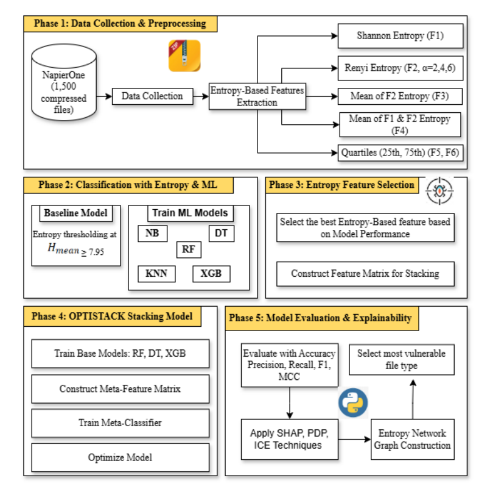
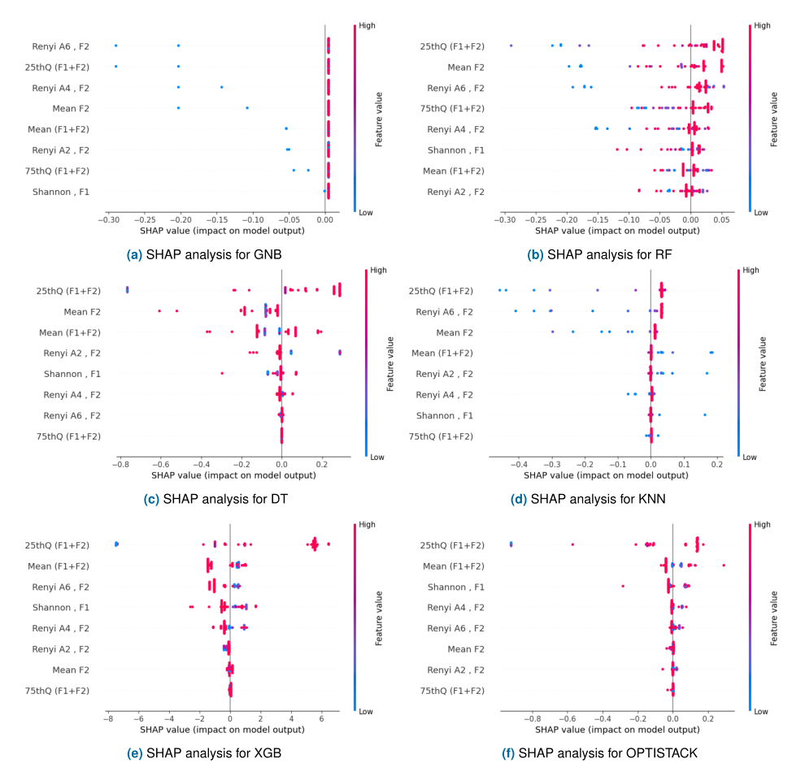
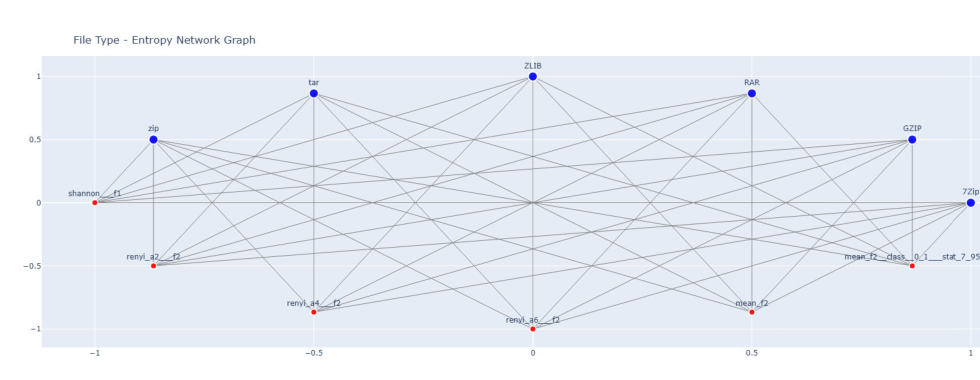

# Review Paper

## OPTISTACK: A Hybrid Ensemble Learning and XAI-Based Approach for Malware Detection in Compressed Files

### Identitas paper

- **Penulis:** Khaled Mahmud Sujon, Rohayanti Binti Hassan, M. Abdullah-Al-Wadud, dan Jia Uddin.
- **Tahun:** 2025.
- **Publikasi:** *IEEE Access*, Vol. 13, hlm. 104992–105026.
- **DOI:** [10.1109/ACCESS.2025.3579880](https://doi.org/10.1109/ACCESS.2025.3579880).
- **Sumber:** [IEEE Xplore](https://ieeexplore.ieee.org/document/11036813) · [PDF IEEE](https://ieeexplore.ieee.org/stamp/stamp.jsp?tp=&arnumber=11036813).

### Tujuan penelitian

Penelitian mengembangkan OPTISTACK untuk mendeteksi berkas malware yang berada dalam berbagai format arsip terkompresi. Model menggabungkan fitur statistik entropi tingkat lanjut, stacking ensemble, dan teknik explainable AI (XAI) untuk klasifikasi serta interpretasi keputusan.

### Dataset dan evaluasi

Penulis mengambil subset 1.500 berkas terkompresi dari NapierOne dalam enam format: ZIP (285), 7ZIP (204), GZIP (276), RAR (285), TAR (247), dan ZLIB (203). Kelas berisi sekitar 44% malware dan 56% benign. Label dibuat menggunakan ambang **mean entropy 7,95**: nilai di atas ambang dianggap malware, dan sisanya benign. Data dilaporkan dibagi secara stratified 80:20 serta dievaluasi dengan 10-fold cross-validation.

Metrik yang digunakan mencakup accuracy, precision, recall, F1-score, MCC, dan AUC-ROC. Paper membandingkan threshold entropy, Gaussian Naïve Bayes, Random Forest, Decision Tree, KNN, XGBoost, dan OPTISTACK; analisis XAI menggunakan SHAP, PDP, dan ICE.

*Gambar 1. Kerangka penelitian untuk deteksi malware pada berkas terkompresi, Fig. 1 Sujon et al. (2025), diekstrak dari PDF paper.*

### Metode atau arsitektur model

Dari tiap berkas, penulis menghitung Shannon entropy, Rényi entropy pada α = 2, 4, dan 6, nilai mean, serta fitur kuartil entropy. Fitur kemudian dinormalisasi menggunakan Min-Max. Base learner OPTISTACK adalah Random Forest, Decision Tree, dan XGBoost; prediksi probabilitas ketiganya dipakai Logistic Regression sebagai meta-classifier. Untuk interpretasi, penulis menerapkan SHAP serta PDP-ICE dan membuat entropy network graph untuk membahas format berkas.

*Gambar 2. Distribusi SHAP untuk fitur entropy pada beberapa classifier dan OPTISTACK, Fig. 8; diekstrak dari PDF paper.*

### Domain penelitian

Keamanan siber dan analisis berkas, khususnya deteksi malware dalam arsip terkompresi berdasarkan statistik entropi. Penelitian ini menggunakan fitur numerik berkas, bukan klasifikasi citra malware.

### Hasil utama

- OPTISTACK dengan fitur kuartil ke-25 dari gabungan F1 + F2 dilaporkan mencapai **99,45% accuracy**, **99,40% precision**, **99,43% recall**, **99,62% F1-score**, dan **0,9880 MCC**.
- AUC-ROC yang dilaporkan adalah **0,9411**.
- Penulis menyebut fitur kuartil ke-25 sebagai fitur paling berpengaruh menurut SHAP. Analisis jaringan entropi mengidentifikasi ZIP dan 7ZIP sebagai format dengan keterkaitan entropi tinggi; uraian pada bagian lain paper menyebut ZIP dan RAR, sehingga kesimpulan format paling rentan tidak konsisten.

*Gambar 3. Entropy network graph untuk berbagai tipe berkas, Fig. 15; diekstrak dari PDF paper.*

### Analisis kontribusi model

Paper menggabungkan beberapa entropy statistik dengan stacking ensemble dan penjelasan fitur. Namun, label target ditentukan langsung dari mean entropy ≥ 7,95, sementara fitur input juga mencakup mean entropy dan statistik entropy terkait. Ini membuat target sangat terkait secara definisional dengan prediktor; akurasi tinggi bisa mencerminkan kemampuan model mereproduksi aturan pelabelan tersebut, bukan kemampuan yang telah tervalidasi untuk mengenali malware aktual secara independen. Karena itu, angka performa perlu ditafsirkan dengan hati-hati.

### Kelebihan

1. Menguji beragam format arsip dan melaporkan jumlah sampel untuk masing-masing format.
2. Membandingkan beberapa model dasar dan stacking ensemble dengan metrik yang mencakup MCC serta AUC-ROC.
3. Menyertakan SHAP dan PDP-ICE untuk menguraikan pengaruh fitur terhadap prediksi.
4. Mengangkat ruang lingkup arsip terkompresi, yang berbeda dari studi yang hanya memproses citra visualisasi malware atau executable.

### Keterbatasan

1. Label malware/benign diturunkan dari ambang entropi yang sama dengan keluarga fitur prediktor, sehingga terdapat risiko target leakage atau evaluasi yang sirkular. Label ini bukan ground truth independen dari pemindaian atau anotasi malware.
2. Dataset hanya 1.500 berkas dari subset NapierOne dan cakupan format/ancaman terbatas; penulis juga menyatakan ukuran dataset sebagai keterbatasan.
3. Pembagian 80:20 dan 10-fold cross-validation disebutkan, tetapi cara menghubungkan hasil split dengan skor utama dan cara mencegah leakage antar-fold tidak diterangkan sepenuhnya.
4. Kesimpulan format paling rentan tidak konsisten: abstrak menyebut ZIP dan RAR, sedangkan uraian hasil menyebut ZIP dan 7ZIP.
5. Paper tidak mengevaluasi MaleVis, citra RGB, ViT, atau Vision Mamba; kontribusinya berkaitan dengan malware dan metode ensemble tabular berbasis entropi.
6. Ketahanan terhadap teknik evasion/adversarial tidak diuji, dan penulis menyarankan evaluasi lebih luas.

### Kesimpulan review

OPTISTACK menggabungkan fitur entropy beragam, stacking, serta XAI untuk mengklasifikasikan arsip terkompresi. Hasil numerik yang dilaporkan tinggi, tetapi interpretasinya dibatasi oleh pelabelan berbasis entropy yang sama dengan fitur prediktor, sehingga belum membuktikan deteksi malware terhadap label ground truth independen. Paper memberi konteks untuk deteksi malware dan explainability, tetapi bukan pembanding langsung untuk klasifikasi citra MaleVis atau eksperimen ViT versus Vision Mamba.

### Sumber

Sujon, K. M., Hassan, R. B., Abdullah-Al-Wadud, M., & Uddin, J. (2025). *OPTISTACK: A Hybrid Ensemble Learning and XAI-Based Approach for Malware Detection in Compressed Files*. **IEEE Access, 13**, 104992–105026. [IEEE Xplore](https://ieeexplore.ieee.org/document/11036813) · [PDF](https://ieeexplore.ieee.org/stamp/stamp.jsp?tp=&arnumber=11036813) · [DOI](https://doi.org/10.1109/ACCESS.2025.3579880).
