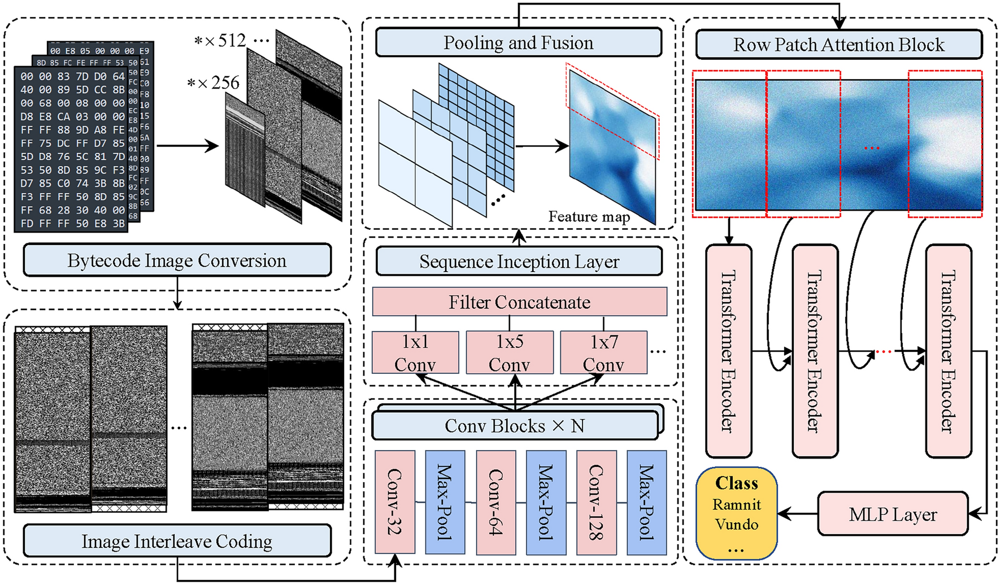
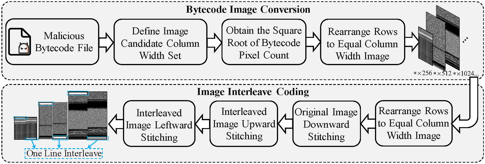

# Review Paper

## Semantic Lossless Encoded Image Representation for Malware Classification

### Identitas paper

- **Penulis:** Yaoxiang Yu, Bo Cai, Kamran Aziz, Xinyan Wang, Jian Luo, Muhammad Shahid Iqbal, Prasun Chakrabarti, dan Tulika Chakrabarti
- **Tahun:** 2025
- **Publikasi:** *Scientific Reports*, volume 15, artikel 7997; diterbitkan 7 Maret 2025.
- **DOI:** [10.1038/s41598-025-88130-0](https://doi.org/10.1038/s41598-025-88130-0)

### Tujuan penelitian

Penelitian ini mengatasi hilangnya urutan byte dan detail kode saat berkas malware diubah menjadi citra berukuran tetap, dipotong, atau di-resize. Penulis merancang encoding citra bytecode dengan lebar proporsional dan penggabungan baris agar urutan byte tetap terbawa, lalu menggabungkan ekstraksi fitur lokal dengan pemodelan konteks global untuk klasifikasi keluarga malware.

### Dataset dan evaluasi

Eksperimen menggunakan dua dataset:

- **Microsoft BIG-15:** 9 keluarga malware. Tabel paper mencatat 6.367 sampel train dan 4.501 test.
- **Datafountain BDCI-21:** 10 kelas termasuk normal, dengan total 5.841 sampel. Tabel paper mencatat 3.500 train dan 2.341 test.

Untuk eksperimen utama, paper menyebut pembagian data 60:40. Selain itu, penulis menguji kelompok berdasarkan lebar citra; beberapa kelompok lebar tertentu tidak memiliki data train dan hanya berisi sedikit sampel uji. Metrik yang dilaporkan meliputi accuracy, macro F1, dan false positive rate (FPR). Lingkungan eksperimen adalah PyTorch 2.0, Python 3.8, CentOS 7.5, dan empat GPU Nvidia Tesla V100 16 GB. Pengaturan model mencakup batch size 32, empat iterasi lapisan konvolusi, hidden size Transformer 256, Adam dengan learning rate 2 × 10⁻⁴, dropout 0,2, dan 60 epoch.

*Gambar 1. Arsitektur encoding bytecode, image interleave, ekstraksi fitur, dan row-patch Transformer. Gambar asli dari Yu et al. (2025), Fig. 2.*

*Gambar 2. Tahapan konversi bytecode dan image interleave coding. Gambar asli dari Yu et al. (2025), Fig. 3.*

### Metode atau arsitektur model

Metode yang diusulkan terdiri dari empat tahap:

1. **Encoding bytecode menjadi citra grayscale:** setiap byte dipetakan ke nilai piksel. Lebar citra dipilih dari rentang nilai berbasis pangkat dua sesuai panjang bytecode, sehingga dimensi citra dapat bervariasi dan seluruh byte dipertahankan dalam representasi.
2. **Image interleave coding:** dua salinan citra digeser ke arah berlawanan lalu barisnya digabungkan untuk mengurangi terputusnya urutan saat bytecode dilipat menjadi baris citra.
3. **Ekstraksi fitur CNN multiskala dan spatial pyramid pooling (SPP):** Sequence Inception menggunakan kernel konvolusi 1D dengan skala berbeda, lalu pooling menyamakan lebar feature map.
4. **Row-patch Transformer:** feature map dibagi menjadi blok baris. Hidden state dari blok sebelumnya di-cache dan diteruskan ke blok berikutnya. Representasi keluaran dipakai oleh MLP dan softmax untuk klasifikasi.

Dengan demikian, model ini menggabungkan CNN, SPP, dan Transformer; bukan Vision Transformer standar. Encoding citra yang dijelaskan adalah grayscale, bukan citra RGB.

### Domain penelitian

**Cybersecurity dan computer vision**, khususnya klasifikasi keluarga malware dari citra bytecode hasil analisis statis.

### Hasil utama

| Dataset | Accuracy | Macro F1 | FPR |
|---|---:|---:|---:|
| Microsoft BIG-15 | 96,7% | 95,2% | 0,006 |
| Datafountain BDCI-21 | 99,7% | 99,7% | 0,001 |

Angka di atas berasal dari hasil perbandingan model pada Tabel 3 dan Tabel 4. Pada uji khusus lebar citra, performa berubah antar kelompok lebar. Sebagai contoh, Tabel 5 melaporkan accuracy 87,5% dan F1 56,4% pada kelompok lebar 256 BIG-15 yang memiliki 16 sampel uji dan tidak memiliki sampel train pada kelompok lebar tersebut. Untuk BDCI-21, kelompok lebar 128 memiliki 6 sampel uji tanpa data train pada kelompok itu; kelompok 4096 memiliki 24 sampel uji tanpa train dan accuracy 95,6%. Hasil pada kelompok kecil tersebut perlu dibaca dengan memperhatikan jumlah sampelnya.

### Analisis kontribusi model

Kontribusi utama penelitian adalah mempertahankan semua nilai byte pada encoding grayscale dengan dimensi yang menyesuaikan ukuran berkas, kemudian menangani dimensi citra bervariasi melalui konvolusi multiskala, SPP, dan Transformer berbasis blok baris. Cache hidden state memungkinkan konteks diteruskan antarpotongan baris. Paper melaporkan hasil pada dua dataset dan menguji generalisasi terhadap beberapa kelompok lebar citra. Meski memakai Transformer pada pemrosesan citra malware, paper tidak memakai MaleVis, tidak menguji citra RGB, dan tidak membandingkan model dengan Vision Mamba.

### Kelebihan

1. Menjelaskan encoding yang mempertahankan urutan byte alih-alih memotong atau me-resize seluruh citra ke satu ukuran tetap.
2. Menangani ukuran citra bervariasi melalui fitur multiskala, SPP, dan row-patch Transformer.
3. Mengevaluasi pada BIG-15 dan BDCI-21 serta melaporkan macro F1 dan FPR bersama accuracy.
4. Membandingkan model dengan metode statistik dan beberapa arsitektur deep learning; paper menyebut baseline direproduksi dalam lingkungan eksperimen penulis.
5. Menguji kelompok lebar yang sebagian tidak muncul dalam data train, sebagai eksplorasi atas generalisasi terhadap ukuran citra.

### Keterbatasan

1. Dataset yang diuji adalah BIG-15 dan BDCI-21; MaleVis tidak digunakan.
2. Representasi bytecode yang dijelaskan berupa grayscale, sehingga penelitian tidak menguji informasi warna RGB.
3. Tidak tersedia ablation study; penulis menyebut struktur model yang ringkas sebagai alasan kedua modul utama tidak diablasi.
4. Penulis menyatakan perlu pengujian lebih luas pada dataset dan keluarga malware yang lebih beragam; hasil pada dua dataset tidak memastikan generalisasi ke sampel lain.
5. Beberapa kelompok lebar khusus memiliki sangat sedikit data uji dan tanpa data latih pada kelompok itu, sehingga skor kelompok tersebut belum menjadi bukti kuat untuk semua variasi ukuran.
6. Hasil model tidak dapat dibandingkan langsung dengan eksperimen ViT versus Vision Mamba pada MaleVis RGB karena dataset, representasi masukan, dan arsitekturnya berbeda.

### Kesimpulan review

Paper ini mengusulkan pipeline klasifikasi malware yang menggabungkan encoding citra bytecode grayscale, CNN multiskala, SPP, dan row-patch Transformer. Model melaporkan accuracy 96,7% pada BIG-15 dan 99,7% pada BDCI-21, dengan macro F1 masing-masing 95,2% dan 99,7%. Paper relevan untuk memahami pemrosesan citra malware dan penggunaan Transformer, tetapi bukan bukti perbandingan ViT dengan Vision Mamba dan bukan evaluasi MaleVis RGB. Keterbatasan dataset, ketiadaan ablation study, serta jumlah sampel yang kecil pada beberapa kelompok lebar perlu diperhitungkan saat mengutip hasil.

### Sumber

1. Yu, Y., Cai, B., Aziz, K., Wang, X., Luo, J., Iqbal, M. S., Chakrabarti, P., & Chakrabarti, T. (2025). *Semantic lossless encoded image representation for malware classification*. **Scientific Reports, 15**, 7997. [Halaman artikel Nature](https://www.nature.com/articles/s41598-025-88130-0) · [DOI](https://doi.org/10.1038/s41598-025-88130-0).
2. [PDF artikel dari Nature](https://www.nature.com/articles/s41598-025-88130-0.pdf).
