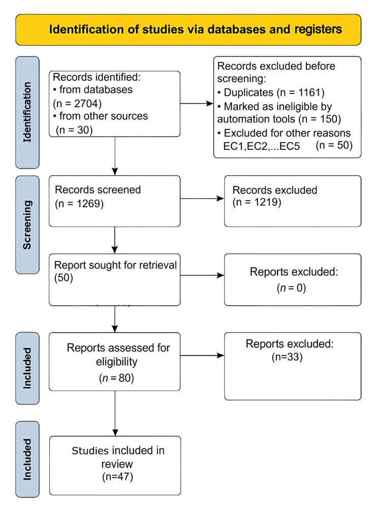
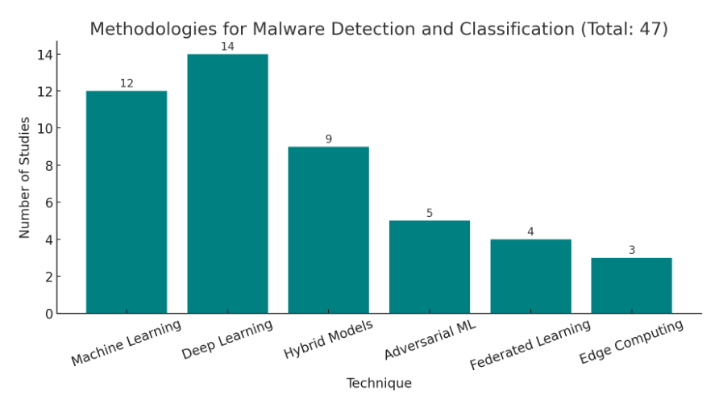

# Review Paper

## Systematic Review: Malware Detection and Classification in Cybersecurity

### Identitas paper

- **Penulis:** Sebastian Berrios, Dante Leiva, Bastian Olivares, Héctor Allende-Cid, dan Pamela Hermosilla.
- **Tahun:** 2025.
- **Publikasi:** *Applied Sciences*, 15(14), artikel 7747.
- **DOI:** [10.3390/app15147747](https://doi.org/10.3390/app15147747).
- **Sumber:** [Halaman artikel MDPI](https://www.mdpi.com/2076-3417/15/14/7747) · [PDF artikel](https://www.mdpi.com/2076-3417/15/14/7747/pdf).

### Tujuan penelitian

Paper ini menyajikan systematic literature review tentang metode deteksi dan klasifikasi malware dalam cybersecurity. Pertanyaan kajiannya meliputi tujuan deteksi malware, teknik yang digunakan, kontribusi deep learning, serta dataset yang dipakai dalam penelitian terdahulu.

### Dataset dan evaluasi

Ini adalah review literatur, bukan eksperimen klasifikasi baru. Penulis mencari publikasi di **Scopus** dan **Web of Science**. Cakupan utama metode ditetapkan pada 2020–2024, sementara bagian state of the art tidak dibatasi tahun. Setelah pencarian dan penyaringan, penulis melaporkan pemilihan **47 studi**: 21 dari Scopus dan 26 dari Web of Science.

Review merangkum studi yang memakai dataset beragam, termasuk dataset berkas PE, Android, malware berbasis citra, serta lalu lintas jaringan seperti Malimg, Microsoft Malware, VirusShare, CICIDS-2017, dan Bot-IoT. Penulis mengelompokkan pendekatan dan dataset secara naratif serta dalam tabel; tidak melakukan meta-analisis kuantitatif atau eksperimen ulang dengan satu protokol evaluasi bersama.

*Gambar 1. Diagram alur seleksi studi menurut PRISMA, Fig. 2 Berrios et al. (2025); diekstrak dari PDF paper.*

### Metode atau arsitektur model

Paper menerapkan proses review sistematis yang dinyatakan mengikuti **PRISMA 2020**. Pencarian dilakukan dengan kata kunci malware dan cybersecurity; kriteria seleksi mencakup fokus pada deteksi/klasifikasi malware, hasil empiris, bahasa Inggris atau Spanyol, relevansi periode publikasi, ketersediaan teks penuh, serta penghapusan duplikasi. Studi yang dipilih kemudian dikelompokkan menurut teknik seperti machine learning, deep learning, computer vision, analisis statis, dan analisis dinamis.

*Gambar 2. Kategori metodologi yang dirangkum dalam review, Fig. 4; diekstrak dari PDF paper.*

### Domain penelitian

Keamanan siber, khususnya kajian metode deteksi dan klasifikasi malware di lingkungan komputer, perangkat seluler, IoT, cloud, dan jaringan. Computer vision dibahas sebagai salah satu pendekatan untuk merepresentasikan biner malware sebagai citra.

### Hasil utama

- Paper melaporkan distribusi teknik sebesar **machine learning 45%**, **deep learning 30%**, **computer vision 15%**, **analisis statis 5%**, dan **analisis dinamis 5%**. Gambar metodologi lain mengelompokkan 47 studi sebagai machine learning (12), deep learning (14), hybrid models (9), adversarial ML (5), federated learning (4), dan edge computing (3); hubungan antara dua skema kategorisasi ini tidak dijelaskan.
- Review menyoroti keterbatasan umum berupa ketergantungan pada dataset tertentu, evaluasi yang tidak seragam, biaya komputasi deep learning, masalah interpretabilitas, dan kerentanan terhadap adversarial evasion.
- Arah riset yang diusulkan mencakup metode hibrida, XAI, federated learning, dataset yang lebih mutakhir dan beragam, serta kolaborasi antara akademia dan industri.
- Bagian ringkasan kemudian menyebut analisis statis dan dinamis masing-masing sebesar 10%, yang tidak cocok dengan distribusi 5% + 5% pada tabel dan kalimat sebelumnya.

### Analisis kontribusi model

Kontribusinya adalah pemetaan luas atas teknik, konteks penerapan, dataset, tantangan, dan arah penelitian malware detection. Paper menyebut computer vision serta satu studi Vision Transformer dalam daftar referensi, tetapi tidak membangun atau menguji ViT, Vision Mamba, atau model klasifikasi citra sendiri. Teks paper tidak membahas MaleVis.

### Kelebihan

1. Menjelaskan basis pencarian, kriteria seleksi, dan jumlah studi yang dipilih.
2. Mencakup beberapa lingkungan dan pendekatan, dari analisis berkas hingga IoT, cloud, dan jaringan.
3. Merangkum contoh dataset dan studi dalam tabel sehingga berguna untuk orientasi literatur.
4. Membahas isu praktis seperti generalisasi, biaya komputasi, interpretabilitas, dan adversarial evasion.

### Keterbatasan

1. Pencarian dibatasi pada Scopus dan Web of Science; studi dari sumber indeks lain dapat tidak tercakup.
2. Pemilihan akhir 47 studi diprioritaskan menurut jumlah sitasi, sehingga studi baru yang belum banyak disitasi berpotensi tidak terwakili.
3. Tidak ada meta-analisis atau evaluasi ulang dengan dataset, split, dan metrik yang seragam; angka performa antarstudi tidak dapat dianggap perbandingan langsung.
4. Diagram PRISMA tidak sepenuhnya konsisten secara aritmetika: 2704 rekaman basis data dan 30 dari sumber lain, dikurangi eksklusi yang ditampilkan (1161 duplikat, 150 oleh otomatisasi, dan 50 alasan lain), tidak menghasilkan 1269 rekaman yang disebut disaring. Diagram juga menyebut 50 laporan dicari untuk diambil tetapi 80 dinilai kelayakannya. Jumlah akhir 47 disebut dalam narasi, tetapi alur seleksinya perlu diklarifikasi.
5. Ada ketidakkonsistenan pada persentase analisis statis dan dinamis: tabel melaporkan 5% masing-masing, sementara bagian berikutnya menyebut 10% masing-masing.
6. Paper membahas computer vision secara umum, tetapi tidak membahas MaleVis, RGB MaleVis, atau Vision Mamba secara khusus.

### Kesimpulan review

Paper ini berguna sebagai tinjauan umum atas metode deteksi malware, dataset, tantangan, dan peluang riset. Relevansinya terhadap tesis terutama berada pada konteks literatur computer vision untuk malware. Namun, paper tidak menguji model atau dataset MaleVis dan tidak membandingkan ViT dengan Vision Mamba; hasilnya juga merupakan sintesis naratif, bukan benchmark eksperimental yang dapat dibandingkan langsung.

### Sumber

Berrios, S., Leiva, D., Olivares, B., Allende-Cid, H., & Hermosilla, P. (2025). *Systematic Review: Malware Detection and Classification in Cybersecurity*. **Applied Sciences, 15**(14), 7747. [Artikel MDPI](https://www.mdpi.com/2076-3417/15/14/7747) · [PDF](https://www.mdpi.com/2076-3417/15/14/7747/pdf) · [DOI](https://doi.org/10.3390/app15147747).
